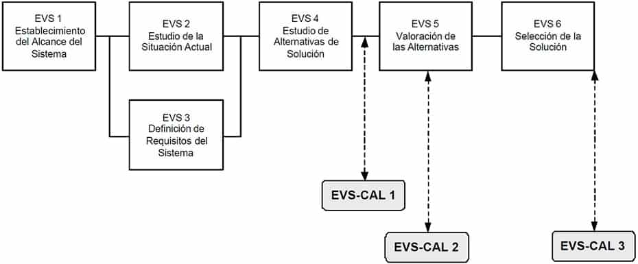
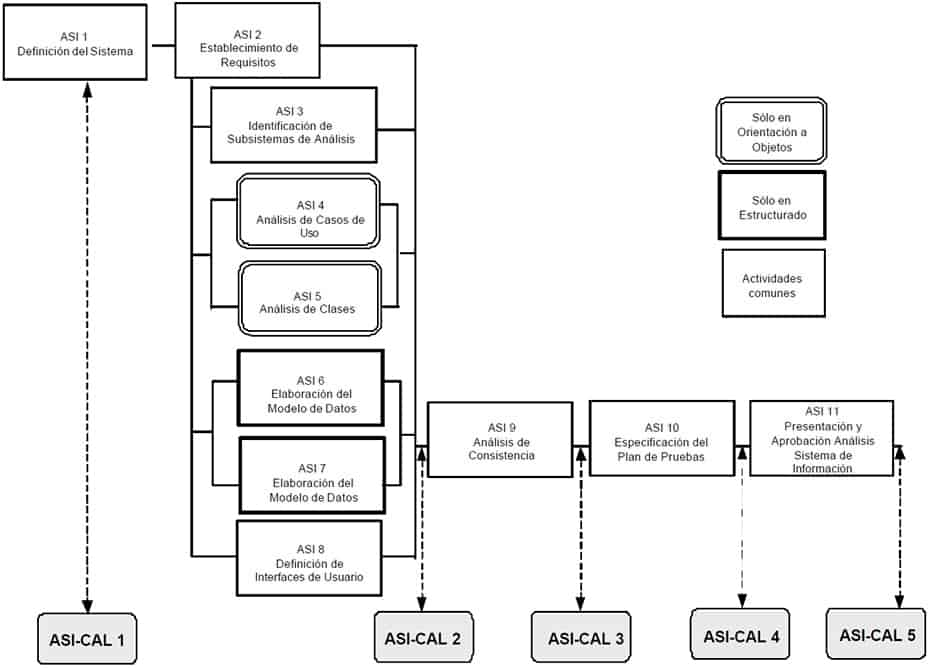
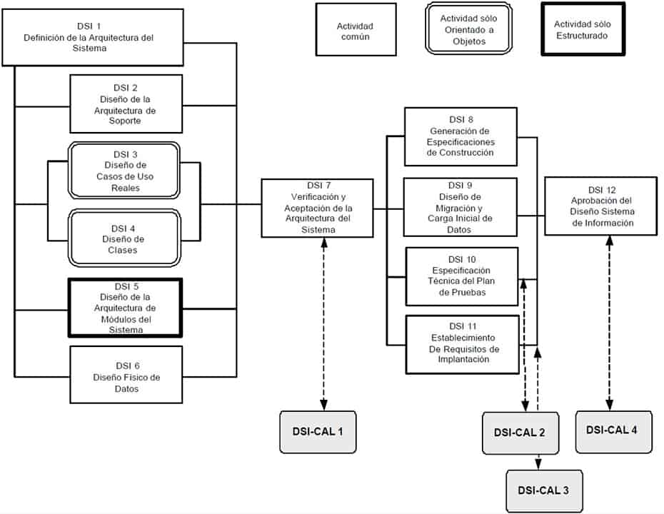
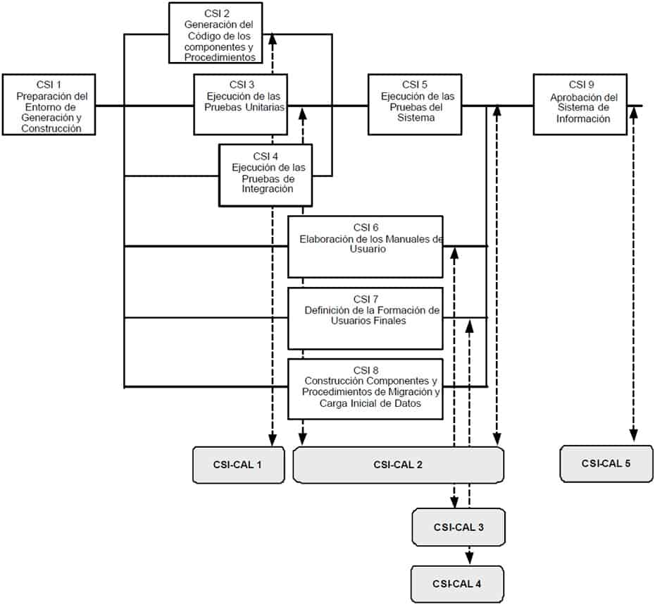
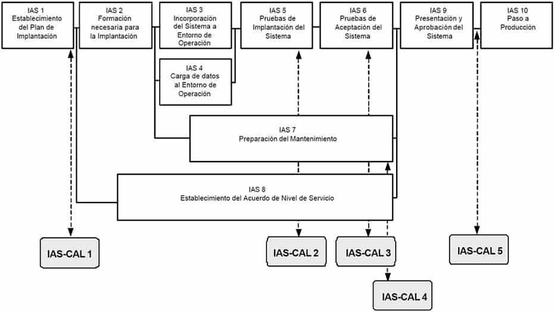
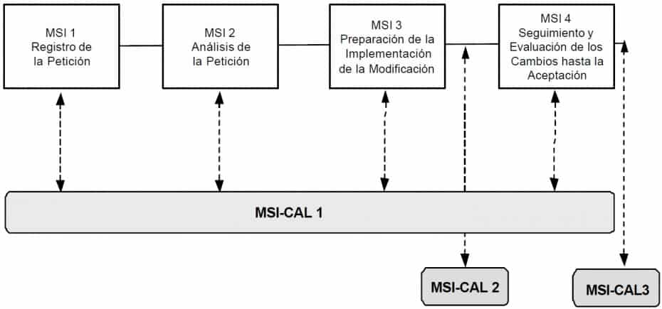

# Aseguramiento de la Calidad

## Descripción y objetivos

El objetivo de la interfaz de Aseguramiento de la Calidad de MÉTRICA Versión 3 es proporcionar un marco común de referencia para la definición y puesta en marcha de planes específicos de aseguramiento de calidad aplicables a proyectos concretos. Si en la organización ya existe un sistema de calidad, dichos planes deberán ser coherentes con el mismo, completándolo en los aspectos no contemplados relativos a normas particulares del cliente, usuario o sistema concreto.

La calidad se define como “**grado en que un conjunto de características inherentes cumple con unos requisitos**” [ISO 9000:2000]. El Aseguramiento de la Calidad pretende dar confianza en que el producto reune las características necesarias para satisfacer todos los requisitos del Sistema de Información.

Por tanto, para asegurar la calidad de los productos resultantes el equipo de calidad deberá realizar un conjunto de actividades que servirán para:

    Reducir, eliminar y lo más importante, prevenir las deficiencias de calidad de los productos a obtener.
    Alcanzar una razonable confianza en que las prestaciones y servicios esperados por el cliente o el usuario queden satisfechas.

Para conseguir estos objetivos, es necesario desarrollar un plan de aseguramiento de calidad específico que se aplicará durante la planificación del proyecto de acuerdo a la estrategia de desarrollo adoptada en la gestión del proyecto. En el plan de aseguramiento de calidad se reflejan las actividades de calidad a realizar (normales o extraordinarias), los estándares a aplicar, los productos a revisar, los procedimientos a seguir en la obtención de los distintos productos durante el desarrollo en MÉTRICA Versión 3 y la normativa para informar de los defectos detectados a sus responsables y realizar el seguimiento de los mismos hasta su corrección.

El grupo de aseguramiento de calidad participa en la revisión de los productos seleccionados para determinar si son conformes o no a los procedimientos, normas o criterios especificados, siendo totalmente independiente del equipo de desarrollo. Las actividades a realizar por el grupo de aseguramiento de calidad vienen gobernadas por el plan. Sus funciones están dirigidas a:

    Identificar las posibles desviaciones en los estándares aplicados, así como en los requisitos y procedimientos especificados.
    Comprobar que se han llevado a cabo las medidas preventivas o correctoras necesarias.

Las revisiones son una de las actividades más importantes del aseguramiento de la calidad, debido a que permiten eliminar defectos lo más pronto posible, cuando son menos costosos de corregir. Además existen procedimientos extraordinarios, como las auditorías, aplicables en desarrollos singulares y en el transcurso de las cuales se revisarán tanto las actividades de desarrollo como las propias de aseguramiento de calidad. La detección anticipada de errores evita el que se propaguen a los restantes procesos de desarrollo, reduciendo substancialmente el esfuerzo invertido en los mismos. En este sentido es importante destacar que el establecimiento del plan de aseguramiento de calidad comienza en el Estudio de Viabilidad del Sistema y se aplica a lo largo de todo el desarrollo, en los procesos de Análisis, Diseño, Construcción, Implantación y Aceptación del Sistema y en su posterior Mantenimiento.
Actividades

ESTUDIO DE VIABILIDAD DEL SISTEMA

    Actividad EVS-CAL 1: Identificación de las Propiedades de Calidad par el Sistema
    Actividad EVS-CAL 2: Establecimiento del Plan de Aseguramiento de Calidad
    Actividad EVS-CAL 3: Adecuación del Plan de Aseguramiento de Calidad a la Solución

ANÁLISIS DEL SISTEMA DE INFORMACIÓN

    Actividad ASI-CAL 1: Especificación Inicial del Plan de Aseguramiento de Calidad
    Actividad ASI-CAL 2: Especificación Detallada del Plan de Aseguramiento de Calidad
    Actividad ASI-CAL 3: Revisión del Análisis de Consistencia
    Actividad ASI-CAL 4: Revisión del Plan de Pruebas
    Actividad ASI-CAL 5: Registro de la Aprobación del Análisis del Sistema

DISEÑO DEL SISTEMA DE INFORMACIÓN

    Actividad DSI-CAL 1: Revisión de la Verificación de la Arquitectura del Sistema
    Actividad DSI-CAL 2: Revisión de la Especificación Técnica del Plan de Pruebas
    Actividad DSI-CAL 3: Revisión de los Requisitos de Implantación
    Actividad DSI-CAL 4: Registro de la Aprobación del Diseño del Sistema de Información

CONSTRUCCIÓN DEL SISTEMA DE INFORMACIÓN

    Actividad CSI-CAL 1: Revisión del Código de Componentes y Procedimientos
    Actividad CSI-CAL 2: Revisión de las Pruebas Unitarias, de Integración y del Sistema
    Actividad CSI-CAL 3: Revisión de los Manuales de Usuario
    Actividad CSI-CAL 4: Revisión de la Formación a Usuarios Finales
    Actividad CSI-CAL 5: Registro de la Aprobación del Sistema de Información

IMPLANTACIÓN Y ACEPTACIÓN DEL SISTEMA

    Actividad IAS-CAL 1: Revisión del Plan de Implantación del Sistema
    Actividad IAS-CAL 2: Revisión de las Pruebas de Implantación del Sistema
    Actividad IAS-CAL 3: Revisión de las Pruebas de Aceptación del Sistema
    Actividad IAS-CAL 4: Revisión del Plan de Mantenimiento del Sistema
    Actividad IAS-CAL 5: Registro de la Aprobación de la Implantación del Sistema

MANTENIMIENTO DEL SISTEMA DE INFORMACIÓN

    Actividad MSI-CAL 1: Revisión del Mantenimiento del Sistema de Información
    Actividad MSI-CAL 2: Revisión del Plan de Pruebas de Regresión
    Actividad MSI-CAL 3: Revisión de la Realización de las Prueba de Regresión

## Estudio de viabilidad del sistema {#evs-cal}

En este proceso el grupo de aseguramiento de calidad inicia el estudio de los sistemas de información definidos en cada alternativa de solución propuesta, con el fin de identificar las condiciones en que se van a desarrollar y/o a implantar, así como las caracte {#evs-cal-3-1}rísticas que deben reunir en cuanto a operación, mantenibilidad y portabilidad, para satisfacer las necesidades del cliente y los requisitos especificados.

La necesidad de establecer un plan específico de aseguramiento de calidad y el grado de intensidad con el que se aplican las actuaciones de calidad, vendrá determinada en función de este estudio y de los riesgos analizados por el equipo de desarrollo.

Una vez tomada la decisión de llevar a cabo un plan de aseguramiento de calidad en las alternativas propuestas, se define el contenido de dicho plan, de acuerdo a los estándares de calidad, si existen en la organización, sino se recomienda acudir a los estándares *UNE-EN-ISO 9001:2000 Sistemas de Gestión de la Calidad – Requisitos y UNE-EN-ISO 9000:2000 Sistemas de Gestión de la Calidad – Fundamentos y vocabulario*. El plan de aseguramiento de calidad debe cubrir todas las necesidades establecidas de modo que, aquellas normas impuestas por los usuarios o clientes que difieran de las existentes en el sistema de calidad, deben quedar también reflejadas en el plan.

El siguiente esquema muestra la correspondencia entre las actividades del proceso EVS y las de la interfaz de Aseguramiento de la Calidad.



### Actividad EVS-CAL 1: Identificación de las Propiedades de Calidad para el Sistema {#evs-cal-1}

TAREA 	PRODUCTOS 	TÉCNICAS Y PRÁCTICAS 	PARTICIPANTES
EVS-CAL 1.1: Constitución del Equipo de Aseguramiento de Calidad 	

    Equipo de aseguramiento de calidad
    Plan de acción

	

    Sesiones de trabajo
    Planificación

	

    Grupo de Aseguramiento de la Calidad
    Jefe de Proyecto

EVS-CAL 1.2: Determinación de los Sistemas de Información objeto de Aseguramiento de Calidad 	

    Sistemas de Información objeto de aseguramiento de calidad

	

    Sesiones de trabajo

	

    Grupo de Aseguramiento de la Calidad
    Jefe de Proyecto

EVS-CAL 1.3: Identificación de las Propiedades de Calidad 	

    Sistemas de Información objeto de aseguramiento de calidad
        Propiedades de calidad

	

    Sesiones de trabajo

	

    Grupo de Aseguramiento de la Calidad
    Jefe de Proyecto

#### Tarea EVS-CAL 1.1: Constitución del Equipo de Aseguramiento de Calidad {#evs-cal-1-1}

Se constituye el equipo de trabajo inicial necesario para determinar y valorar la conveniencia de establecer un plan de aseguramiento de calidad para las alternativas de solución propuestas y se fija un plan de acción.
Productos

De entrada

    Recursos disponibles (externo)

De salida

    Equipo de aseguramiento de calidad
    Plan de acción

Técnicas

    Planificación

Prácticas

    Sesiones de Trabajo

Participantes

    Grupo de Aseguramiento de la Calidad
    Jefe de Proyecto

#### Tarea EVS-CAL 1.2: Determinación de los Sistemas de Información objeto de Aseguramiento de Calidad {#evs-cal-1-2}

Para cada alternativa de solución propuesta se determina qué sistemas de información van a estar afectados por un plan de aseguramiento de calidad. Para ello se pueden considerar varios criterios relativos a las características que reúna el sistema, como pueden ser:

    Un período de vida largo.
    Sujeto a cambios constantes.
    Equipo de trabajo heterogéneo en el desarrollo del sistema.
    Operación continua.
    Alta disponibilidad.
    Fuerte interacción con otros sistemas.
    Portabilidad.

Productos

De entrada

    Equipo de aseguramiento de calidad
    Alternativas de solución a estudiar (EVS 4.2)

De salida

    Sistemas de Información objeto de aseguramiento de calidad

Prácticas

    Sesiones de Trabajo

Participantes

    Grupo de Aseguramiento de la Calidad
    Jefe de Proyecto

#### Tarea EVS-CAL 1.3: Identificación de las Propiedades de Calidad {#evs-cal-1-3}

Una vez identificados para cada alternativa propuesta los sistemas de información, se definen para cada uno de ellos aquellas propiedades que permitan evaluar la calidad en cuanto a las características de operación, facilidad de mantenimiento y adaptabilidad a nuevos entornos. Algunas de estas propiedades pueden ser, por ejemplo, la facilidad de uso, eficiencia, seguridad, portabilidad, integridad y fiabilidad.
Productos

De entrada

    Sistemas de Información objeto de aseguramiento de calidad (EVS-CAL 1.2)

De salida

    Sistemas de Información objeto de aseguramiento de calidad:
        Propiedades de calidad

Prácticas

    Sesiones de Trabajo

Participantes

    Grupo de Aseguramiento de la Calidad
    Jefe de Proyecto

### Actividad EVS-CAL 2: Establecimiento del Plan de Aseguramiento de Calidad {#evs-cal-2}

TAREA 	PRODUCTOS 	TÉCNICAS Y PRÁCTICAS 	PARTICIPANTES
EVS-CAL 2.1: Necesidad del Plan de Aseguramiento de Calidad para las Alternativas Propuestas 	

    Sistemas de Información objeto de aseguramiento de calidad
        Necesidad de un plan de aseguramiento de calidad

	

    Sesiones de trabajo

	

    Grupo de Aseguramiento de la Calidad

EVS-CAL 2.2: Alcance del Plan de Aseguramiento de Calidad 	

    Plan de aseguramiento de calidad de cada alternativa

	

    Sesiones de trabajo

	

    Grupo de Aseguramiento de la Calidad

EVS-CAL 2.3: Impacto en el Coste del Sistema 	

    Valoración de alternativas
        Coste del plan de aseguramiento de calidad

	

    Análisis coste/beneficio
    Grupo de Aseguramiento de la Calidad
    Jefe de Proyecto

#### Tarea EVS-CAL 2.1: Necesidad del Plan de Aseguramiento de Calidad para las Alternativas Propuestas {#evs-cal-2-1}

Se determina la necesidad de incluir un plan de aseguramiento de calidad en las alternativas propuestas teniendo en cuenta el análisis de riesgos y el enfoque del plan de trabajo establecido en la actividad Valoración de las Alternativas (EVS 5), así como las propiedades de calidad establecidas, para cada sistema de información objeto de aseguramiento de calidad, en la tarea Identificación de las Propiedades de Calidad (EVS-CAL 1.3).
Productos

De entrada

    Valoración de alternativas (EVS 5.2)
    Plan de trabajo de cada alternativa (EVS 5.3)
    Necesidad de aseguramiento de calidad (EVS-CAL 1.3)

De salida

    Sistemas de Información objeto de aseguramiento de calidad:
        Necesidad de un plan de aseguramiento de calidad

Prácticas

    Sesiones de Trabajo

Participantes

    Grupo de Aseguramiento de la Calidad

#### Tarea EVS-CAL 2.2: Alcance del Plan de Aseguramiento de Calidad {#evs-cal-2-2}

Si en la organización existe un sistema de calidad, se realiza una valoración de las directrices generales establecidas en el mismo, con el fin de proceder a su adaptación al plan de aseguramiento de calidad específico de cada sistema de información implicado, con el que se deben cubrir las propiedades de calidad identificadas anteriormente.

En algunos casos puede ser necesario reflejar en el plan de aseguramiento de calidad ciertas normas que difieran en mayor o menor medida de las establecidas en el sistema de calidad. El contenido del plan de aseguramiento de calidad se fijará de acuerdo a los estándares del sistema de calidad, si existen, y en cualquier caso se incluirán aspectos tales como:

    Propósito y alcance del plan en términos de propiedades de calidad.
    Objetivos.
    Actividades y tareas relacionadas con el aseguramiento de calidad a realizar a lo largo del desarrollo del software y responsabilidades.
    Productos mínimos exigibles de ingeniería del software.
    Estándares, prácticas y normas aplicables durante el desarrollo del software.
    Tipos de revisiones, verificaciones y validaciones que se van a llevar a cabo, así como los responsables de su realización.
    Criterios para la aceptación o rechazo de cada producto resultante de un proceso.
    Procedimientos para implementar acciones correctoras o preventivas y realizar su seguimiento, identificando responsables.
    Métodos para la salvaguarda y mantenimiento de la documentación obtenida en las actividades de aseguramiento de calidad..

Productos

De entrada

    Sistema de calidad existente en la organización (externo)
    Necesidad de aseguramiento de calidad (EVS-CAL 2.1)

De salida

    Plan de aseguramiento de calidad de cada alternativa

Prácticas

    Sesiones de Trabajo

Participantes

    Grupo de Aseguramiento de la Calidad

#### Tarea EVS-CAL 2.3: Impacto en el Coste del Sistema {#evs-cal-2-3}

Una vez identificada la necesidad de un plan de aseguramiento de calidad y definido su alcance, se establece el coste adicional asociado a cada sistema de información en las alternativas propuestas, con el fin de aportar esta información al coste total del sistema y en consecuencia determinar su viabilidad económica.

Este coste aporta la información necesaria para poder valorar globalmente cada alternativa de solución y determinar su viabilidad en el caso de que sea necesario un plan de aseguramiento de calidad.
Productos

De entrada

    Plan de aseguramiento de calidad (EVS-CAL 2.2)
    Valoración de alternativas (EVS 5.1)

De salida

    Valoración de alternativas:
        Coste del plan de aseguramiento de calidad

Técnicas

    Análisis Coste/Beneficio

Participantes

    Grupo de Aseguramiento de la Calidad
    Jefe de Proyecto

### Actividad EVS-CAL 3: Adecuación del Plan de Aseguramiento de Calidad a la Solución {#evs-cal-3}

TAREA 	PRODUCTOS 	TÉCNICAS Y PRÁCTICAS 	PARTICIPANTES
EVS-CAL 3.1: Ajuste del Plan de Aseguramiento de Calidad 	

    Plan de aseguramiento de calidad de la alternativa elegida

	

    Sesiones de trabajo

	

    Grupo de Aseguramiento de la Calidad
    Jefe de Proyecto

EVS-CAL 3.2: Aprobación del Plan de Aseguramiento de Calidad 	

    Registro de aprobación / rechazo

		

    Grupo de Aseguramiento de la Calidad

#### Tarea EVS-CAL 3.1 {#evs-cal-3-1}

Una vez ponderadas las dificultades económicas, técnicas, etc. que surjan como consecuencia de incluir un plan de aseguramiento de calidad en la solución seleccionada, puede ser necesario modificar el enfoque de algunas de las propiedades de calidad y el modo en que se les da respuesta, recogiendo estas variaciones en el plan de aseguramiento de calidad.
Productos

De entrada

    Plan de Aseguramiento de Calidad (EVS-CAL 2.2)
    Solución propuesta (EVS 6.2)

De salida

    Plan de aseguramiento de calidad para la alternativa elegida

Prácticas

    Sesiones de Trabajo

Participantes

    Grupo de Aseguramiento de la Calidad
    Jefe de Proyecto

#### Tarea EVS-CAL 3.2 {#evs-cal-3-2}

Se registra la aprobación del plan de aseguramiento de calidad asociado a cada sistema de información que conforman la solución seleccionada. En caso de rechazo se incluirá el motivo.
Productos

De entrada

    Aprobación de la solución (EVS 6.3)
    Plan de aseguramiento de calidad (EVS-CAL 3.1)

De salida

    Registro de aprobación/rechazo del Plan de Aseguramiento de Calidad

Participantes

    Grupo de Aseguramiento de la Calidad

## Análisis del sistema de información {#asi-cal}

En este proceso se define de forma detallada el plan de aseguramiento de calidad para un sistema de información, a partir de la especificación resultante del proceso Estudio de Viabilidad del Sistema (EVS).

También se detallan los estándares y normas a cumplir, las revisiones a llevar a cabo y sobre qué productos, así como los procedimientos y mecanismos necesarios para resolver los problemas que surjan, definiendo las acciones preventivas o correctoras para su posterior corrección e identificando quiénes son los responsables en cada caso.

En el proceso Análisis del Sistema de Información (ASI), el grupo de aseguramiento de calidad se implica directamente en la revisión de los siguientes productos:

    Catálogo de requisitos, comprobando hasta que punto se han definido de una forma que facilite su comprensión y seguimiento.
    Modelos resultantes del análisis, asegurando que se han verificado y validado y que se ha realizado la trazabilidad de requisitos.
    Plan de pruebas, comprobando que se han tenido en cuenta en su definición los criterios establecidos en el plan de aseguramiento de calidad, con el fin de facilitar en los procesos Diseño del Sistema de Información (DSI), Construcción del Sistema de Información (CSI) e Implantación y Aceptación del Sistema (IAS) la revisión de los distintos niveles de prueba.



### Actividad ASI-CAL 1: Especificación Inicial del Plan de Aseguramiento de Calidad {#asi-cal-1}

```{=html}
<table class="avia-table avia-data-table">
<tbody>
<tr>
<td style="background-color: #000033; text-align: left; width: 25%;"><strong><span style="color: #ffffff;">TAREA</span></strong></td>
<td style="background-color: #000033; text-align: left; width: 30%;"><strong><span style="color: #ffffff;">PRODUCTOS</span></strong></td>
<td style="background-color: #000033; text-align: left; width: 25%;"><strong><span style="color: #ffffff;">TÉCNICAS Y PRÁCTICAS</span></strong></td>
<td style="background-color: #000033; text-align: left; width: 20%;"><strong><span style="color: #ffffff;">PARTICIPANTES</span></strong></td>
</tr>
<tr>
<td style="text-align: left; vertical-align: top;"><a href="#asi-cal-1-1"><strong>ASI-CAL 1.1</strong>: Definición del Plan de Aseguramiento de Calidad para el Sstema de Información</a></td>
<td style="text-align: left; vertical-align: top;">Plan de aseguramiento de calidad</p>
<ul>
<li>Aspetos generales</li>
</ul>
</td>
<td style="text-align: left; vertical-align: top;">
<ul>
<li><a href="../03-tecnicas/01-tecnicas.qmd#sesiones-de-trabajo">Sesiones de trabajo</a></li>
</ul>
</td>
<td style="text-align: left; vertical-align: top;">
<ul>
<li><a href="../04-participantes/01-participantes.qmd#perfil-analista">Grupo de Aseguramiento de la Calidad</a></li>
<li><a href="../04-participantes/01-participantes.qmd#perfil-jefe-de-proyecto">Jefe de Proyecto</a></li>
</ul>
</td>
</tr>
</tbody>
</table>
```

#### Tarea ASI-CAL 1.1 {#asi-cal-1-1}

Se especifican de forma clara y detallada:

    Estándares y normas a aplicar durante el proceso de desarrollo.
    Procedimientos para informar, hacer seguimiento y resolver errores, identificando los responsables de llevarlos a cabo.
    Mecanismos de modificación de productos estableciendo cómo se van a gestionar dichas modificaciones y el modo de comunicarlo a los implicados.
    Modo de valorar las propiedades de calidad.

Productos

De entrada

    Plan de aseguramiento de calidad (EVS-CAL 3.1)

De salida

    Plan de aseguramiento de calidad
        Aspectos generales

Prácticas

    Sesiones de Trabajo

Participantes

    Grupo de Aseguramiento de la Calidad
    Jefe de Proyecto

### Actividad ASI-CAL 2: Especificación Detallada del Plan de Aseguramiento de Calidad {#asi-cal-2}

```{=html}
<table class="avia-table avia-data-table">
<tbody>
<tr>
<td style="background-color: #000033; text-align: left; width: 25%;"><strong><span style="color: #ffffff;">TAREA</span></strong></td>
<td style="background-color: #000033; text-align: left; width: 30%;"><strong><span style="color: #ffffff;">PRODUCTOS</span></strong></td>
<td style="background-color: #000033; text-align: left; width: 25%;"><strong><span style="color: #ffffff;">TÉCNICAS Y PRÁCTICAS</span></strong></td>
<td style="background-color: #000033; text-align: left; width: 20%;"><strong><span style="color: #ffffff;">PARTICIPANTES</span></strong></td>
</tr>
<tr>
<td style="text-align: left; vertical-align: top;"><a href="#asi-cal-2-1"><strong>ASI-CAL 2.1</strong>: Contenido del Plan de Aseguramiento de Calidad para el Sistema de Información</a></td>
<td style="text-align: left; vertical-align: top;">
<ul>
<li>Plan de aseguramiento de calidad (detallado)</li>
<li>Dossier de aseguramiento de calidad (índice)</li>
</ul>
</td>
<td style="text-align: left; vertical-align: top;">
<ul>
<li><a href="../03-tecnicas/01-tecnicas.qmd#sesiones-de-trabajo">Sesiones de trabajo</a></li>
</ul>
</td>
<td style="text-align: left; vertical-align: top;">
<ul>
<li><a href="../04-participantes/01-participantes.qmd#perfil-analista">Grupo de Aseguramiento de la Calidad</a></li>
<li><a href="../04-participantes/01-participantes.qmd#perfil-jefe-de-proyecto">Jefe de Proyecto</a></li>
</ul>
</td>
</tr>
</tbody>
</table>
```

#### Tarea ASI-CAL 2.1 {#asi-cal-2-1}

Una vez conocido el alcance del sistema de información objeto del análisis, se completa el plan de aseguramiento de calidad definido anteriormente, incluyendo:

    Actividades y tareas a realizar en cuanto al aseguramiento de calidad y su emplazamiento a lo largo del proceso de desarrollo. Se valora, incluyéndo en su caso, la realización de auditorías.
    Descripción de cada uno de los productos obtenidos en el proceso de desarrollo, como por ejemplo planes de pruebas, catálogo de requisitos, etc.
    Revisiones a realizar, su propósito y criterios que se deben seguir en la revisión.
    Calendario para la ejecución de estas actividades, incluyendo los recursos humanos y materiales necesarios para llevarlo a cabo.

Una vez definido el plan de aseguramiento de calidad, toda la información resultante de las actividades llevadas a cabo por el grupo de aseguramiento de calidad se incluirá en el dossier de calidad que formará parte del producto software..
Productos

De entrada

    Plan de aseguramiento de calidad (ASI-CAL 1.1)

De salida

    Plan de aseguramiento de calidad
        Detallado
    Dossier de aseguramiento de calidad
        Índice

Prácticas

    Sesiones de Trabajo

Participantes

    Grupo de Aseguramiento de la Calidad
    Jefe de Proyecto

### Actividad ASI-CAL 3: Revisión del Análisis de Consistencia {#asi-cal-3}

```{=html}
<table class="avia-table avia-data-table">
<tbody>
<tr>
<td style="background-color: #000033; text-align: left; width: 25%;"><strong><span style="color: #ffffff;">TAREA</span></strong></td>
<td style="background-color: #000033; text-align: left; width: 30%;"><strong><span style="color: #ffffff;">PRODUCTOS</span></strong></td>
<td style="background-color: #000033; text-align: left; width: 25%;"><strong><span style="color: #ffffff;">TÉCNICAS Y PRÁCTICAS</span></strong></td>
<td style="background-color: #000033; text-align: left; width: 20%;"><strong><span style="color: #ffffff;">PARTICIPANTES</span></strong></td>
</tr>
<tr>
<td style="text-align: left; vertical-align: top;"><a href="#asi-cal-3-1"><strong>ASI-CAL 3.1</strong>: Revisión del Catálogo de Requisitos</a></td>
<td style="text-align: left; vertical-align: top;">Dossier de aseguramiento de calidad</p>
<ul>
<li>Revisión de requisitos</li>
</ul>
</td>
<td style="text-align: left; vertical-align: top;">
<ul>
<li><a href="../03-tecnicas/01-tecnicas.qmd#revision-tecnica">Revisión técnica</a></li>
</ul>
</td>
<td style="text-align: left; vertical-align: top;">
<ul>
<li><a href="../04-participantes/01-participantes.qmd#perfil-analista">Grupo de Aseguramiento de la Calidad</a></li>
</ul>
</td>
</tr>
<tr>
<td style="text-align: left; vertical-align: top;"><a href="#asi-cal-3-2"><strong>ASI-CAL 3.2</strong>: Revisión de la Consistencia entre Productos</a></td>
<td style="text-align: left; vertical-align: top;">Dossier de aseguramiento de calidad</p>
<ul>
<li>Revisión de consistencia</li>
</ul>
</td>
<td style="text-align: left; vertical-align: top;">
<ul>
<li><a href="../03-tecnicas/01-tecnicas.qmd#revision-tecnica">Revisión técnica</a></li>
</ul>
</td>
<td style="text-align: left; vertical-align: top;">
<ul>
<li><a href="../04-participantes/01-participantes.qmd#perfil-analista">Grupo de Aseguramiento de la Calidad</a></li>
</ul>
</td>
</tr>
</tbody>
</table>
```

#### Tarea ASI-CAL 3.1 {#asi-cal-3-1}

Se valida que los requisitos se han especificado de una forma estructurada de acuerdo a los criterios establecidos en el plan de aseguramiento de calidad y que su contenido es preciso y completo.

Asimismo, se comprueba que los requisitos del sistema de información son consistentes y que el equipo de desarrollo asume que puede satisfacerlos.

En el caso de detectarse alguna deficiencia se remitirán las no conformidades a su responsable con el fin de que modifique o añada la información correspondiente, de acuerdo a los estándares establecidos.
Productos

De entrada

    Catálogo de requisitos (ASI 2.4)
    Plan de aseguramiento de calidad (ASI-CAL 2.1)
    Dossier de aseguramieto de calidad (ASI-CAL 2.1)

De salida

    Dossier de aseguramiento de calidad:
        Revisión de requisitos

Prácticas

    Revisión técnica

Participantes

    Grupo de Aseguramiento de la Calidad

#### Tarea ASI-CAL 3.2 {#asi-cal-3-2}

Se comprueba que todos los productos obtenidos se ajustan a las normas y estándares establecidos en el plan de aseguramiento de calidad y que responden a los requisitos especificados.

Se revisa que se ha realizado la verificación y validación de los productos resultantes del análisis, así como la trazabilidad de requisitos..
Productos

De entrada

    Catálogo de requisitos (ASI 2.4)
    Modelos de análisis revisados (ASI 9.3)
    Plan de aseguramiento de calidad (ASI-CAL 2.1)
    Dossier de aseguramiento de calidad (ASI-CAL 3.1)

De salida

    Dossier de aseguramiento de calidad
        Revisión de la consistencia entre productos

Prácticas

    Revisión técnica

Participantes

    Grupo de Aseguramiento de la Calidad

### Actividad ASI-CAL 4: Revisión del Plan de Pruebas {#asi-cal-4}

```{=html}
<table class="avia-table avia-data-table">
<tbody>
<tr>
<td style="background-color: #000033; text-align: left; width: 25%;"><strong><span style="color: #ffffff;">TAREA</span></strong></td>
<td style="background-color: #000033; text-align: left; width: 30%;"><strong><span style="color: #ffffff;">PRODUCTOS</span></strong></td>
<td style="background-color: #000033; text-align: left; width: 25%;"><strong><span style="color: #ffffff;">TÉCNICAS Y PRÁCTICAS</span></strong></td>
<td style="background-color: #000033; text-align: left; width: 20%;"><strong><span style="color: #ffffff;">PARTICIPANTES</span></strong></td>
</tr>
<tr>
<td style="text-align: left; vertical-align: top;"><a href="#asi-cal-4-1"><strong>ASI-CAL 4.1</strong>: Revisión del Plan de Pruebas</a></td>
<td style="text-align: left; vertical-align: top;">Dossier de aseguramiento de calidad</p>
<ul>
<li>Revisión del plan de pruebas</li>
</ul>
</td>
<td style="text-align: left; vertical-align: top;">
<ul>
<li><a href="../03-tecnicas/01-tecnicas.qmd#revision-tecnica">Revisión técnica</a></li>
</ul>
</td>
<td style="text-align: left; vertical-align: top;">
<ul>
<li><a href="../04-participantes/01-participantes.qmd#perfil-analista">Grupo de Aseguramiento de la Calidad</a></li>
</ul>
</td>
</tr>
</tbody>
</table>
```

#### Tarea ASI-CAL 4.1 {#asi-cal-4-1}

Se revisan los criterios establecidos en el plan de aseguramiento de calidad para la elaboración del plan de pruebas, desde el punto de vista de aseguramiento de calidad, con el fin de determinar qué métodos se van a aplicar en la ejecución de las pruebas, cuáles van a ser los criterios de aceptación, cómo se van a realizar las actividades de verificación y cómo se van a emitir los resultados.

Se revisa la existencia en el plan de pruebas de una normativa para la gestión de los resultados de las pruebas, que permita constatar que dichas pruebas se han realizado y descubrir las diferencias entre los resultados esperados y los obtenidos en el caso de incidencias.
Productos

De entrada

    Plan de pruebas (ASI 10.3)
    Plan de aseguramiento de calidad (ASI-CAL 2.1)
    Dossier de aseguramiento de calidad (ASI-CAL 3.2)

De salida

    Dossier de aseguramiento de calidad:
        Revisión del plan de pruebas

Prácticas

    Revisión técnica

Participantes

    Grupo de Aseguramiento de la Calidad

#### Actividad ASI-CAL 5: Registro de la Aprobación del Análisis del Sistema {#asi-cal-5}

```{=html}
<table class="avia-table avia-data-table">
<tbody>
<tr>
<td style="background-color: #000033; text-align: left; width: 25%;"><strong><span style="color: #ffffff;">TAREA</span></strong></td>
<td style="background-color: #000033; text-align: left; width: 30%;"><strong><span style="color: #ffffff;">PRODUCTOS</span></strong></td>
<td style="background-color: #000033; text-align: left; width: 25%;"><strong><span style="color: #ffffff;">TÉCNICAS Y PRÁCTICAS</span></strong></td>
<td style="background-color: #000033; text-align: left; width: 20%;"><strong><span style="color: #ffffff;">PARTICIPANTES</span></strong></td>
</tr>
<tr>
<td style="text-align: left; vertical-align: top;"><a href="#asi-cal-5-1"><strong>ASI-CAL 5.1</strong>: Registro de la Aprobación del Análisis del Sistema de Información</a></td>
<td style="text-align: left; vertical-align: top;">Dossier de aseguramiento de calidad</p>
<ul>
<li>Registro de la aprobación del Análisis del Sistema de Información</li>
</ul>
</td>
<td style="text-align: left; vertical-align: top;"></td>
<td style="text-align: left; vertical-align: top;">
<ul>
<li><a href="../04-participantes/01-participantes.qmd#perfil-analista">Grupo de Aseguramiento de la Calidad</a></li>
</ul>
</td>
</tr>
</tbody>
</table>
```

#### Tarea ASI-CAL 5.1 {#asi-cal-5-1}

Se registra en el dossier de aseguramiento de calidad, la aprobación o rechazo de los productos resultantes del Análisis del Sistema de Información, teniendo en cuenta los criterios establecidos en el plan de aseguramiento de calidad en cuanto al tipo de productos a entregar, contenido, y normativa aplicada. En caso de rechazo se registran las no conformidades.
Productos

De entrada

    Aprobación del análisis del sistema de información (ASI 11.1)
    Dossier de aseguramiento de calidad (ASI-CAL 4.1)

De salida

    Dossier de aseguramiento de calidad
        Registro de la aprobación del Análisis del Sistema de Información

Participantes

    Grupo de Aseguramiento de la Calidad

## Diseño del sistema de información {#dsi-cal}

Las revisiones del diseño se centran en confirmar que los requisitos especificados en el proceso Análisis del Sistema de Información se han traducido en una arquitectura conforme al entorno tecnológico seleccionado.

Asimismo, se revisan los requisitos que deben cumplir los distintos niveles de pruebas (unitarias, de integración, del sistema, de implantación y aceptación) especificados en el plan de pruebas, de acuerdo a los criterios de revisión establecidos en el plan de aseguramiento de calidad.

También se realiza una revisión de la identificación de los requisitos no funcionales relacionados con la documentación de usuario e implantación.

El siguiente esquema muestra la correspondencia entre las actividades del proceso DSI y las de la interfaz de Aseguramiento de la Calidad.



### Actividad DSI-CAL 1: Revisión de la Verificación de la Arquitectura del Sistema {#dsi-cal-1}

```{=html}
<table class="avia-table avia-data-table">
<tbody>
<tr>
<td style="background-color: #000033; text-align: left; width: 25%;"><strong><span style="color: #ffffff;">TAREA</span></strong></td>
<td style="background-color: #000033; text-align: left; width: 30%;"><strong><span style="color: #ffffff;">PRODUCTOS</span></strong></td>
<td style="background-color: #000033; text-align: left; width: 25%;"><strong><span style="color: #ffffff;">TÉCNICAS Y PRÁCTICAS</span></strong></td>
<td style="background-color: #000033; text-align: left; width: 20%;"><strong><span style="color: #ffffff;">PARTICIPANTES</span></strong></td>
</tr>
<tr>
<td style="text-align: left; vertical-align: top;"><a href="#dsi-cal-1-1"><strong>DSI-CAL 1.1</strong>: Revisión de la Consistencia entre Productos del Diseño</a></td>
<td style="text-align: left; vertical-align: top;">Dossier de aseguramiento de calidad:</p>
<ul>
<li>Revisión de la arquitectura del sistema</li>
</ul>
</td>
<td style="text-align: left; vertical-align: top;">
<ul>
<li><a href="../03-tecnicas/01-tecnicas.qmd#revision-tecnica">Revisión técnica</a></li>
</ul>
</td>
<td style="text-align: left; vertical-align: top;">
<ul>
<li><a href="../04-participantes/01-participantes.qmd#perfil-analista">Grupo de Aseguramiento de la Calidad</a></li>
</ul>
</td>
</tr>
<tr>
<td style="text-align: left; vertical-align: top;"><a href="#dsi-cal-1-2"><strong>DSI-CAL 1.2</strong>: Registro de la Aceptación de la Arquitectura del Sistema</a></td>
<td style="text-align: left; vertical-align: top;">Dossier de aseguramiento de calidad:</p>
<ul>
<li>Registro de la aceptación de la arquitectura del sistema</li>
</ul>
</td>
<td style="text-align: left; vertical-align: top;"></td>
<td style="text-align: left; vertical-align: top;">
<ul>
<li><a href="../04-participantes/01-participantes.qmd#perfil-analista">Grupo de Aseguramiento de la Calidad</a></li>
</ul>
</td>
</tr>
</tbody>
</table>
```

#### Tarea DSI-CAL 1.1 {#dsi-cal-1-1}

Se comprueba que todos los productos resultantes del diseño se ajustan a las normas y estándares establecidos en el plan de aseguramiento de calidad y se revisa que se ha realizado la verificación y validación de los mismos.

Se comprueba que el diseño de la arquitectura del sistema responde a los requisitos especificados en el análisis.
Productos

De entrada

    Modelos del diseño verificados (DSI 7.2)
    Plan de aseguramiento de calidad (ASI-CAL 2.1)
    Dossier de aseguramiento de calidad (ASI-CAL 5.1)

De salida

    Dossier de aseguramiento de calidad:
        Revisión de la arquitectura del sistema

Prácticas

    Revisión técnica

Participantes

    Grupo de Aseguramiento de la Calidad

#### Tarea DSI-CAL 1.2 {#dsi-cal-1-2}

Se comprueba que los responsables de operación están de acuerdo con el diseño de la arquitectura del sistema, teniendo en cuenta el entorno tecnológico en el que va a estar operativo.

Se registra la aprobación o rechazo de los productos resultantes teniendo en cuenta los criterios establecidos en el plan de aseguramiento de calidad. En caso de rechazo se registran las no conformidades.
Productos

De entrada

    Aceptación técnica del diseño (DSI 7.3)
    Dossier de aseguramiento de calidad (DSI-CAL 1.1)

De salida

    Dossier de aseguramiento de calidad:
        Registro de la aceptación de la arquitectura del sistema

Participantes

    Grupo de Aseguramiento de la Calidad

### Actividad DSI-CAL 2: Revisión de la Especificación Técnica del Plan de Pruebas {#dsi-cal-2}

```{=html}
<table class="avia-table avia-data-table">
<tbody>
<tr>
<td style="background-color: #000033; text-align: left; width: 25%;"><strong><span style="color: #ffffff;">TAREA</span></strong></td>
<td style="background-color: #000033; text-align: left; width: 30%;"><strong><span style="color: #ffffff;">PRODUCTOS</span></strong></td>
<td style="background-color: #000033; text-align: left; width: 25%;"><strong><span style="color: #ffffff;">TÉCNICAS Y PRÁCTICAS</span></strong></td>
<td style="background-color: #000033; text-align: left; width: 20%;"><strong><span style="color: #ffffff;">PARTICIPANTES</span></strong></td>
</tr>
<tr>
<td style="text-align: left; vertical-align: top;"><a href="#dsi-cal-2-1"><strong>DSI-CAL 2.1</strong>: Revisión del Diseño de las Pruebas Unitarias, de Integración y del Sistema</a></td>
<td style="text-align: left; vertical-align: top;">Dossier de aseguramiento de calidad:</p>
<ul>
<li>Revisión del diseño de las pruebas</li>
</ul>
</td>
<td style="text-align: left; vertical-align: top;">
<ul>
<li><a href="../03-tecnicas/01-tecnicas.qmd#revision-tecnica">Revisión técnica</a></li>
</ul>
</td>
<td style="text-align: left; vertical-align: top;">
<ul>
<li><a href="../04-participantes/01-participantes.qmd#perfil-analista">Grupo de Aseguramiento de la Calidad</a></li>
</ul>
</td>
</tr>
<tr>
<td style="text-align: left; vertical-align: top;"><a href="#dsi-cal-2-2"><strong>DSI-CAL 2.2</strong>: Revisión del Plan de Pruebas</a></td>
<td style="text-align: left; vertical-align: top;">Dossier de aseguramiento de calidad:</p>
<ul>
<li>Revisión del plan de pruebas</li>
</ul>
</td>
<td style="text-align: left; vertical-align: top;">
<ul>
<li><a href="../03-tecnicas/01-tecnicas.qmd#revision-tecnica">Revisión técnica</a></li>
</ul>
</td>
<td style="text-align: left; vertical-align: top;">
<ul>
<li><a href="../04-participantes/01-participantes.qmd#perfil-analista">Grupo de Aseguramiento de la Calidad</a></li>
</ul>
</td>
</tr>
</tbody>
</table>
```

#### Tarea DSI-CAL 2.1 {#dsi-cal-2-1}

Según los criterios de revisión establecidos en el plan de aseguramiento de calidad, se comprueba que el diseño de las pruebas unitarias, de integración y del sistema, cumplen dichos criterios, en cuanto a la especificación de verificaciones, casos de prueba asociados a cada verificación, registro de resultados de las pruebas, informes de incidencias en la ejecución, etc. Con respecto a la especificación de los casos de prueba, se comprobará que se han tenido en cuenta las propiedades de calidad establecidas anteriormente.

Asimismo, en función de las características del sistema de información, se determina según los criterios de selección establecidos en el plan de aseguramiento de calidad sobre qué verificaciones y casos de prueba, unitarias, de integración y del sistema, se va a llevar a cabo la revisión.
Productos

De entrada

    Plan de pruebas (DSI 10.2)
    Plan de aseguramiento de calidad (ASI-CAL 2.1)
    Dossier de aseguramiento de calidad (DSI-CAL 1.2)

De salida

    Dossier de aseguramiento de calidad:
        Revisión del diseño de las pruebas

Prácticas

    Revisión técnica

Participantes

    Grupo de Aseguramiento de la Calidad

#### Tarea DSI-CAL 2.2 {#dsi-cal-2-2}

Se comprueba que en el plan de pruebas se han detallado tanto las pruebas de implantación como las de aceptación.

Las verificaciones asociadas a las pruebas de implantación deben contemplar los requisitos no funcionales relacionados con las propiedades de calidad.

En las pruebas de aceptación, se revisará que las verificaciones y casos de prueba propuestos van dirigidos a la comprobación de los criterios de aceptación establecidos por el usuario.

Se revisa la planificación de las pruebas con el fin de establecer el propio plan de acción del grupo de aseguramiento de calidad.
Productos

De entrada

    Plan de pruebas (DSI 10.3)
    Plan de aseguramiento de calidad (ASI-CAL 2.1)
    Dossier de aseguramiento de calidad (DSI-CAL 2.1)

De salida

    Dossier de aseguramiento de calidad
        Revisión del plan de pruebas

Prácticas

    Revisión técnica

Participantes

    Grupo de Aseguramiento de la Calidad

### Actividad DSI-CAL 3: Revisión de los Requisitos de Implantación {#dsi-cal-3}

```{=html}
<table class="avia-table avia-data-table">
<tbody>
<tr>
<td style="background-color: #000033; text-align: left; width: 25%;"><strong><span style="color: #ffffff;">TAREA</span></strong></td>
<td style="background-color: #000033; text-align: left; width: 30%;"><strong><span style="color: #ffffff;">PRODUCTOS</span></strong></td>
<td style="background-color: #000033; text-align: left; width: 25%;"><strong><span style="color: #ffffff;">TÉCNICAS Y PRÁCTICAS</span></strong></td>
<td style="background-color: #000033; text-align: left; width: 20%;"><strong><span style="color: #ffffff;">PARTICIPANTES</span></strong></td>
</tr>
<tr>
<td style="text-align: left; vertical-align: top;"><a href="#dsi-cal-3-1"><strong>DSI-CAL 3.1</strong>: Revisión de los Requisitos de Documentación de Usuario</a></td>
<td style="text-align: left; vertical-align: top;">Dossier de aseguramiento de calidad:</p>
<ul>
<li>Revisión de los requisitos de documentación de usuario</li>
</ul>
</td>
<td style="text-align: left; vertical-align: top;">
<ul>
<li><a href="../03-tecnicas/01-tecnicas.qmd#revision-tecnica">Revisión técnica</a></li>
</ul>
</td>
<td style="text-align: left; vertical-align: top;">
<ul>
<li><a href="../04-participantes/01-participantes.qmd#perfil-analista">Grupo de Aseguramiento de la Calidad</a></li>
</ul>
</td>
</tr>
<tr>
<td style="text-align: left; vertical-align: top;"><a href="#dsi-cal-3-2"><strong>DSI-CAL 3.2</strong>: Revisión de los Requisitos de Implantación</a></td>
<td style="text-align: left; vertical-align: top;">Dossier de aseguramiento de calidad:</p>
<ul>
<li>Revisión de los requisitos de implantación</li>
</ul>
</td>
<td style="text-align: left; vertical-align: top;">
<ul>
<li><a href="../03-tecnicas/01-tecnicas.qmd#revision-tecnica">Revisión técnica</a></li>
</ul>
</td>
<td style="text-align: left; vertical-align: top;">
<ul>
<li><a href="../04-participantes/01-participantes.qmd#perfil-analista">Grupo de Aseguramiento de la Calidad</a></li>
</ul>
</td>
</tr>
</tbody>
</table>
```

#### Tarea DSI-CAL 3.1 {#dsi-cal-3-1}

Se comprueba que se han identificado los requisitos necesarios relativos a la documentación que se va a entregar a los usuarios y a operación (tipos de documentos y estructura, formato en que se desarrollarán, estándares a seguir, soporte, número de copias a editar, etc.).
Productos

De entrada

    Catálogo de requisitos (DSI 11.1)
    Dossier de aseguramiento de calidad (DSI-CAL 2.2)

De salida

    Dossier de aseguramiento de calidad
        Revisión de los requisitos de documentación de usuario

Prácticas

    Revisión técnica

Participantes

    Grupo de Aseguramiento de la Calidad

#### Tarea DSI-CAL 3.2 {#dsi-cal-3-2}

Se comprueba que se han identificado y detallado los requisitos necesarios para la implantación del sistema relacionados con la instalación, formación e infraestructura.
Productos

De entrada

    Catálogo de requisitos (DSI 11.2)
    Dossier de aseguramiento de calidad (DSI-CAL 3.1)

De salida

    Dossier de aseguramiento de calidad
        Revisión de los requisitos de implantación

Prácticas

    Revisión técnica

Participantes

    Grupo de Aseguramiento de la Calidad

### Actividad DSI-CAL 4: Registro de la Aprobación del Diseño del Sistema de Información {#dsi-cal-4}

```{=html}
<table class="avia-table avia-data-table">
<tbody>
<tr>
<td style="background-color: #000033; text-align: left; width: 25%;"><strong><span style="color: #ffffff;">TAREA</span></strong></td>
<td style="background-color: #000033; text-align: left; width: 30%;"><strong><span style="color: #ffffff;">PRODUCTOS</span></strong></td>
<td style="background-color: #000033; text-align: left; width: 25%;"><strong><span style="color: #ffffff;">TÉCNICAS Y PRÁCTICAS</span></strong></td>
<td style="background-color: #000033; text-align: left; width: 20%;"><strong><span style="color: #ffffff;">PARTICIPANTES</span></strong></td>
</tr>
<tr>
<td style="text-align: left; vertical-align: top;"><a href="#dsi-cal-4-1"><strong>DSI-CAL 4.1</strong>: Registro de la Aprobación del Diseño del Sistema de Información</a></td>
<td style="text-align: left; vertical-align: top;">Dossier de aseguramiento de calidad:</p>
<ul>
<li>Registro de la aprobación del Diseño del Sistema de Información</li>
</ul>
</td>
<td style="text-align: left; vertical-align: top;"></td>
<td style="text-align: left; vertical-align: top;">
<ul>
<li><a href="../04-participantes/01-participantes.qmd#perfil-analista">Grupo de Aseguramiento de la Calidad</a></li>
</ul>
</td>
</tr>
</tbody>
</table>
```

#### Tarea DSI-CAL 4.1 {#dsi-cal-4-1}

Se registra la aprobación o rechazo de los productos resultantes del Diseño del Sistema de Información (DSI), teniendo en cuenta los criterios establecidos en el plan de aseguramiento de calidad en cuanto al tipo de productos a entregar, contenido y normativa aplicada. En caso de rechazo se registrarán las no conformidades.
Productos

De entrada

    Aprobación del diseño del sistema de información (DSI 12.1)
    Dossier de aseguramiento de calidad (DSI-CAL 3.2)

De salida

    Dossier de aseguramiento de calidad
        Registro de la aprobación del Diseño del Sistema de Información

Participantes

    Grupo de Aseguramiento de la Calidad

## Construcción del sistema de información  {#csi-cal}

En este proceso el grupo de aseguramiento de calidad revisa los estándares de nomenclatura y normativa aplicada en la generación del código de componentes, en la evaluación de los resultados de las pruebas, en los manuales de usuario y en el esquema de formación.

Con respecto a las pruebas, se revisa que se han llevado a cabo las pruebas unitarias, de integración y del sistema según los criterios de selección de verificaciones y casos de prueba asociados que se habrán fijado en el plan de aseguramiento de calidad.

El siguiente esquema muestra la correspondencia entre las actividades del proceso CSI y las de la interfaz de Aseguramiento de la Calidad.



### Actividad CSI-CAL 1: Revisión del Código de Componentes y Procedimientos {#csi-cal-1}

```{=html}
<table class="avia-table avia-data-table">
<tbody>
<tr>
<td style="background-color: #000033; text-align: left; width: 25%;"><strong><span style="color: #ffffff;">TAREA</span></strong></td>
<td style="background-color: #000033; text-align: left; width: 30%;"><strong><span style="color: #ffffff;">PRODUCTOS</span></strong></td>
<td style="background-color: #000033; text-align: left; width: 25%;"><strong><span style="color: #ffffff;">TÉCNICAS Y PRÁCTICAS</span></strong></td>
<td style="background-color: #000033; text-align: left; width: 20%;"><strong><span style="color: #ffffff;">PARTICIPANTES</span></strong></td>
</tr>
<tr>
<td style="text-align: left; vertical-align: top;"><a href="#csi-cal-1-1"><strong>CSI-CAL 1.1</strong>: Revisión de Estándares</a></td>
<td style="text-align: left; vertical-align: top;">Dossier de aseguramiento de calidad (actualizado con la revisión del código de componentes y procedimientos)</td>
<td style="text-align: left; vertical-align: top;">
<ul>
<li><a href="../03-tecnicas/01-tecnicas.qmd#revision-tecnica">Revisión técnica</a></li>
</ul>
</td>
<td style="text-align: left; vertical-align: top;">
<ul>
<li><a href="../04-participantes/01-participantes.qmd#perfil-analista">Grupo de Aseguramiento de la Calidad</a></li>
</ul>
</td>
</tr>
</tbody>
</table>
```

#### Tarea CSI-CAL 1.1 {#csi-cal-1-1}

Se comprueba que se ha generado el código de los componentes y de los procedimientos de operación y seguridad de acuerdo con los criterios de nomenclatura y normativa vigentes en la organización y especificados en el proceso Diseño del Sistema de Información (DSI). Si se considera oportuno se puede llevar a cabo una revisión más detallada del código por alguna propiedad de calidad relativa a la modularidad o autodefinición.
Productos

De entrada

    Producto software (CSI 2.2)
    Dossier de aseguramiento de calidad (DSI-CAL 4.1)

De salida

    Dossier de aseguramiento de calidad:
        Revisión del código de componentes y procedimientos

Prácticas

    Revisión técnica

Participantes

    Grupo de Aseguramiento de la Calidad

### Actividad CSI-CAL 2: Revisión de las Pruebas Unitarias, de Integración y del Sistema {#csi-cal-2}

```html
<table class="avia-table avia-data-table">
<tbody>
<tr>
<td style="background-color: #000033; text-align: left; width: 25%;"><strong><span style="color: #ffffff;">TAREA</span></strong></td>
<td style="background-color: #000033; text-align: left; width: 30%;"><strong><span style="color: #ffffff;">PRODUCTOS</span></strong></td>
<td style="background-color: #000033; text-align: left; width: 25%;"><strong><span style="color: #ffffff;">TÉCNICAS Y PRÁCTICAS</span></strong></td>
<td style="background-color: #000033; text-align: left; width: 20%;"><strong><span style="color: #ffffff;">PARTICIPANTES</span></strong></td>
</tr>
<tr>
<td style="text-align: left; vertical-align: top;"><a href="#csi-cal-2-1"><strong>CSI-CAL 2.1</strong>: Revisión de la Realización de las Pruebas Unitarias</a></td>
<td style="text-align: left; vertical-align: top;">Dossier de aseguramiento de calidad:</p>
<ul>
<li>Revisión de la realización de las pruebas unitarias</li>
</ul>
</td>
<td style="text-align: left; vertical-align: top;">
<ul>
<li><a href="../03-tecnicas/01-tecnicas.qmd#revision-formal">Revisión formal</a></li>
</ul>
</td>
<td style="text-align: left; vertical-align: top;">
<ul>
<li><a href="../04-participantes/01-participantes.qmd#perfil-analista">Grupo de Aseguramiento de la Calidad</a></li>
</ul>
</td>
</tr>
<tr>
<td style="text-align: left; vertical-align: top;"><a href="#csi-cal-2-2"><strong>CSI-CAL 2.2</strong>: Revisión de la Realización de las Pruebas de Integración</a></td>
<td style="text-align: left; vertical-align: top;">Dossier de aseguramiento de calidad:</p>
<ul>
<li>Revisión de la realización de las pruebas de integración</li>
</ul>
</td>
<td style="text-align: left; vertical-align: top;">
<ul>
<li><a href="../03-tecnicas/01-tecnicas.qmd#revision-formal">Revisión formal</a></li>
</ul>
</td>
<td style="text-align: left; vertical-align: top;">
<ul>
<li><a href="../04-participantes/01-participantes.qmd#perfil-analista">Grupo de Aseguramiento de la Calidad</a></li>
</ul>
</td>
</tr>
<tr>
<td style="text-align: left; vertical-align: top;"><a href="#csi-cal-2-3"><strong>CSI-CAL 2.3</strong>: Revisión de la Realización de las Pruebas del Sistema</a></td>
<td style="text-align: left; vertical-align: top;">Dossier de aseguramiento de calidad:</p>
<ul>
<li>Revisión de la realización de las pruebas del sistema</li>
</ul>
</td>
<td style="text-align: left; vertical-align: top;">
<ul>
<li><a href="../03-tecnicas/01-tecnicas.qmd#revision-formal">Revisión formal</a></li>
</ul>
</td>
<td style="text-align: left; vertical-align: top;">
<ul>
<li><a href="../04-participantes/01-participantes.qmd#perfil-analista">Grupo de Aseguramiento de la Calidad</a></li>
</ul>
</td>
</tr>
</tbody>
</table>
```

#### Tarea CSI-CAL 2.1 {#csi-cal-2-1}

Se comprueba la realización de las pruebas unitarias. Se lleva a cabo la revisión de las verificaciones y casos de prueba que se hayan determinado aplicando los criterios de selección y de acuerdo al modo que se recogió en los criterios de revisión del plan de aseguramiento de calidad.

Para todo esto, se tendrá en cuenta la normativa establecida para la gestión de los resultados de dichas pruebas.
Productos

De entrada

    Resultado de las pruebas unitarias (CSI 3.2)
    Dossier de aseguramiento de calidad (CSI-CAL 1.1)

De salida

    Dossier de aseguramiento de calidad:
        Revisión de la realización de las pruebas unitarias

Prácticas

    Revisión formal

Participantes

    Grupo de Aseguramiento de la Calidad

#### Tarea CSI-CAL 2.2 {#csi-cal-2-2}

Se comprueba la realización de las pruebas de integración. Se lleva a cabo la revisión de las verificaciones y los casos de prueba que se hayan determinado aplicando los criterios de selección y de acuerdo al modo que se recogió en los criterios de revisión del plan de aseguramiento de calidad.

Para todo esto, se tendrá en cuenta la normativa establecida para la gestión de los resultados de dichas pruebas.
Productos

De entrada

    Evaluación del resultado de las pruebas de integración (CSI 4.3)
    Dossier de aseguramiento de calidad (CSI-CAL 2.1)

De salida

    Dossier de aseguramiento de calidad:
        Revisión de la realización de las pruebas de integración

Prácticas

    Revisión formal

Participantes

    Grupo de Aseguramiento de la Calidad

#### Tarea CSI-CAL 2.3 {#csi-cal-2-3}

Se comprueba la realización de las pruebas del sistema. Se lleva a cabo la revisión de las verificaciones y los casos de prueba que se hayan determinado de acuerdo al modo que se recogió en los criterios de revisión del plan de aseguramiento de calidad.

Para todo esto, se tendrá en cuenta la normativa establecida para la gestión de los resultados de dichas pruebas.

En el caso de existir casos de prueba adicionales, incorporados como consecuencia de las medidas correctoras tomadas para solventar los errores detectados, el grupo de aseguramiento de calidad revisará que se han resuelto de forma correcta.

Igualmente se revisarán las incidencias no resueltas con el fin de validar hasta que punto se ven comprometidas las propiedades de calidad establecidas inicialmente.
Productos

De entrada

    Evaluación del resultado de las pruebas del sistema (CSI 5.3)
    Dossier de aseguramiento de calidad (CSI-CAL 2.2)

De salida

    Dossier de aseguramiento de calidad:
        Revisión de la realización de las pruebas del sistema

Prácticas

    Revisión formal

Participantes

    Grupo de Aseguramiento de la Calidad

### Actividad CSI-CAL 3: Revisión de los Manuales de Usuario {#csi-cal-3}

```{=html}
<table class="avia-table avia-data-table">
<tbody>
<tr>
<td style="background-color: #000033; text-align: left; width: 25%;"><strong><span style="color: #ffffff;">TAREA</span></strong></td>
<td style="background-color: #000033; text-align: left; width: 30%;"><strong><span style="color: #ffffff;">PRODUCTOS</span></strong></td>
<td style="background-color: #000033; text-align: left; width: 25%;"><strong><span style="color: #ffffff;">TÉCNICAS Y PRÁCTICAS</span></strong></td>
<td style="background-color: #000033; text-align: left; width: 20%;"><strong><span style="color: #ffffff;">PARTICIPANTES</span></strong></td>
</tr>
<tr>
<td style="text-align: left; vertical-align: top;"><a href="#csi-cal-3-1"><strong>CSI-CAL 3.1</strong>: Revisión de los Manuales de Usuario</a></td>
<td style="text-align: left; vertical-align: top;">Dossier de aseguramiento de calidad:</p>
<ul>
<li>Revisión de los manuales de usuario</li>
</ul>
</td>
<td style="text-align: left; vertical-align: top;">
<ul>
<li><a href="../03-tecnicas/01-tecnicas.qmd#revision-tecnica">Revisión técnica</a></li>
</ul>
</td>
<td style="text-align: left; vertical-align: top;">
<ul>
<li><a href="../04-participantes/01-participantes.qmd#perfil-analista">Grupo de Aseguramiento de la Calidad</a></li>
</ul>
</td>
</tr>
</tbody>
</table>
```

#### Tarea CSI-CAL 3.1 {#csi-cal-3-1}

Se comprueba que los manuales de operación y de usuario se han descrito de forma clara y concisa y se ajustan a los criterios y normativa establecidos.
Productos

De entrada

    Producto software (CSI 6.1)
    Dossier de aseguramiento de calidad (CSI-CAL 2.3)

De salida

    Dossier de aseguramiento de calidad:
        Revisión de los manuales de usuario

Prácticas

    Revisión técnica

Participantes

    Grupo de Aseguramiento de la Calidad

### Actividad CSI-CAL 4: Revisión de la Formación a Usuarios Finales {#csi-cal-4}

```{=html}
<table class="avia-table avia-data-table">
<tbody>
<tr>
<td style="background-color: #000033; text-align: left; width: 25%;"><strong><span style="color: #ffffff;">TAREA</span></strong></td>
<td style="background-color: #000033; text-align: left; width: 30%;"><strong><span style="color: #ffffff;">PRODUCTOS</span></strong></td>
<td style="background-color: #000033; text-align: left; width: 25%;"><strong><span style="color: #ffffff;">TÉCNICAS Y PRÁCTICAS</span></strong></td>
<td style="background-color: #000033; text-align: left; width: 20%;"><strong><span style="color: #ffffff;">PARTICIPANTES</span></strong></td>
</tr>
<tr>
<td style="text-align: left; vertical-align: top;"><a href="#csi-cal-4-1"><strong>CSI-CAL 4.1</strong>: Revisión de la Formación a Usuarios Finales</a></td>
<td style="text-align: left; vertical-align: top;">Dossier de aseguramiento de calidad:</p>
<ul>
<li>Revisión de la formación a usuarios finales</li>
</ul>
</td>
<td style="text-align: left; vertical-align: top;">
<ul>
<li><a href="../03-tecnicas/01-tecnicas.qmd#revision-tecnica">Revisión técnica</a></li>
</ul>
</td>
<td style="text-align: left; vertical-align: top;">
<ul>
<li><a href="../04-participantes/01-participantes.qmd#perfil-analista">Grupo de Aseguramiento de la Calidad</a></li>
</ul>
</td>
</tr>
</tbody>
</table>
```

#### Tarea CSI-CAL 4.1 {#csi-cal-4-1}

Se revisa que se han definido los esquemas de formación a los usuarios finales del sistema de información y que se han identificado los distintos perfiles de usuario en función de sus capacidades, habilidades, experiencia y responsabilidades, así como los recursos necesarios para llevarlo a cabo.
Productos

De entrada

    Especificación de la formación a usuarios finales (CSI 7.2)
    Dossier de aseguramiento de calidad (CSI-CAL 3.1)

De salida

    Dossier de aseguramiento de calidad:
        Revisión de la formación a usuarios finales

Prácticas

    Revisión técnica

Participantes

    Grupo de Aseguramiento de la Calidad

### Actividad CSI-CAL 5: Registro de la Aprobación del Sistema de Información {#csi-cal-5}

```{=html}
<table class="avia-table avia-data-table">
<tbody>
<tr>
<td style="background-color: #000033; text-align: left; width: 25%;"><strong><span style="color: #ffffff;">TAREA</span></strong></td>
<td style="background-color: #000033; text-align: left; width: 30%;"><strong><span style="color: #ffffff;">PRODUCTOS</span></strong></td>
<td style="background-color: #000033; text-align: left; width: 25%;"><strong><span style="color: #ffffff;">TÉCNICAS Y PRÁCTICAS</span></strong></td>
<td style="background-color: #000033; text-align: left; width: 20%;"><strong><span style="color: #ffffff;">PARTICIPANTES</span></strong></td>
</tr>
<tr>
<td style="text-align: left; vertical-align: top;"><a href="#csi-cal-5-1"><strong>CSI-CAL 5.1</strong>: Registro de la Aprobación del Sistema de Información</a></td>
<td style="text-align: left; vertical-align: top;">Dossier de aseguramiento de calidad:</p>
<ul>
<li>Registro de la aprobación del sistema de información</li>
</ul>
</td>
<td style="text-align: left; vertical-align: top;"></td>
<td style="text-align: left; vertical-align: top;">
<ul>
<li><a href="../04-participantes/01-participantes.qmd#perfil-analista">Grupo de Aseguramiento de la Calidad</a></li>
</ul>
</td>
</tr>
</tbody>
</table>
```

#### Tarea CSI-CAL 5.1 {#csi-cal-5-1}

Se registra la aprobación o rechazo del sistema de información construido teniendo en cuenta los criterios establecidos en el plan de aseguramiento de calidad en cuanto al tipo de productos a entregar, contenido y normativa aplicada. En caso de rechazo se registrarán las no conformidades.
Productos

De entrada

    Aprobación del sistema de información (CSI 9.1)
    Dossier de aseguramiento de calidad (CSI-CAL 4.1)

De salida

    Dossier de aseguramiento de calidad:
        Registro de la aprobación del sistema de información

Participantes

    Grupo de Aseguramiento de la Calidad

## Implantación y aceptación del sistema {#ias-cal}

El grupo de aseguramiento de calidad en este proceso es responsable de revisar la existencia de un plan de implantación que se habrá elaborado conforme a la estrategia de implantación determinada en el proceso Estudio de Viabilidad del Sistema (EVS) y teniendo en cuenta los requisitos de implantación establecidos en el proceso Diseño del Sistema de Información (DSI).

También deben comprobar que se han realizado las pruebas de implantación y de aceptación según el plan de pruebas establecido en MÉTRICA Versión 3 y la normativa acordada en el plan de aseguramiento de calidad. Revisan la totalidad de las verificaciones y casos de prueba de implantación y aceptación que se hayan especificado para el sistema y las incidencias producidas, con el fin de determinar si puede verse afectada alguna propiedad de calidad. En cualquier caso, se registra la aprobación de las pruebas de implantación y de aceptación por parte de operación y del usuario respectivamente.

En cuanto al mantenimiento, el grupo de aseguramiento de calidad debe asegurar que se le entrega el producto software al responsable de mantenimiento, con las propiedades adecuadas para que pueda asumir el servicio de mantenimiento, una vez que el sistema se encuentre en producción.

El siguiente esquema muestra la correspondencia entre las actividades del proceso IAS y las de la interfaz de Aseguramiento de la Calidad.



### Actividad IAS-CAL 1: Revisión del Plan de Implantación del Sistema {#ias-cal-1}

```{=html}
<table class="avia-table avia-data-table">
<tbody>
<tr>
<td style="background-color: #000033; text-align: left; width: 25%;"><strong><span style="color: #ffffff;">TAREA</span></strong></td>
<td style="background-color: #000033; text-align: left; width: 30%;"><strong><span style="color: #ffffff;">PRODUCTOS</span></strong></td>
<td style="background-color: #000033; text-align: left; width: 25%;"><strong><span style="color: #ffffff;">TÉCNICAS Y PRÁCTICAS</span></strong></td>
<td style="background-color: #000033; text-align: left; width: 20%;"><strong><span style="color: #ffffff;">PARTICIPANTES</span></strong></td>
</tr>
<tr>
<td style="text-align: left; vertical-align: top;"><a href="#ias-cal-1-1"><strong>IAS-CAL 1.1</strong>: Revisión del Plan de Implantación del Sistema</a></td>
<td style="text-align: left; vertical-align: top;">Dossier de aseguramiento de calidad:</p>
<ul>
<li>Revisión del plan de implantación</li>
</ul>
</td>
<td style="text-align: left; vertical-align: top;">
<ul>
<li><a href="../03-tecnicas/01-tecnicas.qmd#revision-tecnica">Revisión técnica</a></li>
</ul>
</td>
<td style="text-align: left; vertical-align: top;">
<ul>
<li><a href="../04-participantes/01-participantes.qmd#perfil-analista">Grupo de Aseguramiento de la Calidad</a></li>
</ul>
</td>
</tr>
</tbody>
</table>
```

#### Tarea IAS-CAL 1.1 {#ias-cal-1-1}

Se revisa que se ha elaborado un plan de implantación de acuerdo a la estrategia de implantación establecida en el proceso Estudio de Viabilidad del Sistema (EVS) y conforme a los requisitos de implantación establecidos.

Asimismo, se comprueba que se ha establecido un plan de trabajo para la implantación que permita determinar las actividades a realizar por el grupo de aseguramiento de calidad durante el proceso de implantación.
Productos

De entrada

    Plan de implantación (IAS 1.1)
    Equipo de implantación (IAS 1.2)
    Dossier de aseguramiento de calidad (CSI-CAL 5.1)

De salida

    Dossier de aseguramiento de calidad:
        Revisión del plan de implantación

Prácticas

    Revisión técnica

Participantes

    Grupo de Aseguramiento de la Calidad

### Actividad IAS-CAL 2: Revisión de las Pruebas de Implantación del Sistema {#ias-cal-2}

```{=html}
<table class="avia-table avia-data-table">
<tbody>
<tr>
<td style="background-color: #000033; text-align: left; width: 25%;"><strong><span style="color: #ffffff;">TAREA</span></strong></td>
<td style="background-color: #000033; text-align: left; width: 30%;"><strong><span style="color: #ffffff;">PRODUCTOS</span></strong></td>
<td style="background-color: #000033; text-align: left; width: 25%;"><strong><span style="color: #ffffff;">TÉCNICAS Y PRÁCTICAS</span></strong></td>
<td style="background-color: #000033; text-align: left; width: 20%;"><strong><span style="color: #ffffff;">PARTICIPANTES</span></strong></td>
</tr>
<tr>
<td style="text-align: left; vertical-align: top;"><a href="#ias-cal-2-1"><strong>IAS-CAL 2.1</strong>: Revisión de la Realización de las Pruebas de Implantación del Sistema</a></td>
<td style="text-align: left; vertical-align: top;">Dossier de aseguramiento de calidad:</p>
<ul>
<li>Revisión de las pruebas de implantación</li>
</ul>
</td>
<td style="text-align: left; vertical-align: top;">
<ul>
<li><a href="../03-tecnicas/01-tecnicas.qmd#revision-formal">Revisión formal</a></li>
</ul>
</td>
<td style="text-align: left; vertical-align: top;">
<ul>
<li><a href="../04-participantes/01-participantes.qmd#perfil-analista">Grupo de Aseguramiento de la Calidad</a></li>
</ul>
</td>
</tr>
<tr>
<td style="text-align: left; vertical-align: top;"><a href="#ias-cal-2-2"><strong>IAS-CAL 2.2</strong>: Registro de la Aprobación de las Pruebas de Implantación del Sistema</a></td>
<td style="text-align: left; vertical-align: top;">Dossier de aseguramiento de calidad:</p>
<ul>
<li>Registro de la aprobación de las pruebas de implantación por operación</li>
</ul>
</td>
<td style="text-align: left; vertical-align: top;"></td>
<td style="text-align: left; vertical-align: top;">
<ul>
<li><a href="../04-participantes/01-participantes.qmd#perfil-analista">Grupo de Aseguramiento de la Calidad</a></li>
</ul>
</td>
</tr>
</tbody>
</table>
```

#### Tarea IAS-CAL 2.1 {#ias-cal-2-1}

Se comprueba la realización de las pruebas de implantación. Se lleva a cabo la revisión de las verificaciones y casos de prueba que se hayan determinado para cada sistema de información implicado en la implantación del sistema, tal y como se especificó en los criterios de revisión de los respectivos planes de aseguramiento de calidad.

Para todo esto, se tendrá en cuenta la normativa establecida para la documentación de los resultados de dichas pruebas.

En el caso de existir casos de prueba adicionales, incorporados como consecuencia de las medidas correctoras tomadas para solventar los errores detectados, el grupo de aseguramiento de calidad revisará que se han resuelto de forma correcta.

Igualmente se revisarán las incidencias no resueltas con el fin de valorar hasta que punto se ven comprometidas las propiedades de calidad establecidas inicialmente.
Productos

De entrada

    Evaluación del resultado de las pruebas de implantación (IAS 5.3)
    Dossier de aseguramiento de calidad (IAS-CAL 1.1)

De salida

    Dossier de aseguramiento de calidad:
        Revisión de las pruebas de implantación

Prácticas

    Revisión formal

Participantes

    Grupo de Aseguramiento de la Calidad

#### Tarea IAS-CAL 2.2 {#ias-cal-2-2}

Se registra la aprobación o rechazo de las pruebas de implantación por parte del responsable de operación.
Productos

De entrada

    Dossier de aseguramiento de calidad (IAS-CAL 2.1)

De salida

    Dossier de aseguramiento de calidad:
        Registro de la aprobación de las pruebas de implantación por operación

Participantes

    Grupo de Aseguramiento de la Calidad

### Actividad IAS-CAL 3: Revisión de las Pruebas de Aceptación del Sistema {#ias-cal-3}

```{=html}
<table class="avia-table avia-data-table">
<tbody>
<tr>
<td style="background-color: #000033; text-align: left; width: 25%;"><strong><span style="color: #ffffff;">TAREA</span></strong></td>
<td style="background-color: #000033; text-align: left; width: 30%;"><strong><span style="color: #ffffff;">PRODUCTOS</span></strong></td>
<td style="background-color: #000033; text-align: left; width: 25%;"><strong><span style="color: #ffffff;">TÉCNICAS Y PRÁCTICAS</span></strong></td>
<td style="background-color: #000033; text-align: left; width: 20%;"><strong><span style="color: #ffffff;">PARTICIPANTES</span></strong></td>
</tr>
<tr>
<td style="text-align: left; vertical-align: top;"><a href="#ias-cal-3-1"><strong>IAS-CAL 3.1</strong>: Revisión de la Realización de las Pruebas de Aceptación del Sistema</a></td>
<td style="text-align: left; vertical-align: top;">Dossier de aseguramiento de calidad:</p>
<ul>
<li>Revisión de la realización de las pruebas de aceptación</li>
</ul>
</td>
<td style="text-align: left; vertical-align: top;">
<ul>
<li><a href="../03-tecnicas/01-tecnicas.qmd#revision-formal">Revisión formal</a></li>
</ul>
</td>
<td style="text-align: left; vertical-align: top;">
<ul>
<li><a href="../04-participantes/01-participantes.qmd#perfil-analista">Grupo de Aseguramiento de la Calidad</a></li>
</ul>
</td>
</tr>
<tr>
<td style="text-align: left; vertical-align: top;"><a href="#ias-cal-3-2"><strong>IAS-CAL 3.2</strong>: Registro de la Aprobación de las Pruebas de Aceptación del Sistema</a></td>
<td style="text-align: left; vertical-align: top;">Dossier de aseguramiento de calidad:</p>
<ul>
<li>Registro de la aprobación de las pruebas de aceptación por el usuario</li>
</ul>
</td>
<td style="text-align: left; vertical-align: top;"></td>
<td style="text-align: left; vertical-align: top;">
<ul>
<li><a href="../04-participantes/01-participantes.qmd#perfil-analista">Grupo de Aseguramiento de la Calidad</a></li>
</ul>
</td>
</tr>
</tbody>
</table>
```

#### Tarea IAS-CAL 3.1 {#ias-cal-3-1}

Se comprueba la realización de las pruebas de aceptación. Se lleva a cabo la revisión de las verificaciones y casos de prueba que se hayan determinado para cada sistema de información implicado en la implantación del sistema, de acuerdo al modo que se recogió en los criterios de revisión de los respectivos planes de aseguramiento de calidad.

Para todo esto, se tendrá en cuenta la normativa establecida para la documentación de los resultados de dichas pruebas.

En el caso de existir casos de prueba adicionales, incorporados como consecuencia de las medidas correctoras tomadas para solventar los errores detectados, el grupo de aseguramiento de calidad revisará que se han resuelto de forma correcta.

Igualmente se revisarán las incidencias no resueltas con el fin de valorar hasta que punto se ven comprometidas las propiedades de calidad establecidas inicialmente.
Productos

De entrada

    Evaluación del resultado de las pruebas de aceptación (IAS 6.3)
    Dossier de aseguramiento de calidad (IAS-CAL 2.2)

De salida

    Dossier de aseguramiento de calidad:
        Revisión de la realización de las pruebas de aceptación

Prácticas

    Revisión formal

Participantes

    Grupo de Aseguramiento de la Calidad

#### Tarea IAS-CAL 3.2 {#ias-cal-3-2}

Se registra la aprobación o rechazo de las pruebas de aceptación por parte del responsable de usuarios finales.
Productos

De entrada

    Dossier de aseguramiento de calidad (IAS-CAL 3.1)

De salida

    Dossier de aseguramiento de calidad:
        Registro de la aprobación de las pruebas de aceptación por el usuario

Participantes

    Grupo de Aseguramiento de la Calidad

### Actividad IAS-CAL 4: Revisión del Plan de Mantenimiento del Sistema {#ias-cal-4}

```{=html}
<table class="avia-table avia-data-table">
<tbody>
<tr>
<td style="background-color: #000033; text-align: left; width: 25%;"><strong><span style="color: #ffffff;">TAREA</span></strong></td>
<td style="background-color: #000033; text-align: left; width: 30%;"><strong><span style="color: #ffffff;">PRODUCTOS</span></strong></td>
<td style="background-color: #000033; text-align: left; width: 25%;"><strong><span style="color: #ffffff;">TÉCNICAS Y PRÁCTICAS</span></strong></td>
<td style="background-color: #000033; text-align: left; width: 20%;"><strong><span style="color: #ffffff;">PARTICIPANTES</span></strong></td>
</tr>
<tr>
<td style="text-align: left; vertical-align: top;"><a href="#ias-cal-4-1"><strong>IAS-CAL 4.1</strong>: Revisión del Plan de Mantenimiento del Sistema</a></td>
<td style="text-align: left; vertical-align: top;">Dossier de aseguramiento de calidad:</p>
<ul>
<li>Revisión del plan de mantenimiento</li>
</ul>
</td>
<td style="text-align: left; vertical-align: top;">
<ul>
<li><a href="../03-tecnicas/01-tecnicas.qmd#revision-tecnica">Revisión técnica</a></li>
</ul>
</td>
<td style="text-align: left; vertical-align: top;">
<ul>
<li><a href="../04-participantes/01-participantes.qmd#perfil-analista">Grupo de Aseguramiento de la Calidad</a></li>
</ul>
</td>
</tr>
</tbody>
</table>
```

#### Tarea IAS-CAL 4.1 {#ias-cal-4-1}

Se comprueba que los productos entregados al responsable de mantenimiento son los acordados y que éste asume el mantenimiento del sistema de información.

Asimismo, se comprueba que se ha formalizado un plan de mantenimiento para al sistema de información, entre el cliente/usuario y el responsable de mantenimiento.

Si se considera conveniente, se estudiará la necesidad de llevar a cabo un seguimiento y control de la calidad en los sistemas de información, una vez se encuentren en el entorno de producción.
Productos

De entrada

    Plan de mantenimiento (IAS 7.2)
    Dossier de aseguramiento de calidad (IAS-CAL 3.2)

De salida

    Dossier de aseguramiento de calidad:
        Revisión del plan de mantenimiento

Prácticas

    Revisión técnica

Participantes

    Grupo de Aseguramiento de la Calidad

### Actividad IAS-CAL 5: Registro de la Aprobación de la Implantación del Sistema {#ias-cal-5}

```{=html}
<table class="avia-table avia-data-table">
<tbody>
<tr>
<td style="background-color: #000033; text-align: left; width: 25%;"><strong><span style="color: #ffffff;">TAREA</span></strong></td>
<td style="background-color: #000033; text-align: left; width: 30%;"><strong><span style="color: #ffffff;">PRODUCTOS</span></strong></td>
<td style="background-color: #000033; text-align: left; width: 25%;"><strong><span style="color: #ffffff;">TÉCNICAS Y PRÁCTICAS</span></strong></td>
<td style="background-color: #000033; text-align: left; width: 20%;"><strong><span style="color: #ffffff;">PARTICIPANTES</span></strong></td>
</tr>
<tr>
<td style="text-align: left; vertical-align: top;"><a href="#ias-cal-5-1"><strong>IAS-CAL 5.1</strong>: Registro de la Aprobación de la Implantación del Sistema</a></td>
<td style="text-align: left; vertical-align: top;">Dossier de aseguramiento de calidad:</p>
<ul>
<li>Registro de la aprobación de la implantación del sistema</li>
</ul>
</td>
<td style="text-align: left; vertical-align: top;"></td>
<td style="text-align: left; vertical-align: top;">
<ul>
<li><a href="../04-participantes/01-participantes.qmd#perfil-analista">Grupo de Aseguramiento de la Calidad</a></li>
</ul>
</td>
</tr>
</tbody>
</table>
```

#### Tarea IAS-CAL 5.1 {#ias-cal-5-1}

Se registra la aprobación de la implantación del sistema y se comprueba que el dossier de aseguramiento de calidad forma parte del producto software.
Productos

De entrada

    Aprobación del sistema (IAS 9.2)
    Dossier de aseguramiento de calidad (IAS-CAL 4.1)

De salida

    Dossier de aseguramiento de calidad:
        Registro de la aprobación de la implantación del sistema

Participantes

    Grupo de Aseguramiento de la Calidad

## Mantenimineto del sistema de información {#msi-cal}

En el proceso Implantación y Aceptación del Sistema (IAS) se habrá determinado la necesidad de llevar a cabo un seguimiento y control de la calidad en los sistemas de información, una vez se encuentren en el entorno de producción.

El grupo de aseguramiento de calidad intenvendrá durante el mantenimiento, efectuando revisiones de seguimiento periódicas, más o menos frecuentes según los casos, que sirvan para constatar que el mantenimiento establecido para el sistema de información se realiza de forma correcta.

En algún caso, según las implicaciones del cambio, puede ser necesario revisar puntualmente:

    El contenido del plan de pruebas de regresión.
    La ejecución de las pruebas de regresión según la normativa acordada en el plan de aseguramiento de calidad.
    Las verificaciones y casos de prueba que se hayan incluido en el plan de pruebas para los cambios producidos por una petición.
    Las incidencias detectadas con el fin de determinar si puede verse afectada alguna propiedad de calidad.

En caso de revisar la ejecución de las pruebas de regresión, se registrará la aprobación de las pruebas por el responsable de mantenimiento.

En el siguiente gráfico se aprecian las actividades de Aseguramiento de la Calidad
durante el Mantenimiento del Sistema de Información.



### Actividad MSI-CAL 1: Revisión del Mantenimiento del Sistema de Información {#msi-cal-1}

```{=html}
<table class="avia-table avia-data-table">
<tbody>
<tr>
<td style="background-color: #000033; text-align: left; width: 25%;"><strong><span style="color: #ffffff;">TAREA</span></strong></td>
<td style="background-color: #000033; text-align: left; width: 30%;"><strong><span style="color: #ffffff;">PRODUCTOS</span></strong></td>
<td style="background-color: #000033; text-align: left; width: 25%;"><strong><span style="color: #ffffff;">TÉCNICAS Y PRÁCTICAS</span></strong></td>
<td style="background-color: #000033; text-align: left; width: 20%;"><strong><span style="color: #ffffff;">PARTICIPANTES</span></strong></td>
</tr>
<tr>
<td style="text-align: left; vertical-align: top;"><a href="#msi-cal-1-1"><strong>MSI-CAL 1.1</strong>: Revisión del Mantenimiento</a></td>
<td style="text-align: left; vertical-align: top;">Informe de seguimiento del mantenimiento</td>
<td style="text-align: left; vertical-align: top;">
<ul>
<li><a href="../03-tecnicas/01-tecnicas.qmd#revision-tecnica">Revisión técnica</a></li>
</ul>
</td>
<td style="text-align: left; vertical-align: top;">
<ul>
<li><a href="../04-participantes/01-participantes.qmd#perfil-analista">Grupo de Aseguramiento de la Calidad</a></li>
</ul>
</td>
</tr>
</tbody>
</table>
```

#### Tarea MSI-CAL 1.1 {#msi-cal-1-1}

Se verifica que las peticiones incluidas en el Catálogo de peticiones se correponden con las previstas en la revisión del plan de mantenimiento del Dossier de aseguramiento de la calidad que se obtiene en la tarea IAS-CAL 4.1.

Se realiza una revisión periódica del catálogo de requisitos comprobando que se mantiene actualizado. Asimismo, se revisa que el usuario acepta o rechaza la solución propuesta para dar respuesta a su petición y que aprueba formalmente el cierre de la petición.

Esta tarea de la interfaz de aseguramiento de calidad se aplica a todas las actividades del proceso Mantenimiento de Sistemas de Información.
Productos

De entrada

    Dossier de aseguramiento de calidad:
        Revisión del plan de mantenimiento (IAS-CAL 4.1)
    Catálogo de peticiones (MSI 1, MSI 2, MSI 3, MSI 4)
    Plan de Mantenimiento (IAS 7.2)

De salida

    Informe de seguimiento del mantenimiento

Prácticas

    Revisión técnica

Participantes

    Grupo de Aseguramiento de la Calidad

### Actividad MSI-CAL 2: Revisión del Plan de Pruebas de Regresión {#msi-cal-2}

```{=html}
<table class="avia-table avia-data-table">
<tbody>
<tr>
<td style="background-color: #000033; text-align: left; width: 25%;"><strong><span style="color: #ffffff;">TAREA</span></strong></td>
<td style="background-color: #000033; text-align: left; width: 30%;"><strong><span style="color: #ffffff;">PRODUCTOS</span></strong></td>
<td style="background-color: #000033; text-align: left; width: 25%;"><strong><span style="color: #ffffff;">TÉCNICAS Y PRÁCTICAS</span></strong></td>
<td style="background-color: #000033; text-align: left; width: 20%;"><strong><span style="color: #ffffff;">PARTICIPANTES</span></strong></td>
</tr>
<tr>
<td style="text-align: left; vertical-align: top;"><a href="#msi-cal-2-1"><strong>MSI-CAL 2.1</strong>: Comprobación de la Existencia del Plan de Pruebas de Regresión</a></td>
<td style="text-align: left; vertical-align: top;">Informe de revisión del plan de pruebas de regresión</td>
<td style="text-align: left; vertical-align: top;">
<ul>
<li><a href="../03-tecnicas/01-tecnicas.qmd#revision-tecnica">Revisión técnica</a></li>
</ul>
</td>
<td style="text-align: left; vertical-align: top;">
<ul>
<li><a href="../04-participantes/01-participantes.qmd#perfil-analista">Grupo de Aseguramiento de la Calidad</a></li>
</ul>
</td>
</tr>
</tbody>
</table>
```

#### Tarea MSI-CAL 2.1 {#msi-cal-2-1}

Se revisa que se ha establecido un plan de pruebas de regresión de acuerdo a los criterios establecidos en el plan de aseguramiento de calidad para la elaboración del plan de pruebas desde el punto de vista de aseguramiento de calidad, con el objetivo de determinar qué métodos se van a aplicar para la ejecución de las pruebas, cuáles van a ser los criterios de aceptación, cómo se van a realizar las actividades de verificación y cómo se van a emitir los resultados.

Se revisa la existencia de una normativa para la gestión de los resultados de las pruebas.
Productos

De entrada

    Plan de pruebas de regresión (MSI 3.3)
    Plan de acción para la modificación (MSI 3.2)

De salida

    Informe de revisión del plan de pruebas de regresión

Prácticas

    Revisión técnica

Participantes

    Grupo de Aseguramiento de la Calidad

### Actividad MSI-CAL 3: Revisión de la Realización de las Pruebas de Regresión {#msi-cal-3}

```{=html}
<table class="avia-table avia-data-table">
<tbody>
<tr>
<td style="background-color: #000033; text-align: left; width: 25%;"><strong><span style="color: #ffffff;">TAREA</span></strong></td>
<td style="background-color: #000033; text-align: left; width: 30%;"><strong><span style="color: #ffffff;">PRODUCTOS</span></strong></td>
<td style="background-color: #000033; text-align: left; width: 25%;"><strong><span style="color: #ffffff;">TÉCNICAS Y PRÁCTICAS</span></strong></td>
<td style="background-color: #000033; text-align: left; width: 20%;"><strong><span style="color: #ffffff;">PARTICIPANTES</span></strong></td>
</tr>
<tr>
<td style="text-align: left; vertical-align: top;"><a href="#msi-cal-3-1"><strong>MSI-CAL 3.1</strong>: Revisión de la Realización de las Pruebas de Regresión</a></td>
<td style="text-align: left; vertical-align: top;">Informe de revisión de la realización de las pruebas de regresión</td>
<td style="text-align: left; vertical-align: top;">
<ul>
<li><a href="../03-tecnicas/01-tecnicas.qmd#revision-formal">Revisión formal</a></li>
</ul>
</td>
<td style="text-align: left; vertical-align: top;">
<ul>
<li><a href="../04-participantes/01-participantes.qmd#perfil-analista">Grupo de Aseguramiento de la Calidad</a></li>
</ul>
</td>
</tr>
</tbody>
</table>
```

#### Tarea MSI-CAL 3.1 {#msi-cal-3-1}

Se comprueba que se han realizado las pruebas de regresión y se lleva a cabo la revisión de las verificaciones y casos de prueba que se hayan determinado para la correcta implantación del cambio.

Para todo esto, se tendrá en cuenta la normativa establecida para la gestión de los resultados de dichas pruebas.

En el caso de existir casos de prueba adicionales, incorporados como consecuencia de las medidas correctoras tomadas para solventar los errores detectados, el grupo de aseguramiento de calidad revisará que se han resuelto de forma correcta.

Igualmente, se revisarán las incidencias no resueltas con el fin de valorar hasta que punto se ven comprometidas las propiedades de calidad establecidas inicialmente.

Se registra la aprobación por parte del responsable de mantenimiento.
Productos

De entrada

    Informe de revisión del plan de pruebas de regresión (MSI-CAL 2.1)
    Evaluación del resultado de las pruebas de regresión (MSI 4.2)

De salida

    Informe de revisión de la realización de las pruebas de regresión

Prácticas

    Revisión formal

Participantes

    Grupo de Aseguramiento de la Calidad
