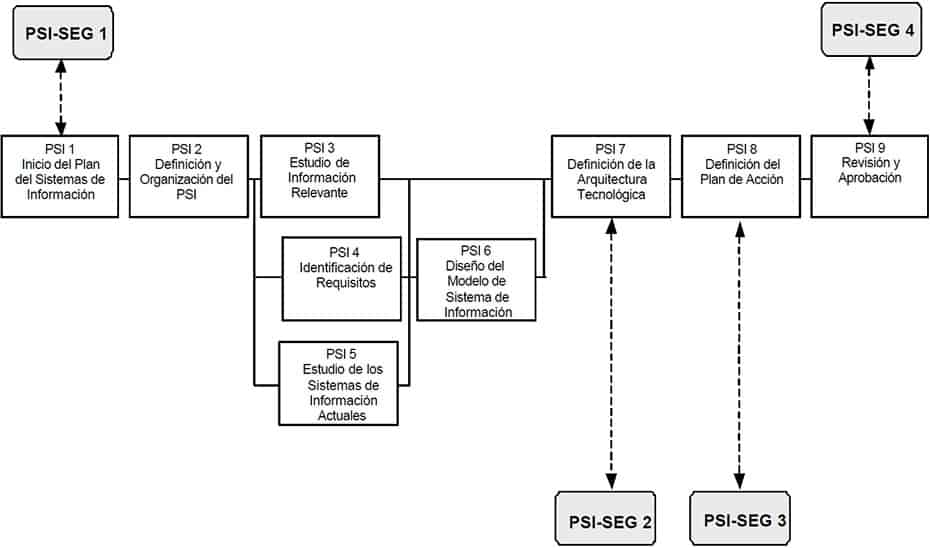
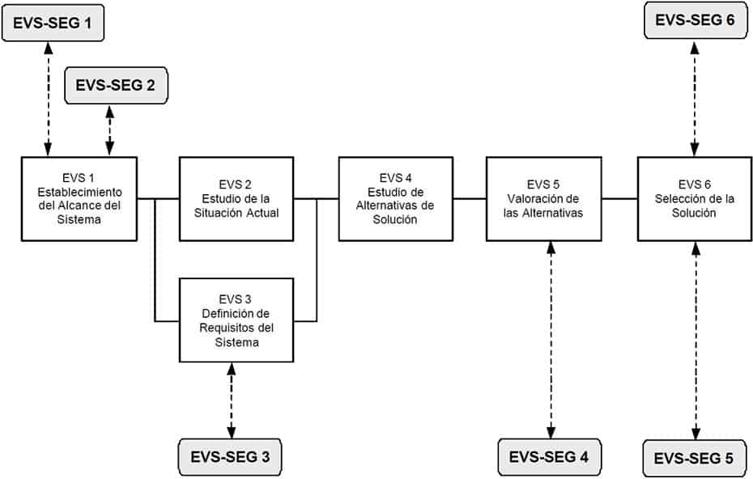
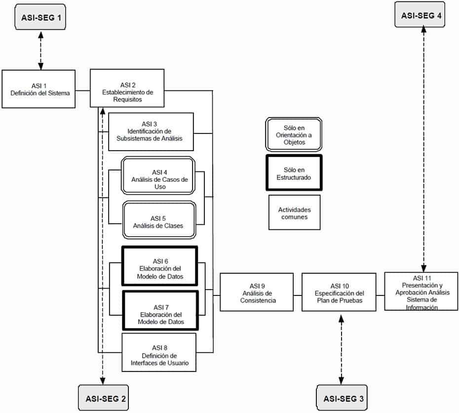
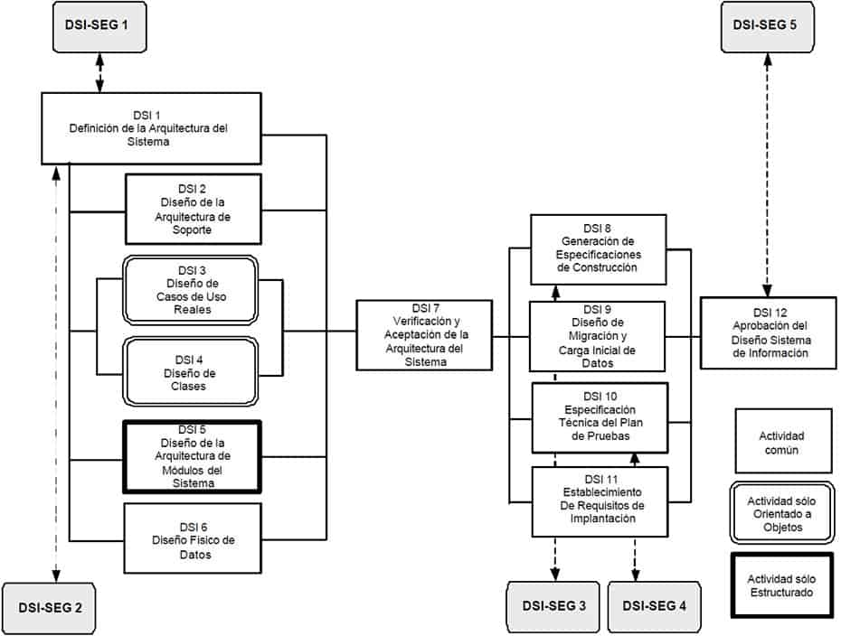
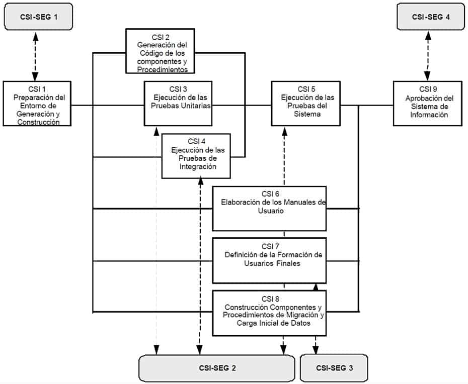
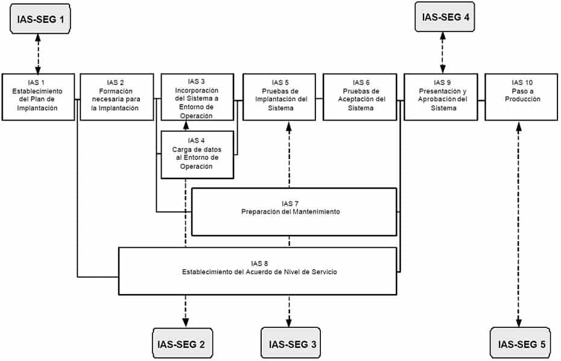
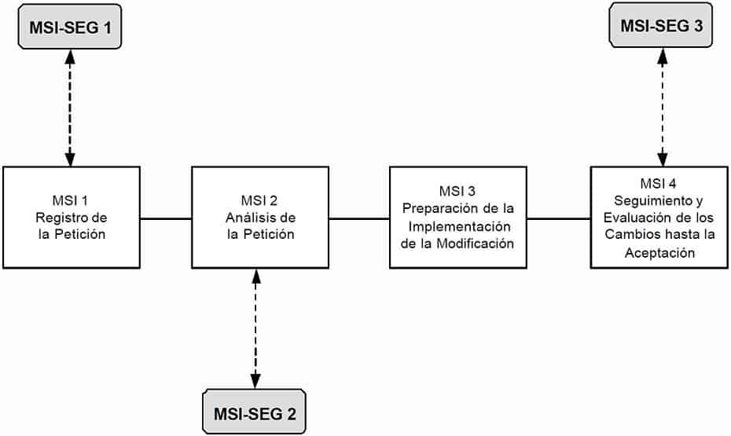

# Seguridad

## Descripción y objetivos

El objetivo de la interfaz de seguridad de MÉTRICA Versión 3 es incorporar en los sistemas de información mecanismos de seguridad adicionales a los que se proponen en la propia metodología, asegurando el desarrollo de cualquier tipo de sistema a lo largo de los procesos que se realicen para su obtención.

La seguridad del sistema de información ya se considera en MÉTRICA Versión 3 como requisito funcional (ASI 2.1), es decir previamente al desarrollo del mismo. La interfaz de Seguridad hace posible incorporar durante la fase de desarrollo las funciones y mecanismos que refuerzan la seguridad del nuevo sistema y del propio proceso de desarrollo, asegurando su consistencia y seguridad.

El análisis de los riesgos constituye una pieza fundamental en el diseño y desarrollo de sistemas de información seguros. Si bien los riesgos que afectan a un sistema de información son de distinta índole: naturales (inundaciones, incendios, etc.) o lógicos (fallos propios, ataques externos, virus, etc.) son estos últimos los contemplados en la interfaz de Seguridad de MÉTRICA Versión 3.

De lo anterior se desprende que existen dentro de la interfaz dos tipos de actividades diferenciadas:

    Actividades relacionadas con la seguridad intrínseca del sistema de información (representadas en la parte inferior del gráfico).
    Actividades que velan por la seguridad del propio proceso de desarrollo del sistema de información (representadas en la parte superior del gráfico).

Si en la organización ya existe un plan de seguridad o una metodología de análisis y gestión de riesgos como por ejemplo MAGERIT, para cada sistema de información deberán analizarse las necesidades de seguridad del sistema respecto al método vigente, y determinar las diferencias si las hubiera, así como aquellas necesidades concretas que no se encuentren recogidas, estableciendo así el plan de seguridad del sistema de información. Si no existe un plan de seguridad en la organización habrá que desarrollarlo desde el principio. El plan recogerá además las medidas de seguridad activas o preventivas y reactivas, en respuesta a situaciones en que se produce un fallo reduciendo su efecto, relacionadas con la seguridad del sistema de información y del proceso de desarrollo.

Las valoraciones sobre la seguridad deben ser realizadas en función de las características del sistema: complejidad, tamaño, incertidumbre, participantes, etc. por los responsables de la seguridad del sistema de información, quienes se apoyarán para sus decisiones en su conocimiento y experiencia en la materia sin perder de vista además que, al ser finitos los recursos, no pueden asegurarse todos los aspectos del desarrollo de los sistemas de información, por lo que habrá que aceptar un determinado nivel de riesgo concentrándose en los aspectos más comprometidos o amenazados, que serán diferentes según las circunstancias.

Actividades

* Planificación de Sistemas de Información
  * Actividad PSI-SEG 1: Planificación de la Seguridad Requerida en el Proceso Planificación de Sistemas de Información
  * Actividad PSI-SEG 2: Evaluación del Riesgo para la Arquitectura Tecnológica
  * Actividad PSI-SEG 3: Determinación de la Seguridad en el Plan de Acción
  * Actividad PSI-SEG 4: Catalogación de los Productos Generados Durante el Proceso de Planificación de Sistemas de Información
* Estudio de Viabilidad del Sistema
  * Actividad EVS-SEG 1: Estudio de la Seguridad Requerida en el Proceso Estudio de Viabilidad del Sistema
  * Actividad EVS-SEG 2: Selección del Equipo de Seguridad
  * Actividad EVS-SEG 3: Recomendaciones Adicionales de Seguridad para el Sistema de Información
  * Actividad EVS-SEG 4: Evaluación de la Seguridad de las Alternativas de Solución
  * Actividad EVS-SEG 5: Evaluación Detallada de la Seguridad de la Solución Propuesta
  * Actividad EVS-SEG 6: Catalogación de los Productos Generados Durante el Proceso de Estudio de Viabilidad del Sistema
* Análisis del Sistema de Información
  * Actividad ASI-SEG 1: Estudio de la Seguridad Requerida en el Proceso de Análisis del Sistema de Información
  * Actividad ASI-SEG 2: Descripción de las Funciones y Mecanismos de Seguridad
  * Actividad ASI-SEG 3: Definición de los Criterios de Aceptación de la Seguridad
  * Actividad ASI-SEG 4: Catalogación de los Productos Generados Durante el Proceso de Análisis del Sistema de Información
* Diseño del Sistema de Información
  * Actividad DSI-SEG 1: Estudio de la Seguridad Requerida en el Proceso de Diseño del Sistema de Información
  * Actividad DSI-SEG 2: Especificación de Requisitos de Seguridad del Entorno Tecnológico
  * Actividad DSI-SEG 3: Requisitos de Seguridad del Entorno de Construcción
  * Actividad DSI-SEG 4: Diseño de Pruebas de Seguridad
  * Actividad DSI-SEG 5: Catalogación de los Productos Generados Durante el Proceso de Diseño del Sistema de Información
* Construcción del Sistema de Información
  * Actividad CSI-SEG 1: Estudio de la Seguridad Requerida en el Proceso de Construcción del Sistema de Información
  * Actividad CSI-SEG 2: Evaluación de los Resultados de Pruebas de Seguridad
  * Actividad CSI-SEG 3: Elaboración del Plan de Formación de Seguridad
  * Actividad CSI-SEG 4: Catalogación de los Productos Generados Durante el Proceso de Construcción del Sistema de Información
* Implantación y Aceptación del Sistema
  * Actividad IAS-SEG 1: Estudio de la Seguridad Requerida en el Proceso de Implantación y Aceptación del Sistema
  * Actividad IAS-SEG 2: Revisión de Medidas de Seguridad del Entorno de Operación
  * Actividad IAS-SEG 3: Evaluación de Resultados de Pruebas de Seguridad de Implantación del Sistema
  * Actividad IAS-SEG 4: Catalogación de los Productos Generados Durante el Proceso de Implantación y Aceptación del Sistema
  * Actividad IAS-SEG 5: Revisión de Medidas de Seguridad en el Entorno de Producción
* Mantenimiento de Sistemas de Información
  * Actividad MSI-SEG 1: Estudio de la Seguridad Requerida en el Proceso Mantenimiento de Sistemas de Información
  * Actividad MSI-SEG 2: Especificación e Identificación de las Funciones y Mecanismos de Seguridad
  * Actividad MSI-SEG 3: Catalogación de los Productos Generados Durante el Proceso de Mantenimiento de Sistemas de Información

## Planificación de Sistemas de Información {#psi-seg}

En la actualidad, la mayoría de las organizaciones suelen disponer, en mayor o menor grado, de una política de seguridad. Esta política constituirá el punto de partida de la interfaz de seguridad, completándola o adaptándola en aquellos aspectos que así lo requieran. Si la organización no dispone de ella será necesario realizar un esfuerzo suplementario dirigido a la identificación de los objetivos de seguridad ya que su determinación no es una tarea trivial.

La seguridad influirá en las decisiones adoptadas en el proceso de Planificación de Sistemas de Información al igual que otros aspectos tales como la calidad, ya que debe ser un parámetro más a contemplar en el análisis y evaluación de soluciones.

En la siguiente figura aparecen las actividades de la interfaz de seguridad a lo largo del proceso Planificación de Sistemas de Información (PSI).



### Actividad PSI-SEG 1: Planificación de la Seguridad Requerida en el Proceso Planificación de Sistemas de Información {#psi-seg-1}

Durante esta actividad, y para el proceso de Planificación de Sistemas de Información, se especifica:

    La política de seguridad de la organización, si existe.
    La determinación global de objetivos de seguridad.
    La organización necesaria para la seguridad.

```{=html}
<table class="avia-table avia-data-table">
<tbody>
<tr>
<td style="background-color: #000033; text-align: left; width: 25%;"><strong><span style="color: #ffffff;">TAREA</span></strong></td>
<td style="background-color: #000033; text-align: left; width: 30%;"><strong><span style="color: #ffffff;">PRODUCTOS</span></strong></td>
<td style="background-color: #000033; text-align: left; width: 25%;"><strong><span style="color: #ffffff;">TÉCNICAS Y PRÁCTICAS</span></strong></td>
<td style="background-color: #000033; text-align: left; width: 20%;"><strong><span style="color: #ffffff;">PARTICIPANTES</span></strong></td>
</tr>
<tr>
<td style="text-align: left; vertical-align: top;"><a href="#psi-seg-1-1"><strong>PSI-SEG 1.1</strong>: Estudio de la Seguridad Requerida en el Proceso Planificación de Sistemas de Información</a></td>
<td style="text-align: left; vertical-align: top;">Seguridad Requerida en el Proceso Planificación de<br/>
Sistemas de Sistemas de Información:</p>
<ul>
<li>Seguridad para la Ejecución de Actividades</li>
<li>Seguridad para la Clasificación y Catalogación de los Productos Intermedios</li>
</ul>
</td>
<td style="text-align: left; vertical-align: top;">
<ul>
<li><a href="../03-tecnicas/01-tecnicas.qmd#sesiones-de-trabajo">Sesiones de Trabajo</a></li>
</ul>
</td>
<td style="text-align: left; vertical-align: top;">
<ul>
<li><a href="../04-participantes/01-participantes.qmd#perfil-jefe-de-proyecto">Responsable de Seguridad</a></li>
</ul>
</td>
</tr>
<tr>
<td style="text-align: left; vertical-align: top;"><a href="#psi-seg-1-2"><strong>PSI-SEG 1.2</strong>: Organización y Planificación</a></td>
<td style="text-align: left; vertical-align: top;">Plan de Seguridad de Sistemas de Información:</p>
<ul>
<li>Política de Seguridad de la Organización</li>
<li>Organización y Planificación Necesaria para la Seguridad</li>
<li>Análisis y Conclusiones</li>
</ul>
</td>
<td style="text-align: left; vertical-align: top;">
<ul>
<li><a href="../03-tecnicas/01-tecnicas.qmd#revision-formal">Revisión</a></li>
<li><a href="../03-tecnicas/01-tecnicas.qmd#sesiones-de-trabajo">Sesiones de Trabajo</a></li>
</ul>
</td>
<td style="text-align: left; vertical-align: top;">
<ul>
<li><a href="../04-participantes/01-participantes.qmd#perfil-jefe-de-proyecto">Responsable de Seguridad</a></li>
<li><a href="../04-participantes/01-participantes.qmd#perfil-directivo">Comité de Dirección</a></li>
</ul>
</td>
</tr>
</tbody>
</table>
```

#### Tarea PSI-SEG 1.1: Estudio de la Seguridad Requerida en el Proceso Planificación de Sistemas de Información

El Responsable de Seguridad debe estudiar si es necesario supervisar la seguridad (niveles de autenticación, confidencialidad, integridad y disponibilidad) de los productos generados en las actividades del proceso Planificación de Sistemas de Información. Como fruto de dicho estudio se establecerá el control de la seguridad en las actividades tanto a nivel de ejecución como de los productos obtenidos.
Productos

###### De entrada {.unnumbered .unlisted}

    Descripción General del PSI (PSI 1.3)
    Política de Seguridad de la Organización (externo)
    Riesgo Aceptable (Comité de Seguimiento)

###### De salida {.unnumbered .unlisted}

    Seguridad Requerida en el Proceso Planificación de Sistemas de Información:
        Seguridad para la Ejecución de Actividades
        Seguridad para la Clasificación y Catalogación de los Productos Intermedios

##### Prácticas {.unnumbered .unlisted}

    Sesiones de Trabajo

##### Participantes {.unnumbered .unlisted}

    Responsable de Seguridad

#### Tarea PSI-SEG 1.2: Organización y Planificación

El responsable de seguridad determina la organización y planificación necesaria para la seguridad del proceso con objetivos, fases y posibles condicionantes. Deben adaptarse los objetivos globales de seguridad de la organización relacionándolos con los recursos necesarios, y determinando así el equipo de seguridad necesario para el proceso de Planificación de Sistemas de Información.
Productos

###### De entrada {.unnumbered .unlisted}

    Política de Seguridad de la Organización (externo)
    Seguridad Requerida en el Proceso PSI (PSI-SEG 1.1)

###### De salida {.unnumbered .unlisted}

    Plan de Seguridad de los Sistemas de Información:
        Política de Seguridad de la Organización
        Organización y Planificación Necesaria para la Seguridad
        Análisis y Conclusiones

##### Prácticas {.unnumbered .unlisted}

    Revisión
    Sesiones de Trabajo

##### Participantes {.unnumbered .unlisted}

    Responsable de Seguridad
    Comité de Dirección

### Actividad PSI-SEG 2: Evaluación del Riesgo para la Arquitectura Tecnológica {#psi-seg-2}

Se evalúan las características (vulnerabilidades, riesgos y costes de los mecanismos de seguridad a implantar) para la arquitectura tecnológica establecida en cada una de las alternativas de solución. Dicha evaluación se entrega al Comité de Seguimiento para su aprobación.

```{=html}
<table class="avia-table avia-data-table">
<tbody>
<tr>
<td style="background-color: #000033; text-align: left; width: 25%;"><strong><span style="color: #ffffff;">TAREA</span></strong></td>
<td style="background-color: #000033; text-align: left; width: 30%;"><strong><span style="color: #ffffff;">PRODUCTOS</span></strong></td>
<td style="background-color: #000033; text-align: left; width: 25%;"><strong><span style="color: #ffffff;">TÉCNICAS Y PRÁCTICAS</span></strong></td>
<td style="background-color: #000033; text-align: left; width: 20%;"><strong><span style="color: #ffffff;">PARTICIPANTES</span></strong></td>
</tr>
<tr>
<td style="text-align: left; vertical-align: top;"><a href="#psi-seg-2-1"><strong>PSI-SEG 2.1</strong>: Estudio y Evaluación del Riesgo de las Alternativas de Arquitectura Tecnológica</a></td>
<td style="text-align: left; vertical-align: top;">Seguridad de las Alternativas de Arquitectura Tecnológica:</p>
<ul>
<li>Características detalladas de seguridad para cada Alternativa</li>
<li>Análisis y Gestión del Riesgo de cada Alternativa</li>
</ul>
</td>
<td style="text-align: left; vertical-align: top;">
<ul>
<li><a href="../03-tecnicas/01-tecnicas.qmd#revision-formal">Revisión</a></li>
<li><a href="../03-tecnicas/01-tecnicas.qmd#sesiones-de-trabajo">Sesiones de Trabajo</a></li>
</ul>
</td>
<td style="text-align: left; vertical-align: top;">
<ul>
<li><a href="../04-participantes/01-participantes.qmd#perfil-analista">Equipo de Seguridad</a></li>
<li><a href="../04-participantes/01-participantes.qmd#perfil-jefe-de-proyecto">Responsable de Seguridad</a></li>
</ul>
</td>
</tr>
<tr>
<td style="text-align: left; vertical-align: top;"><a href="#psi-seg-2-2"><strong>PSI-SEG 2.2</strong>: Revisión de la Evaluación del Riesgo de las Alternativas de Arquitectura Tecnológica</a></td>
<td style="text-align: left; vertical-align: top;">Seguridad de las Alternativas de Arquitectura Tecnológica:</p>
<ul>
<li>Análisis y Gestión del Riesgo de la Arquitectura Tecnológica</li>
<li>Nivel de Riesgo Aceptable</li>
</ul>
</td>
<td style="text-align: left; vertical-align: top;">
<ul>
<li><a href="../03-tecnicas/01-tecnicas.qmd#revision-formal">Revisión</a></li>
<li><a href="../03-tecnicas/01-tecnicas.qmd#sesiones-de-trabajo">Sesiones de Trabajo</a></li>
</ul>
</td>
<td style="text-align: left; vertical-align: top;">
<ul>
<li><a href="../04-participantes/01-participantes.qmd#perfil-directivo">Comité de Seguimiento</a></li>
<li><a href="../04-participantes/01-participantes.qmd#perfil-jefe-de-proyecto">Responsable de Seguridad</a></li>
</ul>
</td>
</tr>
</tbody>
</table>
```

#### Tarea PSI-SEG 2.1: Estudio y Evaluación del Riesgo de las Alternativas de Arquitectura Tecnológica {#psi-seg-2-1}

El equipo de seguridad estudia las alternativas de arquitectura tecnológica, analizando para cada una el nivel de seguridad, las vulnerabilidades, los riesgos y la posible gestión de los mismos. Para ello, dicho equipo realizará los siguientes pasos:

    Determinación de los principales recursos (entornos, redes, comunicaciones, etc) de cada una de las alternativas de arquitectura tecnológica.
    Identificación de las amenazas relevantes para cada uno de los recursos anteriores.
    Determinación del riesgo efectivo e intrínseco de cada alternativa.
    Selección de los mecanismos de salvaguarda oportunos que minimicen los riesgos.

Para la realización de esta tarea se puede tomar como referencia MAGERIT, Metodología de Análisis y Gestión de Riesgos de los Sistemas de Información.
Productos

###### De entrada {.unnumbered .unlisted}

    Plan de Seguridad de los Sistemas de Información (PSI-SEG 1.2)
    Alternativas de Arquitectura Tecnológica (PSI 7.1)

###### De salida {.unnumbered .unlisted}

    Seguridad de las Alternativas de Arquitectura Tecnológica:
        Características detalladas de seguridad para cada Alternativa
        Análisis y Gestión del Riesgo de cada Alternativa

##### Prácticas {.unnumbered .unlisted}

    Revisión
    Sesiones de Trabajo

##### Participantes {.unnumbered .unlisted}

    Equipo de Seguridad
    Responsable de Seguridad

#### Tarea PSI-SEG 2.2: Revisión de la Evaluación del Riesgo de las Alternativas de Arquitectura Tecnológica {#psi-seg-2-2}

Una vez se dispone de la alternativa de la arquitectura tecnológica seleccionada (PSI 7.2) y del estudio de seguridad de las alternativas obtenido en la tarea anterior, el Comité de Seguimiento y el Responsable de Seguridad realizan un examen del mismo para aceptarlo o rechazarlo.
Productos

###### De entrada {.unnumbered .unlisted}

    Arquitectura Tecnológica (PSI 7.2)
    Seguridad de las Alternativas de Arquitectura Tecnológica (PSI-SEG 2.1)

###### De salida {.unnumbered .unlisted}

    Seguridad de las Alternativas de Arquitectura Tecnológica:
        Análisis y Gestión del Riesgo de la Arquitectura Tecnológica
        Nivel de Riesgo Aceptable

##### Prácticas {.unnumbered .unlisted}

    Revisión
    Sesiones de Trabajo

##### Participantes {.unnumbered .unlisted}

    Comité de Seguimiento
    Responsable de Seguridad

### Actividad PSI-SEG 3: Determinación de la Seguridad en el Plan de Acción {#psi-seg-3}

Una vez definida la arquitectura tecnológica en el Plan de Sistemas de Información se determina la política de seguridad a llevar a cabo en el Plan de Acción en función de los riesgos aceptados. El objetivo de esta actividad es detallar la forma en que se efectuará la puesta en marcha de los servicios y mecanismos de salvaguarda durante el Plan de Acción, así como la infraestructura y los recursos necesarios para llevarlo a cabo.

```{=html}
<table class="avia-table avia-data-table">
<tbody>
<tr>
<td style="background-color: #000033; text-align: left; width: 25%;"><strong><span style="color: #ffffff;">TAREA</span></strong></td>
<td style="background-color: #000033; text-align: left; width: 30%;"><strong><span style="color: #ffffff;">PRODUCTOS</span></strong></td>
<td style="background-color: #000033; text-align: left; width: 25%;"><strong><span style="color: #ffffff;">TÉCNICAS Y PRÁCTICAS</span></strong></td>
<td style="background-color: #000033; text-align: left; width: 20%;"><strong><span style="color: #ffffff;">PARTICIPANTES</span></strong></td>
</tr>
<tr>
<td style="text-align: left; vertical-align: top;"><a href="#psi-seg-3-1"><strong>PSI-SEG 3.1</strong>: Determinación de la Seguridad en el Plan de Acción</a></td>
<td style="text-align: left; vertical-align: top;">Seguridad para el Plan de Acción</td>
<td style="text-align: left; vertical-align: top;">
<ul>
<li><a href="../03-tecnicas/01-tecnicas.qmd#revision-formal">Revisión</a></li>
<li><a href="../03-tecnicas/01-tecnicas.qmd#sesiones-de-trabajo">Sesiones de Trabajo</a></li>
</ul>
</td>
<td style="text-align: left; vertical-align: top;">
<ul>
<li><a href="../04-participantes/01-participantes.qmd#perfil-directivo">Comité de Seguimiento</a></li>
<li><a href="../04-participantes/01-participantes.qmd#perfil-jefe-de-proyecto">Responsable de Seguridad</a></li>
</ul>
</td>
</tr>
</tbody>
</table>
```

#### Tarea PSI-SEG 3.1: Determinación de la Seguridad en el Plan de Acción {#psi-seg-3-1}

Se estudia el Plan de Acción establecido en el Plan de Sistemas de Información (PSI 8.1) con el objetivo de programar los recursos lógicos y físicos necesarios para la activación de los servicios y mecanismos de salvaguarda que se determinaron para la arquitectura tecnológica escogida.
Productos

###### De entrada {.unnumbered .unlisted}

    Plan de Seguridad de los Sistemas de Información (PSI-SEG 1.2)
    Plan de Acción (PSI 8.1)

###### De salida {.unnumbered .unlisted}

    Seguridad para el Plan de Acción

##### Prácticas {.unnumbered .unlisted}

    Revisión
    Sesiones de Trabajo

##### Participantes {.unnumbered .unlisted}

    Comité de Seguimiento
    Responsable de Seguridad

### Actividad PSI-SEG 4: Catalogación de los Productos Generados Durante el Proceso de Planificación de Sistemas de Información {#psi-seg-4}

```{=html}
<table class="avia-table avia-data-table">
<tbody>
<tr>
<td style="background-color: #000033; text-align: left; width: 25%;"><strong><span style="color: #ffffff;">TAREA</span></strong></td>
<td style="background-color: #000033; text-align: left; width: 30%;"><strong><span style="color: #ffffff;">PRODUCTOS</span></strong></td>
<td style="background-color: #000033; text-align: left; width: 25%;"><strong><span style="color: #ffffff;">TÉCNICAS Y PRÁCTICAS</span></strong></td>
<td style="background-color: #000033; text-align: left; width: 20%;"><strong><span style="color: #ffffff;">PARTICIPANTES</span></strong></td>
</tr>
<tr>
<td style="text-align: left; vertical-align: top;"><a href="#psi-seg-4-1"><strong>PSI-SEG 4.1</strong>: Clasificación y Catalogación de los Productos Generados durante el Proceso de Planificación de Sistemas de Información</a></td>
<td style="text-align: left; vertical-align: top;">Catalogación de los Productos Generados en el Proceso PSI:</p>
<ul>
<li>Determinación de Niveles de Seguridad</li>
<li>Listado de Productos Generados</li>
<li>Niveles de Seguridad de los Productos</li>
<li>Soporte de Almacenamiento</li>
</ul>
</td>
<td style="text-align: left; vertical-align: top;">
<ul>
<li><a href="../03-tecnicas/01-tecnicas.qmd#revision-formal">Revisión</a></li>
<li><a href="../03-tecnicas/01-tecnicas.qmd#catalogacion">Catalogación</a></li>
</ul>
</td>
<td style="text-align: left; vertical-align: top;">
<ul>
<li><a href="../04-participantes/01-participantes.qmd#perfil-jefe-de-proyecto">Responsable de Seguridad</a></li>
</ul>
</td>
</tr>
</tbody>
</table>
```

#### Tarea PSI-SEG 4.1: Clasificación y Catalogación de los Productos Generados durante el Proceso de Planificación de Sistemas de Información {#psi-seg-4-1}

El responsable de seguridad estudia los productos generados durante el proceso de Planificación de Sistemas de Información y determinan el nivel de seguridad de cada uno de ellos con respecto a la autenticación, confidencialidad, integridad y disponibilidad. En función del nivel de seguridad se establece la catalogación y archivo de los productos, teniendo en cuenta a este respecto las particularidades del soporte de almacenamiento elegido y del sistema de gestión de configuración vigente en la organización (Véase la Interfaz de Gestión de Configuración).
Productos

###### De entrada {.unnumbered .unlisted}

    Productos generados durante el proceso Planificación de Sistemas de Información

###### De salida {.unnumbered .unlisted}

    Catalogación de los Productos Generados en el Proceso Planificación de Sistemas de Información:
        Determinación de Niveles de Seguridad
        Listado de Productos Generados
        Niveles de Seguridad de los Productos
        Soporte de Almacenamiento

##### Prácticas {.unnumbered .unlisted}

    Revisión
    Catalogación

##### Participantes {.unnumbered .unlisted}

    Responsable de Seguridad

## Estudio de Viabilidad del Sistema {#evs-seg}

La primera actividad de la interfaz de Seguridad que debe abordarse en el proceso de Estudio de Viabilidad del Sistema es el estudio de la seguridad requerida en este proceso, seleccionando a continuación a los miembros del Equipo de Seguridad para los procesos de Estudio de Viabilidad, Análisis, Diseño, Construcción e Implantación del Sistema de Información. Se trata de una tarea de vital importancia para las siguientes actividades de seguridad, tanto las relativas a la Seguridad del Sistema de Información, como para las concernientes a la Seguridad del Proceso de Desarrollo. Es importante que tanto el Responsable de Seguridad como el Equipo de Seguridad se basen en la política de seguridad de la organización y en la Seguridad para el Plan de Acción (PSI-SEG 3.1). Si no se ha realizado el proceso Planificación de Sistemas de Información y las actividades de la interfaz de seguridad correspondientes al mismo, se partirá de la política de seguridad de la organización y del nivel de riesgo aceptable.

En el siguiente gráfico se muestra la relación entre las actividades del Estudio de Viabilidad del Sistema (EVS) y las de la interfaz de Seguridad.



### Actividad EVS-SEG 1: Estudio de la Seguridad Requerida en el Proceso Estudio de Viabilidad del Sistema {#evs-seg-1}

```{=html}
<table class="avia-table avia-data-table">
<tbody>
<tr>
<td style="background-color: #000033; text-align: left; width: 25%;"><strong><span style="color: #ffffff;">TAREA</span></strong></td>
<td style="background-color: #000033; text-align: left; width: 30%;"><strong><span style="color: #ffffff;">PRODUCTOS</span></strong></td>
<td style="background-color: #000033; text-align: left; width: 25%;"><strong><span style="color: #ffffff;">TÉCNICAS Y PRÁCTICAS</span></strong></td>
<td style="background-color: #000033; text-align: left; width: 20%;"><strong><span style="color: #ffffff;">PARTICIPANTES</span></strong></td>
</tr>
<tr>
<td style="text-align: left; vertical-align: top;"><a href="#evs-seg-1-1"><strong>EVS-SEG 1.1</strong>: Estudio de la Seguridad Requerida en el Proceso Estudio de Viabilidad del Sistema</a></td>
<td style="text-align: left; vertical-align: top;">Seguridad Requerida en el Proceso Estudio de Viabilidad del Sistema:</p>
<ul>
<li>Seguridad para Ejecución de Actividades</li>
<li>Seguridad para la Clasificación y Catalogación de los Productos Intermedios</li>
</ul>
</td>
<td style="text-align: left; vertical-align: top;">
<ul>
<li><a href="../03-tecnicas/01-tecnicas.qmd#sesiones-de-trabajo">Sesiones de Trabajo</a></li>
</ul>
</td>
<td style="text-align: left; vertical-align: top;">
<ul>
<li><a href="../04-participantes/01-participantes.qmd#perfil-jefe-de-proyecto">Responsable de Seguridad</a></li>
<li><a href="../04-participantes/01-participantes.qmd#perfil-jefe-de-proyecto">Jefe de Proyecto</a></li>
</ul>
</td>
</tr>
</tbody>
</table>
```

#### Tarea EVS-SEG 1.1: Estudio de la Seguridad Requerida en el Proceso Estudio de Viabilidad del Sistema {#evs-seg-1-1}

El Responsable de Seguridad analiza la necesidad de supervisar la seguridad (niveles de autenticación, confidencialidad, integridad y disponibilidad) de los productos intermedios de alguna de las actividades del proceso Estudio de Viabilidad del Sistema. Para ello se basa en las particularidades del sistema de información y en la manera en que el proceso es llevado a cabo. Como fruto de dicho estudio, y teniendo en cuenta las características del proceso, se establecerá el control de la seguridad en las actividades tanto a nivel de ejecución como de los productos obtenidos.
Productos

###### De entrada {.unnumbered .unlisted}

    Catálogo de objetivos del EVS (EVS 1.1)
    Plan de trabajo (EVS 1.3)
    Seguridad para el Plan de Acción (PSI-SEG 3.1)

###### De salida {.unnumbered .unlisted}

    Seguridad Requerida en el Proceso Estudio de Viabilidad del Sistema:
        Seguridad para la Ejecución de Actividades
        Seguridad para la Clasificación y Catalogación de los Productos Intermedios

##### Prácticas {.unnumbered .unlisted}

    Sesiones de Trabajo

##### Participantes {.unnumbered .unlisted}

    Responsable de Seguridad
    Jefe de Proyecto

### Actividad EVS-SEG 2: Selección del Equipo de Seguridad {#evs-seg-2}

```{=html}
<table class="avia-table avia-data-table">
<tbody>
<tr>
<td style="background-color: #000033; text-align: left; width: 25%;"><strong><span style="color: #ffffff;">TAREA</span></strong></td>
<td style="background-color: #000033; text-align: left; width: 30%;"><strong><span style="color: #ffffff;">PRODUCTOS</span></strong></td>
<td style="background-color: #000033; text-align: left; width: 25%;"><strong><span style="color: #ffffff;">TÉCNICAS Y PRÁCTICAS</span></strong></td>
<td style="background-color: #000033; text-align: left; width: 20%;"><strong><span style="color: #ffffff;">PARTICIPANTES</span></strong></td>
</tr>
<tr>
<td style="text-align: left; vertical-align: top;"><a href="#evs-seg-2-1"><strong>EVS-SEG 2.1</strong>: Selección del Equipo de Seguridad</a></td>
<td style="text-align: left; vertical-align: top;">Equipo de Seguridad:</p>
<ul>
<li>Perfil de Selección</li>
<li>Funciones y Responsabilidades</li>
</ul>
</td>
<td style="text-align: left; vertical-align: top;">
<ul>
<li><a href="../03-tecnicas/01-tecnicas.qmd#revision-formal">Revisión</a></li>
<li><a href="../03-tecnicas/01-tecnicas.qmd#sesiones-de-trabajo">Sesiones de Trabajo</a></li>
</ul>
</td>
<td style="text-align: left; vertical-align: top;">
<ul>
<li><a href="../04-participantes/01-participantes.qmd#perfil-directivo">Comité de Seguimiento</a></li>
<li><a href="../04-participantes/01-participantes.qmd#perfil-jefe-de-proyecto">Responsable de Seguridad</a></li>
</ul>
</td>
</tr>
</tbody>
</table>
```

#### Tarea EVS-SEG 2.1: Selección del Equipo de Seguridad {#evs-seg-2-1}

La naturaleza de las funciones a desempeñar y la criticidad y confidencialidad de la información y productos a los que tendrá acceso el personal de seguridad hacen necesario que tanto el Comité de Seguimiento como el Responsable de Seguridad seleccionen cuidadosamente a los miembros del equipo de seguridad para el proceso de desarrollo completo.

Deben realizarse las sesiones de trabajo necesarias para especificar las labores que deben desempeñar y con qué grado de responsabilidad.
Productos

###### De entrada {.unnumbered .unlisted}

    Plan de Seguridad de los Sistemas de Información (PSI-SEG 1.2)

###### De salida {.unnumbered .unlisted}

    Equipo de Seguridad:
        Perfil de Selección
        Funciones y Responsabilidades

##### Prácticas {.unnumbered .unlisted}

    Revisión
    Sesiones de Trabajo

##### Participantes {.unnumbered .unlisted}

    Comité de Seguimiento
    Responsable de Seguridad

### Actividad EVS-SEG 3: Recomendaciones Adicionales de Seguridad para el Sistema de Información {#evs-seg-3}

El Equipo de Seguridad establece las recomendaciones de seguridad del sistema en función del umbral del riesgo aceptado o asumible. Para ello, se estudian las amenazas y vulnerabilidades que en función del Catálogo de Requisitos del Sistema (EVS 3.3) se prevean, así como el impacto previsible de su materialización.

```{=html}
<table class="avia-table avia-data-table">
<tbody>
<tr>
<td style="background-color: #000033; text-align: left; width: 25%;"><strong><span style="color: #ffffff;">TAREA</span></strong></td>
<td style="background-color: #000033; text-align: left; width: 30%;"><strong><span style="color: #ffffff;">PRODUCTOS</span></strong></td>
<td style="background-color: #000033; text-align: left; width: 25%;"><strong><span style="color: #ffffff;">TÉCNICAS Y PRÁCTICAS</span></strong></td>
<td style="background-color: #000033; text-align: left; width: 20%;"><strong><span style="color: #ffffff;">PARTICIPANTES</span></strong></td>
</tr>
<tr>
<td style="text-align: left; vertical-align: top;"><a href="#evs-seg-3-1"><strong>EVS-SEG 3.1</strong>: Elaboración de Recomendaciones de Seguridad</a></td>
<td style="text-align: left; vertical-align: top;">Recomendaciones de Seguridad:</p>
<ul>
<li>Normativas y Legislación</li>
<li>Catálogo de Recomendaciones de Seguridad</li>
</ul>
</td>
<td style="text-align: left; vertical-align: top;">
<ul>
<li><a href="../03-tecnicas/01-tecnicas.qmd#sesiones-de-trabajo">Sesiones de Trabajo</a></li>
<li><a href="../03-tecnicas/01-tecnicas.qmd#catalogacion">Catalogación</a></li>
</ul>
</td>
<td style="text-align: left; vertical-align: top;">
<ul>
<li><a href="../04-participantes/01-participantes.qmd#perfil-jefe-de-proyecto">Responsable de Seguridad</a></li>
<li><a href="../04-participantes/01-participantes.qmd#perfil-analista">Equipo de Seguridad</a></li>
</ul>
</td>
</tr>
</tbody>
</table>
```

#### Tarea EVS-SEG 3.1: Elaboración de Recomendaciones de Seguridad {#evs-seg-3-1}

El Equipo de Seguridad estudia la legislación, normas y procedimientos referentes a la seguridad que son aplicables al sistema de información y que completan la política de seguridad de la organización, elaborando las recomendaciones de seguridad para dicho sistema.
Productos

###### De entrada {.unnumbered .unlisted}

    Legislación, Normas y Procedimientos de Seguridad (Externo)
    Catálogo de Normas (EVS 3.1)
    Catálogo de Requisitos (EVS 3.3)

###### De salida {.unnumbered .unlisted}

    Recomendaciones de Seguridad:
        Normativas y Legislación
        Catálogo de Recomendaciones de Seguridad

##### Prácticas {.unnumbered .unlisted}

    Sesiones de Trabajo
    Catalogación

##### Participantes {.unnumbered .unlisted}

    Responsable de Seguridad
    Equipo de Seguridad

### Actividad EVS-SEG 4: Evaluación de la Seguridad de las Alternativas de Solución {#evs-seg-4}

Se revisan las características de seguridad (amenazas, vulnerabilidades, riesgos y costes de los mecanismos de seguridad a implantar) de cada una de las alternativas de solución, identificando la alternativa más adecuada de acuerdo con los requisitos de seguridad del sistema identificados en MÉTRICA Versión 3 y las recomendaciones adicionales de seguridad establecidas en EVS-SEG 3.1.

```{=html}
<table class="avia-table avia-data-table">
<tbody>
<tr>
<td style="background-color: #000033; text-align: left; width: 25%;"><strong><span style="color: #ffffff;">TAREA</span></strong></td>
<td style="background-color: #000033; text-align: left; width: 30%;"><strong><span style="color: #ffffff;">PRODUCTOS</span></strong></td>
<td style="background-color: #000033; text-align: left; width: 25%;"><strong><span style="color: #ffffff;">TÉCNICAS Y PRÁCTICAS</span></strong></td>
<td style="background-color: #000033; text-align: left; width: 20%;"><strong><span style="color: #ffffff;">PARTICIPANTES</span></strong></td>
</tr>
<tr>
<td style="text-align: left; vertical-align: top;"><a href="#evs-seg-4-1"><strong>EVS-SEG 4.1</strong>: Valoración y Evaluación de la Seguridad de las Alternativas de Solución</a></td>
<td style="text-align: left; vertical-align: top;">Seguridad de las Alternativas de Solución:</p>
<ul>
<li>Características Detalladas para cada Alternativa</li>
<li>Resultado del Análisis y Gestión del Riesgo</li>
</ul>
</td>
<td style="text-align: left; vertical-align: top;">
<ul>
<li><a href="../03-tecnicas/01-tecnicas.qmd#revision-formal">Revisión</a></li>
<li><a href="../03-tecnicas/01-tecnicas.qmd#sesiones-de-trabajo">Sesiones de Trabajo</a></li>
</ul>
</td>
<td style="text-align: left; vertical-align: top;">
<ul>
<li><a href="../04-participantes/01-participantes.qmd#perfil-analista">Equipo de Seguridad</a></li>
<li><a href="../04-participantes/01-participantes.qmd#perfil-jefe-de-proyecto">Responsable de Seguridad</a></li>
</ul>
</td>
</tr>
</tbody>
</table>
```

#### Tarea EVS-SEG 4.1: Valoración y Evaluación de la Seguridad de las Alternativas de Solución

El Equipo de Seguridad estudia la información sobre las alternativas de solución. Debe analizar el nivel de seguridad, las vulnerabilidades, los riesgos y la gestión de los mismos para cada una de las alternativas de solución. Para ello dicho equipo sigue los pasos enumerados a continuación:

    Determinación de los principales recursos del sistema de información (entorno, aplicaciones, información, funcionalidades de la organización, personal, etc.) que intervienen en cada una de las alternativas de solución.
    Identificación de las amenazas relevantes para cada uno de los recursos anteriores.
    Determinación del riesgo efectivo e intrínseco de cada una de las alternativas de solución.
    Selección de los mecanismos de salvaguarda oportunos que minimicen los riesgos.

Productos

###### De entrada {.unnumbered .unlisted}

    Recomendaciones de Seguridad (EVS-SEG 3.1)
    Alternativas de Solución a Estudiar (EVS 4.2)
    Valoración de Alternativas (EVS 5.2)
    Plan de Trabajo de cada Alternativa (EVS 5.3)

###### De salida {.unnumbered .unlisted}

    Seguridad de las Alternativas de Solución:
        Características Detalladas para cada Alternativa
        Resultado del Análisis y Gestión del Riesgo

##### Prácticas {.unnumbered .unlisted}

    Revisión
    Sesiones de Trabajo

##### Participantes {.unnumbered .unlisted}

    Equipo de Seguridad
    Responsable de Seguridad

### Actividad EVS-SEG 5: Evaluación Detallada de la Seguridad de la Solución Propuesta {#evs-seg-5}

El objetivo de esta actividad es describir en detalle la seguridad de la solución escogida, identificando las posibles debilidades y mejoras.

```{=html}
<table class="avia-table avia-data-table">
<tbody>
<tr>
<td style="background-color: #000033; text-align: left; width: 25%;"><strong><span style="color: #ffffff;">TAREA</span></strong></td>
<td style="background-color: #000033; text-align: left; width: 30%;"><strong><span style="color: #ffffff;">PRODUCTOS</span></strong></td>
<td style="background-color: #000033; text-align: left; width: 25%;"><strong><span style="color: #ffffff;">TÉCNICAS Y PRÁCTICAS</span></strong></td>
<td style="background-color: #000033; text-align: left; width: 20%;"><strong><span style="color: #ffffff;">PARTICIPANTES</span></strong></td>
</tr>
<tr>
<td style="text-align: left; vertical-align: top;"><a href="#evs-seg-5-1"><strong>EVS-SEG 5.1</strong>: Descripción Detallada de la Seguridad de la Solución Propuesta</a></td>
<td style="text-align: left; vertical-align: top;">Seguridad de la Solución Propuesta:</p>
<ul>
<li>Características Detalladas de Seguridad de la Solución</li>
<li>Recomendación Final de Mejoras de Seguridad</li>
</ul>
</td>
<td style="text-align: left; vertical-align: top;">
<ul>
<li><a href="../03-tecnicas/01-tecnicas.qmd#catalogacion">Catalogación</a></li>
</ul>
</td>
<td style="text-align: left; vertical-align: top;">
<ul>
<li><a href="../04-participantes/01-participantes.qmd#perfil-jefe-de-proyecto">Responsable de Seguridad</a></li>
<li><a href="../04-participantes/01-participantes.qmd#perfil-analista">Equipo de Seguridad</a></li>
</ul>
</td>
</tr>
</tbody>
</table>
```

#### Tarea EVS-SEG 5.1: Descripción Detallada de la Seguridad de la Solución Propuesta

El estudio de la seguridad de la solución propuesta debe llevarse a cabo partiendo del estudio de seguridad de las alternativas de solución realizado en EVS-SEG 4, ampliándolo y profundizando en el mismo para la alternativa seleccionada. Para ello se siguen las etapas citadas a continuación:

    Determinación de los principales recursos del sistema de información (entorno, aplicaciones, información, funcionalidades de la organización, personal, etc.) que intervienen en la solución propuesta.
    Identificación y estudio de las amenazas relevantes para cada uno de los recursos anteriores. Se analiza la posibilidad de que dichas amenazas se materialicen sobre cada recurso (vulnerabilidad del recurso) y su impacto en el sistema.
    Determinación del riesgo efectivo e intrínseco de la solución propuesta.
    Selección de los mecanismos de salvaguarda oportunos que minimicen los riesgos.
    Incorporación, si es necesario, de nuevos mecanismos a este respecto.

Partiendo de una especificación de las principales características de la solución y mediante modelos de inferencia, se detectan las vulnerabilidades, riesgos y las posibilidades de gestión que pueda hacerse de dichos riesgos. Tras esa labor el Equipo de Seguridad realiza una evaluación de la seguridad de la solución propuesta.
Productos

###### De entrada {.unnumbered .unlisted}

    Solución Propuesta (EVS 6.2)
    Seguridad de las Alternativas de Solución (EVS-SEG 4.1)

###### De salida {.unnumbered .unlisted}

    Seguridad de la Solución Propuesta:
        Características Detalladas de Seguridad de la Solución
        Recomendación Final de Mejoras de Seguridad

##### Prácticas {.unnumbered .unlisted}

    Catalogación

##### Participantes {.unnumbered .unlisted}

    Responsable de Seguridad
    Equipo de Seguridad

### Actividad EVS-SEG 6: Catalogación de los Productos Generados Durante el Proceso de Estudio de Viabilidad del Sistema {#evs-seg-6}

```{=html}
<table class="avia-table avia-data-table">
<tbody>
<tr>
<td style="background-color: #000033; text-align: left; width: 25%;"><strong><span style="color: #ffffff;">TAREA</span></strong></td>
<td style="background-color: #000033; text-align: left; width: 30%;"><strong><span style="color: #ffffff;">PRODUCTOS</span></strong></td>
<td style="background-color: #000033; text-align: left; width: 25%;"><strong><span style="color: #ffffff;">TÉCNICAS Y PRÁCTICAS</span></strong></td>
<td style="background-color: #000033; text-align: left; width: 20%;"><strong><span style="color: #ffffff;">PARTICIPANTES</span></strong></td>
</tr>
<tr>
<td style="text-align: left; vertical-align: top;"><a href="#evs-seg-6-1"><strong>EVS-SEG 6.1</strong>: Clasificación y Catalogación de los Productos Generados durante el Proceso de Estudio de Viabilidad del Sistema</a></td>
<td style="text-align: left; vertical-align: top;">Catalogación de los Productos Generados en el Proceso Estudio de Viabilidad del Sistema:</p>
<ul>
<li>Determinación de Niveles de Seguridad</li>
<li>Listado de Productos Generados</li>
<li>Niveles de Seguridad de los Productos</li>
<li>Soporte de Almacenamiento</li>
</ul>
</td>
<td style="text-align: left; vertical-align: top;">
<ul>
<li><a href="../03-tecnicas/01-tecnicas.qmd#revision-formal">Revisión</a></li>
<li><a href="../03-tecnicas/01-tecnicas.qmd#catalogacion">Catalogación</a></li>
</ul>
</td>
<td style="text-align: left; vertical-align: top;">
<ul>
<li><a href="../04-participantes/01-participantes.qmd#perfil-jefe-de-proyecto">Responsable de Seguridad</a></li>
<li><a href="../04-participantes/01-participantes.qmd#perfil-jefe-de-proyecto">Jefe de Proyecto</a></li>
<li><a href="../04-participantes/01-participantes.qmd#perfil-directivo">Comité de Seguimiento</a></li>
</ul>
</td>
</tr>
</tbody>
</table>
```

#### Tarea EVS-SEG 6.1: Clasificación y Catalogación de los Productos Generados durante el Proceso de Estudio de Viabilidad del Sistema {#evs-seg-6-1}

El Responsable de Seguridad, el Jefe de Proyecto y el Comité de Seguimiento estudian los productos generados durante el proceso de Estudio de Viabilidad del Sistema y determinan el nivel de seguridad de cada uno de ellos con respecto a la autenticación, confidencialidad, integridad y disponibilidad. En función del nivel de seguridad se establece la catalogación y archivo de los productos, teniendo en cuenta a este respecto las particularidades del soporte de almacenamiento elegido y del sistema de gestión de configuración vigente en la organización.
Productos

###### De entrada {.unnumbered .unlisted}

    Productos generados durante el proceso Estudio de Viabilidad del Sistema.

###### De salida {.unnumbered .unlisted}

    Catalogación de los Productos Generados en el Proceso Estudio de Viabilidad del Sistema:
        Determinación de Niveles de Seguridad
        Listado de Productos Generados
        Niveles de Seguridad de los Productos
        Soporte de Almacenamiento

##### Prácticas {.unnumbered .unlisted}

    Revisión
    Catalogación

##### Participantes {.unnumbered .unlisted}

    Responsable de Seguridad
    Jefe de Proyecto
    Comité de Seguimiento

## Análisis del Sistema de Información {#asi-seg}

En las actividades de la interfaz de seguridad que se realizan durante el proceso de Análisis del Sistema de Información se hace referencia a lo que se denomina “funciones de seguridad” y “mecanismos de seguridad”. El entendimiento de ambos conceptos es fundamental para comprender su papel dentro del trabajo de desarrollo de un sistema de información:

    Una función de seguridad se define como “un servicio que garantiza la seguridad del sistema de información”.
    Un mecanismo de seguridad se define como “la lógica o el algoritmo que implementa una función de seguridad, ya sea en Hardware o en Software”.

Las funciones y mecanismos adicionales de seguridad definidos en las actividades de interfaz se implementarán en el sistema a través de MÉTRICA Versión 3, al igual que los demás requisitos de seguridad.

En el siguiente gráfico se muestra la relación entre las actividades del proceso de Análisis del Sistema de Información (ASI) y las de la interfaz de Seguridad.



### Actividad ASI-SEG 1: Estudio de la Seguridad Requerida en el Proceso de Análisis del Sistema de Información {#asi-seg-1}

```{=html}
<table class="avia-table avia-data-table">
<tbody>
<tr>
<td style="background-color: #000033; text-align: left; width: 25%;"><strong><span style="color: #ffffff;">TAREA</span></strong></td>
<td style="background-color: #000033; text-align: left; width: 30%;"><strong><span style="color: #ffffff;">PRODUCTOS</span></strong></td>
<td style="background-color: #000033; text-align: left; width: 25%;"><strong><span style="color: #ffffff;">TÉCNICAS Y PRÁCTICAS</span></strong></td>
<td style="background-color: #000033; text-align: left; width: 20%;"><strong><span style="color: #ffffff;">PARTICIPANTES</span></strong></td>
</tr>
<tr>
<td style="text-align: left; vertical-align: top;"><a href="#asi-seg-1-1"><strong>ASI-SEG 1.1</strong>: Estudio de la Seguridad Requerida en el Proceso de Análisis del Sistema de Información</a></td>
<td style="text-align: left; vertical-align: top;">Seguridad Requerida en el Proceso Análisis del Sistema de Información:</p>
<ul>
<li>Seguridad para Ejecución de Actividades</li>
<li>Seguridad para Clasificación y Catalogación de los Productos Intermedios</li>
</ul>
</td>
<td style="text-align: left; vertical-align: top;">
<ul>
<li><a href="../03-tecnicas/01-tecnicas.qmd#sesiones-de-trabajo">Sesiones de Trabajo</a></li>
</ul>
</td>
<td style="text-align: left; vertical-align: top;">
<ul>
<li><a href="../04-participantes/01-participantes.qmd#perfil-analista">Equipo de Seguridad</a></li>
<li><a href="../04-participantes/01-participantes.qmd#perfil-jefe-de-proyecto">Responsable de Seguridad</a></li>
<li><a href="../04-participantes/01-participantes.qmd#perfil-jefe-de-proyecto">Jefe de Proyecto</a></li>
</ul>
</td>
</tr>
</tbody>
</table>
```

#### Tarea ASI-SEG 1.1: Estudio de la Seguridad Requerida en el Proceso de Análisis del Sistema de Información {#asi-seg-1-1}

El Equipo de Seguridad estudia la necesidad de supervisar la seguridad (niveles de autenticación, confidencialidad, integridad y disponibilidad) de los productos generados en alguna de las actividades del proceso de Análisis del Sistema de Información. Para ello se parte de la planificación del proceso obtenida mediante la interfaz de Gestión de Proyectos (GPI 2) y de las particularidades del sistema de información. Como fruto de dicho estudio, y teniendo en cuenta las características del proceso, se establecerá el control de la seguridad en las actividades tanto a nivel de ejecución como de los productos obtenidos.
Productos

###### De entrada {.unnumbered .unlisted}

    Catálogo de Requisitos (ASI 1.1)
    Planificación detallada (GPI 2)

###### De salida {.unnumbered .unlisted}

    Seguridad Requerida en el Proceso Análisis del Sistema de Información:
        Seguridad para Ejecución de Actividades
        Seguridad para Clasificación y Catalogación de los Productos Intermedios

##### Prácticas {.unnumbered .unlisted}

    Sesiones de Trabajo

##### Participantes {.unnumbered .unlisted}

    Equipo de Seguridad
    Responsable de Seguridad
    Jefe de Proyecto

### Actividad ASI-SEG 2: Descripción de las Funciones y Mecanismos de Seguridad {#asi-seg-2}

El objetivo de esta actividad es describir las funciones adicionales de seguridad prestando especial atención a las de tipo organizativo que deben ser incorporadas al catálogo de requisitos del sistema. Igualmente deben determinarse los mecanismos de seguridad que permiten la consecución de tales funciones.

```{=html}
<table class="avia-table avia-data-table">
<tbody>
<tr>
<td style="background-color: #000033; text-align: left; width: 25%;"><strong><span style="color: #ffffff;">TAREA</span></strong></td>
<td style="background-color: #000033; text-align: left; width: 30%;"><strong><span style="color: #ffffff;">PRODUCTOS</span></strong></td>
<td style="background-color: #000033; text-align: left; width: 25%;"><strong><span style="color: #ffffff;">TÉCNICAS Y PRÁCTICAS</span></strong></td>
<td style="background-color: #000033; text-align: left; width: 20%;"><strong><span style="color: #ffffff;">PARTICIPANTES</span></strong></td>
</tr>
<tr>
<td style="text-align: left; vertical-align: top;"><a href="#asi-seg-2-1"><strong>ASI-SEG 2.1</strong>: Estudio de las Funciones y Mecanismos de Seguridad a Implantar</a></td>
<td style="text-align: left; vertical-align: top;">Funciones y Mecanismos de<br/>
Seguridad:</p>
<ul>
<li>Estudio de Riesgos</li>
<li>Especificación de Funciones de Seguridad</li>
<li>Mecanismos de Seguridad</li>
</ul>
</td>
<td style="text-align: left; vertical-align: top;">
<ul>
<li><a href="../03-tecnicas/01-tecnicas.qmd#catalogacion">Catalogación</a></li>
</ul>
</td>
<td style="text-align: left; vertical-align: top;">
<ul>
<li><a href="../04-participantes/01-participantes.qmd#perfil-jefe-de-proyecto">Responsable de Seguridad</a></li>
<li><a href="../04-participantes/01-participantes.qmd#perfil-analista">Equipo de Seguridad</a></li>
</ul>
</td>
</tr>
</tbody>
</table>
```

#### Tarea ASI-SEG 2.1: Estudio de las Funciones y Mecanismos de Seguridad a Implantar {#asi-seg-2-1}

Se estudian los aspectos complementarios a los contemplados en MÉTRICA Versión 3 en cuanto a funciones y mecanismos de seguridad a implantar.

La selección de las funciones de seguridad a implementar se hace en función de la gestión de los riesgos escogida, de forma que los riesgos se minimicen, eliminen o controlen. El Equipo de Seguridad ha de determinar el tipo de funciones de seguridad a implantar (de prevención, de detección o de corrección) y la naturaleza de las mismas (técnica, física, organizativa, etc.). Se presta especial atención a los aspectos de seguridad organizativa, ya que son tanto o más importantes que los relativos a la seguridad física y técnica.

Para la determinación de tales funciones pueden utilizarse las técnicas que posea al efecto la metodología de análisis y gestión de riesgos seleccionada, por ejemplo MAGERIT. Así mismo se establecen los mecanismos de seguridad que implementan esas funciones.

Las funciones y mecanismos adicionales de seguridad definidos en esta actividad se implementarán en el sistema a través de MÉTRICA Versión 3, al igual que los demás requisitos de seguridad.
Productos

###### De entrada {.unnumbered .unlisted}

    Seguridad de la Solución Propuesta (EVS-SEG 5.1)
    Catálogo de Requisitos (ASI 2.1)

###### De salida {.unnumbered .unlisted}

    Funciones y Mecanismos de Seguridad:
        Estudio de Riesgos
        Especificación de Funciones de Seguridad
        Mecanismos de Seguridad

##### Prácticas {.unnumbered .unlisted}

    Catalogación

##### Participantes {.unnumbered .unlisted}

    Responsable de Seguridad
    Equipo de Seguridad

### Actividad ASI-SEG 3: Definición de los Criterios de Aceptación de la Seguridad {#asi-seg-3}

El Equipo de Seguridad debe determinar los criterios de aceptación de la seguridad para el sistema de información.

```{=html}
<table class="avia-table avia-data-table">
<tbody>
<tr>
<td style="background-color: #000033; text-align: left; width: 25%;"><strong><span style="color: #ffffff;">TAREA</span></strong></td>
<td style="background-color: #000033; text-align: left; width: 30%;"><strong><span style="color: #ffffff;">PRODUCTOS</span></strong></td>
<td style="background-color: #000033; text-align: left; width: 25%;"><strong><span style="color: #ffffff;">TÉCNICAS Y PRÁCTICAS</span></strong></td>
<td style="background-color: #000033; text-align: left; width: 20%;"><strong><span style="color: #ffffff;">PARTICIPANTES</span></strong></td>
</tr>
<tr>
<td style="text-align: left; vertical-align: top;"><a href="#asi-seg-3-1"><strong>ASI-SEG 3.1</strong>: Actualización del Plan de Pruebas</a></td>
<td style="text-align: left; vertical-align: top;">Plan de Pruebas:</p>
<ul>
<li>Criterios de Seguridad</li>
</ul>
</td>
<td style="text-align: left; vertical-align: top;">
<ul>
<li><a href="../03-tecnicas/01-tecnicas.qmd#revision-formal">Revisión</a></li>
<li><a href="../03-tecnicas/01-tecnicas.qmd#sesiones-de-trabajo">Sesiones de Trabajo</a></li>
</ul>
</td>
<td style="text-align: left; vertical-align: top;">
<ul>
<li><a href="../04-participantes/01-participantes.qmd#perfil-jefe-de-proyecto">Responsable de Seguridad</a></li>
<li><a href="../04-participantes/01-participantes.qmd#perfil-analista">Equipo de Seguridad</a></li>
<li><a href="../04-participantes/01-participantes.qmd#perfil-jefe-de-proyecto">Jefe de Proyecto</a></li>
</ul>
</td>
</tr>
</tbody>
</table>
```

#### Tarea ASI-SEG 3.1: Actualización del Plan de Pruebas {#asi-seg-3-1}

Partiendo del plan de pruebas del Sistema de Información, se incluirán en las pruebas los funciones y mecanismos adicionales de seguridad. El Equipo de Seguridad debe comprobar la eficiencia del sistema de información para la eliminación, control o reducción de las amenazas mediante los mecanismos de seguridad.
Productos

###### De entrada {.unnumbered .unlisted}

    Plan de Pruebas (ASI 10.3)
    Funciones y Mecanismos de Seguridad (ASI-SEG 2.1)

###### De salida {.unnumbered .unlisted}

    Plan de Pruebas:
        Criterios de Seguridad

##### Prácticas {.unnumbered .unlisted}

    Revisión
    Sesiones de Trabajo

##### Participantes {.unnumbered .unlisted}

    Responsable de Seguridad
    Equipo de Seguridad del Proyecto
    Jefe de Proyecto


### Actividad ASI-SEG 4: Catalogación de los Productos Generados Durante el Proceso de Análisis del Sistema de Información {#asi-seg-4}

```{=html}
<table class="avia-table avia-data-table">
<tbody>
<tr>
<td style="background-color: #000033; text-align: left; width: 25%;"><strong><span style="color: #ffffff;">TAREA</span></strong></td>
<td style="background-color: #000033; text-align: left; width: 30%;"><strong><span style="color: #ffffff;">PRODUCTOS</span></strong></td>
<td style="background-color: #000033; text-align: left; width: 25%;"><strong><span style="color: #ffffff;">TÉCNICAS Y PRÁCTICAS</span></strong></td>
<td style="background-color: #000033; text-align: left; width: 20%;"><strong><span style="color: #ffffff;">PARTICIPANTES</span></strong></td>
</tr>
<tr>
<td style="text-align: left; vertical-align: top;"><a href="#asi-seg-4-1"><strong>ASI-SEG 4.1</strong>: Clasificación y Catalogación de los Productos Generados Durante el Proceso de Análisis del Sistema de Información</a></td>
<td style="text-align: left; vertical-align: top;">Catalogación de los Productos Generados en el Proceso Análisis del Sistema de Información:</p>
<ul>
<li>Determinación de Niveles de Seguridad</li>
<li>Listado de Productos Generados</li>
<li>Niveles de Seguridad de los Productos</li>
<li>Soporte de Almacenamiento</li>
</ul>
</td>
<td style="text-align: left; vertical-align: top;">
<ul>
<li><a href="../03-tecnicas/01-tecnicas.qmd#revision-formal">Revisión</a></li>
<li><a href="../03-tecnicas/01-tecnicas.qmd#catalogacion">Catalogación</a></li>
</ul>
</td>
<td style="text-align: left; vertical-align: top;">
<ul>
<li><a href="../04-participantes/01-participantes.qmd#perfil-jefe-de-proyecto">Responsable de Seguridad</a></li>
<li><a href="../04-participantes/01-participantes.qmd#perfil-jefe-de-proyecto">Jefe de Proyecto</a></li>
<li><a href="../04-participantes/01-participantes.qmd#perfil-directivo">Comité de Seguimiento</a></li>
</ul>
</td>
</tr>
</tbody>
</table>
```

#### Tarea ASI-SEG 4.1: Clasificación y Catalogación de los Productos Generados Durante el Proceso de Análisis del Sistema de Información {#asi-seg-4-1}

<table class="avia-table avia-data-table">
<tbody>
<tr>
<td style="background-color: #000033; text-align: left; width: 25%;"><strong><span style="color: #ffffff;">TAREA</span></strong></td>
<td style="background-color: #000033; text-align: left; width: 30%;"><strong><span style="color: #ffffff;">PRODUCTOS</span></strong></td>
<td style="background-color: #000033; text-align: left; width: 25%;"><strong><span style="color: #ffffff;">TÉCNICAS Y PRÁCTICAS</span></strong></td>
<td style="background-color: #000033; text-align: left; width: 20%;"><strong><span style="color: #ffffff;">PARTICIPANTES</span></strong></td>
</tr>
<tr>
<td style="text-align: left; vertical-align: top;"><a href="#asi-seg-4-1"><strong>ASI-SEG 4.1</strong>: Clasificación y Catalogación de los Productos Generados Durante el Proceso de Análisis del Sistema de Información</a></td>
<td style="text-align: left; vertical-align: top;">Catalogación de los Productos Generados en el Proceso Análisis del Sistema de Información:</p>
<ul>
<li>Determinación de Niveles de Seguridad</li>
<li>Listado de Productos Generados</li>
<li>Niveles de Seguridad de los Productos</li>
<li>Soporte de Almacenamiento</li>
</ul>
</td>
<td style="text-align: left; vertical-align: top;">
<ul>
<li><a href="../03-tecnicas/01-tecnicas.qmd#revision-formal">Revisión</a></li>
<li><a href="../03-tecnicas/01-tecnicas.qmd#catalogacion">Catalogación</a></li>
</ul>
</td>
<td style="text-align: left; vertical-align: top;">
<ul>
<li><a href="../04-participantes/01-participantes.qmd#perfil-jefe-de-proyecto">Responsable de Seguridad</a></li>
<li><a href="../04-participantes/01-participantes.qmd#perfil-jefe-de-proyecto">Jefe de Proyecto</a></li>
<li><a href="../04-participantes/01-participantes.qmd#perfil-directivo">Comité de Seguimiento</a></li>
</ul>
</td>
</tr>
</tbody>
</table>

## Diseño del Sistema de Información {#dsi-seg}

Durante este proceso cobran especial relevancia las actividades que tienden a velar por la seguridad del sistema de información, diseñándose las funciones de seguridad que controlarán, minimizarán o eliminarán los riesgos intrínsecos al sistema de información. Es también importante para la seguridad la determinación del entorno tecnológico, ya que sobre él se deberán incorporar las funciones y mecanismos de seguridad.

En el siguiente gráfico se aprecia la relación entre las actividades del proceso Diseño del Sistema de Información (DSI) y las de la interfaz de Seguridad.



### Actividad DSI-SEG 1: Estudio de la Seguridad Requerida en el Proceso de Diseño del Sistema de Información {#dsi-seg-1}

```{=html}
<table class="avia-table avia-data-table">
<tbody>
<tr>
<td style="background-color: #000033; text-align: left; width: 25%;"><strong><span style="color: #ffffff;">TAREA</span></strong></td>
<td style="background-color: #000033; text-align: left; width: 30%;"><strong><span style="color: #ffffff;">PRODUCTOS</span></strong></td>
<td style="background-color: #000033; text-align: left; width: 25%;"><strong><span style="color: #ffffff;">TÉCNICAS Y PRÁCTICAS</span></strong></td>
<td style="background-color: #000033; text-align: left; width: 20%;"><strong><span style="color: #ffffff;">PARTICIPANTES</span></strong></td>
</tr>
<tr>
<td style="text-align: left; vertical-align: top;"><a href="#dsi-seg-1-1"><strong>DSI-SEG 1.1</strong>: Estudio de la Seguridad Requerida en el Proceso de Diseño del Sistema de Información</a></td>
<td style="text-align: left; vertical-align: top;">Seguridad Requerida en el Proceso Diseño del Sistema de Información:</p>
<ul>
<li>Seguridad para Ejecución de Actividades</li>
<li>Seguridad para Clasificación y Catalogación de los Productos Intermedios</li>
</ul>
</td>
<td style="text-align: left; vertical-align: top;">
<ul>
<li><a href="../03-tecnicas/01-tecnicas.qmd#sesiones-de-trabajo">Sesiones de Trabajo</a></li>
</ul>
</td>
<td style="text-align: left; vertical-align: top;">
<ul>
<li><a href="../04-participantes/01-participantes.qmd#perfil-analista">Equipo de Seguridad</a></li>
<li><a href="../04-participantes/01-participantes.qmd#perfil-jefe-de-proyecto">Responsable de Seguridad</a></li>
<li><a href="../04-participantes/01-participantes.qmd#perfil-jefe-de-proyecto">Jefe de Proyecto</a></li>
</ul>
</td>
</tr>
</tbody>
</table>
```

#### Tarea DSI-SEG 1.1: Estudio de la Seguridad Requerida en el Proceso de Diseño del Sistema de Información {#dsi-seg-1-1}

El Responsable de Seguridad y el Equipo de Seguridad estudian, partiendo de las particularidades del sistema de información, si es necesario supervisar la seguridad (niveles de autenticación, confidencialidad, integridad y disponibilidad de los productos intermedios) de alguna de las actividades del proceso Diseño del Sistema de Información previstas en la planificación del proceso obtenida mediante la interfaz de Gestión de Proyectos (GPI 2). Como fruto de dicho estudio, y teniendo en cuenta las características del proceso, se establecerá el control de la seguridad en las actividades tanto a nivel de ejecución como de los productos obtenidos.
Productos

###### De entrada {.unnumbered .unlisted}

    Planificación detallada (GPI 2)

###### De salida {.unnumbered .unlisted}

    Seguridad Requerida en el Proceso Diseño del Sistema de Información:
        Seguridad para Ejecución de Actividades
        Seguridad para Clasificación y Catalogación de los Productos Intermedios

##### Prácticas {.unnumbered .unlisted}

    Sesiones de Trabajo

##### Participantes {.unnumbered .unlisted}

    Equipo de Seguridad
    Responsable de Seguridad
    Jefe de Proyecto

### Actividad DSI-SEG 2: Especificación de Requisitos de Seguridad del Entorno Tecnológico {#dsi-seg-2}

Es una realidad que el entorno tecnológico actúa de manera significativa en la seguridad del sistema de información. En algunos casos aporta mayor seguridad al sistema; en otros, por el contrario, provoca un déficit de seguridad que habrá de ser superado. Esta actividad estudia en qué modo y en qué medida el entorno tecnológico previsto influye en la seguridad.

```{=html}
<table class="avia-table avia-data-table">
<tbody>
<tr>
<td style="background-color: #000033; text-align: left; width: 25%;"><strong><span style="color: #ffffff;">TAREA</span></strong></td>
<td style="background-color: #000033; text-align: left; width: 30%;"><strong><span style="color: #ffffff;">PRODUCTOS</span></strong></td>
<td style="background-color: #000033; text-align: left; width: 25%;"><strong><span style="color: #ffffff;">TÉCNICAS Y PRÁCTICAS</span></strong></td>
<td style="background-color: #000033; text-align: left; width: 20%;"><strong><span style="color: #ffffff;">PARTICIPANTES</span></strong></td>
</tr>
<tr>
<td style="text-align: left; vertical-align: top;"><a href="#dsi-seg-2-1"><strong>DSI-SEG 2.1</strong>: Análisis de los Riesgos del Entorno Tecnológico</a></td>
<td style="text-align: left; vertical-align: top;">Requisitos de Seguridad del Entorno Tecnológico</td>
<td style="text-align: left; vertical-align: top;"></td>
<td style="text-align: left; vertical-align: top;">
<ul>
<li><a href="../04-participantes/01-participantes.qmd#perfil-analista">Equipo de Seguridad</a></li>
<li><a href="../04-participantes/01-participantes.qmd#perfil-jefe-de-proyecto">Responsable de Seguridad</a></li>
</ul>
</td>
</tr>
</tbody>
</table>
```

#### Tarea DSI-SEG 2.1: Análisis de los Riesgos del Entorno Tecnológico {#dsi-seg-2-1}

El Equipo de Seguridad estudia los riesgos que plantea la conjunción del entorno tecnológico previsto y el sistema de información. Las técnicas para la detección de riesgos sirven de apoyo para la identificación de los mismos en el entorno tecnológico del sistema.
Productos

###### De entrada {.unnumbered .unlisted}

    Diseño de la Arquitectura del Sistema (DSI 1.5)
    Entorno Tecnológico del Sistema (DSI 1.6)

###### De salida {.unnumbered .unlisted}

    Requisitos de Seguridad del Entorno Tecnológico

##### Participantes {.unnumbered .unlisted}

    Equipo de Seguridad
    Responsable de Seguridad

### Actividad DSI-SEG 3: Requisitos de Seguridad del Entorno de Construcción {#dsi-seg-3}

El Equipo de Seguridad establece los requisitos de seguridad que debe cumplir el entorno de construcción del Sistema de Información (ubicación, gestión de los datos, comunicaciones, control de acceso, etc.).

```{=html}
<table class="avia-table avia-data-table">
<tbody>
<tr>
<td style="background-color: #000033; text-align: left; width: 25%;"><strong><span style="color: #ffffff;">TAREA</span></strong></td>
<td style="background-color: #000033; text-align: left; width: 30%;"><strong><span style="color: #ffffff;">PRODUCTOS</span></strong></td>
<td style="background-color: #000033; text-align: left; width: 25%;"><strong><span style="color: #ffffff;">TÉCNICAS Y PRÁCTICAS</span></strong></td>
<td style="background-color: #000033; text-align: left; width: 20%;"><strong><span style="color: #ffffff;">PARTICIPANTES</span></strong></td>
</tr>
<tr>
<td style="text-align: left; vertical-align: top;"><a href="#dsi-seg-3-1"><strong>DSI-SEG 3.1</strong>: Identificación de los Requisitos de Seguridad del Entorno de Construcción</a></td>
<td style="text-align: left; vertical-align: top;">Requisitos de Seguridad del Entorno de Construcción</td>
<td style="text-align: left; vertical-align: top;">
<ul>
<li><a href="../03-tecnicas/01-tecnicas.qmd#sesiones-de-trabajo">Sesiones de Trabajo</a></li>
</ul>
</td>
<td style="text-align: left; vertical-align: top;">
<ul>
<li><a href="../04-participantes/01-participantes.qmd#perfil-analista">Equipo de Seguridad</a></li>
</ul>
</td>
</tr>
</tbody>
</table>
```

#### Tarea DSI-SEG 3.1: Identificación de los Requisitos de Seguridad del Entorno de Construcción {#dsi-seg-3-1}

El Equipo de Seguridad estudia las condiciones que debe cumplir el entorno de Construcción del Sistema de Información en materia de seguridad. Para ello se lleva a cabo un análisis de la seguridad del entorno de construcción, determinando los riesgos intrínsecos y los mecanismos de salvaguarda.
Productos

###### De entrada {.unnumbered .unlisted}

    Especificaciones de Construcción del Sistema de Información (DSI 8.4)
    Requisitos de Seguridad del Entorno Tecnológico (DSI-SEG 2.1)

###### De salida {.unnumbered .unlisted}

    Requisitos de Seguridad del Entorno de Construcción

##### Prácticas {.unnumbered .unlisted}

    Sesiones de Trabajo

##### Participantes {.unnumbered .unlisted}

    Equipo de Seguridad

### Actividad DSI-SEG 4: Diseño de Pruebas de Seguridad {#dsi-seg-4}

A partir del plan de pruebas del sistema y teniendo en cuenta las funciones y mecanismos de seguridad así como los requisitos de seguridad del entorno, el Equipo de Seguridad ha de acometer el diseño de las pruebas de seguridad.

```{=html}
<table class="avia-table avia-data-table">
<tbody>
<tr>
<td style="background-color: #000033; text-align: left; width: 25%;"><strong><span style="color: #ffffff;">TAREA</span></strong></td>
<td style="background-color: #000033; text-align: left; width: 30%;"><strong><span style="color: #ffffff;">PRODUCTOS</span></strong></td>
<td style="background-color: #000033; text-align: left; width: 25%;"><strong><span style="color: #ffffff;">TÉCNICAS Y PRÁCTICAS</span></strong></td>
<td style="background-color: #000033; text-align: left; width: 20%;"><strong><span style="color: #ffffff;">PARTICIPANTES</span></strong></td>
</tr>
<tr>
<td style="text-align: left; vertical-align: top;"><a href="#dsi-seg-4-1"><strong>DSI-SEG 4.1</strong>: Diseño de las Pruebas de Seguridad</a></td>
<td style="text-align: left; vertical-align: top;">Diseño de Pruebas de Seguridad del Sistema y Aceptación</td>
<td style="text-align: left; vertical-align: top;">
<ul>
<li><a href="../03-tecnicas/01-tecnicas.qmd#pruebas/sistema">Pruebas de Sistema</a></li>
<li><a href="../03-tecnicas/01-tecnicas.qmd#pruebas/aceptacion">Pruebas de Aceptación</a></li>
</ul>
</td>
<td style="text-align: left; vertical-align: top;">
<ul>
<li><a href="../04-participantes/01-participantes.qmd#perfil-analista">Equipo de Seguridad</a></li>
<li><a href="../04-participantes/01-participantes.qmd#perfil-jefe-de-proyecto">Responsable de Seguridad</a></li>
</ul>
</td>
</tr>
</tbody>
</table>
```

#### Tarea DSI-SEG 4.1: Diseño de las Pruebas de Seguridad {#dsi-seg-4-1}

El Equipo de Seguridad debe realizar el diseño específico de las pruebas de seguridad del sistema y establecer la manera en que se comprobará la seguridad del mismo.
Productos

###### De entrada {.unnumbered .unlisted}

    Plan de Pruebas (ASI-SEG 4.1)
    Funciones y Mecanismos de Seguridad (ASI-SEG 2.1)
    Requisitos de Seguridad del Entorno Tecnológico (DSI-SEG 2.1)
    Procedimientos de Seguridad y Control de acceso (DSI 1.7)
    Plan de Pruebas (DSI 10.1)

###### De salida {.unnumbered .unlisted}

    Diseño de Pruebas de Seguridad del Sistema y Aceptación

##### Prácticas {.unnumbered .unlisted}

    Pruebas del Sistema
    Pruebas de Aceptación

##### Participantes {.unnumbered .unlisted}

    Equipo de Seguridad
    Responsable de Seguridad

### Actividad DSI-SEG 5: Catalogación de los Productos Generados Durante el Proceso de Diseño del Sistema de Información {#dsi-seg-5}

```{=html}
<table class="avia-table avia-data-table">
<tbody>
<tr>
<td style="background-color: #000033; text-align: left; width: 25%;"><strong><span style="color: #ffffff;">TAREA</span></strong></td>
<td style="background-color: #000033; text-align: left; width: 30%;"><strong><span style="color: #ffffff;">PRODUCTOS</span></strong></td>
<td style="background-color: #000033; text-align: left; width: 25%;"><strong><span style="color: #ffffff;">TÉCNICAS Y PRÁCTICAS</span></strong></td>
<td style="background-color: #000033; text-align: left; width: 20%;"><strong><span style="color: #ffffff;">PARTICIPANTES</span></strong></td>
</tr>
<tr>
<td style="text-align: left; vertical-align: top;"><a href="#dsi-seg-5-1"><strong>DSI-SEG 5.1</strong>: Clasificación y Catalogación de los Productos Generados durante el Proceso de Diseño del Sistema de Información</a></td>
<td style="text-align: left; vertical-align: top;">Clasificación y Catalogación de los Productos Generados en el Proceso Diseño del Sistema de Información:</p>
<ul>
<li>Determinación de Niveles de Seguridad</li>
<li>Listado de productos generados</li>
<li>Niveles de Seguridad de los Productos</li>
<li>Soporte de Almacenamiento</li>
</ul>
</td>
<td style="text-align: left; vertical-align: top;">
<ul>
<li><a href="../03-tecnicas/01-tecnicas.qmd#revision-formal">Revisión</a></li>
<li><a href="../03-tecnicas/01-tecnicas.qmd#catalogacion">Catalogación</a></li>
</ul>
</td>
<td style="text-align: left; vertical-align: top;">
<ul>
<li><a href="../04-participantes/01-participantes.qmd#perfil-jefe-de-proyecto">Responsable de Seguridad</a></li>
<li><a href="../04-participantes/01-participantes.qmd#perfil-jefe-de-proyecto">Jefe de Proyecto</a></li>
<li><a href="../04-participantes/01-participantes.qmd#perfil-directivo">Comité de Seguimiento</a></li>
</ul>
</td>
</tr>
</tbody>
</table>
```

#### Tarea DSI-SEG 5.1: Clasificación y Catalogación de los Productos Generados durante el Proceso de Diseño del Sistema de Información {#dsi-seg-5-1}

El Responsable de Seguridad, el Jefe de Proyecto y el Comité de Seguimiento estudian los productos generados durante el proceso de Diseño del Sistema de Información y determinan el nivel de seguridad de cada uno de ellos con respecto a la autenticación, confidencialidad, integridad y disponibilidad (ACID). En función del nivel de seguridad se establece la catalogación y archivo de los productos, teniendo en cuenta a este respecto las particularidades del soporte de almacenamiento elegido y del sistema de gestión de configuración vigente en la organización.
Productos

###### De entrada {.unnumbered .unlisted}

    Productos generados durante el proceso Diseño del Sistema de Información

###### De salida {.unnumbered .unlisted}

    Catalogación de los Productos Generados en el Proceso Diseño del Sistema de Información:
        Determinación de Niveles de Seguridad
        Listado de Productos Generados
        Niveles de Seguridad de los Productos
        Soporte de Almacenamiento

##### Prácticas {.unnumbered .unlisted}

    Revisión
    Catalogación

##### Participantes {.unnumbered .unlisted}

    Responsable de Seguridad
    Jefe de Proyecto
    Comité de Seguimiento

## Construccion del Sistema de Información {#csi-seg}

Dada la gran cantidad de productos generados en este proceso y según las características del proyecto, el entorno de construcción debe ser sometido a controles de seguridad que eviten filtraciones indeseables de datos relativos al sistema de información. Además se verifica el resultado de las pruebas de las funciones y mecanismos adicionales de seguridad.

Se completa la Definición de la Formación a Usuarios Finales (CSI 7) con un plan de formación específico en seguridad dirigido a los distintos usuarios del sistema y en el que se contemplan diferentes niveles y perfiles.

En el siguiente gráfico se aprecia la relación entre las actividades del proceso Construcción del Sistema de Información (CSI) y las de la interfaz de Seguridad.



### Actividad CSI-SEG 1: Estudio de la Seguridad Requerida en el Proceso de Construcción del Sistema de Información {#csi-seg-1}

```{=html}
<table class="avia-table avia-data-table">
<tbody>
<tr>
<td style="background-color: #000033; text-align: left; width: 25%;"><strong><span style="color: #ffffff;">TAREA</span></strong></td>
<td style="background-color: #000033; text-align: left; width: 30%;"><strong><span style="color: #ffffff;">PRODUCTOS</span></strong></td>
<td style="background-color: #000033; text-align: left; width: 25%;"><strong><span style="color: #ffffff;">TÉCNICAS Y PRÁCTICAS</span></strong></td>
<td style="background-color: #000033; text-align: left; width: 20%;"><strong><span style="color: #ffffff;">PARTICIPANTES</span></strong></td>
</tr>
<tr>
<td style="text-align: left; vertical-align: top;"><a href="#csi-seg-1-1"><strong>CSI-SEG 1.1</strong>: Estudio de la Seguridad Requerida en el Proceso de Construcción del Sistema de Información</a></td>
<td style="text-align: left; vertical-align: top;">Seguridad Requerida en el Proceso Construcción del<br/>
Sistema de Información:</p>
<ul>
<li>Seguridad para la Ejecución de Actividades</li>
<li>Seguridad para la Clasificación y Catalogación de los Productos Intermedios</li>
</ul>
</td>
<td style="text-align: left; vertical-align: top;">
<ul>
<li><a href="../03-tecnicas/01-tecnicas.qmd#sesiones-de-trabajo">Sesiones de Trabajo</a></li>
</ul>
</td>
<td style="text-align: left; vertical-align: top;">
<ul>
<li><a href="../04-participantes/01-participantes.qmd#perfil-analista">Equipo de Seguridad</a></li>
<li><a href="../04-participantes/01-participantes.qmd#perfil-jefe-de-proyecto">Responsable de Seguridad</a></li>
<li><a href="../04-participantes/01-participantes.qmd#perfil-jefe-de-proyecto">Jefe de Proyecto</a></li>
</ul>
</td>
</tr>
</tbody>
</table>
```

#### Tarea CSI-SEG 1.1: Estudio de la Seguridad Requerida en el Proceso de Construcción del Sistema de Información {#csi-seg-1-1}

El Equipo de Seguridad analiza si es necesario supervisar la seguridad (niveles de autenticación, confidencialidad, integridad y disponibilidad de los productos intermedios) de alguna de las actividades pertenecientes al proceso de Construcción del Sistema de Información previstas en la planificación del proceso obtenida mediante la interfaz de Gestión de Proyectos (GPI 2). Para ello parte de las particularidades del sistema de información. Como producto de este estudio, el Equipo de Seguridad elabora un informe con las principales características del proceso y el control de la seguridad de sus actividades, tanto a nivel de ejecución como de los productos intermedios.
Productos

###### De entrada {.unnumbered .unlisted}

    Planificación detallada (GPI 2)

###### De salida {.unnumbered .unlisted}

    Seguridad Requerida en el Proceso Construcción del Sistema de Información:
        Seguridad para Ejecución de Actividades
        Seguridad para Clasificación y Catalogación de los Productos Intermedios

##### Prácticas {.unnumbered .unlisted}

    Sesiones de Trabajo

##### Participantes {.unnumbered .unlisted}

    Equipo de Seguridad
    Responsable de Seguridad
    Jefe de Proyecto

### Actividad CSI-SEG 2: Evaluación de los Resultados de Pruebas de Seguridad {#csi-seg-2}

```{=html}
<table class="avia-table avia-data-table">
<tbody>
<tr>
<td style="background-color: #000033; text-align: left; width: 25%;"><strong><span style="color: #ffffff;">TAREA</span></strong></td>
<td style="background-color: #000033; text-align: left; width: 30%;"><strong><span style="color: #ffffff;">PRODUCTOS</span></strong></td>
<td style="background-color: #000033; text-align: left; width: 25%;"><strong><span style="color: #ffffff;">TÉCNICAS Y PRÁCTICAS</span></strong></td>
<td style="background-color: #000033; text-align: left; width: 20%;"><strong><span style="color: #ffffff;">PARTICIPANTES</span></strong></td>
</tr>
<tr>
<td style="text-align: left; vertical-align: top;"><a href="#csi-seg-2-1"><strong>CSI-SEG 2.1</strong>: Estudio de los Resultados de Pruebas de Seguridad</a></td>
<td style="text-align: left; vertical-align: top;">Resultados de las Pruebas de Seguridad de Integración y de Sistema</td>
<td style="text-align: left; vertical-align: top;">
<ul>
<li><a href="../03-tecnicas/01-tecnicas.qmd#sesiones-de-trabajo">Sesiones de Trabajo</a></li>
</ul>
</td>
<td style="text-align: left; vertical-align: top;">
<ul>
<li><a href="../04-participantes/01-participantes.qmd#perfil-analista">Equipo de Seguridad</a></li>
</ul>
</td>
</tr>
</tbody>
</table>
```

#### Tarea CSI-SEG 2.1: Estudio de los Resultados de Pruebas de Seguridad {#csi-seg-2-1}

El Equipo de Seguridad estudia los resultados obtenidos en las pruebas de seguridad unitarias, de integración y del Sistema de Información, y comprueba que no ha habido problemas debidos a las funciones y mecanismos adicionales de seguridad incorporados al sistema.
Productos

###### De entrada {.unnumbered .unlisted}

    Diseño de Pruebas de Seguridad de Sistema y Aceptación (DSI-SEG 4.1)
    Resultado de las Pruebas Unitarias (CSI 3.2)
    Resultado de las Pruebas de Integración (CSI 4.2)
    Resultado de las Pruebas del Sistema (CSI 5.2)

###### De salida {.unnumbered .unlisted}

    Resultados de las Pruebas de Seguridad de Integración y de Sistema

##### Prácticas {.unnumbered .unlisted}

    Sesiones de trabajo

##### Participantes {.unnumbered .unlisted}

    Equipo de Seguridad

### Actividad CSI-SEG 3: Elaboración del Plan de Formación de Seguridad {#csi-seg-3}

Para garantizar que los usuarios son conscientes de las amenazas y riesgos en el ámbito de la seguridad del Sistema de Información, se desarrolla un plan de formación. Con ello se intenta reducir el riesgo que provoca respecto a la seguridad el factor humano, por acción o negligencia, ya que por muchas medidas que existan, si las personas no las aplican todo es inútil.

```{=html}
<table class="avia-table avia-data-table">
<tbody>
<tr>
<td style="background-color: #000033; text-align: left; width: 25%;"><strong><span style="color: #ffffff;">TAREA</span></strong></td>
<td style="background-color: #000033; text-align: left; width: 30%;"><strong><span style="color: #ffffff;">PRODUCTOS</span></strong></td>
<td style="background-color: #000033; text-align: left; width: 25%;"><strong><span style="color: #ffffff;">TÉCNICAS Y PRÁCTICAS</span></strong></td>
<td style="background-color: #000033; text-align: left; width: 20%;"><strong><span style="color: #ffffff;">PARTICIPANTES</span></strong></td>
</tr>
<tr>
<td style="text-align: left; vertical-align: top;"><a href="#csi-seg-3-1"><strong>CSI-SEG 3.1</strong>: Elaboración del Plan de Formación de Seguridad</a></td>
<td style="text-align: left; vertical-align: top;">Plan de Formación de Seguridad</td>
<td style="text-align: left; vertical-align: top;">
<ul>
<li><a href="../03-tecnicas/01-tecnicas.qmd#sesiones-de-trabajo">Sesiones de Trabajo</a></li>
<li><a href="../03-tecnicas/01-tecnicas.qmd#planificacion">Planificación</a></li>
</ul>
</td>
<td style="text-align: left; vertical-align: top;">
<ul>
<li><a href="../04-participantes/01-participantes.qmd#perfil-analista">Equipo de Seguridad</a></li>
<li><a href="../04-participantes/01-participantes.qmd#perfil-jefe-de-proyecto">Responsable de Seguridad</a></li>
</ul>
</td>
</tr>
</tbody>
</table>
```

#### Tarea CSI-SEG 3.1: Elaboración del Plan de Formación de Seguridad {#csi-seg-3-1}

En esta tarea se definen las pautas que deben seguir los grupos de usuarios en materia de seguridad. Para ello el Equipo de Seguridad define planes de formación específicos, contemplando distintos niveles y perfiles, para los grupos de usuarios finales y usuarios de operación del sistema de información. El Responsable de Seguridad establece, también de forma particular, la manera en que debe acometerse la formación de los grupos de usuarios.
Productos

###### De entrada {.unnumbered .unlisted}

    Funciones y Mecanismos de Seguridad (DSI-SEG 3.1)
    Recomendaciones de Seguridad (EVS-SEG 3.1)
    Especificación de la Formación a Usuarios Finales (CSI 7.1)

###### De salida {.unnumbered .unlisted}

    Plan de Formación de Seguridad

Técnicas

    Planificación

##### Prácticas {.unnumbered .unlisted}

    Sesiones de Trabajo

##### Participantes {.unnumbered .unlisted}

    Equipo de Seguridad
    Responsable de Seguridad

### Actividad CSI-SEG 4: Catalogación de los Productos Generados Durante el Proceso de Construcción del Sistema de Información {#csi-seg-4}

```{=html}
<table class="avia-table avia-data-table">
<tbody>
<tr>
<td style="background-color: #000033; text-align: left; width: 25%;"><strong><span style="color: #ffffff;">TAREA</span></strong></td>
<td style="background-color: #000033; text-align: left; width: 30%;"><strong><span style="color: #ffffff;">PRODUCTOS</span></strong></td>
<td style="background-color: #000033; text-align: left; width: 25%;"><strong><span style="color: #ffffff;">TÉCNICAS Y PRÁCTICAS</span></strong></td>
<td style="background-color: #000033; text-align: left; width: 20%;"><strong><span style="color: #ffffff;">PARTICIPANTES</span></strong></td>
</tr>
<tr>
<td style="text-align: left; vertical-align: top;"><a href="#csi-seg-4-1"><strong>CSI-SEG 4.1</strong>: Clasificación y Catalogación de los Productos Generados durante el Proceso de Construcción del Sistema de Información</a></td>
<td style="text-align: left; vertical-align: top;">Catalogación de los Productos Generados en el Proceso Construcción del Sistema de Información:</p>
<ul>
<li>Determinación de Niveles de Seguridad</li>
<li>Listado de Productos Generados</li>
<li>Niveles de Seguridad de los Productos</li>
<li>Soporte de Almacenamiento</li>
</ul>
</td>
<td style="text-align: left; vertical-align: top;">
<ul>
<li><a href="../03-tecnicas/01-tecnicas.qmd#revision-formal">Revisión</a></li>
<li><a href="../03-tecnicas/01-tecnicas.qmd#catalogacion">Catalogación</a></li>
</ul>
</td>
<td style="text-align: left; vertical-align: top;">
<ul>
<li><a href="../04-participantes/01-participantes.qmd#perfil-jefe-de-proyecto">Responsable de Seguridad</a></li>
<li><a href="../04-participantes/01-participantes.qmd#perfil-jefe-de-proyecto">Jefe de Proyecto</a></li>
<li><a href="../04-participantes/01-participantes.qmd#perfil-directivo">Comité de Seguimiento</a></li>
</ul>
</td>
</tr>
</tbody>
</table>
```

#### Tarea CSI-SEG 4.1: Clasificación y Catalogación de los Productos Generados durante el Proceso de Construcción del Sistema de Información {#csi-seg-4-1}

El Responsable de Seguridad, el Jefe de Proyecto y el Comité de Seguimiento estudian los productos generados durante el proceso de Construcción del Sistema de Información y determinan el nivel de seguridad de cada uno de ellos con respecto a la autenticación, confidencialidad, integridad y disponibilidad. En función del nivel de seguridad se establece la catalogación y archivo de los productos, teniendo en cuenta a este respecto las particularidades del soporte de almacenamiento elegido y del sistema de gestión de configuración vigente en la organización.
Productos

###### De entrada {.unnumbered .unlisted}

    Productos generados durante el proceso Construcción del Sistema de Información

###### De salida {.unnumbered .unlisted}

    Catalogación de los Productos Generados en el Proceso Construcción del Sistema de Información:
        Determinación de Niveles de Seguridad
        Listado de Productos Generados
        Niveles de Seguridad de los Productos
        Soporte de Almacenamiento

##### Prácticas {.unnumbered .unlisted}

    Revisión
    Catalogación

##### Participantes {.unnumbered .unlisted}

    Responsable de Seguridad
    Jefe de Proyecto
    Comité de Seguimiento

## Implantación y Aceptación del Sistema {#ias-seg}

En este proceso se define de forma detallada la seguridad para la implantación del sistema una vez construido, especificando tanto las actividades relacionadas con la seguridad intrínseca del propio sistema, como las que velan por la seguridad del proceso. El equipo de seguridad tiene como objetivo reforzar los procedimientos de seguridad y control de accesos previstos en MÉTRICA Versión 3 en el proceso de Implantación y Aceptación del Sistema (IAS 3).

Tiene especial importancia el asegurar que se cubren los requisitos de seguridad, a través de las pruebas de implantación, comprobando las funciones y mecanismos adicionales. Dichos requisitos se deberán tener en cuenta al establecer el acuerdo de nivel de servicio para el sistema antes de su puesta en producción.

En el siguiente gráfico se aprecia la relación entre las actividades del proceso Implantación y Aceptación del Sistema (IAS) y las de la interfaz de seguridad.



### Actividad IAS-SEG 1: Estudio de la Seguridad Requerida en el Proceso de Implantación y Aceptación del Sistema {#ias-seg-1}

```{=html}
<table class="avia-table avia-data-table">
<tbody>
<tr>
<td style="background-color: #000033; text-align: left; width: 25%;"><strong><span style="color: #ffffff;">TAREA</span></strong></td>
<td style="background-color: #000033; text-align: left; width: 30%;"><strong><span style="color: #ffffff;">PRODUCTOS</span></strong></td>
<td style="background-color: #000033; text-align: left; width: 25%;"><strong><span style="color: #ffffff;">TÉCNICAS Y PRÁCTICAS</span></strong></td>
<td style="background-color: #000033; text-align: left; width: 20%;"><strong><span style="color: #ffffff;">PARTICIPANTES</span></strong></td>
</tr>
<tr>
<td style="text-align: left; vertical-align: top;"><a href="#ias-seg-1-1"><strong>IAS-SEG 1.1</strong>: Estudio de la Seguridad Requerida en el Proceso de Implantación y Aceptación del Sistema</a></td>
<td style="text-align: left; vertical-align: top;">Seguridad Requerida en el Proceso Implantación y Aceptación del Sistema de<br/>
Información:</p>
<ul>
<li>Seguridad para la Ejecución de Actividades</li>
<li>Seguridad para la Clasificación y Catalogación de los Productos Intermedios</li>
</ul>
</td>
<td style="text-align: left; vertical-align: top;">
<ul>
<li><a href="../03-tecnicas/01-tecnicas.qmd#sesiones-de-trabajo">Sesiones de Trabajo</a></li>
</ul>
</td>
<td style="text-align: left; vertical-align: top;">
<ul>
<li><a href="../04-participantes/01-participantes.qmd#perfil-analista">Equipo de Seguridad</a></li>
<li><a href="../04-participantes/01-participantes.qmd#perfil-jefe-de-proyecto">Responsable de Seguridad</a></li>
<li><a href="../04-participantes/01-participantes.qmd#perfil-jefe-de-proyecto">Jefe de Proyecto</a></li>
</ul>
</td>
</tr>
</tbody>
</table>
```

#### Tarea IAS-SEG 1.1: Estudio de la Seguridad Requerida en el Proceso de Implantación y Aceptación del Sistema {#ias-seg-1-1}

El Equipo de Seguridad analiza la necesidad de supervisar la seguridad (niveles de autenticación, confidencialidad, integridad y disponibilidad de los productos intermedios) de alguna de las actividades pertenecientes al proceso de Implantación y Aceptación del Sistema. Para ello parte de las particularidades del sistema. Como fruto de dicho estudio, y teniendo en cuenta las características del proceso, se establecerá el control de la seguridad en las actividades tanto a nivel de ejecución como de los productos obtenidos.
Productos

###### De entrada {.unnumbered .unlisted}

    Plan de Implantación (IAS 1.1)

###### De salida {.unnumbered .unlisted}

    Seguridad Requerida en el Proceso Implantación y Aceptación del Sistema de Información:
        Seguridad para Ejecución de Actividades
        Seguridad para Clasificación y Catalogación de los Productos Intermedios

##### Prácticas {.unnumbered .unlisted}

    Sesiones de Trabajo

##### Participantes {.unnumbered .unlisted}

    Equipo de Seguridad
    Responsable de Seguridad
    Jefe de Proyecto

### Actividad IAS-SEG 2: Revisión de Medidas de Seguridad del Entorno de Operación {#ias-seg-2}

```{=html}
<table class="avia-table avia-data-table">
<tbody>
<tr>
<td style="background-color: #000033; text-align: left; width: 25%;"><strong><span style="color: #ffffff;">TAREA</span></strong></td>
<td style="background-color: #000033; text-align: left; width: 30%;"><strong><span style="color: #ffffff;">PRODUCTOS</span></strong></td>
<td style="background-color: #000033; text-align: left; width: 25%;"><strong><span style="color: #ffffff;">TÉCNICAS Y PRÁCTICAS</span></strong></td>
<td style="background-color: #000033; text-align: left; width: 20%;"><strong><span style="color: #ffffff;">PARTICIPANTES</span></strong></td>
</tr>
<tr>
<td style="text-align: left; vertical-align: top;"><a href="#ias-seg-2-1"><strong>IAS-SEG 2.1</strong>: Revisión de Medidas de Seguridad del Entorno de Operación</a></td>
<td style="text-align: left; vertical-align: top;">Medidas de Seguridad del Entorno de Operación</td>
<td style="text-align: left; vertical-align: top;">
<ul>
<li><a href="../03-tecnicas/01-tecnicas.qmd#sesiones-de-trabajo">Sesiones de Trabajo</a></li>
</ul>
</td>
<td style="text-align: left; vertical-align: top;">
<ul>
<li><a href="../04-participantes/01-participantes.qmd#perfil-analista">Equipo de Seguridad</a></li>
<li><a href="../04-participantes/01-participantes.qmd#perfil-jefe-de-proyecto">Responsable de Seguridad</a></li>
</ul>
</td>
</tr>
</tbody>
</table>
```

#### Tarea IAS-SEG 2.1: Revisión de Medidas de Seguridad del Entorno de Operación {#ias-seg-2-1}

En la preparación de la instalación (IAS 3.1) se comprueba la disponibilidad de la infraestructura necesaria para configurar el entorno. El objetivo de esta tarea es que el Equipo de Seguridad refuerce las acciones que relativas a procedimientos de seguridad y control de accesos se realizan en IAS 3.1, verificando, basándose en las particularidades del sistema, que se cubren las medidas de seguridad necesarias que hacen referencia al entorno de operación sobre el que se implantará el sistema y a la carga inicial de datos.
Productos

###### De entrada {.unnumbered .unlisted}

    Requisitos de Seguridad del Entorno Tecnológico (DSI-SEG 2.1)

###### De salida {.unnumbered .unlisted}

    Medidas de Seguridad del Entorno de Operación

##### Prácticas {.unnumbered .unlisted}

    Sesiones de Trabajo

##### Participantes {.unnumbered .unlisted}

    Equipo de Seguridad
    Responsable de Seguridad

### Actividad IAS-SEG 3: Evaluación de Resultados de Pruebas de Seguridad de Implantación del Sistema {#ias-seg-3}

```{=html}
<table class="avia-table avia-data-table">
<tbody>
<tr>
<td style="background-color: #000033; text-align: left; width: 25%;"><strong><span style="color: #ffffff;">TAREA</span></strong></td>
<td style="background-color: #000033; text-align: left; width: 30%;"><strong><span style="color: #ffffff;">PRODUCTOS</span></strong></td>
<td style="background-color: #000033; text-align: left; width: 25%;"><strong><span style="color: #ffffff;">TÉCNICAS Y PRÁCTICAS</span></strong></td>
<td style="background-color: #000033; text-align: left; width: 20%;"><strong><span style="color: #ffffff;">PARTICIPANTES</span></strong></td>
</tr>
<tr>
<td style="text-align: left; vertical-align: top;"><a href="#ias-seg-3-1"><strong>IAS-SEG 3.1</strong>: Estudio de los Resultados de Pruebas de Seguridad de Implantación del Sistema</a></td>
<td style="text-align: left; vertical-align: top;">Resultados de las Pruebas de Seguridad de Implantación del Sistema</td>
<td style="text-align: left; vertical-align: top;">
<ul>
<li><a href="../03-tecnicas/01-tecnicas.qmd#sesiones-de-trabajo">Sesiones de Trabajo</a></li>
</ul>
</td>
<td style="text-align: left; vertical-align: top;">
<ul>
<li><a href="../04-participantes/01-participantes.qmd#perfil-analista">Equipo de Seguridad</a></li>
</ul>
</td>
</tr>
</tbody>
</table>
```

#### Tarea IAS-SEG 3.1: Estudio de los Resultados de Pruebas de Seguridad de Implantación del Sistema {#ias-seg-3-1}

El Equipo de Seguridad estudia los resultados obtenidos en las pruebas de seguridad del sistema, una vez implantado en el entorno de operación, y comprueba que las funciones y mecanismos adicionales incorporados no han originado problemas.
Productos

###### De entrada {.unnumbered .unlisted}

    Resultado de las Pruebas de Implantación (IAS 5.2)
    Diseño de Pruebas de Seguridad del Sistema y Aceptación (DSI-SEG 4.1)

###### De salida {.unnumbered .unlisted}

    Resultados de las Pruebas de Seguridad de Implantación del Sistema

##### Prácticas {.unnumbered .unlisted}

    Sesiones de trabajo

##### Participantes {.unnumbered .unlisted}

    Equipo de Seguridad

### Actividad IAS-SEG 4: Catalogación de los Productos Generados Durante el Proceso de Implantación y Aceptación del Sistema {#ias-seg-4}

```{=html}
<table class="avia-table avia-data-table">
<tbody>
<tr>
<td style="background-color: #000033; text-align: left; width: 25%;"><strong><span style="color: #ffffff;">TAREA</span></strong></td>
<td style="background-color: #000033; text-align: left; width: 30%;"><strong><span style="color: #ffffff;">PRODUCTOS</span></strong></td>
<td style="background-color: #000033; text-align: left; width: 25%;"><strong><span style="color: #ffffff;">TÉCNICAS Y PRÁCTICAS</span></strong></td>
<td style="background-color: #000033; text-align: left; width: 20%;"><strong><span style="color: #ffffff;">PARTICIPANTES</span></strong></td>
</tr>
<tr>
<td style="text-align: left; vertical-align: top;"><a href="#ias-seg-4-1"><strong>IAS-SEG 4.1</strong>: Clasificación y Catalogación de los Productos Generados durante el Proceso Implantación y Aceptación del Sistema</a></td>
<td style="text-align: left; vertical-align: top;">Catalogación de los Productos Generados en el Proceso Implantación y Aceptación del Sistema:</p>
<ul>
<li>Determinación de Niveles de Seguridad</li>
<li>Listado de Productos Generados</li>
<li>Niveles de Seguridad de los Productos</li>
<li>Soporte de Almacenamiento</li>
</ul>
</td>
<td style="text-align: left; vertical-align: top;">
<ul>
<li><a href="../03-tecnicas/01-tecnicas.qmd#revision-formal">Revisión</a></li>
<li><a href="../03-tecnicas/01-tecnicas.qmd#catalogacion">Catalogación</a></li>
</ul>
</td>
<td style="text-align: left; vertical-align: top;">
<ul>
<li><a href="../04-participantes/01-participantes.qmd#perfil-jefe-de-proyecto">Responsable de Seguridad</a></li>
<li><a href="../04-participantes/01-participantes.qmd#perfil-jefe-de-proyecto">Jefe de Proyecto</a></li>
<li><a href="../04-participantes/01-participantes.qmd#perfil-directivo">Comité de Seguimiento</a></li>
</ul>
</td>
</tr>
</tbody>
</table>
```

#### Tarea IAS-SEG 4.1: Clasificación y Catalogación de los Productos Generados durante el Proceso Implantación y Aceptación del Sistema {#ias-seg-4-1}

El Responsable de Seguridad, el Jefe de Proyecto y el Comité de Seguimiento estudian los productos generados durante el proceso de Implantación y Aceptación del Sistema y determinan el nivel de seguridad de cada uno de ellos con respecto a la autenticación, confidencialidad, integridad y disponibilidad. En función del nivel de seguridad se establece la catalogación y archivo de los productos, teniendo en cuenta a este respecto las particularidades del soporte de almacenamiento elegido y del sistema de gestión de configuración vigente en la organización.
Productos

###### De entrada {.unnumbered .unlisted}

    Productos generados durante el proceso Implantación y Aceptación del Sistema

###### De salida {.unnumbered .unlisted}

    Catalogación de los Productos Generados en el Proceso Implantación y Aceptación del Sistema:
        Determinación de Niveles de Seguridad
        Listado de Productos Generados
        Niveles de Seguridad de los Productos
        Soporte de Almacenamiento

##### Prácticas {.unnumbered .unlisted}

    Revisión
    Catalogación

##### Participantes {.unnumbered .unlisted}

    Responsable de Seguridad
    Jefe de Proyecto
    Comité de Seguimiento

### Actividad IAS-SEG 5: Revisión de Medidas de Seguridad en el Entorno de Producción {#ias-seg-5}

```{=html}
<table class="avia-table avia-data-table">
<tbody>
<tr>
<td style="background-color: #000033; text-align: left; width: 25%;"><strong><span style="color: #ffffff;">TAREA</span></strong></td>
<td style="background-color: #000033; text-align: left; width: 30%;"><strong><span style="color: #ffffff;">PRODUCTOS</span></strong></td>
<td style="background-color: #000033; text-align: left; width: 25%;"><strong><span style="color: #ffffff;">TÉCNICAS Y PRÁCTICAS</span></strong></td>
<td style="background-color: #000033; text-align: left; width: 20%;"><strong><span style="color: #ffffff;">PARTICIPANTES</span></strong></td>
</tr>
<tr>
<td style="text-align: left; vertical-align: top;"><a href="#ias-seg-5-1"><strong>IAS-SEG 5.1</strong>: Revisión de Medidas de Seguridad en el Entorno de Producción</a></td>
<td style="text-align: left; vertical-align: top;">Revisión de Medidas de Seguridad del Entorno de Producción</td>
<td style="text-align: left; vertical-align: top;">
<ul>
<li><a href="../03-tecnicas/01-tecnicas.qmd#sesiones-de-trabajo">Sesiones de Trabajo</a></li>
</ul>
</td>
<td style="text-align: left; vertical-align: top;">
<ul>
<li><a href="../04-participantes/01-participantes.qmd#perfil-analista">Equipo de Seguridad</a></li>
<li><a href="../04-participantes/01-participantes.qmd#perfil-jefe-de-proyecto">Responsable de Seguridad</a></li>
</ul>
</td>
</tr>
</tbody>
</table>
```

#### Tarea IAS-SEG 5.1: Revisión de Medidas de Seguridad en el Entorno de Producción {#ias-seg-5-1}

Si el entorno donde se han realizado las pruebas de implantación del sistema no coincide con el entorno de producción, el Equipo de Seguridad debe asegurar de nuevo que se cubren las medidas de seguridad esenciales que hacen referencia al entorno de operación sobre el que se va a implantar el sistema de forma definitiva y a la carga de datos necesaria para su correcto funcionamiento.

Deberá tenerse en cuenta el control y registro de incidentes, tanto provocados como por fallos propios, así como la respuesta dada a los mismos, que a veces puede suponer volver a etapas previas para resolver el problema.
Productos

###### De entrada {.unnumbered .unlisted}

    Requisitos de Seguridad del Entorno Tecnológico Previsto (DSI-SEG 2.1)

###### De salida {.unnumbered .unlisted}

    Revisión de Medidas de Seguridad del Entorno de Producción

##### Prácticas {.unnumbered .unlisted}

    Sesiones de Trabajo

##### Participantes {.unnumbered .unlisted}

    Equipo de Seguridad
    Responsable de Seguridad

## Mantenimiento de Sistemas de Información {#msi-seg}

El hecho de contemplar cuestiones de seguridad en el proceso de Mantenimiento de Sistemas de Información es útil en la toma de decisiones ante una posible petición de una nueva funcionalidad o la modificación de una existente, ya que la seguridad debe ser un parámetro más a contemplar en el análisis y evaluación de soluciones.

En la siguiente figura aparecen las actividades de la interfaz de seguridad a lo largo del proceso Mantenimiento de Sistemas de Información (MSI).



### Actividad MSI-SEG 1: Estudio de la Seguridad Requerida en el Proceso Mantenimiento de Sistemas de Información  {#msi-seg-1}

```{=html}
<table class="avia-table avia-data-table">
<tbody>
<tr>
<td style="background-color: #000033; text-align: left; width: 25%;"><strong><span style="color: #ffffff;">TAREA</span></strong></td>
<td style="background-color: #000033; text-align: left; width: 30%;"><strong><span style="color: #ffffff;">PRODUCTOS</span></strong></td>
<td style="background-color: #000033; text-align: left; width: 25%;"><strong><span style="color: #ffffff;">TÉCNICAS Y PRÁCTICAS</span></strong></td>
<td style="background-color: #000033; text-align: left; width: 20%;"><strong><span style="color: #ffffff;">PARTICIPANTES</span></strong></td>
</tr>
<tr>
<td style="text-align: left; vertical-align: top;"><a href="#msi-seg-1-1"><strong>MSI-SEG 1.1</strong>: Estudio de la Seguridad Requerida en el Proceso Mantenimiento de Sistemas de Información</a></td>
<td style="text-align: left; vertical-align: top;">Seguridad Requerida en el Proceso Mantenimiento de Sistemas de Sistemas de Información:</p>
<ul>
<li>Seguridad para la Ejecución de Actividades</li>
<li>Seguridad para la Clasificación y Catalogación de los Productos Intermedios</li>
</ul>
</td>
<td style="text-align: left; vertical-align: top;">
<ul>
<li><a href="../03-tecnicas/01-tecnicas.qmd#sesiones-de-trabajo">Sesiones de Trabajo</a></li>
</ul>
</td>
<td style="text-align: left; vertical-align: top;">
<ul>
<li><a href="../04-participantes/01-participantes.qmd#perfil-jefe-de-proyecto">Responsable de Seguridad</a></li>
<li><a href="../04-participantes/01-participantes.qmd#perfil-analista">Equipo de Seguridad</a></li>
<li><a href="../04-participantes/01-participantes.qmd#perfil-jefe-de-proyecto">Responsable de Mantenimiento</a></li>
</ul>
</td>
</tr>
</tbody>
</table>
```

#### Tarea MSI-SEG 1.1: Estudio de la Seguridad Requerida en el Proceso Mantenimiento de Sistemas de Información {#msi-seg-1-1}

El Responsable de Seguridad, junto con el Equipo de Seguridad, debe estudiar si es necesario supervisar la seguridad (niveles de autenticación, confidencialidad, integridad y disponibilidad) de los productos generados en las actividades del proceso Mantenimiento de Sistemas de Información. Como fruto de dicho estudio, y teniendo en cuenta las características del proceso, se establecerá el control de la seguridad en las actividades tanto a nivel de ejecución como de los productos obtenidos.

Productos

###### De entrada {.unnumbered .unlisted}

    Plan de Mantenimiento (IAS 7.2)

###### De salida {.unnumbered .unlisted}

    Seguridad Requerida en el Proceso Mantenimiento de Sistemas de Información:
        Seguridad para la Ejecución de Actividades
        Seguridad para la Clasificación y Catalogación de los Productos Intermedios

##### Prácticas {.unnumbered .unlisted}

    Sesiones de Trabajo

##### Participantes {.unnumbered .unlisted}

    Responsable de Seguridad
    Equipo de Seguridad
    Responsable de Mantenimiento

### Actividad MSI-SEG 2: Especificación e Identificación de las Funciones y Mecanismos de Seguridad {#msi-seg-2}

Se estudia si la petición está relacionada con la seguridad del sistema, en cuyo caso se especifican las funciones de seguridad que deben ser incorporadas en el Mantenimiento del sistema, indicando los mecanismos de seguridad que permiten la consecución de tales funciones.

```{=html}
<table class="avia-table avia-data-table">
<tbody>
<tr>
<td style="background-color: #000033; text-align: left; width: 25%;"><strong><span style="color: #ffffff;">TAREA</span></strong></td>
<td style="background-color: #000033; text-align: left; width: 30%;"><strong><span style="color: #ffffff;">PRODUCTOS</span></strong></td>
<td style="background-color: #000033; text-align: left; width: 25%;"><strong><span style="color: #ffffff;">TÉCNICAS Y PRÁCTICAS</span></strong></td>
<td style="background-color: #000033; text-align: left; width: 20%;"><strong><span style="color: #ffffff;">PARTICIPANTES</span></strong></td>
</tr>
<tr>
<td style="text-align: left; vertical-align: top;"><a href="#msi-seg-2-1"><strong>MSI-SEG 2.1</strong>: Estudio de la Petición</a></td>
<td style="text-align: left; vertical-align: top;">Recomendaciones de Seguridad</td>
<td style="text-align: left; vertical-align: top;">
<ul>
<li><a href="../03-tecnicas/01-tecnicas.qmd#catalogacion">Catalogación</a></li>
</ul>
</td>
<td style="text-align: left; vertical-align: top;">
<ul>
<li><a href="../04-participantes/01-participantes.qmd#perfil-jefe-de-proyecto">Responsable de Seguridad</a></li>
<li><a href="../04-participantes/01-participantes.qmd#perfil-analista">Equipo de Seguridad</a></li>
</ul>
</td>
</tr>
<tr>
<td style="text-align: left; vertical-align: top;"><a href="#msi-seg-2-2"><strong>MSI-SEG 2.2</strong>: Análisis de las Funciones y Mecanismos de Seguridad Afectados o Nuevos</a></td>
<td style="text-align: left; vertical-align: top;">Funciones y Mecanismos de<br/>
Seguridad:</p>
<ul>
<li>Estudio de Riesgos</li>
<li>Especificación de Funciones de Seguridad</li>
<li>Mecanismos de Seguridad</li>
</ul>
</td>
<td style="text-align: left; vertical-align: top;">
<ul>
<li><a href="../03-tecnicas/01-tecnicas.qmd#catalogacion">Catalogación</a></li>
</ul>
</td>
<td style="text-align: left; vertical-align: top;">
<ul>
<li><a href="../04-participantes/01-participantes.qmd#perfil-jefe-de-proyecto">Responsable de Seguridad</a></li>
<li><a href="../04-participantes/01-participantes.qmd#perfil-analista">Equipo de Seguridad</a></li>
</ul>
</td>
</tr>
</tbody>
</table>
```

#### Tarea MSI-SEG 2.1: Estudio de la Petición {#msi-seg-2-1}

Ante una solicitud de cambio, habrá que estudiar si el motivo de la petición es, directa o indirectamente, un fallo interno en materia de seguridad o un ataque externo y adoptar en su caso las medidas oportunas para paliarlo.

Las peticiones de cambio originadas por problemas de seguridad deben tenerse en cuenta en proyectos futuros, que desde un principio se beneficiarán de las experiencias anteriores habidas en la organización.
Productos

###### De entrada {.unnumbered .unlisted}

    Propuesta de Solución (MSI 2.2)
    Catálogo de Peticiones (MSI 2.2)
    Funciones y Mecanismos de Seguridad (ASI-SEG 2.1)

###### De salida {.unnumbered .unlisted}

    Recomendaciones de Seguridad

##### Prácticas {.unnumbered .unlisted}

    Catalogación

##### Participantes {.unnumbered .unlisted}

    Responsable de Seguridad
    Equipo de Seguridad

#### Tarea MSI-SEG 2.2: Análisis de las Funciones y Mecanismos de Seguridad Afectados o Nuevos {#msi-seg-2-2}

Se tendrá en cuenta la selección de las funciones de seguridad realizada en el proceso de Análisis del Sistema, a partir del cual se verá si es necesario la implantación de alguna función adicional o, en su caso, la modificación de alguna existente. Las posibles nuevas funciones a implementar se hace en función de la gestión de los riesgos escogida, de forma que los riesgos se minimicen, eliminen o controlen. El Equipo de Seguridad ha de determinar el tipo de funciones de seguridad a implantar (de prevención, de detección o de corrección) y la naturaleza de las mismas (técnica, física, organizativa, etc.). Para la determinación de tales funciones podrán utilizarse las técnicas propuestas en la metodología de análisis y gestión de riesgos que se emplee.

Se establecen los mecanismos de seguridad que implementan esas funciones.
Productos

###### De entrada {.unnumbered .unlisted}

    Recomendaciones de Seguridad (MSI-SEG 2.1)
    Propuesta de Solución (MSI 2.2)
    Catálogo de Peticiones (MSI 2.2)
    Funciones y Mecanismos de Seguridad (ASI-SEG 2.1)

###### De salida {.unnumbered .unlisted}

    Funciones y Mecanismos de Seguridad:
        Estudio de Riesgos
        Especificación de Funciones de Seguridad
        Mecanismos de Seguridad

##### Prácticas {.unnumbered .unlisted}

    Catalogación

##### Participantes {.unnumbered .unlisted}

    Responsable de Seguridad
    Equipo de Seguridad

### Actividad MSI-SEG 3: Catalogación de los Productos Generados Durante el Proceso de Mantenimiento de Sistemas de Información {#msi-seg-3}

```{=html}
<table class="avia-table avia-data-table">
<tbody>
<tr>
<td style="background-color: #000033; text-align: left; width: 25%;"><strong><span style="color: #ffffff;">TAREA</span></strong></td>
<td style="background-color: #000033; text-align: left; width: 30%;"><strong><span style="color: #ffffff;">PRODUCTOS</span></strong></td>
<td style="background-color: #000033; text-align: left; width: 25%;"><strong><span style="color: #ffffff;">TÉCNICAS Y PRÁCTICAS</span></strong></td>
<td style="background-color: #000033; text-align: left; width: 20%;"><strong><span style="color: #ffffff;">PARTICIPANTES</span></strong></td>
</tr>
<tr>
<td style="text-align: left; vertical-align: top;"><a href="#msi-seg-3-1"><strong>MSI-SEG 3.1</strong>: Clasificación y Catalogación de los Productos Generados durante el Proceso de Mantenimiento de Sistemas de Información</a></td>
<td style="text-align: left; vertical-align: top;">Catalogación de los Productos Generados en el Proceso Mantenimiento de Sistemas de Información:</p>
<ul>
<li>Determinación de Niveles de Seguridad</li>
<li>Listado de Productos Generados</li>
<li>Niveles de Seguridad de los Productos</li>
<li>Soporte de<br/>
Almacenamiento</li>
</ul>
</td>
<td style="text-align: left; vertical-align: top;">
<ul>
<li><a href="../03-tecnicas/01-tecnicas.qmd#revision-formal">Revisión</a></li>
<li><a href="../03-tecnicas/01-tecnicas.qmd#catalogacion">Catalogación</a></li>
</ul>
</td>
<td style="text-align: left; vertical-align: top;">
<ul>
<li><a href="../04-participantes/01-participantes.qmd#perfil-jefe-de-proyecto">Responsable de Seguridad</a></li>
<li><a href="../04-participantes/01-participantes.qmd#perfil-jefe-de-proyecto">Jefe de Proyecto</a></li>
</ul>
</td>
</tr>
</tbody>
</table>
```

#### Tarea MSI-SEG 3.1: Clasificación y Catalogación de los Productos Generados durante el Proceso de Mantenimiento de Sistemas de Información {#msi-seg-3-1}

El Responsable de Seguridad y el Jefe de Proyecto estudian los productos generados durante el proceso de Mantenimiento del Sistema de Información y determinan el nivel de seguridad de cada uno de ellos con respecto a la autenticación, confidencialidad, integridad y disponibilidad. En función del nivel de seguridad se establece la catalogación y archivo de los productos, teniendo en cuenta a este respecto las particularidades del soporte de almacenamiento elegido y del sistema de gestión de configuración vigente en la organización.
Productos

###### De entrada {.unnumbered .unlisted}

    Productos generados durante el proceso Mantenimiento de Sistemas de Información

###### De salida {.unnumbered .unlisted}

    Catalogación de los Productos Generados en el Proceso Mantenimiento de Sistemas de Información:
        Determinación de Niveles de Seguridad
        Listado de Productos Generados
        Niveles de Seguridad de los Productos
        Soporte de Almacenamiento

##### Prácticas {.unnumbered .unlisted}

    Revisión
    Catalogación

##### Participantes {.unnumbered .unlisted}

    Responsable de Seguridad
    Jefe de Proyecto
