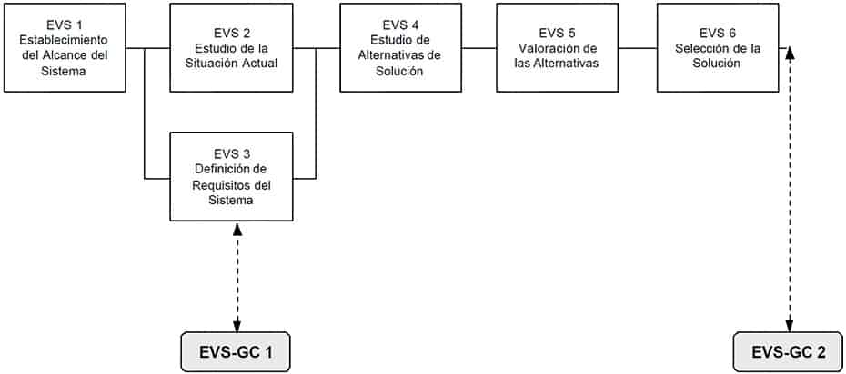
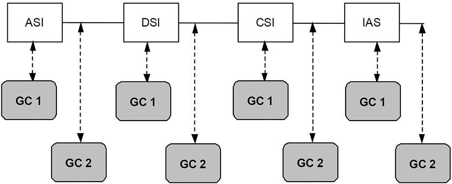

# Gestión de Configuración

## Descripción y Objetivos

En el desarrollo de software los cambios, debidos principalmente a modificaciones de requisitos y fallos, son inevitables. Normalmente se trabaja en equipo por lo que es preciso llevar un control y registro de los cambios con el fin de reducir errores, aumentar la calidad y la productividad y evitar los problemas que puede acarrear una incorrecta sincronización en dichos cambios, al afectar a otros elementos del sistema o a las tareas realizadas por otros miembros del equipo de proyecto.

El objetivo de la gestión de la configuración es mantener la integridad de los productos que se obtienen a lo largo del desarrollo de los sistemas de información, garantizando que no se realizan cambios incontrolados y que todos los participantes en el desarrollo del sistema disponen de la versión adecuada de los productos que manejan. Así, entre los elementos de configuración software, se encuentran no únicamente ejecutables y código fuente, sino también los modelos de datos, modelos de procesos, especificaciones de requisitos, pruebas, etc.

La gestión de configuración se realiza durante todas las actividades asociadas al desarrollo del sistema, y continua registrando los cambios hasta que éste deja de utilizarse.

La gestión de configuración facilita el mantenimiento del sistema, aportando información precisa para valorar el impacto de los cambios solicitados y reduciendo el tiempo de implementación de un cambio, tanto evolutivo como correctivo. Asimismo, permite controlar el sistema como producto global a lo largo de su desarrollo, obtener informes sobre el estado de desarrollo en que se encuentra y reducir el número de errores de adaptación del sistema, lo que se traduce en un aumento de calidad del producto, de la satisfacción del cliente y, en consecuencia, de mejora de la organización.

La interfaz de gestión de configuración de MÉTRICA Versión 3 permite definir las necesidades de gestión de configuración para cada sistema de información, recogiéndolas en un plan de gestión de configuración, en el que se especifican las actividades de identificación y registro de productos en el sistema de gestión de configuración durante el desarrollo y posterior mantenimiento del sistema de información.

Si en la organización ya existe un sistema de gestión de configuración estándar, para el sistema de información en concreto deberán analizarse las necesidades de configuración específicas respecto a dicho sistema estándar y determinar las diferencias, si las hubiera, así como aquellas necesidades concretas que no se encuentren recogidas, estableciendo así el plan de gestión de configuración del sistema de información.

Los productos registrados en el sistema de gestión de la configuración se encuentran identificados y localizados unívocamente, de manera que la información relativa a los productos es de fácil acceso.

La información que puede solicitarse al sistema de gestión de la configuración es variada:

    Información relacionada con Análisis, Diseño, Construcción, Implantación y Aceptación del Sistemas de Información, como productos globales que integran todos los productos que lo componen.
    Información de un producto en concreto, su versión, estado, traza de su evolución y cualquier dato que el plan de gestión de la configuración determine de interés (por ejemplo, participantes en la elaboración o modificación del producto).

Actividades

1. Estudio de Viabilidad del Sistema
   1. Actividad EVS-GC 1: Definición de los Requisitos de Gestión de Configuración
   2. Actividad EVS-GC 2: Establecimiento del Plan de Gestión de la Configuración
2. ANÁLISIS, DISEÑO, CONSTRUCCIÓN E IMPLANTACION Y ACEPTACIÓN DEL SISTEMA DE INFORMACIÓN
   1. Actividad GC 1: Identificación y Registro de Productos
   2. Actividad GC 2: Idetificación y Registro del Producto Global
3. MANTENIMIENTO DEL SISTEMA DE INFORMACIÓN
   1. Actividad MSI-GC 1: Registro del Cambio en el Sistema de Gestión de la Configuración

## Estudio de Viabilidad del Sistema

Durante el Estudio de Viabilidad del Sistema (EVS) se realizan las actividades de la interfaz de Gestión de Configuración que permiten obtener el Plan de Gestión de Configuración para el sistema de información. Con este objetivo se definen en primer término los requisitos de gestión de configuración del sistema de información, los cuales deberán tenerse en cuenta a la hora de establecer el plan de Gestión de Configuración para la Solución propuesta (EVS 6.2).

En el siguiente gráfico se muestra la relación entre las actividades del proceso Estudio de Viabilidad del Sistema (EVS) y las de la Gestión de la Configuración.



### Actividad EVS-GC 1: Definición de los Requisitos de Gestión de Configuración {#evs-gc-1}

```{=html}
<table class="avia-table avia-data-table">
<tbody>
<tr>
<td style="background-color: #000033; text-align: left; width: 25%;"><strong><span style="color: #ffffff;">TAREA</span></strong></td>
<td style="background-color: #000033; text-align: left; width: 30%;"><strong><span style="color: #ffffff;">PRODUCTOS</span></strong></td>
<td style="background-color: #000033; text-align: left; width: 25%;"><strong><span style="color: #ffffff;">TÉCNICAS Y PRÁCTICAS</span></strong></td>
<td style="background-color: #000033; text-align: left; width: 20%;"><strong><span style="color: #ffffff;">PARTICIPANTES</span></strong></td>
</tr>
<tr>
<td style="text-align: left; vertical-align: top;"><a href="#evs-gc-1-1"><strong>EVS-GC 1.1</strong>: Definición de los Requisitos de Gestión de Configuración</a></td>
<td style="text-align: left; vertical-align: top;">Requisitos de gestión de configuración</td>
<td style="text-align: left; vertical-align: top;"></td>
<td style="text-align: left; vertical-align: top;">
<ul>
<li><a href="../04-participantes/01-participantes.qmd#perfil-jefe-de-proyecto">Responsable de Gestión de Configuración</a></li>
<li><a href="../04-participantes/01-participantes.qmd#perfil-jefe-de-proyecto">Jefe de Proyecto</a></li>
<li><a href="../04-participantes/01-participantes.qmd#perfil-analista">Equipo de Desarrollo</a></li>
</ul>
</td>
</tr>
</tbody>
</table>
```

#### Tarea EVS-GC 1.1: Definición de los Requisitos de Gestión de Configuración {#evs-gc-1.1}

El objetivo de esta tarea es identificar la necesidad de gestionar la configuración de los sistemas de información, definiendo para dichos sistemas los requisitos generales de gestión de configuración y determinando los procesos de control que se van a llevar a cabo para mantener la integridad de los productos que se obtengan a lo largo de los procesos principales de MÉTRICA Versión 3: control de versiones, control de estados, control de los cambios, etc.
Productos

De entrada

    Arquitectura de Información (PSI 9.2)
    Identificación de Requisitos (EVS 3.2)

De salida

    Requisitos de gestión de configuración

Participantes

    Responsable de Gestión de Configuración
    Jefe de Proyecto
    Equipo de Desarrollo

### Actividad EVS-GC 2: Establecimiento del Plan de Gestión de la Configuración {#evs-gc-2}

```{=html}
<table class="avia-table avia-data-table">
<tbody>
<tr>
<td style="background-color: #000033; text-align: left; width: 25%;"><strong><span style="color: #ffffff;">TAREA</span></strong></td>
<td style="background-color: #000033; text-align: left; width: 30%;"><strong><span style="color: #ffffff;">PRODUCTOS</span></strong></td>
<td style="background-color: #000033; text-align: left; width: 25%;"><strong><span style="color: #ffffff;">TÉCNICAS Y PRÁCTICAS</span></strong></td>
<td style="background-color: #000033; text-align: left; width: 20%;"><strong><span style="color: #ffffff;">PARTICIPANTES</span></strong></td>
</tr>
<tr>
<td style="text-align: left; vertical-align: top;"><a href="#evs-gc-2-1"><strong>EVS-GC 2.1</strong>: Definición del Plan de Gestión de la Configuración</a></td>
<td style="text-align: left; vertical-align: top;">
<ul>
<li>Plan de gestión de la configuración para el sistema de información</li>
</ul>
</td>
<td style="text-align: left; vertical-align: top;"></td>
<td style="text-align: left; vertical-align: top;">
<ul>
<li><a href="../04-participantes/01-participantes.qmd#perfil-jefe-de-proyecto">Responsable de Gestión de Configuración</a></li>
<li><a href="../04-participantes/01-participantes.qmd#perfil-jefe-de-proyecto">Jefe de Proyecto</a></li>
<li><a href="../04-participantes/01-participantes.qmd#perfil-analista">Equipo de Desarrollo</a></li>
</ul>
</td>
</tr>
<tr>
<td style="text-align: left; vertical-align: top;"><a href="#evs-gc-2-2"><strong>EVS-GC 2.2</strong>: Especificación del Entorno Tecnológico para la Gestión de Configuración</a></td>
<td style="text-align: left; vertical-align: top;">
<ul>
<li>Plan de gestión de la configuración para el sistema de información</li>
</ul>
</td>
<td style="text-align: left; vertical-align: top;"></td>
<td style="text-align: left; vertical-align: top;">
<ul>
<li><a href="../04-participantes/01-participantes.qmd#perfil-jefe-de-proyecto">Responsable de Gestión de Configuración</a></li>
<li><a href="../04-participantes/01-participantes.qmd#perfil-analista">Equipo de Desarrollo</a></li>
</ul>
</td>
</tr>
</tbody>
</table>
```

#### Tarea EVS-GC 2.1: Definición del Plan de Gestión de la Configuración {#evs-gc-2-1}

En el caso de que exista un método de gestión de la configuración o un estándar corporativo, debe indicarse si se toma como plan de gestión de la configuración, es decir, si el método cubre todos los requisitos para el sistema de información que se trata.

Si éste no existe, o no cubre todos los requisitos, es necesario establecer cuáles son estas necesidades y elaborar un plan de gestión de la configuración propio para el sistema de información. En el caso de que sí exista pero no cubra todas las necesidades de configuración del sistema de información, este plan deberá definir solamente las diferencias respecto al estándar.

Los aspectos que debe contemplar el plan son:

    Identificación de todos los productos que deben ser controlados, su clasificación y relaciones entre ellos, así como el criterio o norma de identificación.
    Ubicación y localización de los productos.
    Definición del ámbito y alcance del control de la configuración, describiendo los procesos incluidos en él.
    Definición de las reglas de versionado de los productos y los criterios de actuación para cada caso, teniendo en cuenta el motivo por el cual se realiza el cambio de versión.
    Definición del ciclo de estados para cada tipo de producto y los criterios de trazabilidad entre los mismos.
    Descripción de funciones y responsabilidades.
    Identificación de la información necesaria de control para auditoría.

Productos

De entrada

    Requisitos generales de gestión de configuración (EVS-GC 1.1)
    Método o estándar de gestión de la configuración (externo)
    Solución propuesta (EVS 6.2)

De salida

    Plan de gestión de la configuración para el sistema de información

Participantes

    Responsable de Gestión de Configuración
    Jefe de Proyecto
    Equipo de Desarrollo

#### Tarea EVS-GC 2.2: Especificación del Entorno Tecnológico para la Gestión de Configuración {#evs-gc-2-2}

En esta tarea se define el entorno tecnológico de soporte a la gestión de la configuración del sistema de información y se determinan los componentes hardware y software que van a permitir la mecanización de los procesos y controles que establece el plan. Es importante mencionar que el entorno tecnológico en el que se apoyará el sistema de gestión de la configuración puede ser diferente de aquel en el que se desarrollará el sistema de información.
Productos

De entrada

    Plan de gestión de la configuración para el sistema de información (EVS-GC 2.1)

De salida

    Plan de gestión de la configuración para el sistema de información
        Entorno tecnológico

Participantes

    Responsable de Gestión de Configuración
    Equipo de Desarrollo

## Análisis, diseño, construcción e implantación y aceptación del Sistema de Información

Durante los procesos de Análisis, Diseño, Construcción e Implantación del Sistema de Información se realizan las actividades de identificación y registro previstas en el Plan de Gestión de Configuración, consiguiendo así mantener la consistencia entre las distintas versiones de los productos de desarrollo.

Las actividades de identificación y registro interactúan continuamente con las propias actividades de MÉTRICA Versión 3, controlando y gestionando sus productos y estableciendo versiones de los mismos hasta que el producto se encuentra correctamente finalizado y aceptado. Según se van generando los productos a lo largo de las actividades de un proceso, se registran en el sistema de gestión de la configuración con el estado correspondiente.

En el Plan de Gestión de Configuración se han establecido, para cada uno de los procesos de desarrollo, los productos sobre los que se va a aplicar la gestión de configuración. Además, también se considera producto a mantener en el sistema de gestión de configuración el producto global resultante en cada proceso.

Durante la realización de las distintas actividades, los productos obtenidos en MÉTRICA Versión 3, en función de su naturaleza, van pasando por distintos estados, registrándose en el sistema de gestión de la configuración. No todos los productos pasan por los mismos estados, el Plan de Gestión de Configuración especifica el conjunto de estados posibles para cada uno, entre los que como mínimo deben figurar: en elaboración, finalizado, revisado y aceptado; y la política de versionado de los productos.

Todos los productos que forman parte o intervienen en el desarrollo de un sistema de información y que hayan sido seleccionados como elementos de configuración en el plan de gestión de la configuración, deben denominarse de manera que cada uno de ellos sea perfectamente identificable de forma única. La identificación de los productos se realiza cuando aparecen por primera vez en el sistema de gestión de la configuración, registrándose como la primera versión del producto en el estado que establezca el Plan de Gestión de Configuración.

Antes de ser aceptado, un producto puede sufrir numerosos cambios, e incluso después puede ocurrir que tenga que ser modificado. Esto implica que el producto sea registrado en el SGC con una nueva versión y en el estado correspondiente, de manera que entra de nuevo en un proceso de cambio hasta que concluya su ciclo de estados.

Otro nivel de control establecido por la gestión de configuración es el control de procesos, que facilita el conocer la situación de un sistema de información a lo largo de su desarrollo. Para establecer adecuadamente este control, las actividades de gestión de configuración, como ya se ha mencionado, registran el conjunto de productos que se obtiene al final de un proceso como un producto más, de esta forma se le pueden atribuir estados que permiten controlar el desarrollo del sistema a nivel de procesos.

El siguiente gráfico muestra la relación entre las actividades de la interfaz de gestión de configuración y los procesos de desarrollo de MÉTRICA Versión 3.



### Actividad GC 1: Identificación y registro de Productos {#gc-1}

```{=html}
<table class="avia-table avia-data-table">
<tbody>
<tr>
<td style="background-color: #000033; text-align: left; width: 25%;"><strong><span style="color: #ffffff;">TAREA</span></strong></td>
<td style="background-color: #000033; text-align: left; width: 30%;"><strong><span style="color: #ffffff;">PRODUCTOS</span></strong></td>
<td style="background-color: #000033; text-align: left; width: 25%;"><strong><span style="color: #ffffff;">TÉCNICAS Y PRÁCTICAS</span></strong></td>
<td style="background-color: #000033; text-align: left; width: 20%;"><strong><span style="color: #ffffff;">PARTICIPANTES</span></strong></td>
</tr>
<tr>
<td style="text-align: left; vertical-align: top;"><a href="#gc-1-1"><strong>GC 1.1</strong>: Identificación y Registro de los Productos de los Procesos en el Sistema de Gestión de la Configuración</a></td>
<td style="text-align: left; vertical-align: top;">Registro de los productos creados o modificados:</p>
<ul>
<li>Nombre</li>
<li>Versión</li>
<li>Estado</li>
<li>Localización</li>
</ul>
</td>
<td style="text-align: left; vertical-align: top;"></td>
<td style="text-align: left; vertical-align: top;">
<ul>
<li>Los mismos que en las tareas de Métrica Versión 3</li>
</ul>
</td>
</tr>
</tbody>
</table>
```

#### Tarea GC 1.1: Identificación y Registro de los Productos de los Procesos en el Sistema de Gestión de la Configuración {#gc-1-1}

Cada producto, en función de su naturaleza, va pasando por diferentes estados en los debe superar varias revisiones o aprobaciones. El conjunto de estados por los que va pasando un producto se registra en el sistema de gestión de configuración, según vaya evolucionando el mismo, hasta alcanzar el estado de producto final aprobado.

En el momento en que un participante genere un producto, seleccionado como elemento de configuración en el Plan de Gestión de Configuración, deberá identificarlo y registrarlo en el sistema de gestión de la configuración. Del mismo modo, cuando modifique un producto que ya está registrado en el sistema de gestión de configuración, deberá incluirlo en el sistema de gestión de configuración indicando su versión y estado.
Productos

De entrada

    Información sobre el producto (externo).
    Registro del sistema de gestión de configuración de los productos resultantes de la tarea de MÉTRICA Versión 3 que se esté realizando (externo)
        Nombre
        Versión
        Estado
        Localización

De salida

    Registro de los productos creados o modificados:
        Nombre
        Versión
        Estado
        Localización

Participantes

    Los mismos que en las tareas de MÉTRICA Versión 3

### Actividad GC 2: Identificación y registro del Producto Global {#gc-2}

```{=html}
<table class="avia-table avia-data-table">
<tbody>
<tr>
<td style="background-color: #000033; text-align: left; width: 25%;"><strong><span style="color: #ffffff;">TAREA</span></strong></td>
<td style="background-color: #000033; text-align: left; width: 30%;"><strong><span style="color: #ffffff;">PRODUCTOS</span></strong></td>
<td style="background-color: #000033; text-align: left; width: 25%;"><strong><span style="color: #ffffff;">TÉCNICAS Y PRÁCTICAS</span></strong></td>
<td style="background-color: #000033; text-align: left; width: 20%;"><strong><span style="color: #ffffff;">PARTICIPANTES</span></strong></td>
</tr>
<tr>
<td style="text-align: left; vertical-align: top;"><a href="#gc-2-1"><strong>GC 2.1</strong>: Registro en el Sistema de Gestión de la Configuración del Producto Global de Proceso</a></td>
<td style="text-align: left; vertical-align: top;">Registro del producto global:</p>
<ul>
<li>Nombre</li>
<li>Versión</li>
<li>Estado</li>
<li>Localización</li>
</ul>
</td>
<td style="text-align: left; vertical-align: top;"></td>
<td style="text-align: left; vertical-align: top;">
<ul>
<li><a href="../04-participantes/01-participantes.qmd#perfil-jefe-de-proyecto">Jefe de Proyecto</a></li>
</ul>
</td>
</tr>
</tbody>
</table>
```

### Tarea GC 2.1: Registro en el Sistema de Gestión de la Configuración del Producto Global de Proceso {#gc-2-1}

El objeto de esta tarea es identificar y registrar en el sistema de gestión de la configuración los productos globales que se obtienen a lo largo del desarrollo de los procesos principales.

Se realiza al finalizar los procesos Análisis del Sistema de Información (ASI), Diseño del Sistema de Información (DSI), Construcción del Sistema de Información (CSI) e Implantación y Aceptación del Sistema (IAS), y en cada momento se registrará el producto correspondiente: Especificación de Requisitos Software, Diseño Detallado del Sistema, Sistema de Información y Sistema de Información Implantado.

Una vez que el sistema de información está implantado y aceptado, antes de su puesta en operación real se registra el paso a producción de la versión de dicho sistema de cara a facilitar su posterior mantenimiento.
Productos

De entrada

    Información sobre el producto, si éste no se encuentra registrado en el sistema de gestión de la configuración (externo).
    Registro de la versión del producto global, si ya está registrado en el sistema de gestión de la configuración

De salida

    Registro del producto global:
        Nombre
        Versión
        Estado
        Localización

Participantes

    Jefe de Proyecto

## Mantenimiento del Sistema de Información

El objetivo de la interfaz de gestión de configuración con el proceso de Mantenimiento del Sistema de Información, es conservar la integridad del sistema de información cuando se producen cambios en el mismo, ya sea por la realización de mantenimiento correctivo o evolutivo. En el caso del mantenimiento adaptativo y perfectivo el objetivo es el mismo, aunque estos tipos de mantenimiento quedan fuera del ámbito de MÉTRICA Versión 3, por lo que no van a ser tratados en este documento.

El beneficio de una buena gestión de configuración en el proceso de mantenimiento es muy elevado, teniendo en cuenta la reducción del tiempo de localización de los problemas, la reproducción de errores y el control y seguimiento de los estados por los que va pasando la petición de mantenimiento. De esta manera se puede conocer en cada momento la situación en la que se encuentra cada cambio en particular y el sistema de información en general.

La interfaz de gestión de configuración en el proceso de mantenimiento es fundamental, al realizarse el control del cambio desde que se produce la notificación del mismo o de la incidencia, momento en el que se registra la solicitud de mantenimiento en el sistema de gestión de la configuración, hasta que la solución es aceptada por el usuario.

Para realizar el análisis de la petición en MSI 2 es conveniente solicitar información al sistema de gestión de la configuración para identificar las versiones de los sistemas de información afectados por la petición.

Una vez que ha sido aceptada la propuesta de solución se realiza un registro del cambio en el sistema de gestión de configuración con la información obtenida del mismo relativa a las versiones de los sistemas de información y productos afectados por el cambio. Este registro constituye el nexo de unión entre la petición o peticiones de mantenimiento y los cambios que se van a realizar sobre los sistemas de información afectados. Recoge datos referentes a las versiones de los sistemas de información de los que se parte y cuáles van a ser las nuevas versiones generadas, así como las versiones de los productos concretos afectados por el cambio y cuál será la nueva versión de dichos productos. También debe registrarse en el sistema de gestión de la configuración la nueva versión de los sistemas de información y de los productos según el criterio de versionado establecido en el plan de gestión de la configuración.

A partir de este momento, se realizan las actividades de los procesos Análisis del Sistema de Información (ASI), Diseño del Sistema de Información (DSI), Construcción del Sistema de Información (CSI) e Implantación y Aceptación del Sistema (IAS) que se determinen en la actividad Registro del Cambio en el Sistema de Gestión de la Configuración (MSI-GC 1), así como las actividades de interfaz de la gestión de configuración definidas en los procesos de desarrollo.

Una vez que el cambio ha sido realizado y aceptado se registra dicha aceptación en el sistema de gestión de la configuración.

### Actividad MSI-GC 1: Registro del Cambio en el Sistema de Gestión de la Configuración {#msi-gc-1}

```{=html}
<table class="avia-table avia-data-table">
<tbody>
<tr>
<td style="background-color: #000033; text-align: left; width: 25%;"><strong><span style="color: #ffffff;">TAREA</span></strong></td>
<td style="background-color: #000033; text-align: left; width: 30%;"><strong><span style="color: #ffffff;">PRODUCTOS</span></strong></td>
<td style="background-color: #000033; text-align: left; width: 25%;"><strong><span style="color: #ffffff;">TÉCNICAS Y PRÁCTICAS</span></strong></td>
<td style="background-color: #000033; text-align: left; width: 20%;"><strong><span style="color: #ffffff;">PARTICIPANTES</span></strong></td>
</tr>
<tr>
<td style="text-align: left; vertical-align: top;"><a href="#msi-gc-1-1"><strong>MSI-GC 1.1</strong>: Registro del Cambio en el Sistema de Gestión de la Configuración</a></td>
<td style="text-align: left; vertical-align: top;">
<ul>
<li>Registro del cambio</li>
</ul>
</td>
<td style="text-align: left; vertical-align: top;"></td>
<td style="text-align: left; vertical-align: top;">
<ul>
<li>Técnico de Mantenimiento</li>
</ul>
</td>
</tr>
<tr>
<td style="text-align: left; vertical-align: top;"><a href="#msi-gc-1-2"><strong>MSI-GC 1.2</strong>: Registro de la Nueva Versión de los Productos Afectados por el Cambio en el Sistema de Gestión de la Configuración</a></td>
<td style="text-align: left; vertical-align: top;">
<ul>
<li>Registro de la nueva versión de los productos afectados por el cambio</li>
</ul>
</td>
<td style="text-align: left; vertical-align: top;"></td>
<td style="text-align: left; vertical-align: top;">
<ul>
<li>Técnico de Mantenimiento</li>
</ul>
</td>
</tr>
<tr>
<td style="text-align: left; vertical-align: top;"><a href="#msi-gc-1-3"><strong>MSI-GC 1.3</strong>: Registro de la Nueva Versión de los Sistemas de Información en el Sistema de Gestión de la Configuración</a></td>
<td style="text-align: left; vertical-align: top;">
<ul>
<li>Registro de la nueva versión de los sistemas de información</li>
</ul>
</td>
<td style="text-align: left; vertical-align: top;"></td>
<td style="text-align: left; vertical-align: top;">
<ul>
<li>Técnico de Mantenimiento</li>
</ul>
</td>
</tr>
</tbody>
</table>
```

#### Tarea MSI-GC 1.1: Registro del Cambio en el Sistema de Gestión de la Configuración {#msi-gc-1-1}

Una vez aprobada la propuesta de solución se registra el cambio en el sistema de gestión de la configuración. Este registro refleja las peticiones de mantenimiento que van a ser atendidas con la realización del cambio. Debe indicarse cuáles son las versiones de los sistemas de información y de los productos de las que parte el cambio, y siguiendo el criterio de versionado, cuáles son las nuevas versiones de los mismos que se van a generar como consecuencia de la realización del cambio. La información mantenida en este registro permite en todo momento efectuar una traza de la evolución del sistema y los productos que lo integran desde su puesta en producción como consecuencia de la realización de cambios.
Productos

De entrada

    Catálogo de peticiones (MSI 3)

De salida

    Registro del cambio

Participantes

    Técnico de Mantenimiento

#### Tarea MSI-GC 1.2: Registro de la Nueva Versión de los Productos Afectados por el Cambio en el Sistema de Gestión de la Configuración {#msi-gc-1-2}

Los productos que hayan sido modificados o creados con motivo de la realización del mantenimiento deben registrarse en el sistema de gestión de la configuración en la versión correspondiente. La nueva versión de estos componentes, comienza su ciclo de estados, de manera que deben registrarse en el estado que establezca el plan de gestión de la configuración.
Productos

De entrada

    Registro de la versión correspondiente de los productos que van a ser modificados

De salida

    Registro de la nueva versión de los productos afectados por el cambio

Participantes

    Técnico de Mantenimiento

#### Tarea MSI-GC 1.3: Registro de la Nueva Versión de los Sistemas de Información en el Sistema de Gestión de la Configuración {#msi-gc-1-3}

La realización de un cambio, bien por mantenimiento correctivo o evolutivo, provoca la aparición de una nueva versión de cada sistema de información afectado por el cambio, por lo que debe registrarse en el sistema de gestión de la configuración con la versión y estado correspondiente según establezca el plan de gestión de la configuración.
Productos

De entrada

    Registro de la versión de los sistemas de información de la que parte el cambio

De salida

    Registro de la nueva versión de los sistemas de información

Participantes

    Técnico de Mantenimiento
