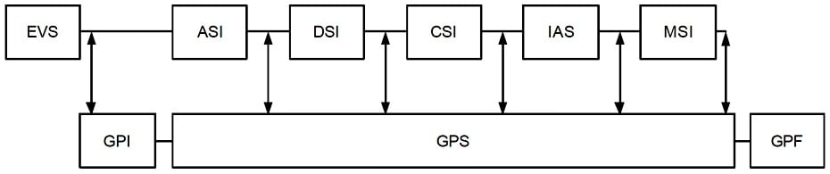
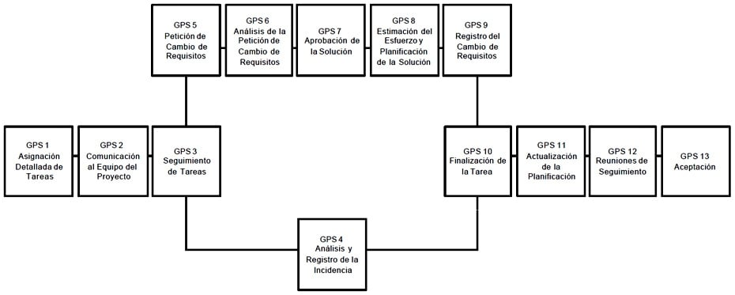

# Gestión de Proyectos

## Descripción y Objetivos

La Gestión de Proyectos tiene como finalidad principal la planificación, el seguimiento y control de las actividades y de los recursos humanos y materiales que intervienen en el desarrollo de un Sistema de Información. Como consecuencia de este control es posible conocer en todo momento qué problemas se producen y resolverlos o paliarlos de manera inmediata.

La Interfaz de Gestión de Proyectos de MÉTRICA Versión 3 contempla proyectos de desarrollo de Sistemas de Información en sentido amplio. Es decir, acorde con EUROMÉTODO se consideran proyectos de desarrollo de nuevos Sistemas de Información y también los proyectos de ampliación y mejora de los ya existentes; estos últimos, contemplados en MÉTRICA Versión 3 al proceso de Mantenimiento del Sistema de Información (MSI).

Las actividades de la Interfaz de Gestión de Proyectos se presentan en el siguiente esquema, en el que se aprecian las áreas que cubre. Se distinguen tres grupos de actividades:

    Actividades de Inicio del Proyecto (GPI). Al principio del proyecto, al concluir el proceso Estudio de Viabilidad del Sistema (EVS), se realizarán las actividades de Estimación de Esfuerzo y Planificación del proyecto.
    Actividades de Seguimiento y Control (GPS). Comprenden desde la asignación de las tareas hasta su aceptación interna por parte del equipo de proyecto, incluyendo la gestión de incidencias y cambios en los requisitos que puedan presentarse y afectar a la planificación del proyecto. El Seguimiento y Control del proyecto se realizan durante los procesos de Análisis, Diseño, Construcción, Implantación y Aceptación, y Mantenimiento del Sistema de Información, para vigilar el correcto desarrollo de las actividades y tareas establecidas en la planificación.
    Actividades de Finalización del Proyecto (GPF). Por último, al concluir el proyecto se realizan las tareas propias de Cierre del Proyecto y Registro de la Documentación de Gestión.

Las técnicas y prácticas utilizadas en la Gestión de Proyectos se describen en la Guía de Técnicas de MÉTRICA Versión 3. En función de las características del proyecto puede ser aconsejable emplear herramientas software de soporte a las técnicas, disponibles en el mercado.



## Actividades de Inicio del Proyecto

Las actividades al inicio de un proyecto tienen un doble objetivo: estimar el esfuerzo a realizar para desarrollar el sistema y planificar las actividades de dicho desarrollo. Para ello, tomando como punto de partida la Solución Propuesta en el Estudio de Viabilidad del Sistema (EVS 6), se identifican los elementos a desarrollar, se calcula el esfuerzo a realizar, y se planifican las actividades del proyecto comprendiendo los aspectos de recursos, programación de tareas y establecimiento de un calendario de entregas y recepciones entre el cliente y los proveedores.

Actividades

    Actividad GPI 1: Estimación de Esfuerzo
    Actividad GPI 2: Planificación

### Actividad GPI 1: Estimación de Esfuerzo {#gpi-1}

El objetivo de esta actividad es conocer el tamaño aproximado del sistema a desarrollar, y establecer el coste, la duración y los recursos necesarios para conseguir desarrollarlo.

Es muy difícil calcular con absoluta precisión el esfuerzo requerido para desarrollar cualquier proyecto informático, debido a la gran cantidad de factores que intervienen en su realización, algunos de ellos inciertos o desconocidos. Sin embargo, las técnicas existentes para realizar los cálculos proporcionan un valor aproximado suficiente para el alcance del desarrollo del proyecto. Será siempre útil la experiencia anterior que hubiese, extraída de la realización de proyectos similares en la organización, así como la existencia de una base de datos con información relativa a métricas, en el sentido del término en ingeniería del software.

Esta actividad se compone de las tareas que aparecen en la siguiente tabla.

```{=html}
<table class="avia-table avia-data-table">
<tbody>
<tr>
<td style="background-color: #000033; text-align: left; width: 25%;"><strong><span style="color: #ffffff;">TAREA</span></strong></td>
<td style="background-color: #000033; text-align: left; width: 30%;"><strong><span style="color: #ffffff;">PRODUCTOS</span></strong></td>
<td style="background-color: #000033; text-align: left; width: 25%;"><strong><span style="color: #ffffff;">TÉCNICAS Y PRÁCTICAS</span></strong></td>
<td style="background-color: #000033; text-align: left; width: 20%;"><strong><span style="color: #ffffff;">PARTICIPANTES</span></strong></td>
</tr>
<tr>
<td style="text-align: left; vertical-align: top;"><a href="#gpi-1-1"><strong>GPI 1.1</strong>: Identificación de Elementos a Desarrollar</a></td>
<td style="text-align: left; vertical-align: top;">Definición General del Proyecto:<br/>
<em><strong>Estructurado</strong></em></p>
<ul>
<li>Catálogo de funciones</li>
<li>Catálogo de entidades</li>
</ul>
<p><em><strong>Orientación a Objeto</strong></em></p>
<ul>
<li>Catálogo de clases</li>
</ul>
</td>
<td style="text-align: left; vertical-align: top;">
<ul>
<li><a href="../03-tecnicas/01-tecnicas.qmd#catalogacion">Catalogación</a></li>
</ul>
</td>
<td style="text-align: left; vertical-align: top;">
<ul>
<li><a href="../04-participantes/01-participantes.qmd#perfil-jefe-de-proyecto">Jefe de Proyecto</a></li>
</ul>
</td>
</tr>
<tr>
<td style="text-align: left; vertical-align: top;"><a href="#gpi-1-2"><strong>GPI 1.2</strong>: Cálculo del Esfuerzo</a></td>
<td style="text-align: left; vertical-align: top;">Definición General del Proyecto:</p>
<ul>
<li>Esfuerzo estimado</li>
</ul>
</td>
<td style="text-align: left; vertical-align: top;">
<ul>
<li><a href="../03-tecnicas/01-tecnicas.qmd#tecnicas-de-estimacion">Estimación</a></li>
</ul>
</td>
<td style="text-align: left; vertical-align: top;">
<ul>
<li><a href="../04-participantes/01-participantes.qmd#perfil-jefe-de-proyecto">Jefe de Proyecto</a></li>
<li><a href="../04-participantes/01-participantes.qmd#perfil-analista">Equipo del Proyecto</a></li>
</ul>
</td>
</tr>
</tbody>
</table>
```

#### Tarea GPI 1.1: Identificación de Elementos a Desarrollar {#gpi-1-1}

Esta tarea tiene como finalidad determinar el número y características de los elementos a desarrollar a partir del Modelo de descomposición en subsistemas de la alternativa seleccionada (EVS 6.2), para el posterior cálculo del esfuerzo necesario para ello. En el caso de los desarrollos estructurados habrán de tenerse en cuenta las funciones, entidades, datos de entrada y datos de salida. En el caso de desarrollos orientados a objeto se tendrán en cuenta las clases, propiedades y métodos asociados.
Productos

De entrada

    Modelo de descomposición en subsistemas (EVS 6.2)

Estructurado

    Modelo abstracto de datos (EVS 6.2)
    Modelo de procesos (EVS 6.2)

Orientación a Objeto

    Modelo de negocio (EVS 6.2)
    Modelo de dominio (EVS 6.2)

De salida

    Definición General del proyecto

Estructurado

    Catálogo de funciones
    Catálogo de entidades

Orientación a Objeto

    Catálogo de clases

Prácticas

    Catalogación

Participantes

    Jefe de Proyecto

#### Tarea GPI 1.2: Cálculo del Esfuerzo {#gpi-1-2}

Una vez identificados los elementos a desarrollar se utilizará la técnica de estimación apropiada para calcular el esfuerzo necesario para su desarrollo. Deben tenerse en cuenta también trabajos que no están encaminados directamente al desarrollo de elementos del proyecto, pero que van a influir en el esfuerzo necesario para su realización. Se obtendrá el esfuerzo estimado en horas distribuidas por procesos.

La técnica que se propone variará según se trate de desarrollos orientados a objetos o estructurados. Si el desarrollo es estructurado se pueden emplear el Método Albrecht o el Método MARK II para el Análisis de los Puntos Función. En el caso de orientación a objetos, se pueden aplicar las métricas de estimación del esfuerzo Staffing Size. En la Guía de Técnicas de MÉTRICA Versión 3 puede consultarse información detallada sobre estas técnicas.
Productos

De entrada

Estructurado

    Catálogo de funciones (GPI 1.1)
    Catálogo de entidades (GPI 1.1)

Orientación a Objeto

    Catálogo de clases (GPI 1.1)

De salida

    Definición General del Proyecto
        Esfuerzo estimado

Técnicas

Estructurado

    Método de Albrecht
    Método MARK II

Orientación a Objeto

    Staffing Size

Participantes

    Jefe de Proyecto
    Equipo del Proyecto

### Actividad GPI 2: Planificación {#gpi-2}

El objetivo de esta actividad es definir y preparar las condiciones de trabajo, estableciendo recursos, fechas y costes, para lograr los objetivos que se persiguen con el proyecto.

La planificación de un proyecto establece las fechas previstas para la realización del conjunto de actividades que lo componen, teniendo en cuenta que se deben emplear para ello unos recursos que implican unos costes, estimados inicialmente en EVS 5.1, cuyo conjunto forma el presupuesto base para lograr el resultado comprometido con el Cliente o Usuario. Así mismo deberán reflejarse hitos y calendario de entregas de productos al cliente.

La actividad de Planificación se compone de las tareas que aparecen en la siguiente tabla.

```{=html}
<table class="avia-table avia-data-table">
<tbody>
<tr>
<td style="background-color: #000033; text-align: left; width: 25%;"><strong><span style="color: #ffffff;">TAREA</span></strong></td>
<td style="background-color: #000033; text-align: left; width: 30%;"><strong><span style="color: #ffffff;">PRODUCTOS</span></strong></td>
<td style="background-color: #000033; text-align: left; width: 25%;"><strong><span style="color: #ffffff;">TÉCNICAS Y PRÁCTICAS</span></strong></td>
<td style="background-color: #000033; text-align: left; width: 20%;"><strong><span style="color: #ffffff;">PARTICIPANTES</span></strong></td>
</tr>
<tr>
<td style="text-align: left; vertical-align: top;"><a href="#gpi-2-1"><strong>GPI 2.1</strong>: Selección de la Estrategia de Desarrollo</a></td>
<td style="text-align: left; vertical-align: top;">
<ul>
<li>Planificación General del Proyecto:
<ul>
<li>Estrategia de desarrollo</li>
</ul>
</li>
</ul>
</td>
<td style="text-align: left; vertical-align: top;"></td>
<td style="text-align: left; vertical-align: top;">
<ul>
<li><a href="../04-participantes/01-participantes.qmd#perfil-jefe-de-proyecto">Jefe de Proyecto</a></li>
</ul>
</td>
</tr>
<tr>
<td style="text-align: left; vertical-align: top;"><a href="#gpi-2-2"><strong>GPI 2.2</strong>: Selección de la Estructura de Actividades, Tareas y Productos</a></td>
<td style="text-align: left; vertical-align: top;">
<ul>
<li>Planificación General del Proyecto:
<ul>
<li>Estructura de actividades</li>
</ul>
</li>
<li>Catálogo de productos a generar</li>
</ul>
</td>
<td style="text-align: left; vertical-align: top;">
<ul>
<li><a href="../03-tecnicas/01-tecnicas.qmd#wbs">Estructura de Descomposición de Trabajo</a></li>
<li><a href="../03-tecnicas/01-tecnicas.qmd#catalogacion">Catalogación</a></li>
</ul>
</td>
<td style="text-align: left; vertical-align: top;">
<ul>
<li><a href="../04-participantes/01-participantes.qmd#perfil-jefe-de-proyecto">Jefe de Proyecto</a></li>
</ul>
</td>
</tr>
<tr>
<td style="text-align: left; vertical-align: top;"><a href="#gpi-2-3"><strong>GPI 2.3</strong>: Establecimiento del Calendario de Hitos y Entregas</a></td>
<td style="text-align: left; vertical-align: top;">
<ul>
<li>Planificación General del Proyecto:
<ul>
<li>Hitos del proyecto</li>
<li>Productos a entregar</li>
</ul>
</li>
</ul>
</td>
<td style="text-align: left; vertical-align: top;">
<ul>
<li><a href="../03-tecnicas/01-tecnicas.qmd#planificacion">Planificación</a></li>
<li><a href="../03-tecnicas/01-tecnicas.qmd#catalogacion">Catalogación</a></li>
</ul>
</td>
<td style="text-align: left; vertical-align: top;">
<ul>
<li><a href="../04-participantes/01-participantes.qmd#perfil-jefe-de-proyecto">Jefe de Proyecto</a></li>
</ul>
</td>
</tr>
<tr>
<td style="text-align: left; vertical-align: top;"><a href="#gpi-2-4"><strong>GPI 2.4</strong>: Planificación Detallada de Actividades y Recursos Necesarios</a></td>
<td style="text-align: left; vertical-align: top;">
<ul>
<li>Planificación General del Proyecto:
<ul>
<li>Organización de los recursos</li>
<li>Planificación detallada del Proyecto</li>
</ul>
</li>
</ul>
</td>
<td style="text-align: left; vertical-align: top;">
<ul>
<li><a href="../03-tecnicas/01-tecnicas.qmd#planificacion">Planificación</a></li>
</ul>
</td>
<td style="text-align: left; vertical-align: top;">
<ul>
<li><a href="../04-participantes/01-participantes.qmd#perfil-jefe-de-proyecto">Jefe de Proyecto</a></li>
</ul>
</td>
</tr>
<tr>
<td style="text-align: left; vertical-align: top;"><a href="#gpi-2-5"><strong>GPI 2.5</strong>: Presentación y Aceptación de la Planificación General del Proyecto</a></td>
<td style="text-align: left; vertical-align: top;">
<ul>
<li>Aceptación de la Planificación General del Proyecto</li>
</ul>
</td>
<td style="text-align: left; vertical-align: top;">
<ul>
<li><a href="../03-tecnicas/01-tecnicas.qmd#presentaciones">Presentación</a></li>
</ul>
</td>
<td style="text-align: left; vertical-align: top;">
<ul>
<li><a href="../04-participantes/01-participantes.qmd#perfil-jefe-de-proyecto">Jefe de Proyecto</a></li>
<li><a href="../04-participantes/01-participantes.qmd#perfil-directivo">Comité de Seguimiento</a></li>
</ul>
</td>
</tr>
</tbody>
</table>
```

#### Tarea GPI 2.1: Selección de la Estrategia de Desarrollo {#gpi-2-1}

El objetivo de esta tarea es elegir la estrategia de desarrollo más adecuada al proyecto. Mientras que la metodología especifica procesos, actividades, tareas y productos a obtener en cada una de ellas, la estrategia de desarrollo es el enfoque a utilizar para establecer cómo debe organizarse el proyecto.

MÉTRICA Versión 3 no establece recomendaciones en cuanto a la estrategia a seguir en un proyecto, dejando que sea el Jefe de Proyecto quien determine la estrategia más adecuada en función de las características del proyecto, tales como su criticidad, tamaño y complejidad.

EUROMÉTODO ofrece una buena aproximación a distintas estrategias de desarrollo, que pueden servir a título orientativo:

    Clásica o en cascada. Es la opción estratégica “Construcción de una vez” de EUROMÉTODO. Se considera el proyecto como un todo, dividido en procesos, y cada proceso no comienza hasta que finaliza el anterior. Por ejemplo: el Diseño del Sistema de Información no se realiza hasta la finalización y aceptación del Análisis del Sistema de Información. Éste es el método más empleado en desarrollo estructurado.
    Por subsistemas. En EUROMÉTODO esta estrategia se conoce como “Construcción incremental”. Se divide el sistema en subsistemas semiindependientes, con estructura, organización y objetivos diferentes. A su vez, el equipo de proyecto se puede dividir en equipos especializados. Cada subsistema, normalmente, se realizará según la estrategia clásica.
    Por prototipo. También denominado “Construcción evolutiva” en EUROMÉTODO. Esta aproximación genera un prototipo funcional en los primeros procesos del proyecto, generalmente con herramientas de ayuda al desarrollo o generadores de código. El prototipo se va completando en sucesivas evaluaciones y revisiones, añadiendo nuevas funcionalidades y mejoras, hasta cubrir los requisitos completamente. Generalmente, esta estrategia se emplea en los modernos desarrollos orientados a objetos.
    Híbrida. Contempla un desarrollo por subsistemas, que a su vez se desarrollan bajo una estrategia o enfoque diferente de los demás.

Productos

De entrada

    Planificación General del Proyecto (GPI 1.2)

De salida

    Planificación General del Proyecto:
        Estrategia de Desarrollo

Participantes

    Jefe de Proyecto


#### Tarea GPI 2.2: Selección de la Estructura de Actividades, Tareas y Productos {#gpi-2-2}

La estructura de procesos, actividades y tareas que se presenta en MÉTRICA Versión 3 abarca el desarrollo completo de sistemas de información y será preciso adaptarla a cada proyecto concreto. En esta tarea se selecciona la estructura del proyecto, estableciendo los procesos principales de desarrollo de MÉTRICA Versión 3 que lo integran. Para cada proceso se determinan las actividades y tareas a realizar, así como los productos a generar, en función de las características concretas del proyecto.
Productos

De entrada

    Planificación General del Proyecto (GPI 2.1)

De salida

    Planificación General del Proyecto:
        Estructura de actividades
    Catálogo de productos a generar

Técnicas

    Planificación
        Estructura de Descomposición de Trabajo (WBS)

Prácticas

    Catalogación

Participantes

    Jefe de Proyecto


#### Tarea GPI 2.3: Establecimiento del Calendario de Hitos y Entregas {#gpi-2-3}

Esta tarea tiene como objetivo, en función de las actividades y tareas seleccionados en GPI 2.2, establecer los plazos de realización de las actividades y tareas del proyecto, las fechas en que se producirán las entregas y aquellas en que deben recibirse los productos adquiridos y los trabajos encargados a terceros. Asimismo, se establecen los hitos o puntos de control precisos para la gestión y seguimiento del desarrollo del proyecto. Entre estos deben incluirse, como mínimo, los de fin de proceso ya previstos en MÉTRICA versión 3.

Se detallan los condicionantes y restricciones existentes, por ejemplo en cuanto a compromisos de plazos de entrega y disponibilidad de recursos, que deben obligatoriamente tenerse en consideración a la hora de establecer la planificación del proyecto en la tarea GPI 2.4.
Productos

De entrada

    Catálogo de productos a generar (GPI 2.2)
    Planificación General del Proyecto:
        Estructura de actividades (GPI 2.2)

De salida

    Planificación General del Proyecto:
        Hitos del Proyecto
        Productos a entregar

Técnicas

    Método PERT
    Diagrama de Gantt

Prácticas

    Catalogación

Participantes

    Jefe de Proyecto


#### Tarea GPI 2.4: Planificación Detallada de Actividades y Recursos Necesarios {#gpi-2-4}

El objetivo de esta tarea es la programación global del proyecto, planificando en el tiempo las actividades y tareas, y realizando la asignación de recursos necesaria en función de los distintos perfiles implicados. La planificación detallada de actividades y tareas, recursos y plazos, permite concretar con exactitud el plan de costes del proyecto.

Para la programación de tiempos y esfuerzos se utilizan técnicas de planificación basadas en datos de gestión de proyectos similares realizados en la instalación o de referencias  externas.

Los recursos del proyecto se especifican mediante la Estructura de Descomposición de Trabajo y la planificación de actividades y tareas del método PERT y el Diagrama de Gantt, que se complementa con la Asignación de recursos, Histograma de recursos, Patrón de límites o la Planificación de actividades y recursos.
Productos

De entrada

    Planificación General del Proyecto (GPI 2.3)

De salida

    Planificación General del Proyecto
        Organización de los recursos
        Planificación detallada del Proyecto

Técnicas

    Estructura de Descomposición de Trabajo
    Método PERT
    Diagrama de Gantt
    Histograma de recursos
    Patrón de límites

Participantes

    Jefe de Proyecto


#### Tarea GPI 2.5: Presentación y Aceptación de la Planificación General del Proyecto {#gpi-2-5}

El Comité de Dirección había aprobado con anterioridad (EVS 6.3) la Solución Propuesta junto con las normas y criterios que deben regir su desarrollo. El objetivo de esta tarea es la presentación de la Planificación General del Proyecto al Comité de Seguimiento para su aprobación.

Es precisa esta aceptación como paso previo a la puesta en marcha de los procesos de desarrollo contemplados en MÉTRICA Versión 3 y que conforman la estructura del proyecto.
Productos

De entrada

    Planificación General del Proyecto (GPI 2.4)

De salida

    Planificación General del Proyecto (aceptada)

Prácticas

    Presentación

Participantes

    Comité de Seguimiento
    Jefe de Proyecto

## Actividades de Seguimiento y Control

El seguimiento y control del proyecto tiene como objetivo fundamental la vigilancia de todas las actividades de desarrollo del sistema. Es una de las labores más importantes en todo desarrollo de sistemas, ya que un adecuado control hace posible evitar desviaciones en costes y plazos, o al menos detectarlas cuanto antes.

Para poder ejercer un correcto seguimiento y control del proyecto es necesario que el Jefe de Proyecto dedique todo el tiempo que sea preciso a vigilar el estado de cada una de las tareas que se están desarrollando, prestando especial interés a aquellas que están sufriendo algún retraso. En el momento en que se detecta cualquier desviación hay que analizar las causas para poder efectuar las correcciones oportunas y recuperar el tiempo perdido.

Las Actividades de Seguimiento y Control de un proyecto se llevan a cabo desde la asignación de las tareas hasta su aceptación interna por parte del equipo de proyecto, previa a la aceptación del Cliente, ya prevista en MÉTRICA Versión 3. Las tareas propias del Seguimiento y Control del proyecto se realizan a medida que se ejecutan las distintas tareas de los procesos de Análisis, Diseño, Construcción, Implantación y Mantenimiento del Sistema.

El siguiente gráfico muestra la secuencia de actividades de Seguimiento y Control del Proyecto.




### Actividad GPS 1: Asignación Detallada de Tareas {#gps-1}

El objetivo de esta actividad es la asignación de tareas a los miembros del equipo de proyecto, documentando los datos necesarios para su control posterior.

Esta actividad contempla una única tarea, que habrá que realizar para que todas las tareas que figuran en la Planificación detallada del proyecto (GPI 2), tengan asignado personal del equipo de proyecto para su desarrollo.

#### Tarea GPS 1.1: Asignación de Tarea {#gps-1-1}

El Jefe de Proyecto debe velar por el cumplimiento de la planificación establecida y que las tareas se vayan realizando según el calendario previsto, ya que de lo contrario se producirán desviaciones en el desarrollo del proyecto que en último término supondrán un incremento en su coste. Para que una tarea finalice con éxito es importante asignarla a un técnico capaz de desarrollarla, por lo que el Jefe de Proyecto debe estudiar muy bien cada tarea antes de su asignación y ser consciente de los conocimientos y capacidades de los componentes del equipo de proyecto.

El Jefe de Proyecto debe reflejar en la planificación las asignaciones realizadas, indicando el nombre del técnico, nombre y descripción de la tarea, esfuerzo estimado, fecha real de comienzo y fecha prevista de finalización.
Productos

De entrada

    Información profesional de los técnicos (externo)
    Planificación General del Proyecto
        Planificación detallada del proyecto (GPI 2)

De salida

    Ficha de asignación de tarea
        Identificador de la tarea en la planificación.
        Nombre de la tarea.
        Descripción de la tarea.
        Fecha prevista de comienzo.
        Esfuerzo estimado.
        Fecha prevista de terminación.

Técnicas

    Planificación
        Asignación de recursos

Participantes

    Jefe de Proyecto

### Actividad GPI 2: Comunicación al Equipo del Proyecto {#gps-2}

Una vez que el Jefe de Proyecto dispone de la asignación de tareas, convoca una reunión para informar al equipo de proyecto de las características del mismo y comunicar a cada miembro las tareas específicas que va a desarrollar.

```{=html}
<table class="avia-table avia-data-table">
<tbody>
<tr>
<td style="background-color: #000033; text-align: left; width: 25%;"><strong><span style="color: #ffffff;">TAREA</span></strong></td>
<td style="background-color: #000033; text-align: left; width: 30%;"><strong><span style="color: #ffffff;">PRODUCTOS</span></strong></td>
<td style="background-color: #000033; text-align: left; width: 25%;"><strong><span style="color: #ffffff;">TÉCNICAS Y PRÁCTICAS</span></strong></td>
<td style="background-color: #000033; text-align: left; width: 20%;"><strong><span style="color: #ffffff;">PARTICIPANTES</span></strong></td>
</tr>
<tr>
<td style="text-align: left; vertical-align: top;"><a href="#gps-2-1"><strong>GPS 2.1</strong>: Informar al Equipo de Proyecto</a></td>
<td style="text-align: left; vertical-align: top;"></td>
<td style="text-align: left; vertical-align: top;">
<ul>
<li><a href="../03-tecnicas/01-tecnicas.qmd#sesiones-de-trabajo/reuniones">Reuniones</a></li>
</ul>
</td>
<td style="text-align: left; vertical-align: top;">
<ul>
<li><a href="../04-participantes/01-participantes.qmd#perfil-jefe-de-proyecto">Jefe de Proyecto</a></li>
<li><a href="../04-participantes/01-participantes.qmd#perfil-analista">Equipo del Proyecto</a></li>
</ul>
</td>
</tr>
</tbody>
</table>
```

#### Tarea GPS 2.1: Informar al Equipo del Proyecto {#gps-2-1}

El Jefe de Proyecto informa a los integrantes del equipo de las características del proyecto, haciendo especial énfasis en sus características particulares: estándares de desarrollo diferentes de los habituales, y peculiaridades en materia de calidad, seguridad y gestión de la configuración.

Una vez que todos los miembros del equipo conocen el proyecto global, comunica la asignación de trabajos a cada uno de los miembros, quienes se ocupan de su realización de acuerdo con MÉTRICA versión 3.

La estructura del proyecto en procesos, actividades y tareas descritos en MÉTRICA Versión 3, determina los productos a obtener como resultado de la ejecución de cada tarea, y las técnicas a aplicar para conseguirlos.
Productos

De entrada

    Fichas de asignación de tareas (GPS 1.1)

Prácticas

    Reuniones

Participantes

    Jefe de Proyecto
    Equipo de proyecto


### Actividad GPS 3: Seguimiento de Tareas {#gps-3}

Esta actividad tiene como objetivo el control de todas las tareas que están siendo desarrolladas, revisando con cada uno de los responsables de las tareas cuál es su estado en el momento del seguimiento, su evolución previsible y los problemas que están encontrando para su desarrollo. La utilización de herramientas automatizadas que existen en el mercado puede facilitar el seguimiento de las tareas, contrastando la situación en que se encuentran con la prevista en la planificación del proyecto.

En la tabla siguiente se especifican las tareas que comprende esta actividad.

```{=html}
<table class="avia-table avia-data-table">
<tbody>
<tr>
<td style="background-color: #000033; text-align: left; width: 25%;"><strong><span style="color: #ffffff;">TAREA</span></strong></td>
<td style="background-color: #000033; text-align: left; width: 30%;"><strong><span style="color: #ffffff;">PRODUCTOS</span></strong></td>
<td style="background-color: #000033; text-align: left; width: 25%;"><strong><span style="color: #ffffff;">TÉCNICAS Y PRÁCTICAS</span></strong></td>
<td style="background-color: #000033; text-align: left; width: 20%;"><strong><span style="color: #ffffff;">PARTICIPANTES</span></strong></td>
</tr>
<tr>
<td style="text-align: left; vertical-align: top;"><a href="#gps-3-1"><strong>GPS 3.1</strong>: Seguimiento de Tareas</a></td>
<td style="text-align: left; vertical-align: top;">
<ul>
<li>Fichas de seguimiento de tareas</li>
</ul>
</td>
<td style="text-align: left; vertical-align: top;">
<ul>
<li><a href="../03-tecnicas/01-tecnicas.qmd#entrevistas">Entrevistas</a></li>
</ul>
</td>
<td style="text-align: left; vertical-align: top;">
<ul>
<li><a href="../04-participantes/01-participantes.qmd#perfil-jefe-de-proyecto">Jefe de Proyecto</a></li>
<li><a href="../04-participantes/01-participantes.qmd#perfil-analista">Equipo de Proyecto</a></li>
</ul>
</td>
</tr>
</tbody>
</table>
```

#### Tarea GPS 3.1: Seguimiento de Tareas {#gps-3-1}

El seguimiento se lleva a cabo revisando el estado de cada tarea con el miembro del equipo asignado par su realización y verificando su estado con los responsables de dichas unidades de trabajo.

El responsable de cada tarea debe informar de:

    La fecha real de comienzo.
    El tiempo empleado hasta el momento en su realización.
    Apreciación del tiempo que queda para terminarla.
    El tanto por ciento de avance sobre el total.
    Los problemas o incidencias encontradas.

Para calcular el porcentaje de avance, el responsable de la ejecución de una tarea no debe tener en cuenta el esfuerzo previsto para su realización, sino el tiempo empleado y su apreciación del tiempo que le queda para terminarla. Por ejemplo: una tarea tiene prevista su realización en 64 horas; si se realiza el seguimiento cuando van empleadas 24 horas en su desarrollo y la opinión del técnico es que lleva un 25% de avance, significa que la tarea tendrá una desviación positiva (retraso) de 32 horas, mientras que si su grado de avance es del 75%, tendrá una desviación negativa (adelanto) de 32 horas; en el primer caso, el esfuerzo total final será de 96 horas, mientras que en el segundo será de 32 horas.

A partir de la información obtenida del equipo de desarrollo, el Jefe de Proyecto debe determinar el estado de cada tarea, indicando la previsión de finalización de cada una. Asimismo, debe prestar atención a las incidencias y desviaciones, positivas y negativas, encontradas por el equipo de desarrollo, ya que puede existir una fuente de problemas que precise atención inmediata.
Productos

De entrada

    Ficha de asignación de tarea (GPS 1.1)

De salida

    Ficha de seguimiento de tarea

Prácticas

    Entrevistas

Participantes

    Jefe de Proyecto
    Equipo del Proyecto

### Gestión de Incidencias

Dentro de las actividades de Seguimiento y Control se trata de manera especial la Gestión de Incidencias, que puede ser la clave del éxito o fracaso de un proyecto. Incidencias son aquellos hechos inesperados y anómalos que se presentan durante la realización de las actividades y tareas del proyecto, y que producen desviaciones en la planificación. Ejemplos de incidencias que se pueden presentar en un proyecto son los retrasos en la entrega de un software, fallos en la infraestructura de desarrollo, enfermedad de alguien del equipo de proyecto, etc.

Mención especial merecen los cambios de requisitos, ya que son un tipo especial de incidencia que exige un tratamiento especial, motivo por el cual se aborda aparte en este documento.

Las siguientes actividades se realizarán en el caso de que durante el seguimiento de tareas (GPS 3.1) se detecte alguna incidencia, y luego se seguirá con la actividad GPS 10.

#### Actividad GPS 4: Análisis y Registro de la Incidencia {#gps-4}

Con esta actividad se persigue conocer el impacto producido por una incidencia en cuanto a:

    Tareas afectadas por la incidencia.
    Horas de trabajo perdidas.
    Retrasos ocasionados.

Para ello es necesario realizar la tarea expresada en la siguiente tabla.

```{=html}
<table class="avia-table avia-data-table">
<tbody>
<tr>
<td style="background-color: #000033; text-align: left; width: 25%;"><strong><span style="color: #ffffff;">TAREA</span></strong></td>
<td style="background-color: #000033; text-align: left; width: 30%;"><strong><span style="color: #ffffff;">PRODUCTOS</span></strong></td>
<td style="background-color: #000033; text-align: left; width: 25%;"><strong><span style="color: #ffffff;">TÉCNICAS Y PRÁCTICAS</span></strong></td>
<td style="background-color: #000033; text-align: left; width: 20%;"><strong><span style="color: #ffffff;">PARTICIPANTES</span></strong></td>
</tr>
<tr>
<td style="text-align: left; vertical-align: top;"><a href="#gps-4-1"><strong>GPS 4.1</strong>: Analizar Impacto</a></td>
<td style="text-align: left; vertical-align: top;">
<ul>
<li>Ficha de Incidencia:
<ul>
<li>Impacto sobre tareas</li>
<li>Impacto en horas</li>
<li>Impacto en fechas</li>
</ul>
</li>
</ul>
</td>
<td style="text-align: left; vertical-align: top;"></td>
<td style="text-align: left; vertical-align: top;">
<ul>
<li><a href="../04-participantes/01-participantes.qmd#perfil-jefe-de-proyecto">Jefe de Proyecto</a></li>
<li><a href="../04-participantes/01-participantes.qmd#perfil-analista">Equipo del Proyecto</a></li>
</ul>
</td>
</tr>
<tr>
<td style="text-align: left; vertical-align: top;"><a href="#gps-4-2"><strong>GPS 4.2</strong>: Propuesta de Solución de la Incidencia</a></td>
<td style="text-align: left; vertical-align: top;">
<ul>
<li>Ficha de Incidencia:
<ul>
<li>Solución propuesta</li>
</ul>
</li>
</ul>
</td>
<td style="text-align: left; vertical-align: top;"></td>
<td style="text-align: left; vertical-align: top;">
<ul>
<li><a href="../04-participantes/01-participantes.qmd#perfil-jefe-de-proyecto">Jefe de Proyecto</a></li>
<li><a href="../04-participantes/01-participantes.qmd#perfil-analista">Equipo del Proyecto</a></li>
</ul>
</td>
</tr>
<tr>
<td style="text-align: left; vertical-align: top;"><a href="#gps-4-3"><strong>GPS 4.3</strong>: Registrar la Incidencia</a></td>
<td style="text-align: left; vertical-align: top;">
<ul>
<li>Registro de incidencias</li>
</ul>
</td>
<td style="text-align: left; vertical-align: top;">
<ul>
<li><a href="../03-tecnicas/01-tecnicas.qmd#catalogacion">Catalogación</a></li>
</ul>
</td>
<td style="text-align: left; vertical-align: top;">
<ul>
<li><a href="../04-participantes/01-participantes.qmd#perfil-jefe-de-proyecto">Jefe de Proyecto</a></li>
</ul>
</td>
</tr>
</tbody>
</table>
```

##### Tarea GPS 4.1: Analizar Impacto {#gps-4-1}

Es fundamental conocer que tareas se verán afectadas por una incidencia, en mayor o menor grado, para poder realizar una evaluación del coste de la misma. Para ello ha de realizarse un estudio cuidadoso de todos los trabajos que puedan verse implicados, directa o indirectamente, como consecuencia de cualquier problema y que tendrán que volverse a realizar.

Una vez identificadas las tareas a las que afecta la incidencia se evalúa su impacto en términos de:

    Horas necesarias para resolverla.
    Retrasos previstos.
    Recursos afectados.

Productos

De entrada

    Conocimiento del problema (externo)
    Planificación General del Proyecto
        Planificación detallada del proyecto (GPI 2 o GPS 11)

De salida

    Ficha de Incidencia:
        Impacto sobre tareas
        Impacto en horas
        Impacto en fechas

Participantes

    Jefe de Proyecto
    Equipo del Proyecto

##### Tarea GPS 4.2: Propuesta de Solución de la Incidencia {#gps-4-2}

Dependiendo del tipo de incidencia se plantean posibles alternativas de solución, por ejemplo incorporar más miembros al equipo de proyecto, asumir el retraso que pueda ocasionar su resolución compensándolo con la realización de tareas en un tiempo inferior al previsto, cambiar la estrategia si se trata de una incidencia grave, etc.

El Jefe de Proyecto elegirá entre las alternativas propuestas la forma de solucionar la incidencia, designando en su caso al miembro o miembros del equipo de proyecto encargados de realizar los trabajos que conlleve su resolución y que se realizarán en MÉTRICA Versión 3.

De acuerdo con la solución adoptada habrá que revisar y ajustar la planificación del proyecto en la actividad Actualización de la Planificación (GPS 10).
Productos

De entrada

    Conocimiento del problema (externo)
    Planificación General del Proyecto
        Planificación detallada del proyecto (GPI 2 o GPS 11)
    Ficha de Incidencia

De salida

    Ficha de Incidencia:
        Solución propuesta

Participantes

    Jefe de Proyecto
    Equipo del Proyecto

##### Tarea GPS 4.3: Registrar la Incidencia {#gps-4-3}

El objetivo de esta tarea es doble: por una parte se intenta resaltar los sucesos que inciden negativamente sobre el desarrollo del proyecto para que se adopten las medidas necesarias de forma que no vuelvan a producirse o, al menos, que se reduzcan en la mayor medida posible, y por otra parte para que los costes originados por dichas incidencias sean imputados a quien corresponda.

Al registrar la incidencia se deja constancia de todos aquellos sucesos que han dificultado o imposibilitado el desarrollo normal del sistema. Se pretende con ello documentar los retrasos generados en el desarrollo del proyecto y los motivos que los han provocado, evitándose una imputación indebida como consecuencia de las incidencias y que el responsable directo o indirecto de la anomalía tome las medidas necesarias para evitar que se repitan.

Toda incidencia producida durante el desarrollo del proyecto debe reflejarse en el Registro de Incidencias, de manera que pueda apreciarse con rapidez cualquier problema habido durante el desarrollo.
Productos

De entrada

    Ficha de Incidencia (GPS 4.1)

De salida

    Registro de Incidencias

Prácticas

    Catalogación

Participantes

    Jefe de Proyecto
    Equipo del Proyecto

### Gestión de cambios en los requisitos

Los cambios de requisitos constituyen el último recurso al que acudir para resolver un problema, y no deberían presentarse ya que en MÉTRICA Versión 3 los usuarios intervienen desde el principio del proyecto, y dan su aprobación a la especificación de requisitos establecida en el Análisis del Sistema de Información (ASI 9). No obstante, si durante el desarrollo se solicitan cambios de requisitos deben plantearse al Comité de Seguimiento. La inclusión de las modificaciones pertinentes se someterá a la aprobación del Comité de Seguimiento, previo análisis del impacto en la planificación y el coste asociado. Los acuerdos alcanzados se registrarán mediante actas.

La Gestión del Proyecto de desarrollo precisa de un mecanismo formal que analice el tratamiento que se aplicará en el caso de que surjan variaciones en los requisitos o nuevos requerimientos durante el desarrollo del sistema, con posterioridad al proceso de Análisis del Sistema de Información (ASI).

Uno de los propósitos del establecimiento de procedimientos para la Gestión de Cambios en los Requisitos es el de asegurar que, cuando existan cambios en los requerimientos, su impacto en el proyecto pueda cuantificarse y acordarse con el Cliente o Usuario en cuanto a plazo, esfuerzo y compensación económica si corresponde.

Todos los cambios de requisitos que se produzcan durante el desarrollo de un proyecto se mantendrán debidamente clasificados en un documento específico, el Registro de Cambios, donde se anotarán todas las peticiones de cambio realizadas por los usuarios. Además, para cada cambio, se registrará la siguiente información:

    Formulario de Petición de Cambio.
    Catálogo de Necesidades.
    Análisis Funcional del Cambio.
    Estimación de Esfuerzo.
    Variaciones en Coste y Plazos.

Es importante mencionar que las actividades de control y seguimiento de los cambios de requisitos se diluyen dentro de las actividades normales de seguimiento y control de todo el proyecto.

Todos los cambios de requisitos posteriores a la entrega del sistema y su paso a producción (IAS 10) se tratan en el proceso de Mantenimiento de Sistemas de Información (MSI) de MÉTRICA Versión 3.

Actividades

* Actividad GPS 5: Petición de Cambio de Requisitos
* Actividad GPS 6: Analisis de la Petición de Cambio de Requisitos
* Actividad GPS 7: Aprobación de la Solución
* Actividad GPS 8: Estimación del Esfuerzo y Planificación de la Solución
* Actividad GPS 9: Registro del Cambio de Requisitos

#### Actividad GPS 5: Petición de Cambios de Requisitos {#gps-5}

La primera actividad en la Gestión de Cambios es la petición realizada por el usuario para alterar las especificaciones iniciales.

En la tabla siguiente se especifica la tarea que comprende esta actividad.

```{=html}
<table class="avia-table avia-data-table">
<tbody>
<tr>
<td style="background-color: #000033; text-align: left; width: 25%;"><strong><span style="color: #ffffff;">TAREA</span></strong></td>
<td style="background-color: #000033; text-align: left; width: 30%;"><strong><span style="color: #ffffff;">PRODUCTOS</span></strong></td>
<td style="background-color: #000033; text-align: left; width: 25%;"><strong><span style="color: #ffffff;">TÉCNICAS Y PRÁCTICAS</span></strong></td>
<td style="background-color: #000033; text-align: left; width: 20%;"><strong><span style="color: #ffffff;">PARTICIPANTES</span></strong></td>
</tr>
<tr>
<td style="text-align: left; vertical-align: top;"><a href="#gps-5-1"><strong>GPS 5.1</strong>: Petición de Cambio de Requisitos</a></td>
<td style="text-align: left; vertical-align: top;">
<ul>
<li>Registro de Cambios:
<ul>
<li>Formulario de Petición de Cambio</li>
</ul>
</li>
</ul>
</td>
<td style="text-align: left; vertical-align: top;">
<ul>
<li><a href="../03-tecnicas/01-tecnicas.qmd#catalogacion">Catalogación</a></li>
</ul>
</td>
<td style="text-align: left; vertical-align: top;">
<ul>
<li>Usuario</li>
<li><a href="../04-participantes/01-participantes.qmd#perfil-jefe-de-proyecto">Jefe de Proyecto</a></li>
</ul>
</td>
</tr>
</tbody>
</table>
```

##### Tarea GPS 5.1: Registro de la Petición de Cambio de Requisitos {#gps-5-1}

El usuario formula una petición de cambio de los requisitos iniciales, que hace llegar al Jefe de Proyecto. Esta petición debe ser tan expresiva y completa como sea posible para facilitar la labor de análisis y evaluación.

Cuando el Jefe de Proyecto recibe una Petición de Cambio debe registrarla de inmediato, de forma que no pueda pasar desapercibida.
Productos

De entrada

    Notificación de la necesidad de cambio (externo)

De salida

    Registro de la Petición de Cambio
        Formulario de Petición de Cambio

Prácticas

    Catalogación

Participantes

    Usuario
    Jefe de Proyecto

#### Actividad GPS 6: Análisis de la Petición de Cambio de Requisitos {#gps-6}

Toda petición de cambio debe ser analizada en detalle por el Equipo del Proyecto, contemplando los posibles cambios en la funcionalidad y el impacto que el cambio pedido tendría sobre el resto del Sistema de Información. En la siguiente tabla se expresan las tareas que componen esta actividad.

```{=html}
<table class="avia-table avia-data-table">
<tbody>
<tr>
<td style="background-color: #000033; text-align: left; width: 25%;"><strong><span style="color: #ffffff;">TAREA</span></strong></td>
<td style="background-color: #000033; text-align: left; width: 30%;"><strong><span style="color: #ffffff;">PRODUCTOS</span></strong></td>
<td style="background-color: #000033; text-align: left; width: 25%;"><strong><span style="color: #ffffff;">TÉCNICAS Y PRÁCTICAS</span></strong></td>
<td style="background-color: #000033; text-align: left; width: 20%;"><strong><span style="color: #ffffff;">PARTICIPANTES</span></strong></td>
</tr>
<tr>
<td style="text-align: left; vertical-align: top;"><a href="#gps-6-1"><strong>GPS 6.1</strong>: Estudio de la Petición de Cambio de Requisitos</a></td>
<td style="text-align: left; vertical-align: top;">
<ul>
<li>Registro de Cambios:
<ul>
<li>Catálogo de Necesidades</li>
</ul>
</li>
</ul>
</td>
<td style="text-align: left; vertical-align: top;">
<ul>
<li><a href="../03-tecnicas/01-tecnicas.qmd#sesiones-de-trabajo/entrevistas">Entrevistas</a></li>
<li><a href="../03-tecnicas/01-tecnicas.qmd#catalogacion">Catalogación</a></li>
</ul>
</td>
<td style="text-align: left; vertical-align: top;">
<ul>
<li><a href="../04-participantes/01-participantes.qmd#perfil-analista">Equipo del Proyecto</a></li>
<li>Usuario</li>
</ul>
</td>
</tr>
<tr>
<td style="text-align: left; vertical-align: top;"><a href="#gps-6-2"><strong>GPS 6.2</strong>: Impacto de la Petición de Cambio de Requisitos</a></td>
<td style="text-align: left; vertical-align: top;">
<ul>
<li>Registro de Cambios:
<ul>
<li>Análisis Funcional del cambio</li>
<li>Diseño Técnico</li>
</ul>
</li>
</ul>
</td>
<td style="text-align: left; vertical-align: top;">
<ul>
<li>Las propias de Análisis y Diseño</li>
</ul>
</td>
<td style="text-align: left; vertical-align: top;">
<ul>
<li><a href="../04-participantes/01-participantes.qmd#perfil-analista">Equipo del Proyecto</a></li>
</ul>
</td>
</tr>
<tr>
<td style="text-align: left; vertical-align: top;"><a href="#gps-6-3"><strong>GPS 6.3</strong>: Estudio de Alternativas y Propuesta de Solución</a></td>
<td style="text-align: left; vertical-align: top;">
<ul>
<li>Registro de Cambios:
<ul>
<li>Propuesta de Solución</li>
</ul>
</li>
</ul>
</td>
<td style="text-align: left; vertical-align: top;">
<ul>
<li><a href="../03-tecnicas/01-tecnicas.qmd#sesiones-de-trabajo">Sesiones de trabajo</a></li>
</ul>
</td>
<td style="text-align: left; vertical-align: top;">
<ul>
<li><a href="../04-participantes/01-participantes.qmd#perfil-jefe-de-proyecto">Jefe de Proyecto</a></li>
<li><a href="../04-participantes/01-participantes.qmd#perfil-analista">Equipo del Proyecto</a></li>
</ul>
</td>
</tr>
</tbody>
</table>
```

##### Tarea GPS 6.1: Estudio de la Petición de Cambio de Requisitos {#gps-6-1}

El Jefe de Proyecto entrega la petición de cambio al Equipo del Proyecto para su estudio. El miembro del equipo encargado de realizarlo deberá mantener las entrevistas necesarias con el usuario para aclarar todas las dudas y poder efectuar un análisis completo.
Productos

De entrada

    Registro de Cambios
        Formulario de Petición de Cambio (GPS 5.1)

De salida

    Registro de Cambios
        Catálogo de Necesidades

Prácticas

    Entrevistas
    Catalogación

Participantes

    Equipo del Proyecto
    Usuario

##### Tarea GPS 6.2 Impacto de la Petición de Cambio de Requisitos {#gps-6-2}

Una vez conocidas las nuevas necesidades, el Equipo del Proyecto por medio de sus analistas realizará un análisis funcional de alto nivel de los nuevos requerimientos y el correspondiente diseño técnico a grandes rasgos, ya que es necesario contemplar ambos para poder estimar adecuadamente el esfuerzo de desarrollo que conlleva.
Productos

De entrada

    Registro de Cambios
        Catálogo de Necesidades (GPS 6.1)
        Formulario de Petición de Cambio (GPS 5.1)

De salida

    Registro de Cambios:
        Análisis Funcional del cambio
        Diseño Técnico

Técnicas y Prácticas

    Las propias de Análisis y Diseño

Participantes

    Equipo del Proyecto

##### Tarea GPS 6.3 Estudio de Alternativas y Propuesta de Solución {#gps-6-3}

A partir del Análisis Funcional y Diseño Técnico obtenido en la tarea anterior, el Jefe de Proyecto y el Equipo de Proyecto estudiarán las posibles alternativas de solución, considerando para cada alternativa los recursos, esfuerzo, tiempo y coste que supone, presentando la más adecuada al Comité de Seguimiento para su aprobación.
Productos

De entrada

    Registro de Cambios
        Formulario de Petición de Cambio (GPS 5.1)
        Catálogo de necesidades (GPS 6.1)
        Análisis Funcional del cambio (GPS 6.2)
        Diseño Técnico (GPS 6.2)

De salida

    Registro de Cambios
        Propuesta de Solución

Prácticas

    Sesiones de Trabajo

Participantes

    Jefe de Proyecto
    Equipo del Proyecto

#### Actividad GPS 7: Aprobación de la Solución {#gps-7}

Esta actividad tiene como objeto que el Comité de Seguimiento considere la solución propuesta en la actividad anterior y decida sobre la procedencia o improcedencia del cambio de requisitos.

En la tabla siguiente se resume la tarea que comprende esta actividad.

```{=html}
<table class="avia-table avia-data-table">
<tbody>
<tr>
<td style="background-color: #000033; text-align: left; width: 25%;"><strong><span style="color: #ffffff;">TAREA</span></strong></td>
<td style="background-color: #000033; text-align: left; width: 30%;"><strong><span style="color: #ffffff;">PRODUCTOS</span></strong></td>
<td style="background-color: #000033; text-align: left; width: 25%;"><strong><span style="color: #ffffff;">TÉCNICAS Y PRÁCTICAS</span></strong></td>
<td style="background-color: #000033; text-align: left; width: 20%;"><strong><span style="color: #ffffff;">PARTICIPANTES</span></strong></td>
</tr>
<tr>
<td style="text-align: left; vertical-align: top;"><a href="#gps-7-1"><strong>GPS 7.1</strong>: Aprobación de la Solución</a></td>
<td style="text-align: left; vertical-align: top;">
<ul>
<li>Registro de Cambios:
<ul>
<li>Aprobación/Rechazo de la Solución</li>
</ul>
</li>
</ul>
</td>
<td style="text-align: left; vertical-align: top;"></td>
<td style="text-align: left; vertical-align: top;">
<ul>
<li><a href="../04-participantes/01-participantes.qmd#perfil-directivo">Comité de Seguimiento</a></li>
<li><a href="../04-participantes/01-participantes.qmd#perfil-jefe-de-proyecto">Jefe de Proyecto</a></li>
</ul>
</td>
</tr>
</tbody>
</table>
```

##### Tarea GPS 7.1: Aprobación de la Solución {#gps-7-1}

Es necesario que el Comité de Seguimiento esté de acuerdo con los costes que el cambio va a ocasionar y con la dilatación que se producirá en los plazos de entrega.

Como consecuencia de esta evaluación pueden darse cuatro posibilidades:

    El Comité de Seguimiento rechaza la petición. En este caso la petición se archiva como rechazada indicándose los motivos.
    El Comité de Seguimiento estima que la petición es necesaria pero que el coste o la dilatación son excesivos. Se pide al Equipo del Proyecto que revise las condiciones.
    El Comité de Seguimiento aprueba la petición. En este caso se desarrolla como se había previsto.
    El Comité de Seguimiento aprueba la petición pero decide aplazar su desarrollo hasta otro momento.

Productos

De entrada

    Registro de Cambios:
        Propuesta de Solución (GPS 6.3)

De salida

    Registro de Cambios:
        Aprobación / Rechazo de la Solución

Participantes

    Comité de Seguimiento
    Jefe de Proyecto

#### Actividad GPS 8: Estimación del Esfuerzo y Planificación de la Solución {#gps-8}

Una vez aprobada la petición de cambio de requisitos y previo a iniciar el desarrollo de la solución, es preciso estimar con mayor detalle el esfuerzo que el cambio supone y planificar las actividades necesarias para la realización del cambio de requisitos, que se llevarán a cabo según MÉTRICA Versión 3.

En la siguiente tabla aparecen las tareas en que se descompone esta actividad.

```{=html}
<table class="avia-table avia-data-table">
<tbody>
<tr>
<td style="background-color: #000033; text-align: left; width: 25%;"><strong><span style="color: #ffffff;">TAREA</span></strong></td>
<td style="background-color: #000033; text-align: left; width: 30%;"><strong><span style="color: #ffffff;">PRODUCTOS</span></strong></td>
<td style="background-color: #000033; text-align: left; width: 25%;"><strong><span style="color: #ffffff;">TÉCNICAS Y PRÁCTICAS</span></strong></td>
<td style="background-color: #000033; text-align: left; width: 20%;"><strong><span style="color: #ffffff;">PARTICIPANTES</span></strong></td>
</tr>
<tr>
<td style="text-align: left; vertical-align: top;"><a href="#gps-8-1"><strong>GPS 8.1</strong>: Estimación de Esfuerzo para el Cambio</a></td>
<td style="text-align: left; vertical-align: top;">
<ul>
<li>Registro de Cambios:
<ul>
<li>Estimación de Esfuerzo</li>
<li>Variación en Coste y Plazos</li>
</ul>
</li>
</ul>
</td>
<td style="text-align: left; vertical-align: top;">
<ul>
<li><a href="../03-tecnicas/01-tecnicas.qmd#tecnicas-de-estimacion">Estimación</a></li>
</ul>
</td>
<td style="text-align: left; vertical-align: top;">
<ul>
<li><a href="../04-participantes/01-participantes.qmd#perfil-analista">Equipo del Proyecto</a></li>
</ul>
</td>
</tr>
<tr>
<td style="text-align: left; vertical-align: top;"><a href="#gps-8-1"><strong>GPS 8.2</strong>: Planificación de los Cambios</a></td>
<td style="text-align: left; vertical-align: top;">
<ul>
<li>Planificación General del Proyecto:
<ul>
<li>Planificación de las actividades</li>
</ul>
</li>
</ul>
</td>
<td style="text-align: left; vertical-align: top;">
<ul>
<li><a href="../03-tecnicas/01-tecnicas.qmd#planificacion">Planificación</a></li>
</ul>
</td>
<td style="text-align: left; vertical-align: top;">
<ul>
<li><a href="../04-participantes/01-participantes.qmd#perfil-jefe-de-proyecto">Jefe de Proyecto</a></li>
</ul>
</td>
</tr>
</tbody>
</table>
```

##### Tarea GPS 8.1: Estimación de Esfuerzo para el Cambio {#gps-8-1}

A partir de la solución aprobada para la petición de cambio, es necesario hacer una estimación del esfuerzo requerido para llevarla a cabo. Para ello habrá que realizar las mismas operaciones que en la actividad GPI 1, pero con una importante característica que es fundamental tener en cuenta: cuando se pide un cambio, se pueden dar las siguientes circunstancias:

    La parte del sistema que hay que modificar está totalmente desarrollada. En este caso la estimación del esfuerzo para el cambio es neta.
    La parte del sistema que hay que modificar está parcialmente desarrollada. En este caso hay que descontar el esfuerzo correspondiente a la parte no desarrollada en la estimación original del total del esfuerzo estimado para el cambio.
    La parte del sistema que hay que modificar está sin desarrollar. En este caso hay que descontar el esfuerzo correspondiente en la estimación original del total del esfuerzo estimado para el cambio.

Productos

De entrada

    Registro de Cambios:
        Análisis Funcional del cambio (GPS 6.2)
        Diseño Técnico (GPS 6.2)
        Propuesta de Solución (GPS 6.3)

De salida

    Registro de Cambios:
        Estimación del Esfuerzo
        Variaciones en Coste y Plazos

Técnicas

    Estimación

Participantes

    Equipo del Proyecto

##### Tarea GPS 8.2: Planificación de los Cambios {#gps-8-2}

Una vez hecha la estimación del esfuerzo es necesario planificar las actividades necesarias para la realización del cambio, de la misma forma que en la actividad GPI 2.4 o la GPS 11.1, utilizando la técnica de planificación más apropiada.
Productos

De entrada

    Registro de Cambios:
        Estimación de Esfuerzo (GPS 8.1)

De salida

    Planificación General del Proyecto:
        Planificación de las actividades

Prácticas

    Planificación

Participantes

    Jefe de Proyecto

#### Actividad GPS 9: Registro del Cambio de Requisitos {#gps-9}

En la tabla siguiente se especifica la tarea que comprende esta actividad.

```{=html}
<table class="avia-table avia-data-table">
<tbody>
<tr>
<td style="background-color: #000033; text-align: left; width: 25%;"><strong><span style="color: #ffffff;">TAREA</span></strong></td>
<td style="background-color: #000033; text-align: left; width: 30%;"><strong><span style="color: #ffffff;">PRODUCTOS</span></strong></td>
<td style="background-color: #000033; text-align: left; width: 25%;"><strong><span style="color: #ffffff;">TÉCNICAS Y PRÁCTICAS</span></strong></td>
<td style="background-color: #000033; text-align: left; width: 20%;"><strong><span style="color: #ffffff;">PARTICIPANTES</span></strong></td>
</tr>
<tr>
<td style="text-align: left; vertical-align: top;"><a href="#gps-9-1"><strong>GPS 9.1</strong>: Registro del Cambio de Requisitos</a></td>
<td style="text-align: left; vertical-align: top;">
<ul>
<li>Registro de Cambios:
<ul>
<li>Solución adoptada</li>
</ul>
</li>
</ul>
</td>
<td style="text-align: left; vertical-align: top;">
<ul>
<li><a href="../03-tecnicas/01-tecnicas.qmd#catalogacion">Catalogación</a></li>
</ul>
</td>
<td style="text-align: left; vertical-align: top;">
<ul>
<li><a href="../04-participantes/01-participantes.qmd#perfil-jefe-de-proyecto">Jefe de Proyecto</a></li>
</ul>
</td>
</tr>
</tbody>
</table>
```

##### Tarea GPS 9.1: Registro del Cambio de Requisitos {#gps-9-1}

Al registrar el cambio de requisitos se deja constancia de la solución adoptada en respuesta a la solicitud de cambio de requisitos. Se pretende con ello documentar en detalle su impacto en el desarrollo del proyecto.

Todo cambio de requisitos producido durante el desarrollo del proyecto debe reflejarse en el Registro de Cambios de Requisitos, de manera que pueda apreciarse con rapidez cualquier variación sobre los requisitos iniciales habido durante el desarrollo.
Productos

De entrada

    Planificación General del Proyecto (GPS 8.2)

De salida

    Registro de Cambios
        Solución adoptada

Prácticas

    Catalogación

Participantes

    Jefe de Proyecto

### Actividad GPS 10: Finalización de la Tarea {#gps-10}

```{=html}
<table class="avia-table avia-data-table">
<tbody>
<tr>
<td style="background-color: #000033; text-align: left; width: 25%;"><strong><span style="color: #ffffff;">TAREA</span></strong></td>
<td style="background-color: #000033; text-align: left; width: 30%;"><strong><span style="color: #ffffff;">PRODUCTOS</span></strong></td>
<td style="background-color: #000033; text-align: left; width: 25%;"><strong><span style="color: #ffffff;">TÉCNICAS Y PRÁCTICAS</span></strong></td>
<td style="background-color: #000033; text-align: left; width: 20%;"><strong><span style="color: #ffffff;">PARTICIPANTES</span></strong></td>
</tr>
<tr>
<td style="text-align: left; vertical-align: top;"><a href="#gps-10-1"><strong>GPS 10.1</strong>: Comprobación de la Tarea</a></td>
<td style="text-align: left; vertical-align: top;">
<ul>
<li>Ficha de asignación de tarea</li>
</ul>
</td>
<td style="text-align: left; vertical-align: top;"></td>
<td style="text-align: left; vertical-align: top;">
<ul>
<li><a href="../04-participantes/01-participantes.qmd#perfil-analista">Equipo del Proyecto</a></li>
<li><a href="../04-participantes/01-participantes.qmd#perfil-jefe-de-proyecto">Jefe de Proyecto</a></li>
</ul>
</td>
</tr>
</tbody>
</table>
```

#### Tarea GPS 10.1: Comprobación de la Tarea {#gps-10-1}

El miembro del equipo del proyecto al que se le ha asignado al desarrollo de una tarea es quien está en disposición de darla por concluida, reflejando en la ficha de asignación de tarea la fecha de finalización y el esfuerzo real empleado.

El Jefe de Proyecto, o el responsable del miembro, deberá comprobar que la tarea ha finalizado correctamente, firmando la ficha de asignación de tareas con los datos relativos a su finalización.
Productos

De entrada

    Ficha de asignación de tarea (GPS 1.1)

De salida

    Ficha de asignación de tarea

Participantes

    Equipo del Proyecto
    Jefe de Proyecto

### Actividad GPS 11: ACTUALIZACIÓN DE LA PLANIFICACIÓN {#gps-11}

A medida que se van finalizando las tareas y una vez que son comprobadas habrá que actualizar la planificación, ya que puede que se hayan producido desviaciones sobre la planificación prevista en GPI 2. Además se preparará una previsión de lo que puede ocurrir en el futuro al considerar la nueva situación, y se elaborará un informe de seguimiento que recoja todo lo relacionado con la situación actual del proyecto y las previsiones para el siguiente periodo.

En la tabla siguiente se especifican las tareas que comprende esta actividad.

```{=html}
<table class="avia-table avia-data-table">
<tbody>
<tr>
<td style="background-color: #000033; text-align: left; width: 25%;"><strong><span style="color: #ffffff;">TAREA</span></strong></td>
<td style="background-color: #000033; text-align: left; width: 30%;"><strong><span style="color: #ffffff;">PRODUCTOS</span></strong></td>
<td style="background-color: #000033; text-align: left; width: 25%;"><strong><span style="color: #ffffff;">TÉCNICAS Y PRÁCTICAS</span></strong></td>
<td style="background-color: #000033; text-align: left; width: 20%;"><strong><span style="color: #ffffff;">PARTICIPANTES</span></strong></td>
</tr>
<tr>
<td style="text-align: left; vertical-align: top;"><a href="#gps-11-1"><strong>GPS 11.1</strong>: Actualización de Tareas</a></td>
<td style="text-align: left; vertical-align: top;">
<ul>
<li>Planificación General del Proyecto:
<ul>
<li>Planificación detallada del proyecto</li>
</ul>
</li>
</ul>
</td>
<td style="text-align: left; vertical-align: top;">
<ul>
<li><a href="../03-tecnicas/01-tecnicas.qmd#planificacion">Planificación</a></li>
</ul>
</td>
<td style="text-align: left; vertical-align: top;">
<ul>
<li><a href="../04-participantes/01-participantes.qmd#perfil-jefe-de-proyecto">Jefe de Proyecto</a></li>
</ul>
</td>
</tr>
<tr>
<td style="text-align: left; vertical-align: top;"><a href="#gps-11-2"><strong>GPS 11.2</strong>: Obtención de la Extrapolación</a></td>
<td style="text-align: left; vertical-align: top;">
<ul>
<li>Diagrama de extrapolación</li>
</ul>
</td>
<td style="text-align: left; vertical-align: top;">
<ul>
<li><a href="../03-tecnicas/01-tecnicas.qmd#diagrama-de-extrapolacion">Diagrama de extrapolación</a></li>
</ul>
</td>
<td style="text-align: left; vertical-align: top;">
<ul>
<li><a href="../04-participantes/01-participantes.qmd#perfil-jefe-de-proyecto">Jefe de Proyecto</a></li>
</ul>
</td>
</tr>
<tr>
<td style="text-align: left; vertical-align: top;"><a href="#gps-11-3"><strong>GPS 11.3</strong>: Elaboración del Informe de Seguimiento</a></td>
<td style="text-align: left; vertical-align: top;">
<ul>
<li>Informe de Seguimiento en el período
<ul>
<li>Objetivos alcanzados durante el período</li>
<li>Incidencias habidas durante el período</li>
<li>Análisis de las desviaciones</li>
<li>Previsión actual</li>
<li>Acciones correctoras</li>
<li>Objetivos previstos para el siguiente período</li>
<li>Movimiento de recursos: humanos y materiales</li>
</ul>
</li>
</ul>
</td>
<td style="text-align: left; vertical-align: top;">
<ul>
<li><a href="../03-tecnicas/01-tecnicas.qmd#catalogacion">Catalogación</a></li>
</ul>
</td>
<td style="text-align: left; vertical-align: top;">
<ul>
<li><a href="../04-participantes/01-participantes.qmd#perfil-jefe-de-proyecto">Jefe de Proyecto</a></li>
</ul>
</td>
</tr>
</tbody>
</table>
```

#### Tarea GPS 11.1: Actualización de Tareas {#gps-11-1}

Con los datos obtenidos en el Seguimiento de Tareas (GPS 3.1), Gestión de Incidencias (GPS 4.2) y Cambios de Requisitos (GPS 8.2), el Jefe de Proyecto debe actualizar la Planificación detallada del Proyecto para adecuar el estado de cada tarea a la situación real. De esta forma se tendrá una visión de conjunto que será la que habrá que tener en cuenta a la hora de evaluar la marcha del proyecto.

Partirá de la Planificación General del Proyecto aceptada en la actividad GPI 2, de la realizada en GPS 8.2 como consecuencia de cambios en los requisitos, o bien de la que haya resultado de esta misma tarea si es que ya ha habido otras actualizaciones anteriores.
Productos

De entrada

    Planificación General del Proyecto
        Planificación detallada del Proyecto (GPI 2 o GPS 11.1)
    Planificación General del Proyecto
        Planificación de las actividades (GPS 8.2)
    Fichas de asignación de tareas (GPS 1.1)

De salida

    Planificación General del Proyecto:
        Planificación detallada del proyecto

Técnicas

    Planificación

Participantes

    Jefe de Proyecto

#### Tarea GPS 11.2: Obtención de la Extrapolación {#gps-11-2}

El seguimiento de un proyecto en un punto cualquiera de su desarrollo nos da la situación exacta del proyecto en ese preciso momento, pero el Jefe de Proyecto y el Comité de Seguimiento deben conocer con exactitud qué ocurrirá con el proyecto si se mantiene la misma situación, es decir, cual será la evolución futura si continúa desarrollándose tal y como hasta ahora. Para conocer este dato es necesario extrapolar los resultados obtenidos en el momento del seguimiento.
Productos

De entrada

    Planificación General del Proyecto
        Planificación detallada del proyecto (GPS 11.1)

De salida

    Diagrama de extrapolación

Técnicas

    Diagrama de extrapolación

Participantes

    Jefe de Proyecto

#### Tarea GPS 11.3: Elaboración del Informe de Seguimiento {#gps-11-3}

A partir de la información obtenida en las tareas anteriores, el Jefe de Proyecto debe elaborar un informe que recoja los objetivos alcanzados durante el período, incidencias y desviaciones detectadas junto con las acciones encaminadas a corregirlas, objetivos que se prevén para el siguiente período y las variaciones en el equipo de proyecto (altas y bajas de miembros del equipo) y en los recursos materiales asignados para su realización.
Productos

De entrada

    Fichas de seguimiento (GPS 3.1)
    Planificación General del Proyecto
        Planificación detallada del proyecto (GPS 11.1)
    Diagrama de extrapolación

De salida

    Informe de seguimiento en el período
        Objetivos alcanzados durante el período
        Incidencias habidas durante el período
        Análisis de las desviaciones
        Previsión actual
        Acciones correctoras
        Objetivos previstos para el siguiente período
        Movimiento de recursos: humanos y materiales

Prácticas

    Catalogación

Participantes

    Jefe de Proyecto

### Actividad GPS 12: Reuniones de Seguimiento {#gps-12}

Las reuniones de seguimiento tienen lugar entre el Jefe y el Equipo del Proyecto (internas) o entre el Jefe de Proyecto y el Comité de Seguimiento (externas).

Su finalidad es presentar la información sobre la marcha del proyecto y estudiar las posibles desviaciones e incidencias, tomando decisiones o adquiriendo compromisos para determinar y realizar las acciones apropiadas que resuelvan dichas desviaciones o incidencias.

Las reuniones externas ya están previstas en MÉTRICA Versión 3, en ellas el Jefe de Proyecto informará al Comité de Seguimiento de la marcha del proyecto exponiendo y aclarando todos los puntos del Informe de seguimiento en el período, haciendo hincapié en la información relativa a las incidencias encontradas, ya que muchas tendrán su origen en el seno del Cliente o Usuario.

La tabla siguiente refleja la tarea que comprende esta actividad.

```{=html}
<table class="avia-table avia-data-table">
<tbody>
<tr>
<td style="background-color: #000033; text-align: left; width: 25%;"><strong><span style="color: #ffffff;">TAREA</span></strong></td>
<td style="background-color: #000033; text-align: left; width: 30%;"><strong><span style="color: #ffffff;">PRODUCTOS</span></strong></td>
<td style="background-color: #000033; text-align: left; width: 25%;"><strong><span style="color: #ffffff;">TÉCNICAS Y PRÁCTICAS</span></strong></td>
<td style="background-color: #000033; text-align: left; width: 20%;"><strong><span style="color: #ffffff;">PARTICIPANTES</span></strong></td>
</tr>
<tr>
<td style="text-align: left; vertical-align: top;"><a href="#gps-12-1"><strong>GPS 12.1</strong>: Reunión Interna de Seguimiento</a></td>
<td style="text-align: left; vertical-align: top;">
<ul>
<li>Informe de seguimiento en el período</li>
</ul>
</td>
<td style="text-align: left; vertical-align: top;">
<ul>
<li><a href="../03-tecnicas/01-tecnicas.qmd#sesiones-de-trabajo/reuniones">Reunión</a></li>
</ul>
</td>
<td style="text-align: left; vertical-align: top;">
<ul>
<li><a href="../04-participantes/01-participantes.qmd#perfil-jefe-de-proyecto">Jefe de Proyecto</a></li>
<li><a href="../04-participantes/01-participantes.qmd#perfil-analista">Equipo del Proyecto</a></li>
</ul>
</td>
</tr>
</tbody>
</table>
```

#### Tarea GPS 12.1: Reunión Interna de Seguimiento {#gps-12-1}

Cuando el Jefe de Proyecto tiene toda la información sobre la marcha del proyecto y el seguimiento de tareas (GPS 3.1), debe reunirse con todo el equipo del proyecto para terminar de analizar las desviaciones.

Es importante que el Jefe de Proyecto escuche y entienda las explicaciones dadas por el Equipo del Proyecto, ya que muchas de las desviaciones podrán resolverse realizando algún ajuste.

Las explicaciones dadas por el Equipo del Proyecto servirán, en gran medida, para documentar el análisis de las desviaciones en el informe de seguimiento.
Productos

De entrada

    Informe de seguimiento en el período (GPS 11.3)

De salida

    Informe de seguimiento en el período

Prácticas

    Reunión

Participantes

    Jefe de Proyecto
    Equipo del Proyecto

### Actividad GPS 13: Aceptación {#gps-13}

La aceptación interna consiste en la verificación por el Equipo del Proyecto del cumplimiento de las especificaciones de un conjunto de tareas. Este es un paso previo a la aceptación por parte del Cliente, interno o externo, que debe irse reiterando a medida que se completan las actividades de un proceso de la metodología susceptible de ser aceptado externamente.

En MÉTRICA Versión 3, la aceptación por parte del Cliente se realiza, de acuerdo a la estructura de proyecto definida y los hitos establecidos, al menos en las actividades de:

    Aprobación del Análisis del Sistema de Información (ASI 11).
    Aprobación del Diseño del Sistema de Información (DSI 12).
    Aprobación del Sistema de Información (CSI 9).
    Presentación y Aprobación del Sistema de Información (IAS 9).
    Mantenimiento del Sistema de Información (MSI 4).

En la tabla siguiente se especifican la tarea que comprende esta actividad.

```{=html}
<table class="avia-table avia-data-table">
<tbody>
<tr>
<td style="background-color: #000033; text-align: left; width: 25%;"><strong><span style="color: #ffffff;">TAREA</span></strong></td>
<td style="background-color: #000033; text-align: left; width: 30%;"><strong><span style="color: #ffffff;">PRODUCTOS</span></strong></td>
<td style="background-color: #000033; text-align: left; width: 25%;"><strong><span style="color: #ffffff;">TÉCNICAS Y PRÁCTICAS</span></strong></td>
<td style="background-color: #000033; text-align: left; width: 20%;"><strong><span style="color: #ffffff;">PARTICIPANTES</span></strong></td>
</tr>
<tr>
<td style="text-align: left; vertical-align: top;"><a href="#gps-13-1"><strong>GPS 13.1</strong>: Verificación de Aceptación Interna</a></td>
<td style="text-align: left; vertical-align: top;">
<ul>
<li>Acta de aceptación interna</li>
</ul>
</td>
<td style="text-align: left; vertical-align: top;">
<ul>
<li><a href="../03-tecnicas/01-tecnicas.qmd#revision-formal">Revisión</a></li>
</ul>
</td>
<td style="text-align: left; vertical-align: top;">
<ul>
<li><a href="../04-participantes/01-participantes.qmd#perfil-analista">Equipo del Proyecto</a></li>
<li><a href="../04-participantes/01-participantes.qmd#perfil-jefe-de-proyecto">Jefe de Proyecto</a></li>
</ul>
</td>
</tr>
</tbody>
</table>
```

#### Tarea GPS 13.1: Verificación de Aceptación Interna

El Jefe de Proyecto debe verificar personalmente que los resultados de las actividades son los esperados. En este caso deberá expresar su aceptación en el acta correspondiente.
Productos

De entrada

    Ficha de Seguimiento de Tarea (GPS 3.1)

De salida

    Acta de Aceptación Interna

Prácticas

    Revisión

Participantes

    Equipo del Proyecto
    Jefe de Proyecto

## Actividades de Finalización

No se puede considerar terminado un proyecto hasta que el Cliente o Usuario expresa su conformidad. La aceptación, por parte del Usuario o Cliente, del Sistema de Información está contemplada en los procesos de MÉTRICA Versión 3: Implantación y Aceptación del Sistema (IAS), y Mantenimiento del Sistema de Información (MSI).

Es posible que el Sistema de Información sea aceptado aun cuando exista alguna reserva de menor importancia que deberá ser solventada y el Jefe de Proyecto será el encargado de verificar que esto es así.

Cuando un proyecto concluye es necesario realizar las tareas asociadas al Cierre del Proyecto.

Actividades

1. [Actividad GPF 1: Cierre del Proyecto](#gpf-1)

### Actividad GPF 1: CIERRE DEL PROYECTO {#gpf-1}

Esta actividad consiste en resumir los datos del proyecto, en cuanto a funcionalidad, tecnología, equipo técnico, formación recibida, experiencias, logros, problemas encontrados y, en general, cualquier dato que el Jefe de Proyecto considere de interés. Hay que tener en cuenta que esta información tiene la finalidad de servir de apoyo a proyectos futuros, aprovechando las experiencias habidas y tratando de evitar incurrir en los mismos errores.

El objetivo de esta actividad es concluir el proyecto, para lo que será necesario registrar toda la información que aún no lo esté, realizar el balance final del proyecto y extraer toda la documentación para archivarla adecuadamente.

En la tabla siguiente se especifican las tareas que comprende esta actividad.

```{=html}
<table class="avia-table avia-data-table">
<tbody>
<tr>
<td style="background-color: #000033; text-align: left; width: 25%;"><strong><span style="color: #ffffff;">TAREA</span></strong></td>
<td style="background-color: #000033; text-align: left; width: 30%;"><strong><span style="color: #ffffff;">PRODUCTOS</span></strong></td>
<td style="background-color: #000033; text-align: left; width: 25%;"><strong><span style="color: #ffffff;">TÉCNICAS Y PRÁCTICAS</span></strong></td>
<td style="background-color: #000033; text-align: left; width: 20%;"><strong><span style="color: #ffffff;">PARTICIPANTES</span></strong></td>
</tr>
<tr>
<td style="text-align: left; vertical-align: top;"><a href="#gpf-1-1"><strong>GPF 1.1</strong>: Inclusión en Histórico de Proyectos</a></td>
<td style="text-align: left; vertical-align: top;">
<ul>
<li>Archivo Histórico de Proyectos</li>
</ul>
</td>
<td style="text-align: left; vertical-align: top;">
<ul>
<li><a href="../03-tecnicas/01-tecnicas.qmd#catalogacion">Catalogación</a></li>
</ul>
</td>
<td style="text-align: left; vertical-align: top;">
<ul>
<li><a href="../04-participantes/01-participantes.qmd#perfil-jefe-de-proyecto">Jefe de Proyecto</a></li>
</ul>
</td>
</tr>
<tr>
<td style="text-align: left; vertical-align: top;"><a href="#gpf-1-2"><strong>GPF 1.2</strong>: Archivo de la Documentación de Gestión de Proyecto</a></td>
<td style="text-align: left; vertical-align: top;">
<ul>
<li>Archivo de la documentación de gestión del proyecto</li>
</ul>
</td>
<td style="text-align: left; vertical-align: top;">
<ul>
<li><a href="../03-tecnicas/01-tecnicas.qmd#catalogacion">Catalogación</a></li>
</ul>
</td>
<td style="text-align: left; vertical-align: top;">
<ul>
<li><a href="../04-participantes/01-participantes.qmd#perfil-jefe-de-proyecto">Jefe de Proyecto</a></li>
</ul>
</td>
</tr>
</tbody>
</table>
```

#### Tarea GPF 1.1: Inclusión en Histórico de Proyectos {#gpf-1-1}

El Histórico de Proyectos es esencialmente una base de datos, en soporte magnético o en papel, donde se recoge toda la información importante de todos los sistemas que se desarrollan en una organización, lo que en Ingeniería del Software se denomina métricas de gestión de proyectos. Esta base de datos debe servir de referencia para los nuevos proyectos, ya que contendrá información que podrá ser consultada y facilitará posteriores desarrollos. Al mismo tiempo, proporcionará información de aquellos elementos que puedan ser reutilizados en otros proyectos, indicándose el lugar dónde se encuentren. Si no existe se puede iniciar con este proyecto.

Si los proyectos desarrollados son complejos, puede ser necesario utilizar herramientas disponibles en el mercado, o bien desarrollos a medida, para dar soporte al Histórico de Proyectos.

A modo de ejemplo se propone incluir en el Histórico de Proyectos información sobre:

    Plataforma tecnológica (sistema operativo, base de datos, monitor de teleproceso, sistema de comunicaciones, lenguajes, etc.).
    Entorno metodológico (metodología de análisis, de diseño, de programación, herramientas CASE, generadores, etc.).
    Rutinas y módulos generales empleados (accesos a ficheros, conversiones, cálculos, etc.).
    Aspectos funcionales del sistema.
    Incidencias dignas de mención.
    Organización del proyecto (indicando los técnicos que participaron y sus funciones).

Productos

De entrada

    Planificación General del Proyecto (GPI 2.5, GPS 11.1)
    Registro de Incidencias (GPS 5.1)

De salida

    Archivo Histórico de Proyectos

Prácticas

    Catalogación

Participantes

    Jefe de Proyecto

#### Tarea GPF 1.2: Archivo de la Documentación de Gestión del Proyecto {#gpf-1-2}

Cuando el proyecto esté totalmente terminado y aceptado por el Cliente o Usuario y con las tareas GPF 1.1 y GPF 1.2 finalizadas, será el momento en que toda la documentación de gestión del proyecto, tanto en papel como en soporte magnético, sea cuidadosamente ordenada y archivada. Así mismo se registrará la versión del sistema puesto en producción en el sistema de gestión de configuración.
Productos

De entrada

    Documentación de Gestión

De salida

    Archivo de la documentación de gestión del proyecto

Prácticas

    Catalogación

Participantes

    Jefe de Proyecto
