# Técnicas

## Introducción {#introduccion}

El objetivo de este documento es describir las técnicas utilizadas en los procesos principales y en el proceso de Gestión de Proyectos.

En el proceso de Desarrollo de Sistemas de Información se incluyen tanto las técnicas propias de un desarrollo orientado a objetos como estructurado, ya que las actividades de ambas aproximaciones están integradas en una estructura común.

La metodología MÉTRICA Versión 3 proporciona un conjunto de métodos y técnicas que guía a los distintos profesionales de Sistemas y Tecnologías de la Información y Comunicaciones (STIC) en la obtención de los diversos productos de los procesos del ciclo de vida de un proyecto informático. Con el fin de mejorar la productividad de los distintos participantes y asegurar la calidad de los productos resultantes, la mayoría de las técnicas propuestas están soportadas por herramientas disponibles en el mercado que automatizan en mayor o menor grado su utilización. En cualquier caso, no todos los productos resultantes de cada tarea son susceptibles de obtenerse de forma automatizada.

Se hace una distinción entre técnicas y prácticas en función del propósito al que respondan. Se considera técnica al conjunto de heurísticas y procedimientos que se apoyan en estándares, es decir, que utilizan una o varias notaciones específicas en términos de sintaxis y semántica y cumplen unos criterios de calidad en cuanto a la forma de obtención del producto asociado. Las prácticas representan un medio para la consecución de unos objetivos específicos de manera rápida, segura y precisa, sin necesidad de cumplir unos criterios o reglas preestablecidas.

Para cada una de las técnicas y prácticas referenciadas en el documento se explica brevemente el objetivo que se persigue al utilizarlas. Se describen: los elementos básicos asociados y los principios fundamentales de elaboración; la notación utilizada, en el caso de técnicas gráficas, para la representación de cada uno de los elementos implicados. En los capítulos finales se incluye el soporte que ofrecen las herramientas del mercado actualmente para las técnicas y las referencias bibliográficas que permitan, a aquellos profesionales que lo deseen, profundizar en un mayor nivel de detalle.

Por continuidad con MÉTRICA Versión 2.1 la notación empleada es la misma para aquellas técnicas que son comunes en ambas versiones. En el caso de desarrollos orientados a objetos se ha seguido la notación de UML.

Es importante resaltar que la notación que se propone en la aplicación de la técnica en ningún caso se considerará obligatoria. Cada organización podrá utilizar la notación que desee, la que suele utilizar o la que ofrecen sus herramientas de desarrollo, respetando las reglas y restricciones específicas de las distintas técnicas.

## Técnicas de desarrollo {#tecnicas-de-desarrollo}

Las técnicas de desarrollo son un conjunto de procedimientos que se basan en reglas y notaciones específicas en términos de sintaxis, semántica y gráficos, orientadas a la obtención de productos en el desarrollo de un sistema de información. En desarrollos del tipo estructurado o de orientación a objetos merecen especial atención las técnicas gráficas, que proponen símbolos y notaciones estándares para una mejor comprensión de los sistemas o sus componentes. De todos modos, y debido a la diversidad existente, las notaciones aquí propuestas no se consideran obligatorias en la metodología MÉTRICA Versión 3, pero sí que se deben aplicar rigurosamente sus reglas y validaciones para conseguir el objetivo propuesto con la mayor eficacia.

Análisis Coste/Beneficio
Casos de Uso
Diagrama de Clases
Diagrama de Componentes
Diagrama de Descomposición
Diagrama de Despliegue
Diagrama de Estructura
Diagrama de Flujo de Datos
Diagrama de Interacción

    Diagrama de Secuencia
    Diagrama de Colaboración

Diagrama de Paquetes
Diagrama de Transición de Estados
Modelado de Procesos de la Organización

    SADT (Structured Analysis and Design Technique)

Modelo Entidad/Relación Extendido
Normalización
Optimización
Reglas de Obtención del Modelo Físico a partir del Lógico
Reglas de Transformación
Técnicas Matriciales

### Análisis Coste/Beneficio {#analisis-coste-beneficio}

La técnica de análisis coste/beneficio tiene como objetivo fundamental proporcionar una medida de los costes en que se incurre en la realización de un proyecto y comparar dichos costes previstos con los beneficios esperados de la realización de dicho proyecto. Esta medida o estimación servirá para:

    Valorar la necesidad y oportunidad de acometer la realización del proyecto.
    Seleccionar la alternativa más beneficiosa para la realización del proyecto.
    Estimar adecuadamente los recursos económicos necesarios en el plazo de realización del proyecto.

Es de destacar la necesidad cada vez mayor de guiarse por criterios económicos y no sólo técnicos para la planificación de trabajos y proyectos. Por ello se hace una primera introducción sobre las técnicas y métodos de evaluación de conceptos económicos, con el fin de proporcionar a los profesionales criterios que les ayuden en la planificación de proyectos y evaluación de alternativas.
Conceptos

Punto de amortización (Break-Even Point)

Es el momento en el tiempo en que el conjunto de beneficios obtenidos por la explotación del nuevo sistema iguala al conjunto de costes de todo tipo que ha ocasionado. A partir del punto de amortización (Break-Even Point), el sistema entra en fase de aportar beneficios netos a la organización.

Periodo de amortización (PayBack)

Es el periodo de tiempo que transcurre desde que los costes son máximos hasta que se alcanza el punto de amortización (Break-Even Point), es decir, en cuanto el sistema empieza a aportar beneficios. Cuanto menor sea el periodo de amortización (Payback) de un Sistema, más atractivo será para la organización acometer su implantación.

Retorno de la Inversión – ROI (Return of Investment)

Es el rendimiento de la inversión expresada en términos de porcentaje. Se calcula mediante la fórmula siguiente:

ROI = 100 x (Beneficio Neto Anual – Coste Desarrollo Anualizado) / Inversión Promedio

Siendo:

Beneficio Neto Anual: Es la ganancia que aporta el sistema como consecuencia de su uso, es decir los beneficios obtenidos más los gastos no incurridos. Deben restársele los gastos operacionales anuales y los de mantenimiento del sistema.

Coste Desarrollo Anualizado: Total del gasto inicial de desarrollo del sistema, dividido por los años que se supone que va a ser operativo.

Inversión Promedio: Total de la inversión realizada (costes de desarrollo, hardware, software, etc.) dividido por el total de conceptos en los que se invierte.

Descripción

Para la realización del análisis coste/beneficio se seguirán los siguientes pasos:

    Producir estimaciones de costes/beneficios.
    Determinar la viabilidad del proyecto y su aceptación.

1. PRODUCIR ESTIMACIONES DE COSTES-BENEFICIOS

Se realizará una lista de todo lo que es necesario para implementar el sistema y una lista de los beneficios esperados del nuevo sistema.

En general, los costes suelen ser medibles y estimables en unidades económicas, no así los beneficios, los cuales pueden ser tangibles o no tangibles. En un análisis de costes y beneficios se deben considerar aquellos aspectos tangibles, es decir, medibles en valores como dinero, tiempo, etc., y no tangibles, es decir, no ponderables de una forma objetiva.

Entre los beneficios no tangibles pueden estar:

    El aumento de cuentas debido a un mejor servicio a los clientes.
    La mejora en la toma de decisiones debido a una mejora en el soporte informático.

La valoración de los beneficios no tangibles se debe estimar de una forma subjetiva y será realizada por las áreas correspondientes.

A menudo es conveniente desglosar los costes estimados a lo largo del proyecto, para ofrecer una información más detallada de la distribución de los recursos de cara a la dirección.

En la estimación de costes se considerarán, entre otros, los siguientes aspectos:

    Adquisición de hardware y software: El que sea preciso para el desarrollo, implantación y normal funcionamiento del sistema. Se debe considerar la saturación de máquinas o sistemas actuales como consecuencia de la entrada en vigor del nuevo sistema.
    Gastos de mantenimiento de hardware y software anteriores.
    Gastos de comunicaciones: Líneas, teléfono, correo, etc.
    Gastos de instalación: Cableado, acondicionamiento de sala, recursos humanos y materiales, gastos de viaje, etc.
    Coste de desarrollo del sistema.
    Gastos del mantenimiento del sistema: Coste anual.
    Gastos de consultoría: En caso de requerirse algún consultor externo en cualquier etapa del proyecto.
    Gastos de formación: De todo tipo (Desarrolladores, Operadores, Implantadores, Usuario Final, etc.).
    Gastos de material: Papel, toner, etc.
    Costes derivados de la curva de aprendizaje: De todo el personal involucrado: Desarrolladores, Técnicos de Sistemas, Operadores, y desde luego, Usuarios.
    Costes financieros, de publicidad, etc.

En la estimación de beneficios se pueden considerar cuestiones como las siguientes:

    Incremento de la productividad: Ahorro o mejor utilización de recursos humanos.
    Ahorro de gastos de mantenimiento del sistema actual.
    Ahorros de adquisición y mantenimiento de hardware y software, o reutilización de plataformas sustituidas.
    Incremento de ventas o resultados, disminución de costes: Producidos por una mejora de la gestión (rotación de stock, «just in time», analítica de clientes, etc.).
    Ahorro de material de todo tipo: Sustituido por datos electrónicos que proporciona el sistema, como por ejemplo: papel, correo, etc.
    Beneficios financieros.
    Otros beneficios tangibles: Ahorro de recursos externos, consultoría, formación, etc.
    Beneficios intangibles: Incremento de la calidad del producto o servicio, mejora de la imagen de la compañía, mejora en la atención al cliente, mejora en la explotación, etc.

2. DETERMINAR LA VIABILIDAD DEL PROYECTO

Se basará en uno de los métodos siguientes:

Retorno de la Inversión:

Este método consiste en calcular el coste y el beneficio anual, conociendo el coste total al inicio del proyecto «C0", para determinar en qué año se recupera el coste total inicialmente estimado.
AÑO 	COSTE 	BENEFICIO 	BENEFICIO NETO
0 	C0 	0 	
1 	C1 	B1 	B1 – C1
2 	C2 	B2 	B2 – C2
… 			
n 	Cn 	Bn 	Bn – Cn

El año de recuperación de la inversión se produce cuando ∑ Beneficio Neto = C0.

Valor Actual:

Este método permite tener en cuenta que un gasto invertido durante un cierto tiempo produce un beneficio.

El método consiste en determinar el dinero que es viable invertir inicialmente para que se recupere la inversión en un periodo de tiempo definido previamente.

El resultado depende del tipo de interés (r) utilizado en la evaluación.

Se debe calcular, en primer lugar, el beneficio neto que se obtendrá cada año. Dicho beneficio no es real, ya que se debe estimar el valor real de dicha cantidad en el año n.

Para ello se aplica la fórmula:

Valor Actual = Beneficio neto / (1 + r/100)n    siendo n = año 1,..,i

Se debe estudiar en cuántos años se recupera la inversión realizada inicialmente, o bien, si en un periodo de años fijado previamente se retorna la inversión y, por tanto, es viable el proyecto.

Si la inversión es el C0, se determinará la viabilidad del proyecto consultando la siguiente tabla:

AÑO 	COSTE 	BENEFICIO 	VALOR ACTUAL
0 	C0 		
1 	C1 	B1 	V.A1 = (B1 – C1) / (1 + r / 100)
2 	C2 	B2 	V.A2 = (B2 – C2) / (1 + r / 100) 2
… 			
n 	Cn 	Bn 	V.An = (Bn – Cn) / (1 + r / 100) n

El proyecto será viable si ∑ VAi > C0 a lo largo del periodo fijado.

### Casos de Uso {#casos-de-uso}

Los objetivos de los casos de uso son los siguientes:

* Capturar los requisitos funcionales del sistema y expresarlos desde el punto de vista del usuario.
* Guiar todo el proceso de desarrollo del sistema de información.

Los casos de uso proporcionan, por tanto, un modo claro y preciso de comunicación entre cliente y desarrollador. Desde el punto de vista del cliente proporcionan una visión de "caja negra" del sistema, esto es, cómo aparece el sistema desde el exterior sin necesidad de entrar en los detalles de su construcción. Para los desarrolladores, suponen el punto de partida y el eje sobre el que se apoya todo el desarrollo del sistema en sus procesos de análisis y diseño.

### Descripción {.unnumbered .unlisted}

Un caso de uso es una secuencia de acciones realizadas por el sistema, que producen un resultado observable y valioso para un usuario en particular, es decir, representa el comportamiento del sistema con el fin de dar respuestas a los usuarios.

Aquellos casos de uso que resulten demasiado complejos se pueden descomponer en un segundo nivel, en el que los nuevos casos de uso que intervengan resulten más sencillos y manejables.

Para especificar este comportamiento existen una serie de recomendaciones o técnicas que se aplican dependiendo del momento del desarrollo que se esté y de la complejidad del caso de uso. Puede ser desde una simple descripción textual que recoja un requisito funcional a una especificación del caso de uso, e incluso un conjunto de diagramas:

#### Especificación de un caso de uso {.unnumbered .unlisted}

Un caso de uso recoge, en un primer momento, una descripción general. Esta descripción reflejará posiblemente uno o varios requisitos funcionales del sistema o formará parte de algún requisito.

Se puede completar la descripción definiendo cuáles son las precondiciones y postcondiciones del sistema, es decir, qué condiciones deben cumplirse para que se realice un caso de uso y cuáles son aquellas condiciones que se cumplen posteriormente al caso de uso.

También se pueden enumerar los diferentes escenarios del caso de uso si los tuviese y dar una breve descripción de ellos. Los escenarios son los distintos caminos por los que puede evolucionar un caso de uso, dependiendo de las condiciones que se van dando en su realización.

#### Diagrama de casos de uso {.unnumbered .unlisted}

Estos diagramas presentan dos tipos de elementos fundamentales:

* *Actores*. Un actor es algo o alguien que se encuentra fuera del sistema y que interactúa con él. En general, los actores serán los usuarios del sistema y los sistemas externos al que se esté desarrollando. Si se habla de usuarios, un actor es el papel que puede llevar a cabo en cuanto a su forma de interactuar con el sistema, es decir, un único actor puede representar a muchos usuarios diferentes y de la misma forma, un usuario puede actuar como actores diferentes.
* *Casos de uso*. Un caso de uso representa el comportamiento que ofrece el sistema de información desde el punto de vista del usuario. Típicamente será un conjunto de transacciones ejecutadas entre el sistema y los actores. Para facilitar la comprensión de los casos de uso del sistema de información en el análisis, es posible agruparlos en paquetes según funcionalidades semejantes o relacionadas.

Además de estos elementos, un diagrama de casos de uso presenta relaciones. Las relaciones pueden tener lugar entre actores y casos de uso o entre casos de uso.

La relación entre un actor y un caso de uso es una relación de comunicación, que indica que un actor interviene en el caso de uso. Normalmente, el actor aporta información para la realización de un caso de uso o recibe información como resultado de la realización del mismo, por ello, esta relación puede ser unidireccional o bidireccional, aunque generalmente se muestra como bidireccional, ya que no es necesario especificar en detalle estas relaciones.

La relación entre casos de uso es una relación unidireccional. Esta relación puede presentar uno de los dos siguientes tipos: "usa" y "extiende".

* La relación "usa" se utiliza cuando se quiere reflejar un comportamiento común en varios casos de uso. Es decir, si los casos de uso A y B presentan una parte común, ésta se puede sacar a un tercer caso de uso C. Entonces, habrá una relación "usa" del caso de uso A al C y otra del B al C.

  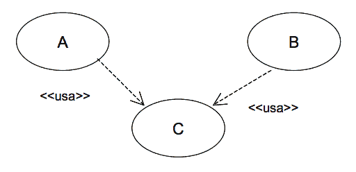

* La relación "extiende" se utiliza cuando se quiere reflejar un comportamiento opcional de un caso de uso. Por ejemplo, se tiene el caso de uso A que representa un comportamiento habitual del sistema. Sin embargo, dependiendo de algún factor, este caso de uso puede presentar un comportamiento adicional o ligeramente diferente, que se podría reflejar en un caso de uso B. En este caso, habrá una relación "extiende" del caso de uso B al A.

  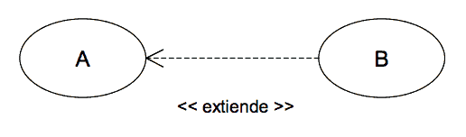

#### Notación {.unnumbered .unlisted}

El diagrama de casos de uso es un grafo de actores, casos de uso y las relaciones entre estos elementos.

Opcionalmente, los casos de uso se pueden enmarcar en un cuadrado que representa los límites del sistema.

##### Caso de Uso {.unnumbered .unlisted}

Un caso de uso se representa mediante una elipse con el nombre del caso de uso dentro o debajo.

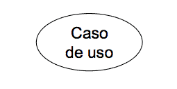

##### Actor {.unnumbered .unlisted}

Un actor se representa con una figura de ‘hombre de palo’ con el nombre del actor debajo de la figura.

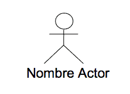

##### Relación {.unnumbered .unlisted}

Dependiendo del tipo de relación, la representación en los diagramas será distinta. Así pues, las relaciones entre un actor y un caso de uso se representan mediante una línea continua entre ellos. Las relaciones entre casos de uso se representan con una flecha discontinua con el nombre del tipo de relación como etiqueta. En las relaciones "extensión" la flecha parte del caso de uso con el comportamiento adicional hacia aquel que recoge el comportamiento básico y en las relaciones "usa" desde el caso de uso básico hacia el que representa el comportamiento común.

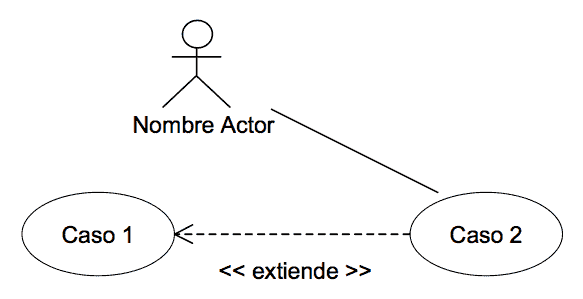

##### Paquete {.unnumbered .unlisted}

Un paquete se representa con un icono con forma de carpeta y con el nombre colocado en la ‘pestaña’. Los paquetes también pueden formar diagramas que complementen al diagrama de casos de uso (ver [Diagrama de paquetes](#diagrama-de-paquetes)).

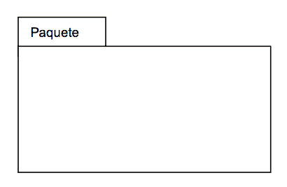

(Nota.- Esta notación es la más habitual, pero MÉTRICA Versión 3 no exige su utilización).

#### Ejemplo {.unnumbered .unlisted}

Estudio de una aplicación que se encarga de la gestión de los préstamos y reservas de libros y revistas en una biblioteca.

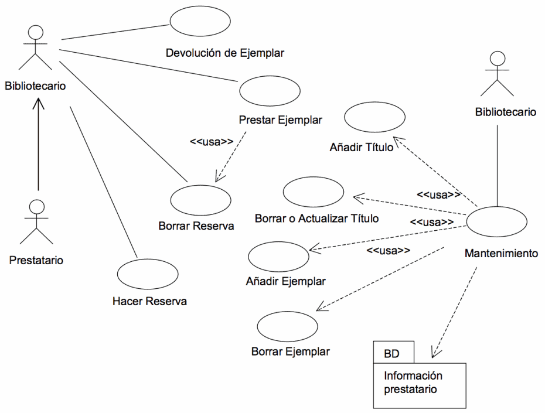

### Diagrama de Clases {#diagrama-de-clases}

El objetivo principal de este modelo es la representación de los aspectos estáticos del sistema, utilizando diversos mecanismos de abstracción (clasificación, generalización, agregación).

#### Descripción {.unnumbered .unlisted}

El diagrama de clases recoge las clases de objetos y sus asociaciones. En este diagrama se representa la estructura y el comportamiento de cada uno de los objetos del sistema y sus relaciones con los demás objetos, pero no muestra información temporal.

Con el fin de facilitar la comprensión del diagrama, se pueden incluir paquetes como elementos del mismo, donde cada uno de ellos agrupa un conjunto de clases.

Este diagrama no refleja los comportamientos temporales de las clases, aunque para mostrarlos se puede utilizar un diagrama de transición de estados, otra de las técnicas propuestas en MÉTRICA Versión 3.

Los elementos básicos del diagrama son:

##### Clases {.unnumbered .unlisted}

Una clase describe un conjunto de objetos con propiedades (atributos) similares y un comportamiento común. Los objetos son instancias de las clases.

No existe un procedimiento inmediato que permita localizar las clases del diagrama de clases. Éstas suelen corresponderse con sustantivos que hacen referencia al ámbito del sistema de información y que se encuentran en los documentos de las especificaciones de requisitos y los casos de uso.

Dentro de la estructura de una clase se definen los atributos y las operaciones o métodos:

* Los atributos de una clase representan los datos asociados a los objetos instanciados por esa clase.
* Las operaciones o métodos representan las funciones o procesos propios de los objetos de una clase, caracterizando a dichos objetos.

El diagrama de clases permite representar clases abstractas. Una Clase abstracta es una clase que no puede existir en la realidad, pero que es útil conceptualmente para el diseño del modelo orientado a objetos. Las clases abstractas no son instanciables directamente sino en sus descendientes. Una clase abstracta suele ser situada en la jerarquía de clases en una posición que le permita ser un depósito de métodos y atributos para ser compartidos o heredados por las subclases de nivel inferior.

Las clases y en general todos los elementos de los diagramas, pueden estar clasificados de acuerdo a varios criterios, como por ejemplo su objetivo dentro de un programa. Esta clasificación adicional se expresa mediante un Estereotipo. Algunos de los autores de métodos OO, establecen una clasificación de todos los objetos que pueden aparecer en un modelo. Los tipos son:

* Objetos Entidad.
* Objetos límite o interfaz.
* Objetos de control.

Éstos son estereotipos de clases. Un estereotipo representa una la meta-clasificación de un elemento.

Dependiendo de la herramienta utilizada, también se puede añadir información adicional a las clases para mostrar otras propiedades de las mismas, como son las reglas de negocio, responsabilidades, manejo de eventos, excepciones, etc.

##### Relaciones {.unnumbered .unlisted}

Los tipos más importantes de relaciones estáticas entre clases son los siguientes:

* **Asociación**. Las relaciones de asociación representan un conjunto de enlaces entre objetos o instancias de clases. Es el tipo de relación más general, y denota básicamente una dependencia semántica. Por ejemplo, una Persona *trabaja* para una Empresa.
  Cada asociación puede presentar elementos adicionales que doten de mayor detalle al tipo de relación:
  * *Rol*, o nombre de la asociación, que describe la semántica de la relación en el sentido indicado. Por ejemplo, la asociación entre Persona y Empresa recibe el nombre de trabaja para, como rol en ese sentido.
  * *Multiplicidad*, que describe la cardinalidad de la relación, es decir, especifica cuántas instancias de una clase están asociadas a una instancia de la otra clase. Los tipos de multiplicidad son: Uno a uno, uno a muchos y muchos a muchos.
 * **Herencia**. Las jerarquías de generalización/especialización se conocen como herencia. Herencia es el mecanismo que permite a una clase de objetos incorporar atributos y métodos de otra clase, añadiéndolos a los que ya posee. Con la herencia se refleja una relación "es_un" entre clases. La clase de la cual se hereda se denomina superclase, y la que hereda subclase.
    La generalización define una superclase a partir de otras. Por ejemplo, de las clases profesor y estudiante se obtiene la superclase *persona*. La especialización o especificación es la operación inversa, y en ella una clase se descompone en una o varias subclases. Por ejemplo, de la clase empleado se pueden obtener las subclases *secretaria*, *técnico* e *ingeniero*.
 * **Agregación**. La agregación es un tipo de relación jerárquica entre un objeto que representa la totalidad de ese objeto y las partes que lo componen. Permite el agrupamiento físico de estructuras relacionadas lógicamente. Los objetos "son-parte-de" otro objeto completo. Por ejemplo, *motor*, *ruedas*, *carrocería* son parte de *automóvil*.
* **Composición**. La composición es una forma de agregación donde la relación de propiedad es más fuerte, e incluso coinciden los tiempos de vida del objeto completo y las partes que lo componen. Por ejemplo, en un sistema de Máquina de café, las relaciones entre la clase *máquina* y *producto*, o entre *máquina* y *depósito de monedas*, son de composición.
* **Dependencia**. Una relación de dependencia se utiliza entre dos clases o entre una clase y una interfaz, e indica que una clase requiere de otra para proporcionar alguno de sus servicios.

##### Interfaces {.unnumbered .unlisted}

Una interfaz es una especificación de la semántica de un conjunto de operaciones de una clase o paquete que son visibles desde otras clases o paquetes. Normalmente, se corresponde con una parte del comportamiento del elemento que la proporciona.

##### Paquetes {.unnumbered .unlisted}

Los paquetes se usan para dividir el modelo de clases del sistema de información, agrupando clases u otros paquetes según los criterios que sean oportunos. Las dependencias entre ellos se definen a partir de las relaciones establecidas entre los distintos elementos que se agrupan en estos paquetes (ver Diagrama de paquetes).

#### Notación {.unnumbered .unlisted}

##### Clases {.unnumbered .unlisted}

Una clase se representa como una caja, separada en tres zonas por líneas horizontales.

En la zona superior se muestra el nombre de la clase y propiedades generales como el estereotipo. El nombre de la clase aparece centrado y si la clase es abstracta se representa en cursiva. El estereotipo, si se muestra, se sitúa sobre el nombre y entre el símbolo: `<< .... >>`.

La zona central contiene una lista de atributos, uno en cada línea. La notación utilizada para representarlos incluye, dependiendo del detalle, el nombre del atributo, su tipo y su valor por defecto, con el formato:

`visibilidad nombre : tipo = valor-inicial { propiedades }`

La visibilidad será en general publica (`+`), privada (`-`) o protegida (`#`), aunque puede haber otros tipos de visibilidad dependiendo del lenguaje de programación empleado.

En la zona inferior se incluye una lista con las operaciones que proporciona la clase. Cada operación aparece en una línea con formato:

`visibilidad nombre (lista-de-parámetros): tipo-devuelto { propiedad }`

La visibilidad será en general publica (+), privada (-) o protegida (#), aunque como con los atributos, puede haber otros tipos de visibilidad dependiendo del lenguaje de programación. La lista de parámetros es una lista con los parámetros recibidos en la operación separados por comas. El formato de un parámetro es:

`nombre : tipo = valor-por-defecto`

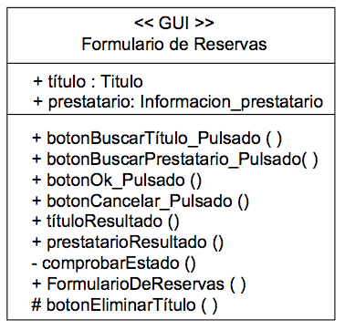

La notación especificada se puede simplificar según el nivel de detalle con el que se quiera trabajar en un momento dado.

##### Relaciones {.unnumbered .unlisted}

Una relación de asociación se representa como una línea continua entre las clases asociadas. En una relación de asociación, ambos extremos de la línea pueden conectar con la misma clase, indicando que una instancia de una clase, está asociada a otras instancias de la misma clase, lo que se conoce como asociación reflexiva.

La relación puede tener un nombre y un estereotipo, que se colocan junto a la línea. El nombre suele corresponderse con expresiones verbales presentes en las especificaciones, y define la semántica de la asociación. Los estereotipos permiten clasificar las relaciones en familias y se escribirán entre el símbolo: `<< ... >>`.

Las diferentes propiedades de la relación se pueden representar con la siguiente notación:

* *Multiplicidad*: La multiplicidad puede ser un número concreto, un rango o una colección de números. La letra ‘`n`’ y el símbolo ‘`*`’ representan cualquier número.
* *Orden*: Se puede especificar si las instancias guardan un orden con la palabra clave ‘`{ordered}`’. Si el modelo es suficientemente detallado, se puede incluir una restricción que indique el criterio de ordenación.
* *Navegabilidad*: La navegación desde una clase a la otra se representa poniendo una flecha sin relleno en el extremo de la línea, indicando el sentido de la navegación.
* *Rol* o *nombre de la asociación*: Este nombre se coloca junto al extremo de la línea que esta unida a una clase, para expresar cómo esa clase hace uso de la otra clase con la que mantiene la asociación.

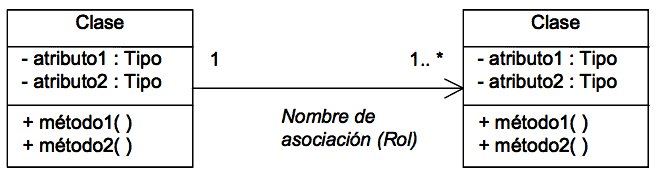

Además, existen notaciones específicas para los otros tipos de relación, como son:

* *Agregación*: Se representa con un rombo hueco en la clase cuya instancia es una agregación de las instancias de la otra.
* *Composición*: Se representa con un rombo lleno en la clase cuya instancia contiene las instancias de la otra clase.
* *Dependencia*: Una línea discontinua con una flecha apuntando a la clase cliente. La relación puede tener un estereotipo que se coloca junto a la línea, y entre el símbolo: `<< ... >>`.
* *Herencia*: Esta relación se representa como una línea continua con una flecha hueca en el extremo que apunta a la superclase.

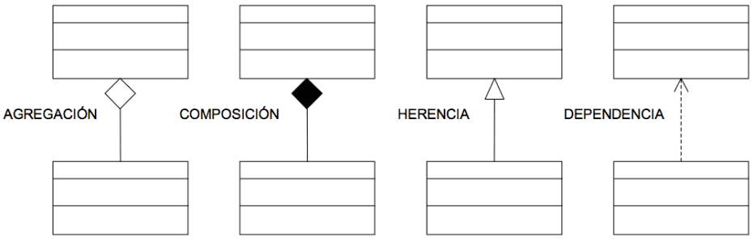

##### Interfaces {.unnumbered .unlisted}

Una interfaz se representa como una caja con compartimentos, igual que las clases. En la zona superior se incluye el nombre y el estereotipo <>. La lista de operaciones se coloca en la zona inferior, igual que en las representaciones de clases. La zona en la que se listan los atributos estará vacía o puede omitirse.

Existe una representación más simple para la interfaz: un círculo pequeño asociado a una clase con el nombre de la interfaz debajo. Las operaciones de la interfaz no aparecen en esta representación; si se quiere que aparezcan, debe usarse la primera notación.

Entre una clase que implementa las operaciones que una interfaz ofrece y esa interfaz se establece una relación de realización que, dependiendo de la notación elegida, se representará con una línea continua entre ellas cuando la interfaz se representa como un círculo y con una flecha hueca discontinua apuntando a la interfaz cuando se represente como una clase.

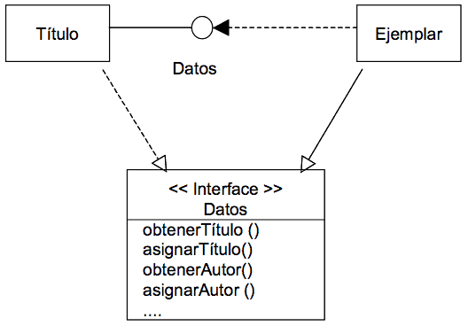

##### Paquetes {.unnumbered .unlisted}

Los paquetes se representan mediante un icono con forma de carpeta y las dependencias con flechas discontinuas entre los paquetes dependientes (ver Diagrama de paquetes).
Ejemplo

Estudio del sistema encargado de la gestión de préstamos y reservas de libros y revistas de una biblioteca. Dependiendo del momento del desarrollo el diagrama estará más o menos detallado. Así, el diagrama tendría la siguiente estructura en el proceso de análisis:

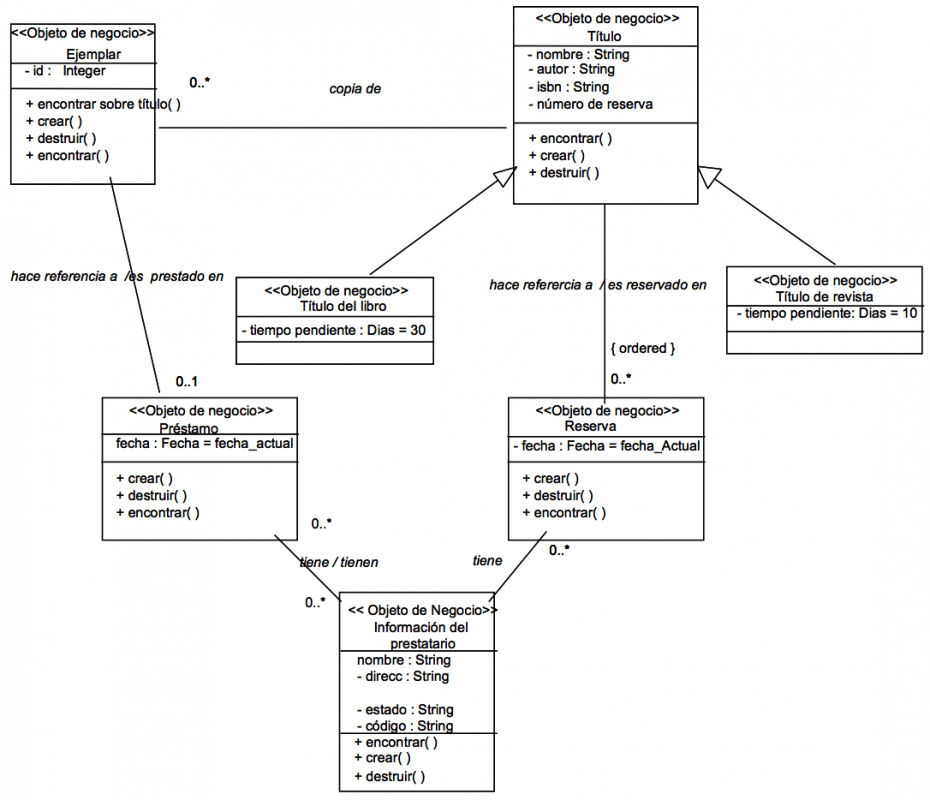

(Nota.- Esta notación es la más habitual, pero MÉTRICA Versión 3 no exige su utilización).

### Diagrama de Componentes {#diagrama-de-componentes}

El diagrama de componentes proporciona una visión física de la construcción del sistema de información. Muestra la organización de los componentes software, sus interfaces y las dependencias entre ellos.

#### Descripción {.unnumbered .unlisted}

Como ya se ha indicado, los elementos de estos diagramas son los componentes software y las dependencias entre ellos.

Un componente es un módulo de software que puede ser código fuente, código binario, un ejecutable, o una librería con una interfaz definida. Una interfaz establece las operaciones externas de un componente, las cuales determinan una parte del comportamiento del mismo. Además se representan las dependencias entre componentes o entre un componente y la interfaz de otro, es decir uno de ellos usa los servicios o facilidades del otro.

Estos diagramas pueden incluir paquetes que permiten organizar la construcción del sistema de información en subsistemas y que recogen aspectos prácticos relacionados con la secuencia de compilación entre componentes, la agrupación de elementos en librerías, etc.

#### Notación {.unnumbered .unlisted}

##### Componente {.unnumbered .unlisted}

Un componente se representa como un rectángulo, con dos pequeños rectángulos superpuestos perpendicularmente en el lado izquierdo.

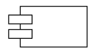

Para distinguir distintos tipos de componentes se les puede asignar un estereotipo, cuyo nombre estará dentro del símbolo: << ... >>

##### Interfaz {.unnumbered .unlisted}

Se representa como un pequeño círculo situado junto al componente que lo implementa y unido a él por una línea continua. La interfaz puede tener un nombre que se escribe junto al círculo. Un componente puede proporcionar más de una interfaz.

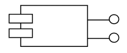

##### Paquete {.unnumbered .unlisted}

Un paquete se representa con un icono de carpeta (ver [Diagrama de Paquetes](#diagrama-de-paquetes)).

##### Relación de dependencia {.unnumbered .unlisted}

Una relación de dependencia se representa mediante una línea discontinua con una flecha que apunta al componente o interfaz que provee del servicio o facilidad al otro. La relación puede tener un estereotipo que se coloca junto a la línea, entre el símbolo: `<<...>>`

#### Ejemplo {.unnumbered .unlisted}

Sistema encargado de la gestión de los préstamos y reservas de libros y revistas en una biblioteca. El lenguaje de desarrollo será Java, y los accesos a la información del prestatario serán mediante un paquete de Base de Datos.

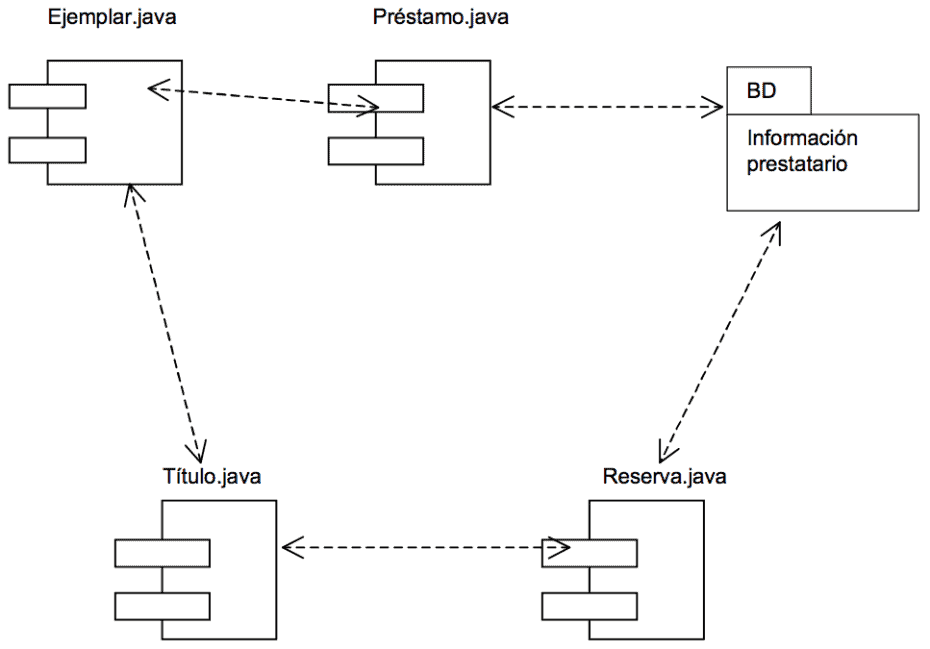

(Nota.- Esta notación es la más habitual, pero MÉTRICA Versión 3 no exige su utilización).

### Diagrama de Descomposición

El objetivo del diagrama de descomposición es representar la estructura jerárquica de un dominio concreto.
Descripción

La técnica es una estructura por niveles que se lee de arriba abajo y de izquierda a derecha, donde cada elemento se puede descomponer en otros de nivel inferior y puede ser descrito con el fin de aclarar su contenido.

El diagrama de descomposición, también conocido como diagrama jerárquico, tomará distintos nombres en función del dominio al que se aplique. En el caso de MÉTRICA Versión 3, se utilizan los diagramas de descomposición funcional, de descomposición organizativo y de descomposición en diálogos.
Notación

Los elementos del dominio que se esté tratando se representan mediante un rectángulo, que contiene un nombre que lo identifica. Las relaciones de unos elementos con otros se representan mediante líneas que los conectan.
Ejemplo

Diagrama de Descomposición Organizativo:

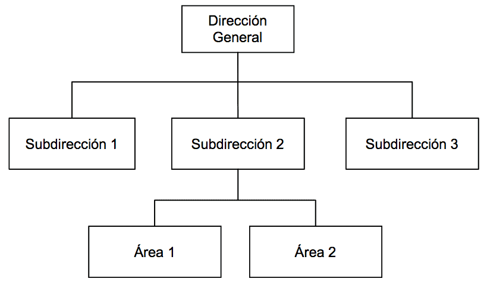

(Nota.- Esta notación es la más habitual, pero MÉTRICA Versión 3 no exige su utilización).

### Diagrama de Despliegue

El objetivo de estos diagramas es mostrar la disposición de las particiones físicas del sistema de información y la asignación de los componentes software a estas particiones. Es decir, las relaciones físicas entre los componentes software y hardware en el sistema a entregar.

#### Descripción {.unnumbered .unlisted}

En estos diagramas se representan dos tipos de elementos, nodos y conexiones, así como la distribución de componentes del sistema de información con respecto a la partición física del sistema.

En MÉTRICA Versión 3 se propone una definición concreta de nodo, prescindiendo de determinados detalles, pero permitiendo una continuidad tanto en el diseño como en la construcción del sistema de información. Con este fin, se utiliza el nodo como partición física o funcional real, pero sin descender a detalles de infraestructura o dimensionamiento; por ejemplo, interesa si el nodo procesador es arquitectura Intel, pero no tanto si tiene dos o cuatro procesadores.

Las conexiones representan las formas de comunicación entre nodos.

Además, a cada nodo se le asocia un subsistema de construcción que agrupa componentes software, permitiendo de este modo, determinar la distribución de estos componentes. Por lo tanto, un diagrama de despliegue puede incluir, dependiendo del nivel de detalle, todos los elementos descritos en la técnica de diagrama de componentes, además los nodos y las conexiones propios de esta técnica.

#### Notación {.unnumbered .unlisted}

##### Nodo {.unnumbered .unlisted}

Se representa con la figura de un cubo. El nodo se etiqueta con un nombre representativo de la partición física que simboliza. Se pueden asociar a los nodos subsistemas de construcción.

##### Conexión {.unnumbered .unlisted}

Las conexiones se representan con una línea continua que une ambos nodos y pueden tener una etiqueta que indique el tipo de conexión. (ejemplo: canal, red, protocolo, etc.)

#### Ejemplo {.unnumbered .unlisted}

El diagrama representa una arquitectura compuesta por un servidor central de lógica de negocio y acceso a datos, en un monitor de teleproceso de tipo XXX, al cual hay conectados 10 servidores departamentales, con clientes (100) e impresora conectados a cada uno de ellos. No interesa tanto recoger en el diagrama la infraestructura real (la exactitud de la configuración, número de procesadores que pueden cambiar con el tiempo y en principio no afecta ni al diseño ni a la construcción), como el tipo "genérico" de los servidores, los volúmenes en el caso de que sean significativos (por ejemplo: 100 puestos por departamento).

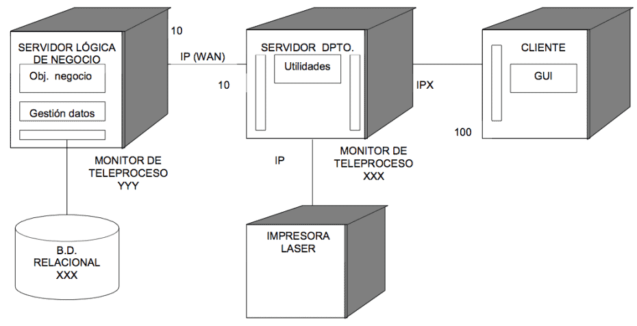

(Nota.- Esta notación es la más habitual, pero MÉTRICA Versión 3 no exige su utilización).

### Diagrama de Estructura

El objetivo de este diagrama es representar la estructura modular del sistema o de un componente del mismo y definir los parámetros de entrada y salida de cada uno de los módulos.

Para su realización se partirá del modelo de procesos obtenido como resultado de la aplicación de la técnica de diagrama de flujo de datos (DFD).
Descripción

Un diagrama de estructura se representa en forma de árbol con los siguientes elementos:

    Módulo: división del software clara y manejable con interfaces modulares perfectamente definidas. Un módulo puede representar un programa, subprograma o rutina dependiendo del lenguaje a utilizar. Admite parámetros de llamada y retorno. En el diseño de alto nivel hay que ver un módulo como una caja negra, donde se contemplan exclusivamente sus entradas y sus salidas y no los detalles de la lógica interna del módulo.
    Para que se reduzca la complejidad del cambio ante una determinada modificación, es necesario que los módulos cumplan las siguientes condiciones:
        Que sean de pequeño tamaño.
        Que sean independientes entre sí.
        Que realicen una función clara y sencilla.
    Conexión: representa una llamada de un módulo a otro.
    Parámetro: información que se intercambia entre los módulos. Pueden ser de dos tipos en función de la clase de información a procesar:
        Control: son valores de condición que afectan a la lógica de los módulos llamados. Sincronizan la operativa de los módulos.
        Datos: información compartida entre módulos y que es procesada en los módulos llamados.

Otros componentes que se pueden representar en el diagrama de estructura son:

    Módulo predefinido: es aquel módulo que está disponible en la biblioteca del sistema o de la propia aplicación, y por tanto no es necesario codificarlo.
    Almacén de datos: es la representación física del lugar donde están almacenados los datos del sistema.
    Dispositivo físico: es cualquier dispositivo por el cual se puede recibir o enviar información que necesite el sistema.

Estructuras del diagrama

Existen ciertas representaciones gráficas que permiten mostrar la secuencia de las llamadas entre módulos. Las posibles estructuras son:

- Secuencial: un módulo llama a otros módulos una sola vez y, se ejecutan de izquierda a derecha y de arriba abajo.
  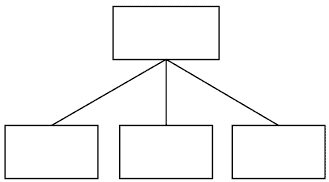
- Repetitiva: cada uno de los módulos inferiores se ejecuta varias veces mientras se cumpla una condición.
  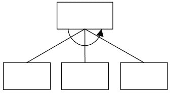
- Alternativa: cuando el módulo superior, en función de una decisión, llama a un módulo u otro de los de nivel inferior.
  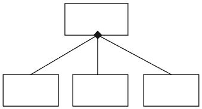

Principios del diseño estructurado

El diagrama de estructura se basa en tres principios fundamentales:

    La descomposición de los módulos, de manera que los módulos que realizan múltiples funciones se descompongan en otros que sólo realicen una. Los objetivos que se persiguen con la descomposición son:
        Reducir el tamaño del módulo.
        Hacer el sistema más fácil de entender y modificar y por lo tanto facilitar el mantenimiento del mismo.
        Minimizar la duplicidad de código.
        Crear módulos útiles.
    La jerarquía entre los módulos, de forma que los módulos de niveles superiores coordinen a los de niveles inferiores. Al dividir los módulos jerárquicamente, es posible controlar el número de módulos que interactúan con cualquiera de los otros.
    La independencia de los módulos, de manera que cada módulo se ve como una caja negra, y únicamente es importante su función y su apariencia externa, y no los detalles de su construcción.

Estrategias de diseño

Dependiendo de la estructura inicial del diagrama de flujo de datos sobre el que se va a realizar el diseño, existen dos estrategias para obtener el diagrama de estructura. El uso de una de las dos estrategias no implica que la otra no se utilice, eso dependerá de las características de los procesos representados en el DFD. Estas estrategias son:

    Análisis de transformación.
    Análisis de transacción.

1.- Análisis de Transformación

El análisis de transformación es un conjunto de pasos que permiten obtener, a partir de un DFD con características de transformación, la estructura del diseño de alto nivel del sistema. Un DFD con características de transformación es aquél en el que se pueden distinguir:

    Flujo de llegada o entrada.
    Flujo de transformación o centro de transformación que contiene los procesos esenciales del sistema y es independiente de las características particulares de la entrada y la salida.
    Flujo de salida.

Los datos que necesita el sistema se recogen por los módulos que se encuentren en las ramas de la izquierda, de modo que los datos que se intercambian en esa rama serán ascendentes. En las ramas centrales habrá movimiento de información compartida, tanto ascendente como descendente. En las ramas de la derecha, la información será de salida y, por lo tanto, descendente.

Los pasos a realizar en el análisis de transformación son:

    Identificar el centro de transformación. Para ello será necesario delimitar los flujos de llegada y salida de la parte del DFD que contiene las funciones esenciales del sistema.
    Realizar el "primer nivel de factorización" o descomposición del diagrama de estructura. Habrá que identificar tres módulos subordinados a un módulo de control del sistema:
        Módulo controlador del proceso de información de entrada.
        Módulo controlador del centro de transformación.
        Módulo controlador del proceso de la información de salida.
    Elaborar el "segundo nivel de factorización". Se transforma cada proceso del DFD en un módulo del diagrama de estructura.
    Revisar la estructura del sistema utilizando medidas y guías de diseño.

A continuación se muestra un gráfico explicativo de dicha estrategia de diseño:

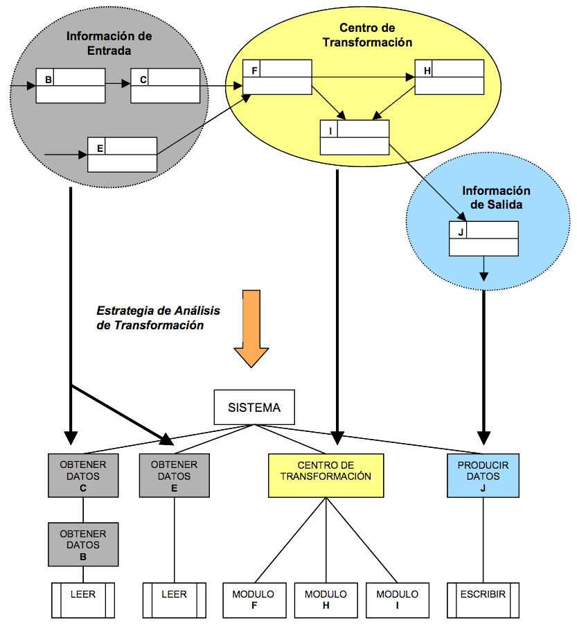

2.- Análisis de Transacción

El análisis de transacción se aplica cuando en un DFD existe un proceso que en función del flujo de llegada, determina la elección de uno o más flujos de información.

Se denomina centro de transacción al proceso desde el que parten los posibles caminos de información. Los pasos a realizar en el análisis de transacción son:

    Identificar el centro de transacción. Se delimita la parte del DFD en la que a partir de un camino de llegada se establecen varios caminos de acción.
    Transformar el DFD en la estructura adecuada al proceso de transacciones. El flujo de transacciones se convierte en una estructura de programa con una bifurcación de entrada y una de salida.
    Factorizar la estructura de cada camino de acción. Cada camino se convierte en una estructura que se corresponde con las características específicas del flujo (de transacción o de transformación).
    Refinar la estructura del sistema utilizando medidas y guías de diseño.

A continuación se muestra un gráfico explicativo de dicha estrategia de diseño:

![Estrategia de Diseño usando Análisis de Transacción][../images/estrategia-disenio-2.png]

Evaluación del diseño

Una vez que hayan sido elaborados los diagramas de estructura, habrá que evaluar el diseño estudiando distintos criterios y medidas. Se utilizan dos métricas que miden la calidad estructural de un diseño:

    Acoplamiento.
    Cohesión.

El acoplamiento se puede definir como el grado de interdependencia existente entre los módulos, por tanto, depende del número de parámetros que se intercambian. El objetivo es que el acoplamiento sea el mínimo posible, es decir, conseguir que los módulos sean lo más independientes entre sí.

Es deseable un bajo acoplamiento, debido a que cuantas menos conexiones existan entre dos módulos, menor será la posibilidad de que aparezcan efectos colaterales al modificar uno de ellos. Además, se mejora el mantenimiento, porque al cambiar un módulo por otro, hay menos riesgo de actualizar la lógica interna de los módulos asociados. Los diferentes grados de acoplamiento son:

    De datos: los módulos se comunican mediante parámetros que constituyen elementos de datos simples.
    De marca: es un caso particular del acoplamiento de datos, dónde la comunicación entre módulos es través de estructuras de datos.
    De control: aparece cuando uno o varios de los parámetros de comunicación son de control, es decir variables que controlan las decisiones de los módulos subordinados o superiores.
    Externo: los módulos están ligados a componentes externos (dispositivos E/S, protocolos de comunicaciones, etc.).
    Común: varios módulos hacen referencia a un área común de datos. Los módulos asociados al área común de datos pueden modificar los valores de los elementos de datos o estructuras de datos que se incluyen en dicha área.
    De contenido: ocurre cuando un módulo cualquiera accede o hace uso de los datos de una parte de otro módulo.

La cohesión es una medida de la relación funcional de los elementos de un módulo, es decir, la sentencia o grupo de sentencias que lo componen, las llamadas a otros módulos o las definiciones de los datos. Un módulo con alta cohesión realiza una tarea concreta y sencilla.

El objetivo es intentar obtener módulos con una cohesión alta o media. Los distintos niveles de cohesión, de mayor a menor, son:

    Funcional: todos los elementos que componen el módulo están relacionados en el desarrollo de una única función.
    Secuencial: un módulo empaqueta en secuencia varios módulos con cohesión funcional.
    De comunicación: todos los elementos de procesamiento utilizan los mismos datos de entrada y de salida.
    Procedimental: todos los elementos de procesamiento de un módulo están relacionados y deben ejecutarse en un orden determinado. En este tipo existe paso de controles.
    Temporal: un módulo contiene tareas relacionadas por el hecho de que todas deben realizarse en el mismo intervalo de tiempo.
    Lógica: un módulo realiza tareas relacionadas de forma lógica (por ejemplo un módulo que produce todas las salidas independientemente del tipo).
    Casual: un módulo realiza un conjunto de tareas que tienen poca o ninguna relación entre sí.

Un buen diseño debe ir orientado a conseguir que los módulos realicen una función sencilla e independiente de las demás (máxima cohesión), y que la dependencia con otros módulos sea mínima (acoplamiento mínimo), lo cual facilita el mantenimiento del diseño.
Notación

Módulo

Se representa mediante un rectángulo con su nombre en el interior.

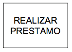

Un módulo predefinido se representa añadiendo dos líneas verticales y paralelas en el interior del rectángulo.

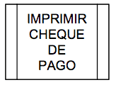

Conexión

Se representa mediante una línea terminada en punta de flecha cuya dirección indica el módulo llamado. Para llamadas a módulos estáticos se utiliza trazo continuo y para llamadas a módulos dinámicos trazo discontinuo.

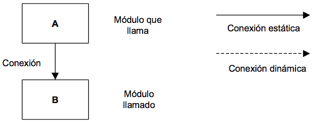

Parámetros

La representación varía según su tipo: control (flags) o datos.

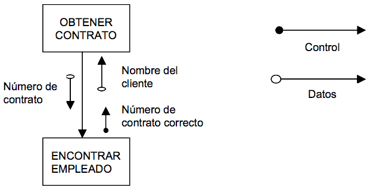

Almacén de datos

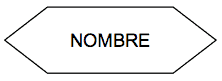

Dispositivo físico

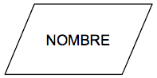

(Nota.- Esta notación es la más habitual, pero MÉTRICA Versión 3 no exige su utilización).
Ejemplo

El siguiente ejemplo muestra un proceso de emisión de cheques para el pago de nóminas de los empleados de una empresa. En él se diferencian los cálculos relativos a los trabajadores empleados por horas y los que poseen contrato. La lectura del fichero de empleados y la impresión de los cheques son módulos ya disponibles en las librerías del sistema, es decir, módulos predefinidos.

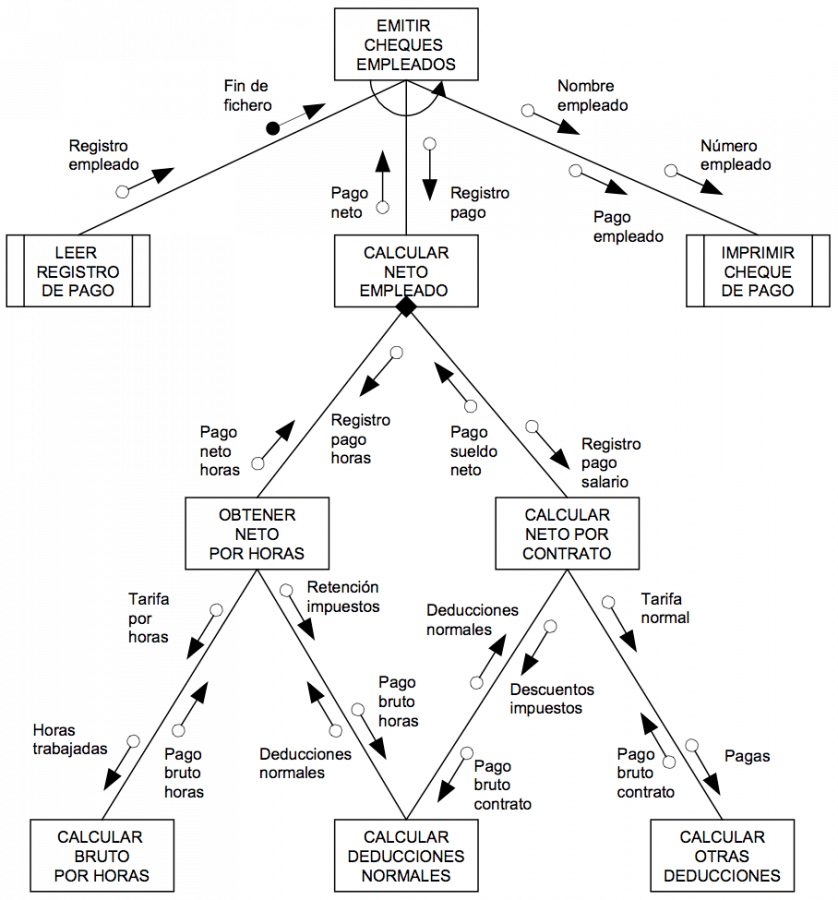 

### Diagrama de Flujo de Datos {#diagrama-de-flujo-de-datos}

El objetivo del diagrama de flujo de datos es la obtención de un modelo lógico de procesos que represente el sistema, con independencia de las restricciones físicas del entorno. Así se facilita su comprensión por los usuarios y los miembros del equipo de desarrollo.

El sistema se divide en distintos niveles de detalle, con el objetivo de:

* Simplificar la complejidad del sistema, representando los diferentes procesos de que consta.
* Facilitar el mantenimiento del sistema.

#### Descripción {.unnumbered .unlisted}

Un diagrama de flujo de datos es una técnica muy apropiada para reflejar de una forma clara y precisa los procesos que conforman el sistema de información. Permite representar gráficamente los límites del sistema y la lógica de los procesos, estableciendo qué funciones hay que desarrollar. Además, muestra el flujo o movimiento de los datos a través del sistema y sus transformaciones como resultado de la ejecución de los procesos.

Esta técnica consiste en la descomposición sucesiva de los procesos, desde un nivel general, hasta llegar al nivel de detalle necesario para reflejar toda la semántica que debe soportar el sistema en estudio.

El diagrama de flujo de datos se compone de los siguientes elementos:

* **Entidad externa**: representa un ente ajeno al sistema que proporciona o recibe información del mismo. Puede hacer referencia a departamentos, personas, máquinas, recursos u otros sistemas. El estudio de las relaciones entre entidades externas no forma parte del modelo.
  Puede aparecer varias veces en un mismo diagrama, así como en los distintos niveles del DFD para mejorar la claridad del diagrama.
* **Proceso**: representa una funcionalidad que tiene que llevar a cabo el sistema para transformar o manipular datos. El proceso debe ser capaz de generar los flujos de datos de salida a partir de los de entrada, más una información constante o variable al proceso.
  El proceso nunca es el origen ni el final de los datos, puede transformar un flujo de datos de entrada en varios de salida y siempre es necesario como intermediario entre una entidad externa y un almacén de datos.
* **Almacén de datos**: representa la información en reposo utilizada por el sistema independientemente del sistema de gestión de datos (por ejemplo un. fichero, base de datos, archivador, etc.). Contiene la información necesaria para la ejecución del proceso.
  El almacén no puede crear, transformar o destruir datos, no puede estar comunicado con otro almacén o entidad externa y aparecerá por primera vez en aquel nivel en que dos o más procesos accedan a él.
* **Flujo de datos:** representa el movimiento de los datos, y establece la comunicación entre los procesos y los almacenes de datos o las entidades externas.
* Un flujo de datos entre dos procesos sólo es posible cuando la información es síncrona, es decir, el proceso destino comienza cuando el proceso origen finaliza su función.
* Los flujos de datos que comunican procesos con almacenes pueden ser de los siguientes tipos:
  * *De consulta*: representan la utilización de los valores de uno o más campos de un almacén o la comprobación de que los valores de los campos seleccionados cumplen unos criterios determinados.
  * *De actualización*: representan la alteración de los datos de un almacén como consecuencia de la creación de un nuevo elemento, por eliminación o modificación de otros ya existentes.
  * *De diálogo:* es un flujo entre un proceso y un almacén que representa una consulta y una actualización.

Existen sistemas que precisan de información orientada al control de datos y requieren flujos y procesos de control, así como los mecanismos que desencadenan su ejecución. Para que resulte adecuado el análisis de estos sistemas, se ha ampliado la notación de los diagramas de flujo de datos incorporando los siguientes elementos:

* **Proceso de control**: representa procesos que coordinan y sincronizan las actividades de otros procesos del diagrama de flujo de datos.
* **Flujo de control**: representa el flujo entre un proceso de control y otro proceso. El flujo de control que sale de un proceso de control activa al proceso que lo recibe y el que entra le informa de la situación de un proceso. A diferencia de los flujos tradicionales, que pueden considerarse como procesadores de datos porque reflejan el movimiento y transformación de los mismos, los flujos de control no representan datos con valores, sino que en cierto modo, se trata de eventos que activan los procesos (señales o interrupciones).

##### Descomposición o explosión por niveles {.unnumbered .unlisted}

Los diagramas de flujo de datos han de representar el sistema de la forma más clara posible, por ello su construcción se basa en el principio de descomposición o explosión en distintos niveles de detalle.

La descomposición por niveles se realiza de arriba abajo (top-down), es decir, se comienza en el nivel más general y se termina en el más detallado, pasando por los niveles intermedios necesarios. De este modo se dispondrá de un conjunto de particiones del sistema que facilitarán su estudio y su desarrollo.

La explosión de cada proceso de un DFD origina otro DFD y es necesario comprobar que se mantiene la consistencia de información entre ellos, es decir, que la información de entrada y de salida de un proceso cualquiera se corresponde con la información de entrada y de salida del diagrama de flujo de datos en el que se descompone.

En cualquiera de las explosiones puede aparecer un proceso que no necesite descomposición. A éste se le denomina Proceso primitivo y sólo se detalla en él su entrada y su salida, además de una descripción de lo que realiza. En la construcción hay que evitar en lo posible la descomposición desigual, es decir, que un nivel contenga un proceso primitivo, y otro que necesite ser particionado en uno o varios niveles más.

El modelo de procesos deberá contener:

* Un diagrama de contexto (Nivel 0).
* Un diagrama 0 (Nivel 1).
* Tantos diagramas 1, 2, 3, … n como funciones haya en el diagrama 0 (Nivel 2).
* Tantos niveles intermedios como sea necesario.
* Varios DFD en el último nivel de detalle.

El diagrama de contexto tiene como objetivo delimitar el ámbito del sistema con el mundo exterior definiendo sus interfaces. En este diagrama se representa un único proceso que corresponde al sistema en estudio, un conjunto de entidades externas que representan la procedencia y destino de la información y un conjunto de flujos de datos que representan los caminos por los que fluye dicha información.

A continuación, este proceso se descompone en otro DFD, en el que se representan los procesos principales o subsistemas. Un subsistema es un conjunto de procesos cuyas funcionalidades tienen algo en común. Éstos deberán ser identificados en base a determinados criterios, como por ejemplo: funciones organizativas o administrativas propias del sistema, funciones homogéneas de los procesos, localización geográfica de los mismos, procesos que actualicen los mismos almacenes de datos, etc.

Cada uno de los procesos principales se descompone a su vez en otros que representan funciones más simples y se sigue descomponiendo hasta que los procesos estén suficientemente detallados y tengan una funcionalidad concreta, es decir, sean procesos primitivos.

Como resultado se obtiene un modelo de procesos del sistema de información que consta de un conjunto de diagramas de flujo de datos de diferentes niveles de abstracción, de modo que cada uno proporciona una visión más detallada de una parte definida en el nivel anterior.

Además de los diagramas de flujo de datos, el modelo de procesos incluye la especificación de los flujos de datos, de los almacenes de datos y la especificación detallada de los procesos que no precisan descomposición, es decir los procesos de último nivel o primitivos. En la especificación de un proceso primitivo se debe describir, de una manera más o menos formal, cómo se obtienen los flujos de datos de salida a partir de los flujos de datos de entrada y características propias del proceso.

Dependiendo del tipo de proceso se puede describir el procedimiento asociado utilizando un lenguaje estructurado o un pseudocódigo, apoyándose en tablas de decisión o árboles de decisión.

A continuación se muestra un ejemplo gráfico que representa la de descomposición jerárquica de los diagramas de flujo de datos.

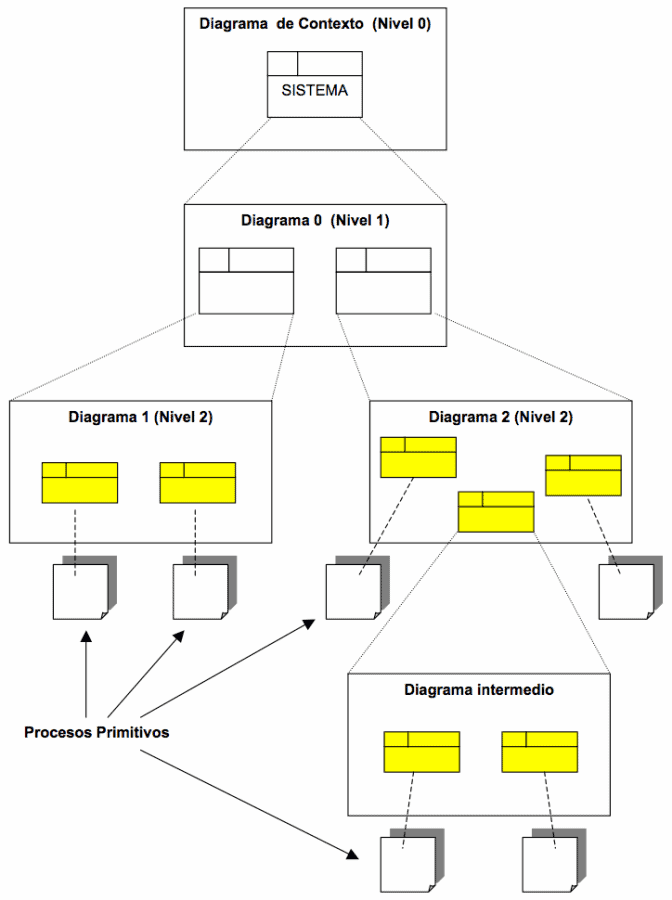

#### Notación {.unnumbered .unlisted}

##### Entidad externa {.unnumbered .unlisted}

Se representa mediante una elipse con un identificador y un nombre significativo en su interior.

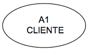

Si la entidad externa aparece varias veces en un mismo diagrama, se representa con una línea inclinada en el ángulo superior izquierdo.

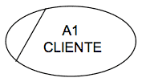

##### Proceso {.unnumbered .unlisted}

Se representa por un rectángulo subdividido en tres casillas donde se indica el nombre del proceso, un número identificativo y la localización.

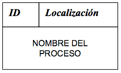

Si el proceso es de último nivel, se representa con un asterisco en el ángulo inferior derecho separado con una línea inclinada.

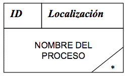

El nombre del proceso debe ser lo más representativo posible. Normalmente estará constituido por un verbo más un sustantivo.

El número identificativo se representa en la parte superior izquierda e indica el nivel del DFD en que se está. Hay que resaltar que el número no indica orden de ejecución alguno entre los procesos ya que en un DFD no se representa una secuencia en el tratamiento de los datos. El número que identifica el proceso es único en el sistema y debe seguir el siguiente estándar de notación:

* El proceso del diagrama de contexto se numera como cero.
* Los procesos del siguiente nivel se enumeran desde 1 y de forma creciente hasta completar el número de procesos del diagrama.
* En los niveles inferiores se forma con el número del proceso en el que está incluido seguido de un número que lo identifica en ese contexto.

La localización expresa el nombre del proceso origen de la descomposición que se esté tratando.

##### Almacén de datos {.unnumbered .unlisted}

Se representa por dos líneas paralelas cerradas en un extremo y una línea vertical que las une. En la parte derecha se indica el nombre del almacén de datos y en la parte izquierda el identificador de dicho almacén en el DFD.

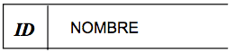

Si un almacén aparece repetido dentro un DFD se puede representar de la siguiente forma:

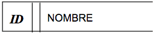

##### Flujo de datos {.unnumbered .unlisted}

Se representa por una flecha que indica la dirección de los datos, y que se etiqueta con un nombre representativo.

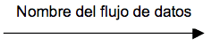

La representación de los flujos de datos entre procesos y almacenes es la siguiente:

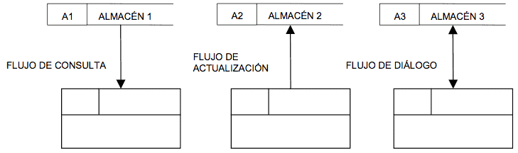

##### Proceso de control {.unnumbered .unlisted}

Se representa por un rectángulo, con trazo discontinuo, subdividido en tres casillas donde se indica el nombre del proceso, un número identificativo y la localización.

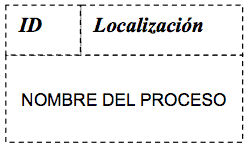

##### Flujo de control {.unnumbered .unlisted}

Se representa por una flecha con trazo discontinuo que indica la dirección de flujo y que se etiqueta con un nombre representativo.

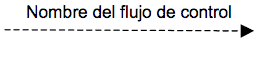

#### Ejemplo {.unnumbered .unlisted}

La figura es un diagrama de flujos de un Sistema Gestor de Pedidos. En él están representados todos los elementos que pueden intervenir en una Diagrama de Flujo de Datos.

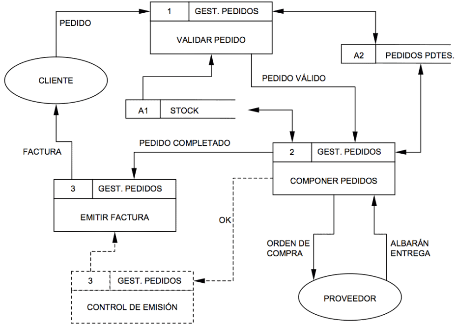

### Diagrama de Interacción

El objetivo de esta técnica es describir el comportamiento dinámico del sistema de información mediante el paso de mensajes entre los objetos del mismo. Además representa un medio para verificar la coherencia del sistema mediante la validación con el modelo de clases.
Descripción

Un diagrama de interacción describe en detalle un determinado escenario de un caso de uso. En él se muestra la interacción entre el conjunto de objetos que cooperan en la realización de dicho escenario. Suele ser conveniente especificar en la parte izquierda del diagrama el caso de uso que se está representando para que resulte más sencilla su validación.

Los elementos que componen los diagramas de interacción son los objetos y los mensajes:

* Un *objeto* es una entidad que tiene un estado, un comportamiento e identidad. La estructura y el comportamiento común de diferentes objetos se recoge en una clase. En un diagrama de interacción, los objetos serán al final instancias de una determinada clase o de un actor.
* Un *mensaje* es una comunicación entre dos objetos. El envío de un mensaje por parte de un objeto (emisor) a otro (receptor), puede provocar que se ejecute una operación, se produzca un evento o se cree o destruya un objeto.

Hay dos tipos de diagramas de interacción: [diagramas de secuencia](#diagrama-de-secuencia) y [diagramas de colaboración](#diagrama-de-colaboracion). Ambos tipos de diagramas tratan la misma información pero cada uno hace énfasis en un aspecto particular en cuanto a la forma de mostrarla.

Los diagramas de secuencia muestran de forma explícita la secuencia de los mensajes intercambiados por los objetos, mientras que los diagramas de colaboración muestran de forma más clara cómo colaboran los objetos, es decir, con qué otros objetos tiene vínculos o intercambia mensajes un determinado objeto.

A continuación se detallan las particularidades de cada uno de ellos.

#### Diagrama de Secuencia

El diagrama de secuencia es un tipo de diagrama de interacción cuyo objetivo es describir el comportamiento dinámico del sistema de información haciendo énfasis en la secuencia de los mensajes intercambiados por los objetos.

##### Descripción {.unnumbered .unlisted}

Un diagrama de secuencia tiene dos dimensiones, el eje vertical representa el tiempo y el eje horizontal los diferentes objetos. El tiempo avanza desde la parte superior del diagrama hacia la inferior. Normalmente, en relación al tiempo sólo es importante la secuencia de los mensajes, sin embargo, en aplicaciones de tiempo real se podría introducir una escala en el eje vertical. Respecto a los objetos, es irrelevante el orden en que se representan, aunque su colocación debería poseer la mayor claridad posible.

Cada objeto tiene asociados una *línea de vida* y *focos de control*. La línea de vida indica el intervalo de tiempo durante el que existe ese objeto. Un foco de control o activación muestra el periodo de tiempo en el cual el objeto se encuentra ejecutando alguna operación, ya sea directamente o mediante un procedimiento concurrente.

##### Notación {.unnumbered .unlisted}

###### Objeto y línea de vida {.unnumbered .unlisted}

Un objeto se representa como una línea vertical discontinua, llamada línea de vida, con un rectángulo de encabezado con el nombre del objeto en su interior. También se puede incluir a continuación el nombre de la clase, separando ambos por dos puntos.

Si el objeto es creado en el intervalo de tiempo representado en el diagrama, la línea comienza en el punto que representa ese instante y encima se coloca el objeto. Si el objeto es destruido durante la interacción que muestra el diagrama, la línea de vida termina en ese punto y se señala con un aspa de ancho equivalente al del foco de control.

En el caso de que un objeto existiese al principio de la interacción representada en el diagrama, dicho objeto se situará en la parte superior del diagrama, por encima del primer mensaje. Si un objeto no es eliminado en el tiempo que dura la interacción, su línea de vida se prolonga hasta la parte inferior del diagrama.

La línea de vida de un objeto puede desplegarse en dos o más líneas para mostrar los diferentes flujos de mensajes que puede intercambiar un objeto, dependiendo de alguna condición.

###### Foco de control o activación {.unnumbered .unlisted}

Se representa como un rectángulo delgado superpuesto a la línea de vida del objeto. Su largo dependerá de la duración de la acción. La parte superior del rectángulo indica el inicio de una acción ejecutada por el objeto y la parte inferior su finalización.

###### Mensaje {.unnumbered .unlisted}

Un mensaje se representa como una flecha horizontal entre las líneas de vida de los objetos que intercambian el mensaje. La flecha va desde el objeto que envía el mensaje al que lo recibe. Además, un objeto puede mandarse un mensaje a sí mismo, en este caso la flecha comienza y termina en su línea de vida.

La flecha tiene asociada una etiqueta con el nombre del mensaje y los argumentos. También pueden ser etiquetados los mensajes con un número de secuencia, sin embargo, este número no es necesario porque la localización física de las flechas que representan a los mensajes ya indica el orden de los mismos.

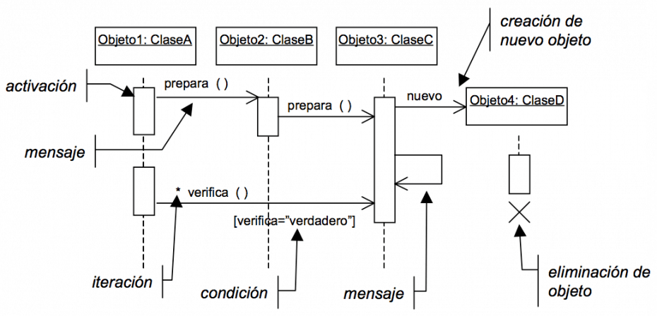

Los mensajes pueden presentar también condiciones e iteraciones. Una condición se representa mediante una expresión booleana encerrada entre corchetes junto a un mensaje, e indica que ese mensaje sólo es enviado en caso de ser cierta la condición. Una iteración se representa con un asterisco y una expresión entre corchetes, que indica el número de veces que se produce.

(Nota.- Esta notación es la más habitual, pero MÉTRICA Versión 3 no exige su utilización).

##### Ejemplo {.unnumbered .unlisted}

Diagrama de secuencia para el caso de uso: Prestar un ejemplar de una aplicación encargada de los préstamos y reservas de una biblioteca:

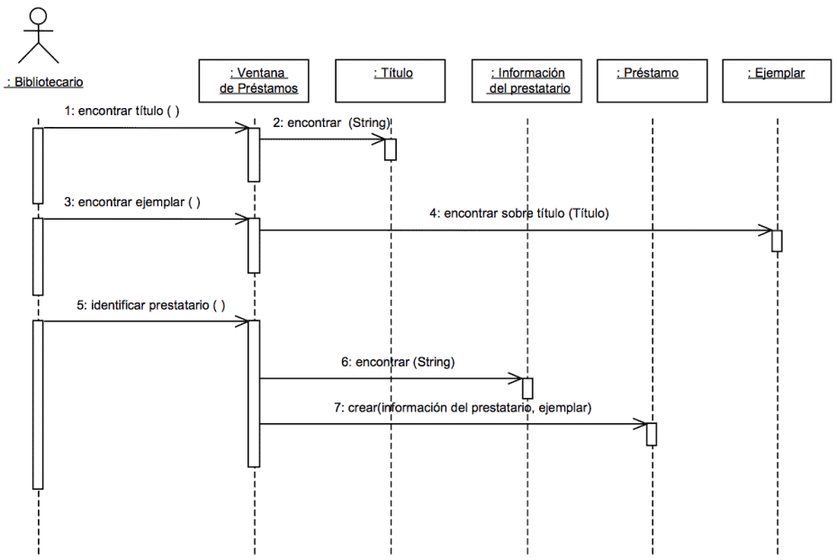

#### Diagrama de Colaboración {#diagrama-de-colaboracion}

El diagrama de colaboración es un tipo de diagrama de interacción cuyo objetivo es describir el comportamiento dinámico del sistema de información mostrando cómo interactúan los objetos entre sí, es decir, con qué otros objetos tiene vínculos o intercambia mensajes un determinado objeto.
Descripción

Un diagrama de colaboración muestra la misma información que un diagrama de secuencia pero de forma diferente. En los diagramas de colaboración no existe una secuencia temporal en el eje vertical; es decir, la colocación de los mensajes en el diagrama no indica cuál es el orden en el que se suceden. Además, la colocación de los objetos es más flexible y permite mostrar de forma más clara cuáles son las colaboraciones entre ellos. En estos diagramas la comunicación entre objetos se denomina vínculo o enlace (link) y estará particularizada mediante los mensajes que intercambian.

##### Notación {.unnumbered .unlisted}

###### Objeto {.unnumbered .unlisted}

Un objeto se representa con un rectángulo dentro del que se incluye el nombre del objeto y, si se desea, el nombre de la clase, separando ambos por dos puntos.

###### Vínculo {.unnumbered .unlisted}

En el diagrama, un vínculo se representa como una línea continua que une ambos objetos y que puede tener uno o varios mensajes asociados en ambas direcciones. Como un vínculo instancia una relación de asociación entre clases, también se puede indicar la navegabilidad del mismo mediante una flecha.

###### Mensaje {.unnumbered .unlisted}

Un mensaje se representa con una pequeña flecha colocada junto a la línea del vínculo al que está asociado. La dirección de la flecha va del objeto emisor del mensaje al receptor del mismo. Junto a ella, se coloca el nombre del mensaje y sus argumentos.

A diferencia de los diagramas de secuencia, en los diagramas de colaboración siempre se muestra el número de secuencia del mensaje delante de su nombre, ya que no hay otra forma de conocer la secuencia de los mismos.

Además, los mensajes pueden tener asociadas condiciones e iteraciones que se representarán como en los diagramas de secuencia.

##### Ejemplo {.unnumbered .unlisted}

Diagrama de colaboración para el caso de uso: Prestar un ejemplar de una aplicación encargada de los préstamos y reservas de una biblioteca.

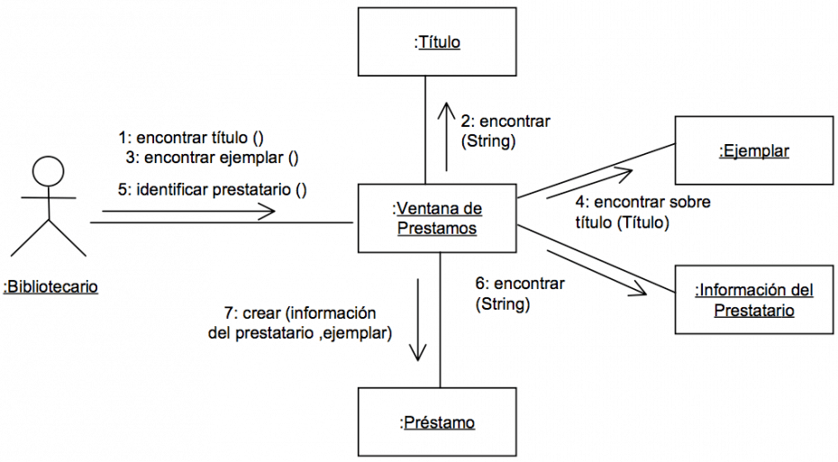

(Nota.- Esta notación es la más habitual, pero MÉTRICA Versión 3 no exige su utilización).

### Diagrama de Paquetes {#diagrama-de-paquetes}
### Diagrama de Transición de Estados {#diagrama-de-transicion-de-estados}
### Modelado de Procesos de la Organización {#modelado-de-procesos-de-la-organizacion}
#### SADT (Structured Analysis and Design Technique) {#sadt}

### Modelo Entidad/Relación Extendido {#modelo-entidad-relacion-extendido}

Se trata de una técnica cuyo objetivo es la representación y definición de todos los datos que se introducen, almacenan, transforman y producen dentro de un sistema de información, sin tener en cuenta las necesidades de la tecnología existente, ni otras restricciones.

Dado que el modelo de datos es un medio para comunicar el significado de los datos, las relaciones entre ellos y las reglas de negocio de un sistema de información, una organización puede obtener numerosos beneficios de la aplicación de esta técnica, pues la definición de los datos y la manera en que éstos operan son compartidos por todos los usuarios.

Las ventajas de realizar un modelo de datos son, entre otras:

* Comprensión de los datos de una organización y del funcionamiento de la organización.
* Obtención de estructuras de datos independientes del entorno físico.
* Control de los posibles errores desde el principio, o al menos, darse cuenta de las deficiencias lo antes posible.
* Mejora del mantenimiento.

Aunque la estructura de datos puede ser cambiante y dinámica, normalmente es mucho más estable que la estructura de procesos. Como resultado, una estructura de datos estable e integrada proporciona datos consistentes que puedan ser fácilmente accesibles según las necesidades de los usuarios, de manera que, aunque se produzcan cambios organizativos, los datos permanecerán estables.

Este diagrama se centra en los datos, independientemente del procesamiento que los transforma y sin entrar en consideraciones de eficiencia. Por ello, es independiente del entorno físico y debe ser una fiel representación del sistema de información objeto del estudio, proporcionando a los usuarios toda la información que necesiten y en la forma en que la necesiten.

#### Descripción {.unnumbered .unlisted}

El modelo entidad/relación extendido describe con un alto nivel de abstracción la distribución de datos almacenados en un sistema. Existen dos elementos principales: las entidades y las relaciones. Las extensiones al modelo básico añaden además los atributos de las entidades y la jerarquía entre éstas. Estas extensiones tienen como finalidad aportar al modelo una mayor capacidad expresiva.

Los elementos fundamentales del modelo son los siguientes:

##### Entidad {.unnumbered .unlisted}

Es aquel objeto, real o abstracto, acerca del cual se desea almacenar información en la base de datos. La estructura genérica de un conjunto de entidades con las mismas características se denomina tipo de entidad.

Existen dos clases de entidades: regulares, que tienen existencia por sí mismas, y débiles cuya existencia depende de otra entidad. Las entidades deben cumplir las siguientes tres reglas:

* Tienen que tener existencia propia.
* Cada ocurrencia de un tipo de entidad debe poder distinguirse de las demás.
* Todas las ocurrencias de un tipo de entidad deben tener los mismos atributos.

##### Relación {.unnumbered .unlisted}

Es una asociación o correspondencia existente entre una o varias entidades. La relación puede ser regular, si asocia tipos de entidad regulares, o débil, si asocia un tipo de entidad débil con un tipo de entidad regular. Dentro de las relaciones débiles se distinguen la **dependencia en existencia** y la **dependencia en identificación**.

Se dice que la dependencia es en existencia cuando las ocurrencias de un tipo de entidad débil no pueden existir sin la ocurrencia de la entidad regular de la que dependen. Se dice que la dependencia es en identificación cuando, además de lo anterior, las ocurrencias del tipo de entidad débil no se pueden identificar sólo mediante sus propios atributos, sino que se les tiene que añadir el identificador de la ocurrencia de la entidad regular de la cual dependen.

Además, se dice que una relación es **exclusiva** cuando la existencia de una relación entre dos tipos de entidades implica la no existencia de las otras relaciones.

Una relación se caracteriza por:

* **Nombre**: que lo distingue unívocamente del resto de relaciones del modelo.
* **Tipo de correspondencia**: es el número máximo de ocurrencias de cada tipo de entidad que pueden intervenir en una ocurrencia de la relación que se está tratando.
* Conceptualmente se pueden identificar tres clases de relaciones:
  * Relaciones 1:1: Cada ocurrencia de una entidad se relaciona con una y sólo una ocurrencia de la otra entidad.
  * Relaciones 1:N: Cada ocurrencia de una entidad puede estar relacionada con cero, una o varias ocurrencias de la otra entidad.
  * Relaciones M:N: Cada ocurrencia de una entidad puede estar relacionada con cero, una o varias ocurrencias de la otra entidad y cada ocurrencia de la otra entidad puede corresponder a cero, una o varias ocurrencias de la primera.
* **Cardinalidad**: representa la participación en la relación de cada una de las entidades afectadas, es decir, el número máximo y mínimo de ocurrencias de un tipo de entidad que pueden estar interrelacionadas con una ocurrencia de otro tipo de entidad. La cardinalidad máxima coincide con el tipo de correspondencia.

Según la cardinalidad, una relación es obligatoria, cuando para toda ocurrencia de un tipo de entidad existe al menos una ocurrencia del tipo de entidad asociado, y es opcional cuando, para toda ocurrencia de un tipo de entidad, puede existir o no una o varias ocurrencias del tipo de entidad asociado.

##### Dominio {.unnumbered .unlisted}

Es un conjunto nominado de valores homogéneos. El dominio tiene existencia propia con independencia de cualquier entidad, relación o atributo.

##### Atributo {.unnumbered .unlisted}

Es una propiedad o característica de un tipo de entidad. Se trata de la unidad básica de información que sirve para identificar o describir la entidad. Un atributo se define sobre un dominio. Cada tipo de entidad ha de tener un conjunto mínimo de atributos que identifiquen unívocamente cada ocurrencia del tipo de entidad. Este atributo o atributos se denomina identificador principal. Se pueden definir restricciones sobre los atributos, según las cuales un atributo puede ser:

* Univaluado, atributo que sólo puede tomar un valor para todas y cada una de las ocurrencias del tipo de entidad al que pertenece.
* Obligatorio, atributo que tiene que tomar al menos un valor para todas y cada una de las ocurrencias del tipo de entidad al que pertenece.

Además de estos elementos, existen extensiones del modelo entidad/relación que incorporan determinados conceptos o mecanismos de abstracción para facilitar la representación de ciertas estructuras del mundo real:

* La **generalización**, permite abstraer un tipo de entidad de nivel superior (supertipo) a partir de varios tipos de entidad (subtipos); en estos casos los atributos comunes y relaciones de los subtipos se asignan al supertipo. Se pueden generalizar por ejemplo los tipos *profesor* y *estudiante* obteniendo el supertipo *persona*.
* La **especialización** es la operación inversa a la generalización, en ella un supertipo se descompone en uno o varios subtipos, los cuales heredan todos los atributos y relaciones del supertipo, además de tener los suyos propios. Un ejemplo es el caso del tipo *empleado*, del que se pueden obtener los subtipos *secretaria*, *técnico* e *ingeniero*.
* **Categorías**. Se denomina categoría al subtipo que aparece como resultado de la unión de varios tipos de entidad. En este caso, hay varios supertipos y un sólo subtipo. Si por ejemplo se tienen los tipos persona y compañía y es necesario establecer una relación con *vehículo*, se puede crear propietario como un subtipo unión de los dos primeros.
* La **agregación**, consiste en construir un nuevo tipo de entidad como composición de otros y su tipo de relación y así poder manejarlo en un nivel de abstracción mayor. Por ejemplo, se tienen los tipos de entidad *empresa* y *solicitante de empleo* relacionados mediante el tipo de relación entrevista; pero es necesario que cada entrevista se corresponda con una determinada *oferta de empleo*. Como no se permite la relación entre tipos de relación, se puede crear un tipo de entidad compuesto por *empresa*, *entrevista* y *solicitante de empleo* y relacionarla con el tipo de entidad *oferta de empleo*. El proceso inverso se denomina desagregación.
* La **asociación**, consiste en relacionar dos tipos de entidades que normalmente son de dominios independientes, pero coyunturalmente se asocian.

La existencia de supertipos y subtipos, en uno o varios niveles, da lugar a una **jerarquía**, que permitirá representar una restricción del mundo real.

Una vez construido el modelo entidad/relación, hay que analizar si se presentan redundancias. Para poder asegurar su existencia se deben estudiar con mucho detenimiento las cardinalidades mínimas de las entidades, así como la semántica de las relaciones.

Los atributos redundantes, los que se derivan de otros elementos mediante algún calculo, deben ser eliminados del modelo entidad/relación o marcarse como redundantes.

Igualmente, las relaciones redundantes deben eliminarse del modelo, comprobando que al eliminarlas sigue siendo posible el paso, tanto en un sentido como en el inverso, entre las dos entidades que unían.

#### Notación {.unnumbered .unlisted}

##### Entidad {.unnumbered .unlisted}
La representación gráfica de un tipo de entidad regular es un rectángulo etiquetado con el nombre del tipo de entidad. Un tipo de entidad débil se representa con dos rectángulos concéntricos con su nombre en el interior.

##### Relación {.unnumbered .unlisted}

Se representa por un rombo unido a las entidades relacionadas por dos líneas rectas a los lados. El tipo de correspondencia se representa gráficamente con una etiqueta 1:1, 1:N o M:N, cerca de alguno de los vértices del rombo, o bien situando cada número o letra cerca de la entidad correspondiente, para mayor claridad.

La representación gráfica de las cardinalidades se realiza mediante una etiqueta del tipo (0,1), (1,1), (0,n) o (1,n), que se coloca en el extremo de la entidad que corresponda. Si se representan las cardinalidades, la representación del tipo de correspondencia es redundante.

##### Atributo {.unnumbered .unlisted}

Un atributo se representa mediante una elipse, con su nombre dentro, conectada por una línea al tipo de entidad o relación.

En lugar de una elipse puede utilizarse un círculo con el nombre dentro, o un círculo más pequeño con el nombre del atributo a un lado. También pueden representarse en una lista asociada a la entidad. El identificador aparece con el nombre marcado o subrayado, o bien con su círculo en negro.

##### Exclusividad {.unnumbered .unlisted}

En la representación de las relaciones exclusivas se incluye un arco sobre las líneas que conectan el tipo de entidad a los dos o más tipos de relación.

##### Jerarquía (tipos y subtipos) {.unnumbered .unlisted}

La representación de las jerarquías se realiza mediante un triángulo invertido, con la base paralela al rectángulo que representa el supertipo y conectando a éste y a los subtipos. Si la división en subtipos viene determinada en función de los valores de un atributo discriminante, éste se representará asociado al triángulo que representa la relación.

En el triángulo se representará: con una letra d el hecho de que los subtipos sean disjuntos, con un círculo o una O si los subtipos pueden solaparse y con una U el caso de uniones por categorías. La presencia de una jerarquía total se representa con una doble línea entre el supertipo y el triángulo.

#### Ejemplo {.unnumbered .unlisted}

Modelo entidad-relación extendido para un sistema de gestión de técnicos y su asignación a proyectos dentro de una empresa u organización.

Como se aprecia en el diagrama, TÉCNICO es un subtipo de EMPLEADO, generado por especialización, pues era necesario para establecer la relación Trabaja en con PROYECTO, ya que no todos los empleados de la empresa, como los administrativos, son susceptibles de trabajar en un proyecto. La entidad TÉCNICO tendrá los atributos de EMPLEADO más el atributo nivel.

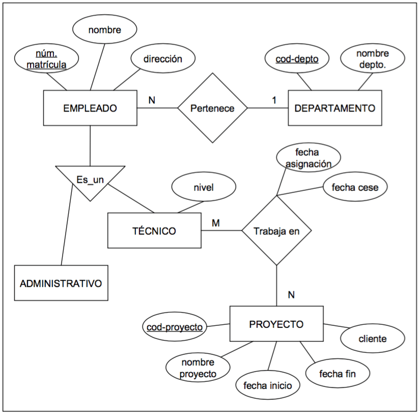

Los tipos de correspondencia son `1:N` entre DEPARTAMENTO y EMPLEADO, pues un departamento tiene 1 o varios empleados. Entre TÉCNICO y PROYECTO es `M:N`, pues un técnico puede trabajar en 1 o varios proyectos, y en un proyecto trabajan 1 o varios técnicos.

Por otro lado, se han incluido atributos que caracterizan la relación *Trabaja en*, como son *fecha de asignación* y *fecha de cese*, ya que un técnico no siempre estará trabajando en un proyecto, sino en determinado periodo. (Nota.- Esta notación es la más habitual, pero MÉTRICA Versión 3 no exige su utilización).

### Normalización {#normalizacion}
### Optimización {#optimizacion}
### Reglas de Obtención del Modelo Físico a partir del Lógico  {#reglas-de-obtencion-del-modelo-fisico-a-partir-del-logico}

El objetivo de esta técnica es obtener un modelo físico de datos a partir del modelo lógico de datos normalizado. Para ello es necesario aplicar un conjunto de reglas que conserven la semántica del modelo lógico.

#### Descripción {.unnumbered .unlisted}

Cada uno de los elementos del modelo lógico se tiene que transformar en un elemento del modelo físico. En algunos casos la transformación es directa porque el concepto se soporta igual en ambos modelos, pero otras veces no existe esta correspondencia, por lo que es necesario buscar una transformación que conserve lo mejor posible la semántica, teniendo en cuenta los aspectos de eficiencia que sean necesarios en cada caso.

##### Transformación de entidades {.unnumbered .unlisted}

Una entidad se transforma en una tabla.

##### Transformación de atributos de entidades {.unnumbered .unlisted}

Cada atributo se transforma en una columna de la tabla en la que se transformó la entidad a la que pertenece. El identificador único se convierte en clave primaria.

Si existen restricciones asociadas a los atributos, éstas pueden recogerse con algunas cláusulas del lenguaje lógico, que se convertirán en disparadores cuando éstos sean soportados por el sistema gestor de base de datos.

##### Transformación de relaciones {.unnumbered .unlisted}

Según el tipo de correspondencia:

* **Relaciones 1:N**, se propaga el identificador de la entidad de cardinalidad máxima 1 a la que es N, teniendo en cuenta que:
  * Si la relación es de asociación, la clave propagada es clave ajena en la tabla a la que se ha propagado.
  * Si la relación es de dependencia, la clave primaria de la tabla correspondiente a la entidad débil está formada por la concatenación de los identificadores de ambas entidades.
* **Relaciones 1:1**, es un caso particular de las 1:N y por tanto se propaga la clave en las dos direcciones. Se debe analizar la situación, intentando recoger la mayor semántica posible, y evitar valores nulos.

Las relaciones de agregación se transforman del mismo modo que las 1:N.

##### Transformación de relaciones exclusivas {.unnumbered .unlisted}

Después de haber realizado la transformación según las relaciones 1:N, se debe tener en cuenta que si los identificadores propagados se han convertido en claves ajenas de la tabla originada por la entidad común a las relaciones, hay que comprobar que una y sólo una de esas claves es nula en cada ocurrencia. En otro caso, estas comprobaciones se deben hacer en las tablas resultantes de transformar las relaciones.

Transformación de la jerarquía {.unnumbered .unlisted}

Existen varias posibilidades que deben ser evaluadas por el diseñador a fin de elegir la que mejor se ajuste a los requisitos. Las opciones para tratar la transformación de la jerarquía son:

* **Opción a**: Consiste en crear una tabla para el supertipo que tenga de clave primaria el identificador y una tabla para cada uno de los subtipos que tengan el identificador del supertipo como clave ajena.
    Esta solución es apropiada cuando los subtipos tienen muchos atributos distintos y se quieren conservar los atributos comunes en una tabla. También se deben implantar las restricciones y aserciones adecuadas. Es la solución que mejor conserva la semántica.
* **Opción b**: Se crea una tabla para cada subtipo, los atributos comunes aparecen en todos los subtipos y la clave primaria para cada tabla es el identificador del supertipo.
    Esta opción mejora la eficiencia en los accesos a todos los atributos de un subtipo, sean los comunes al supertipo o los específicos.
* **Opción c**: Agrupar en una tabla todos los atributos de la entidad supertipo y de los subtipos. La clave primaria de esta tabla es el identificador de la entidad. Se añade un atributo que indique a qué subtipo pertenece cada ocurrencia (el atributo discriminante de la jerarquía). Esta solución puede aplicarse cuando los subtipos se diferencien en pocos atributos y las relaciones entre los subtipos y otras entidades sean las mismas. Para el caso de que la jerarquía sea total, el atributo discriminante no podrá tomar valor nulo (ya que toda ocurrencia pertenece a alguna de las entidades subtipo).

#### Notación {.unnumbered .unlisted}

##### Tabla {.unnumbered .unlisted}

La representación gráfica de una tabla es un rectángulo con una línea horizontal que lo divide en dos. La parte superior, de ancho menor, se etiqueta con el nombre de la tabla.

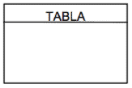

##### Relación {.unnumbered .unlisted}

La relación entre tablas se representa gráficamente mediante una línea que las une. En ella pueden aparecer en sus extremos diversos símbolos para indicar la cardinalidad de la relación, como se muestra a continuación:

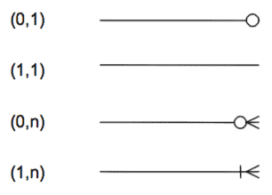

#### Ejemplo {.unnumbered .unlisted}

Sea el diagrama entidad-relación del ejemplo realizado para la Normalización sobre conocimientos de técnicos informáticos y su asignación a proyectos.

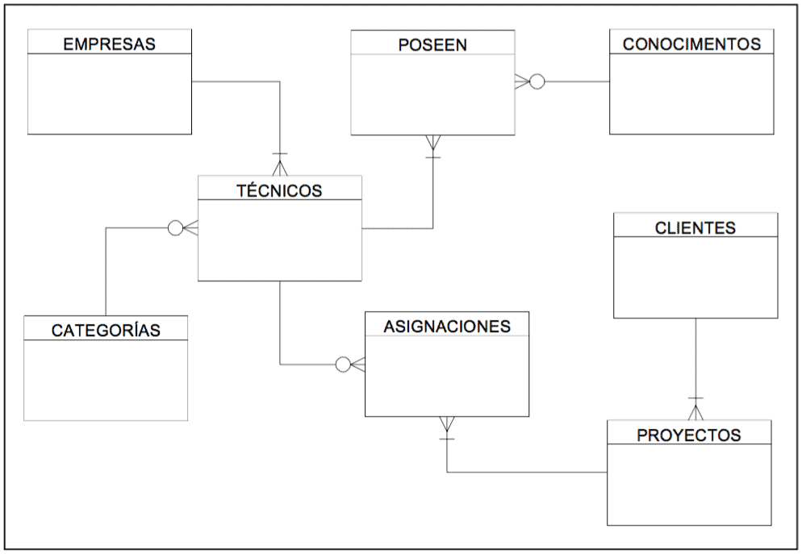

El modelo físico de la figura muestra que cada una de las entidades se ha convertido en una tabla, cuyo contenido coincide con los atributos de la entidad. Pero hay dos tablas más: POSEEN, que surge de la relación del mismo nombre y ASIGNACIONES, que se origina a partir de la relación Están asignados.

La tabla POSEEN está formada por su atributo grado, más cod_empresa, cod_tecnico y cod_conoc. La tabla ASIGNACIONES se forma con los atributos clave cod_empresa, cod_tecnico y cod_proyecto y los propios f_asignación y f_cese.

La relación entre EMPRESAS y TÉCNICOS era 1:N, y la cardinalidad de la figura así lo muestra, pues la empresa siempre estará compuesta de uno o varios técnicos. Lo mismo sucede entre CLIENTES y PROYECTOS: un cliente siempre tendrá 1 o varios proyectos contratados.

El caso de CATEGORÍAS y TÉCNICOS es (0,n). Cada técnico es de una categoría y una categoría corresponde, por regla general, a varios técnicos, pero puede existir alguna en la que no encaje ningún técnico (contable, secretaria de dirección, etc.).

La situación del subconjunto TÉCNICOS-POSEEN-CONOCIMIENTOS tiene algo más de complejidad. Un técnico posee normalmente varios conocimientos, pero debe poseer al menos uno para que tenga sentido su situación. La cardinalidad es pues (1,n) entre TÉCNICOS y POSEEN. En el otro lado, lo natural es que un conocimiento sea poseído por varios técnicos, sin embargo puede existir algún conocimiento que no sea poseído por ningún técnico, por lo que la cardinalidad es (0,n) y dibujada desde la tabla CONOCIMIENTOS a POSEEN.

Por último, en el subconjunto TÉCNICOS-ASIGNACIONES-PROYECTOS, se dispone de: una cardinalidad (0,n), pues a un proyecto estarán asignados uno o más técnicos, pero puede haber algún técnico que, en un momento dado, no esté asignado aún a ningún proyecto y una cardinalidad (1,n), pues un proyecto siempre tendrá asignado al menos a un técnico, o varios.

(Nota.- La notación utilizada para el ejemplo es la más habitual, pero MÉTRICA Versión 3 no exige su utilización).

### Reglas de Transformación {#reglas-de-transformacion}

El objetivo de esta técnica es obtener un modelo físico de datos a partir del modelo de clases. Para ello es necesario aplicar un conjunto de reglas de transformación que conserven la semántica del modelo de clases.

#### Descripción {.unnumbered .unlisted}

Cada uno de los elementos del modelo de clases se tiene que transformar en un elemento del modelo físico. En algunos casos la transformación es directa porque el concepto se soporta igual en ambos modelos, pero otras veces no existe esta correspondencia, por lo que es necesario buscar una transformación que conserve lo mejor posible la semántica, teniendo en cuenta los aspectos de eficiencia que sean necesarios en cada caso.

##### Transformación de clases {.unnumbered .unlisted}

Una clase se transforma en una tabla. Lo habitual es que en los modelos con herencia pueden surgir excepciones cuando se apliquen las reglas de transformación propias de la herencia. Además, es posible que dos clases se transformen en una sola tabla cuando el comportamiento de una de ellas sea irrelevante en la base de datos.

##### Transformación de atributos de clases {.unnumbered .unlisted}

Cada atributo se transforma en una columna de la tabla en la que se transformó la clase a la que pertenece. El identificador único se convierte en clave primaria. Además, se deben tener en cuenta las reglas de transformación que se aplican a la herencia de clases.

Si existen restricciones asociadas a los atributos, éstas pueden recogerse con algunas cláusulas del lenguaje lógico, que se convertirán en disparadores cuando éstos sean soportados por el sistema gestor de base de datos.

##### Transformación de relaciones {.unnumbered .unlisted}

Según el tipo de correspondencia:

* **Relaciones M:N**, se transforman en una tabla, cuya clave primaria es la concatenación de los identificadores de las clases asociadas, siendo cada uno de ellos clave ajena de la propia tabla. Si la relación tiene atributos, éstos se transforman en columnas de la tabla.
* **Relaciones 1:N**, existen varias posibilidades:
  * Propagar el identificador de la clase de cardinalidad máxima 1 a la que es N, teniendo en cuenta que:
    * Si la relación es de asociación, la clave propagada es clave ajena en la tabla a la que se ha propagado.
    * Si la relación es de dependencia, la clave primaria de la tabla correspondiente a la clase débil está formada por la concatenación de los identificadores de ambas clases.
  * La relación se transforma en una tabla de clave primaria sólo el identificador de la clase de cardinalidad máxima N si:
    * La relación tiene atributos propios y se desea que aparezcan como tales.
    * Se piensa que en un futuro la relación puede convertirse en M:N.
    * El número de ocurrencias relacionadas de la clase que propaga su clave es muy pequeño (y por tanto pueden existir muchos valores nulos).
    Al igual que en el caso de relaciones M:N, las claves propagadas son claves ajenas de la nueva tabla creada.
* **Relaciones 1:1**, es un caso particular de las 1:N y se puede tanto crear una tabla o propagar la clave, si bien, en este último caso, la clave se propaga en las dos direcciones. Para decidir qué solución adoptar, se debe analizar la situación, intentando recoger la mayor semántica posible, y evitar valores nulos.
  Las relaciones de agregación se transforman del mismo modo que las 1:N.

##### Transformación de relaciones exclusivas {.unnumbered .unlisted}

Después de haber realizado la transformación según las relaciones 1:N, se debe tener en cuenta que si se han propagado los atributos de las clases, convirtiéndose en claves ajenas de la tabla que provenía de la clase común a las relaciones, hay que comprobar que una y sólo una de esas claves es nula en cada ocurrencia. En caso de no propagarse las claves, estas comprobaciones se deben hacer en las tablas resultantes de transformar las relaciones.

##### Transformación de la herencia {.unnumbered .unlisted}

Existen varias posibilidades que deben ser evaluadas por el diseñador a fin de elegir la que mejor se ajuste a los requisitos. Las opciones para tratar la transformación de la herencia son:

* **Opción a**: Consiste en crear una tabla para la superclase que tenga de clave primaria el identificador y una tabla para cada una de las subclases que tengan el identificador de la superclase como clave ajena.
    Esta solución es apropiada cuando las subclases tienen muchos atributos distintos, y se quieren conservar los atributos comunes en una tabla. También se deben implantar las restricciones y/o aserciones adecuadas. Es la solución que mejor conserva la semántica.
* **Opción b**: Se crea una tabla para cada subclase, los atributos comunes aparecen en todas las subclases y la clave primaria para cada tabla es el identificador de la superclase.
    Esta opción mejora la eficiencia en los accesos a todos los atributos de una subclase (los heredados y los específicos).
* **Opción c**: Agrupar en una tabla todos los atributos de la clase y sus subclases. La clave primaria de esta tabla es el identificador de la clase. Se añade un atributo que indique a qué subclase pertenece cada ocurrencia (el atributo discriminante de la jerarquía).

Esta solución puede aplicarse cuando las subclases se diferencien en pocos atributos y las relaciones que asocian a las subclases con otras clases, sean las mismas. Para el caso de que la jerarquía sea total, el atributo discriminante no podrá tomar valor nulo (ya que toda ocurrencia pertenece a alguna subclase).

### Técnicas Matriciales {#tecnicas-matriciales}

Las técnicas matriciales tienen como objetivo representar las relaciones existentes entre distintos tipos de entidades, objetos o cualquier otro elemento del sistema.

Se utilizan, principalmente, para analizar la consistencia entre los modelos generados durante el desarrollo, comprobar la trazabilidad con los requisitos especificados por el usuario, etc.

#### Descripción {.unnumbered .unlisted}

Las técnicas matriciales son útiles para representar las relaciones entre elementos comunes de los distintos modelos, tales como entidades/procesos, procesos/diálogos, datos/localización geográfica, y asegurar que los modelos son coherentes entre sí.

Las siguientes son algunas de las matrices empleadas en MÉTRICA Versión 3:

* Procesos/localización geográfica: permite representar la localización geográfica de los procesos de una organización.
* Almacenes de datos/entidades del modelo lógico de datos normalizado: establece las relaciones existentes entre los almacenes de datos y las entidades, y permite verificar que cada almacén de datos definido en el modelo de procesos se corresponde con una o varias entidades del modelo lógico de datos normalizado.
* Atributos de interfaz/atributos de entidades del modelo lógico de datos normalizado: permite verificar que los atributos que aparecen en cada diálogo de la interfaz de usuario forman parte del modelo lógico de datos normalizado.
* Entidades/procesos: permite representar el tratamiento lógico de los procesos sobre los datos del sistema y verificar que cada entidad del modelo lógico de datos normalizado es accedida por algún proceso primitivo representado en el DFD.
* Diálogos/procesos: permite representar los diálogos asociados a un proceso interactivo y verificar que cada proceso interactivo tiene asociado al menos un diálogo.
* Objetos Diagrama de interacción / clases, atributos al modelo de clases: permite verificar que cada mensaje entre objetos se corresponde con un método de una clase.
* Mensajes Diagrama de interacción / métodos, atributos del modelo de clases: permite verificar que una clase tiene capacidad para proporcionar los datos que se soliciten en los mensajes que recibe.
* Evento, acción, actividad de clases/ métodos de clases: permite verificar que todo evento, actividad o acción de una clase se corresponde con un método de esa clase.
* Clases/elementos del modelo físico de datos: permite verificar que cada elemento del modelo físico de datos se corresponde con un elemento del modelo de clases.
* Dependencias entre subsistemas/subsistemas: permite representar para cada subsistema, los subsistemas que dependen de él.
* Esquemas físicos de datos /nodos: permite representar la localización física de los datos en los nodos de la arquitectura del sistema, así como verificar que cada esquema del modelo físico de datos está asociado con un nodo del particionamiento físico del sistema de información.

#### Notación {.unnumbered .unlisted}

Dados dos tipos de elementos A y B, su representación será una matriz bidimensional NxM, siendo N el número de elementos de A, y M el número de elementos de B.

En el cruce de una fila y una columna (C), se tendrá el modo en que se relacionan un elemento concreto de A y uno de B.

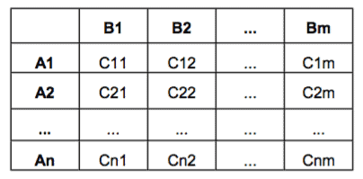

## Técnicas de gestión de proyectos {#tecnicas-de-gestion-de-proyectos}

La Gestión de Proyectos es un conjunto de actividades específicas que se emplean para la administración del proyecto. Estas actividades comprenden diversos aspectos:

* Estimación del esfuerzo necesario para el desarrollo de un Sistema de Información.
* Planificación de tareas y recursos.
* Control de tareas.
* Seguimiento del proyecto.
* Control de las incidencias.
* Control de cambios.

Para el desarrollo de dichas actividades es necesaria la utilización de técnicas específicas para ello. En esta parte del documento de Técnicas y Prácticas se contemplan tales técnicas.

1. [Técnicas de Estimación](#tecnicas-de-estimacion)
  * [Método Albrecht para el Análisis de los Puntos Función](#metodo-albrecht)
  * [Método MARK II para el Análisis de los Puntos Función](#metodo-mark-ii)
2. [Staffing Size (Orientación a Objetos)](#staffing-size)
3. [Planificación](#planificacion)
  * [Program Evaluation & Review Technique – PERT](#pert)
  * [Diagrama de Gantt](#diagrama-de-gantt)
  * [Estructura de Descomposición de Trabajo (WBS – Work Breakdown Structure)](#estructura-de-descomposicion-de-trabajo)
  * [Diagrama de Extrapolación](#diagrama-de-extrapolacion)

### Técnicas de Estimación {#tecnicas-de-estimacion}

Las técnicas de estimación tienen como objetivo calcular el coste total del desarrollo de un sistema de información.

#### Descripción {.unnumbered .unlisted}

La estimación del coste de los productos de software es una de las actividades más difíciles y propensas a error de la ingeniería del software. Es difícil hacer una estimación exacta de coste al comienzo de un desarrollo debido al gran número de factores conocidos o esperados que determinan la complejidad y desconocidos o no esperados que van a producirse en cualquier momento, determinando la incertidumbre.

Las técnicas de estimación ayudan en esta tarea y dan como resultado un número de horas de esfuerzo, a partir de las cuales se calculará el coste correspondiente.

La estimación nos aportará un número de horas aproximado que habrá que combinar con los recursos para obtener la planificación de actividades en el tiempo y establecer los hitos del proyecto.

Las técnicas de estimación más fiables se basan en el análisis de Puntos Función. La técnica de Puntos Función permite la evaluación de un sistema de información a partir de un mínimo conocimiento de las funcionalidades y entidades que intervienen.

Las características más destacables de esta técnica son:

* Es una unidad de medida empírica.
* Contempla el sistema como un todo que se divide en determinadas funciones.
* Es independiente del entorno tecnológico en que se ha de desarrollar el sistema.
* Es independiente de la metodología que vaya a ser utilizada.
* Es independiente de la experiencia y del estilo de programación.
* Es fácil de entender por el usuario.

El resultado de la aplicación de esta técnica viene dado en **Puntos Función**, que posteriormente habrán de ser pasados a días de esfuerzo, para lo que sí habrán de tenerse en cuenta la experiencia del equipo de desarrollo y el estilo de programación, la aplicación de una u otra metodología y la tecnología.

Este cálculo de días por punto función debe basarse en la experiencia adquirida en la valoración y realización de sistemas anteriores, debiendo actualizarse el valor de conversión con posterioridad a la finalización de cada proyecto.

Entre las técnicas de estimación basadas en el análisis de puntos función, se destacan los siguientes dos métodos:

- [Método Albrecht](#metodo-albrecht)
- [Método MARK II](#metodo-mark-ii)

#### Método Albrecht para el Análisis de los Puntos Función {#metodo-albrecht}

Para proceder al cálculo de los puntos función de un sistema han de realizarse tres etapas:

- Identificación de los componentes necesarios para el cálculo.
- Cálculo de los Puntos Función no ajustados.
- Ajuste de los Puntos Función.

##### Identificación de los componentes {.unnumbered .unlisted}

En esta etapa se identifican los elementos a tener en cuenta para el cálculo de los puntos función. Primeramente se enumeran todos los componentes de cada tipo (entradas externas, salidas externas, grupos lógicos de datos internos, grupos lógicos de datos de interfaz y consultas externas); seguidamente, se evalúa individualmente la complejidad de cada uno de ellos, utilizando unas tablas ya establecidas que proporcionan el factor de complejidad de cada componente individual, siendo estos factores: COMPLEJO, MEDIO o SENCILLO.

A continuación se describen los distintos componentes que han de tenerse en cuenta para el cálculo y la forma de determinar su complejidad en cada caso.

###### Entradas externas {.unnumbered .unlisted}

- Son todos aquellos grupos de datos o mandatos de control de usuario que entran en la aplicación y añaden o cambian información en un grupo lógico de datos interno.
- Una entrada es única si difiere en su formato o si arranca procesos diferentes.
- Para el análisis de este componente se utiliza la siguiente matriz de complejidad:

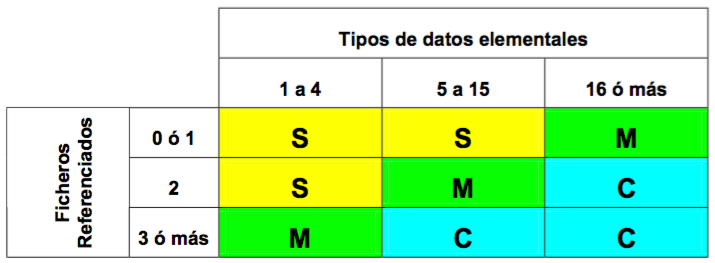

Los tipos de entrada aplicables son los siguientes:

- Documento tecleado.
- Documento de lectura óptica.
- Pantalla.
- Disquete / CD.
- Cinta magnética.
- Interruptor.
- Sensor digital.
- Sensor analógico.
- Tecla de función.
- Puntero electrónico.

##### Salidas externas {.unnumbered .unlisted}

- Son todos aquellos grupos lógicos de datos o mandatos de control de usuario que salen de la aplicación.
- Una salida es única si difiere en su formato o si es generada por procesos lógicos diferentes.

Para el análisis de este componente se utiliza la siguiente matriz de complejidad:

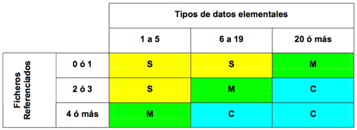

Los tipos de salida aplicables son los siguientes:

- Informe por pantalla.
- Informe por impresora.
- Informe por lotes.
- Transacción automática.
- Escritura en disquete.
- Escritura en soporte magnético / óptico.
- Mensaje por pantalla.
- Accionamiento digital.
- Accionamiento analógico.
- Factura, recibo, albarán, etc.

##### Grupos lógicos de datos internos {.unnumbered .unlisted}

- Son aquellos grupos lógicos de datos o información de control interna que se generan, son usados y mantiene la aplicación.
- No deben incluirse aquellos grupos lógicos de datos que no sean accesibles por el usuario a través de entradas o salidas externas, ficheros de interfaz o consultas.
- Para el análisis de este componente se utiliza la siguiente matriz de complejidad:

Los tipos de datos internos o ficheros aplicables son los siguientes:

- Fichero lógico interno.
- Base de datos.
- Tabla de usuario.
- Fichero de control o proceso secuencial por lotes.
- Fichero de query de usuario.

##### Grupos lógicos de datos de interfaz {.unnumbered .unlisted}

- Son aquellos grupos lógicos de datos compartidos con otra aplicación, recibidos o enviados a ella.
- Los grupos lógicos internos que son a su vez interfaz, deben contarse en ambos grupos.

Para el análisis de este componente se utiliza la siguiente matriz de complejidad:

Los tipos de datos o ficheros de interfaz aplicables son los siguientes:

- Fichero lógico interno accesible desde otra aplicación.
- Fichero lógico interno accesible para otra aplicación.
- Bases de datos compartidas.

##### Consultas externas {.unnumbered .unlisted}

- Son entradas de usuario u otra aplicación que generan una salida inmediata.
- Son consecuencia de una búsqueda y no una actualización de un grupo lógico de datos interno.
- Se utilizará la matriz de Entradas Externas para calificar la parte correspondiente a la entrada.
- Se utilizará la matriz de Salidas Externas para calificar la parte correspondiente a la salida.
- Se seleccionará la más compleja.

Los tipos de consultas aplicables son los siguientes:

- Consulta de usuario sin actualización de ficheros.
- Pantalla o mensaje de ayuda.
- Menú de selección.

##### Cálculo de los Puntos Función no ajustados {.unnumbered .unlisted}

Una vez concluida la etapa anterior se pasan los resultados a la tabla de conversión, que aparece a continuación, dando un peso para cada tipo de componente por su complejidad.

+-----------------------------------------------+----------+----------+----------+------------+
| DESCRIPCIÓN                                   | SENCILLA | MEDIA    | COMPLEJA | TOTAL P.F. |
+===============================================+==========+==========+==========+============+
| Nº de Entradas Externas                       | x 3      | x 4      | x 6      |            |
+-----------------------------------------------+----------+----------+----------+------------+
| Nº de Salidas Externas                        | x 4      | x 5      | x 7      |            |
+-----------------------------------------------+----------+----------+----------+------------+
| Nº Grupos Lógicos de Datos Internos           | x 7      | x 10     | x 15     |            |
+-----------------------------------------------+----------+----------+----------+------------+
| Nº de Grupos Lógicos de Datos de Interfaz     | x 5      | x 7      | x 10     |            |
+-----------------------------------------------+----------+----------+----------+------------+
| Nº de Consultas Externas                      | x 3      | x 4      | x 6      |            |
+-----------------------------------------------+----------+----------+----------+------------+
| TOTAL PUNTOS FUNCIÓN NO AJUSTADOS (PFNA)                                       |            |
+--------------------------------------------------------------------------------+------------+

Una vez calculado el número de funciones y determinada su complejidad, no hay más que llevar los valores obtenidos a la tabla. La suma de los resultados parciales da el valor en PUNTOS FUNCIÓN NO AJUSTADOS (PFNA).

Los distintos factores fueron obtenidos de la investigación llevada a cabo por Allan J. Albrecht. Según sus propias palabras, a base de ensayos y negociaciones. No obstante, alguno de los pesos podrían variarse para reflejar mejor las características peculiares de otra organización u otro tipo especial de desarrollo.

El método para el cálculo es el siguiente:

    Identificar las funciones que intervienen. Estas funciones deben ser las que aparecen en el diagrama 0.
    Clasificar cada función.
    Incorporar cada función a la tabla.
    Sumar los valores obtenidos.

La suma representa la complejidad del proyecto en PUNTOS FUNCIÓN NO AJUSTADOS.

##### Ajuste de los Puntos Función {.unnumbered .unlisted}

Esta etapa tiene como objetivo la adaptación de la estimación a las condiciones de trabajo bajo las que el sistema ha de ser desarrollado. De esta adaptación se obtiene el valor definitivo en Puntos Función del Sistema que se está evaluando, aplicándole correcciones dependiendo de las características de la aplicación que afecten a la complejidad de la misma.

Existen 14 atributos de ajuste que impactan en el desarrollo y que deben ser evaluados, si bien se evalúan independientemente.

A cada atributo se le asignará un valor entre 0 y 5, dependiendo del grado de influencia de éstos. Los posibles valores son:

    Sin influencia (0). El sistema no contempla este atributo.
    Influencia mínima (1). La influencia de este atributo es muy poco significativa.
    Influencia moderada (2). El sistema contempla este atributo y su influencia, aunque pequeña, ha de ser considerada.
    Influencia apreciable (3). La importancia de este atributo debe ser tenida en cuenta, aunque no es fundamental.
    Influencia significativa (4). Este atributo tiene una gran importancia para el Sistema.
    Influencia muy fuerte (5). Este atributo es esencial para el Sistema y ha de ser tenido en cuenta a la hora del diseño.

Los 14 atributos que se contemplan en esta técnica y sus significados aparecen a continuación.

    Comunicación de datos: Los datos usados en la aplicación se envían o reciben por teleproceso. Los posibles valores para este atributo son:
        0 – La aplicación es un proceso por lotes puro.
        1 – Proceso por lotes con impresión remota o entrada remota de datos.
        2 – Proceso por lotes con impresión remota y entrada remota de datos .
        3 – El TP es la interfaz para un proceso por lotes.
        4 – La aplicación está basada en un TP interactivo, pero con un solo protocolo de comunicaciones.
        5 – La aplicación está basada en un TP interactivo, pero con más de un protocolo de comunicaciones.
    Funciones distribuidas: Funciones de datos o procesos distribuidas. Los posibles valores para este atributo son:
        0 – La aplicación no tiene el objetivo de transferir datos o funciones procesadas entre dos sistemas.
        1 – Datos preparados de la aplicación para su procesamiento por el usuario final sobre otro componente del sistema.
        2 – La aplicación prepara los datos para procesarlos sobre otra máquina diferente (no usuario final).
        3 – Proceso distribuido, en línea, con transferencia de datos en una única dirección.
        4 – Como el anterior, pero con transferencia de datos en ambas direcciones.
        5 – Las funciones de proceso se realizan dinámicamente sobre el componente del sistema más apropiado.
    Prestaciones: Consideración en el diseño, instalación y mantenimiento de factores de rendimiento como el tiempo de respuesta, la capacidad de proceso, etc. Los posibles valores para este atributo son:
        0 – No hay requerimientos especiales.
        1 – Se establecen requerimientos para las prestaciones, pero sin tratamiento específico.
        2 – Respuesta crítica del proceso en línea durante las horas punta. No hay especificaciones para la utilización de CPU.
        3 – Respuesta crítica del proceso en línea durante los días laborables. No hay especificaciones para la utilización de CPU. Proceso afectado por aplicaciones de interfaz.
        4 – Las tareas de análisis de las prestaciones se incluyen en la fase de diseño para establecer los requerimientos de usuario.
        5 – Además, se emplearán herramientas específicas para el diseño que contemplen estás características.
    Gran uso de la configuración: Cuando además de los objetivos de rendimiento se considera una gran utilización. El usuario ha de utilizar la aplicación en un entorno bastante cargado. Los posibles valores para este atributo son:
        0-3 – Típica aplicación sobre máquina de producción, sin restricciones de operación declaradas.
        4 – Las restricciones de operación declaradas requieren imperativos especiales sobre la aplicación en el procesador central.
        5 – Además, existen imperativos especiales sobre la aplicación en componentes distribuidos del sistema.
    Velocidad de las transacciones: Número alto de transacciones por unidad de tiempo que influyen en el diseño, instalación y posterior mantenimiento. Los posibles valores para este atributo son:
        0 – Las transacciones no están afectadas por picos de tráfico.
        1 – 10% de transacciones afectadas por los picos de tráfico.
        2 – 50% de transacciones afectadas por los picos de tráfico.
        3 – 100% de transacciones afectadas por los picos de tráfico.
        4 – Se incluyen tareas de análisis para las funciones en la fase de diseño para lograr los altos índices de función declarados por el usuario en los requerimientos de la aplicación o acuerdos de nivel de servicio (SLA).
        5 – Además, se utilizan herramientas de análisis para las prestaciones en las fases de diseño, desarrollo y / o instalación para lograr los altos índices de función declarados por el usuario en los requerimientos de la aplicación o acuerdos de nivel de servicio (SLA).
    Entrada de datos en línea: La toma de datos de la aplicación se realiza en línea. Los posibles valores para este atributo son:
        0 – Todas las transacciones son tratadas por lotes.
        1 – Entre el 1 y el 7% de las funciones son entradas interactivas de datos.
        2 – Entre el 8 y el 15% de las funciones son entradas interactivas de datos.
        3 – Entre el 16 y el 23% de las funciones son entradas interactivas de datos.
        4 – Entre el 24 y el 30% de las funciones son entradas interactivas de datos.
        5 – Más del 30% de las funciones son entradas interactivas de datos.
    Diseño para la eficiencia del usuario final: Se incluyen tareas de diseño para consideraciones especiales del usuario en la Fase de Diseño para atender los requerimientos del usuario, por ejemplo:
        Ayuda de navegación.
        Menús.
        Ayuda en línea.
        Movimiento automático del cursor.
        Scrolling.
        Impresión remota.
        Teclas de función preestablecidas.
        Procesos por lotes lanzados desde transacciones en línea.
        Selección de datos con el cursor.
        Gran uso de facilidades en el monitor (colores, textos resaltados, etc.).
        Copia impresa de las transacciones en línea.
        Ratón.
        Windows.
        Pantallas reducidas.
        Bilingüismo.
        Multilingüismo.
        Los posibles valores para este atributo son:
        0 – No se han declarado ninguno de los anteriores requerimientos especiales de usuario.
        1 – De 1 a 3 de los requerimientos de la lista.
        2 – 4 ó 5 requerimientos de la lista.
        3 – Más de 6 requerimientos de la lista.
        4 – Se incluyen en la fase de diseño tareas de diseño para consideraciones de factores humanos para lograr los requerimientos de usuario declarados.
        5 – Además, se usan herramientas especiales o prototipos para suscitar la eficiencia del usuario final.
    Actualización de datos en línea: Los datos internos se actualizan mediante transacciones en línea. Los posibles valores para este atributo son:
        0 – Ninguna.
        1-2 – Actualización en línea de ficheros de control.
        3 – Actualización en línea de ficheros importantes internos.
        4 – También, se considera esencial la protección contra pérdida de información.
        5 – Además, grandes volúmenes implican consideraciones de coste en el proceso de recuperación.
    Complejidad del proceso lógico interno de la aplicación: Se considera complejo cuando hay muchas interacciones, puntos de decisión o gran número de ecuaciones lógicas o matemáticas. ¿Cuál de las siguientes características tienen aplicación para la aplicación?
        Extensiones de proceso lógicas.
        Extensiones de proceso matemáticas.
        Muchos procesos de excepción, muchas funciones incompletas y muchas iteraciones
        de funciones.
        Procesos sensibles de control y / o seguridad.
        Procesos complejos de manejo de múltiples posibilidades de Entrada / Salida (por ejemplo: multimedia, independencia de dispositivos,…).
        Los posibles valores para este atributo son:
        0 – Ninguno de los anteriores es aplicable.
        1 – Es aplicable uno de los anteriores.
        2 – Son aplicables dos de los anteriores.
        3 – Son aplicables 3 de los anteriores.
        4 – Son aplicables 4 de los anteriores.
        5 – Todos ellos son aplicables.
    Reusabilidad del código por otras aplicaciones. Los posibles valores para este atributo son:
        0 – No hay que reutilizar el código.
        1 – Se emplea código reusable dentro de la aplicación.
        2 – Menos del 10% de la aplicación se considera reusable.
        3 – El 10% o más de la aplicación se considera reusable.
        4 – La aplicación está específicamente preparada y documentada para facilitar la reutilización y se adapta sobre código fuente.
        5 – La aplicación está específicamente preparada y documentada para facilitar la reutilización y, además, se adapta sobre parámetros.
    Facilidad de instalación: Durante el desarrollo se consideran factores que facilitan la ulterior conversión e instalación. Los posibles valores para este atributo son:
        0 – El usuario no ha declarado consideraciones especiales para instalación y conversión.
        1 – El usuario no ha declarado consideraciones especiales para instalación y conversión, pero se requiere un set especial para la instalación.
        2 – El usuario ha declarado consideraciones especiales para la conversión e instalación y se requieren guías probadas de conversión e instalación.
        3 – El usuario ha declarado consideraciones especiales para la conversión e instalación y se requieren guías probadas de conversión e instalación y se considera importante el impacto.
        4 – El usuario ha declarado consideraciones especiales para la conversión e instalación y se requieren guías probadas de conversión e instalación y, además, se facilitan herramientas probadas para la conversión e instalación.
        5 – El usuario ha declarado consideraciones especiales para la conversión e instalación y se requieren guías probadas de conversión e instalación, considerándose importante el impacto. Además, se facilitan herramientas probadas para la conversión e instalación.
    Facilidad de operación: Se han tenido en cuenta factores de operatividad. Se han considerado procedimientos de arranque, de copia de respaldo y de recuperación. Los posibles valores para este atributo son:
        0 – No hay consideraciones especiales de operación.
        1-2 – Se requieren procesos específicos de arranque, back-up y recuperación debidamente probados.
        3-4 – Además, la aplicación debe minimizar las necesidades de operaciones manuales, como manejo de papeles o montaje de cintas.
        5 – La aplicación debe diseñarse para una operación totalmente automática.
    Localizaciones múltiples: La aplicación se diseña para ser utilizada en diversas instalaciones y por organizaciones. El valor para este atributo será la suma de los aplicables:
        0 – No hay requerimientos de usuario para más de un lugar.
        1 – Se consideran múltiples instalaciones pero con idéntica configuración (tanto hardware como software).
        2 – Se consideran múltiples instalaciones pero con similar configuración (tanto hardware como software).
        3 – Se consideran múltiples instalaciones pero con diferente configuración (tanto hardware como software).
        Se añadirá 1 punto por cada una de las siguientes consideraciones:
        Se proporcionará documentación y plan de soporte debidamente probados para soportar la aplicación en múltiples sitios.
        Los lugares están en diferentes países.
    Facilidad de cambios: Se han tenido en cuenta criterios que facilitarán el posterior mantenimiento. El valor para este atributo será la suma de los aplicables:
        0 – No hay requerimientos especiales de diseño para minimizar o facilitar los cambios.
        1 – Se preverá una flexible capacidad de peticiones para modificaciones sencillas.
        2 – Se preverá una flexible capacidad de peticiones para modificaciones medias.
        3 – Se preverá una flexible capacidad de peticiones para modificaciones complejas.

Se añadirán 1 ó 2 puntos dependiendo de que los datos de control significativos se guarden en tablas mantenidas por el usuario mediante procesos interactivos en línea:

- 1 para actualización diferida.
- 2 para actualización inmediata.

Los atributos anteriores, con sus valores correspondientes, se contemplan en la siguiente tabla:

|    | ATRIBUTOS                                               | INFLUENCIA |
|----|---------------------------------------------------------|------------|
| 1  | Comunicación de datos                                   |            |
| 2  | Funciones distribuidas                                  |            |
| 3  | Prestaciones                                            |            |
| 4  | Gran uso de la configuración                            |            |
| 5  | Velocidad de las transacciones                          |            |
| 6  | Entrada de datos en línea                               |            |
| 7  | Diseño para la eficiencia del usuario final             |            |
| 8  | Actualización de datos en línea                         |            |
| 9  | Complejidad del proceso lógico interno de la aplicación |            |
| 10 | Reusabilidad del código                                 |            |
| 11 | Facilidad de instalación                                |            |
| 12 | Facilidad de operación                                  |            |
| 13 | Localizaciones múltiples                                |            |
| 14 | Facilidad de cambios                                    |            |
|    | **SUMA**                                                |            |

Una vez obtenido el valor de los atributos y sumados se obtiene una cifra comprendida entre 0 y 70, a partir de la cual se obtendrá el factor de ajuste, según la fórmula:

$$\text{FA} = 0.65 + (0.01 \times \text{SVA})$$

Siendo:

- FA: Factor de ajuste
- SVA: Suma de los valores de los atributos.

El valor calculado estará comprendido entre 0,65 y 1,35, por lo que el ajuste se realiza en ±35%.

Por último, se ajustan los Puntos Función mediante la siguiente fórmula:

$$\text{PFA} = \text{PFNA} \times \text{FA}$$

Siendo:

- PFA: Puntos Función ajustados
- PFNA: Puntos Función no ajustados
- FA: Factor de ajuste (calculado anteriormente).

##### Cálculo del tiempo en días de esfuerzo {.unnumbered .unlisted}

Una vez ajustados los Puntos Función, bastará multiplicar el valor calculado por los días en que se valore cada Punto Función.

En cada organización se asigna un valor en días diferente para el Punto Función. Es aconsejable que cada organización vaya utilizando su propia experiencia para variar el valor de los Puntos Función dependiendo de sus propios resultados.

Hay quien estima que, inicialmente, se asigne 1 día de esfuerzo por cada Punto Función, de manera que a medida que vayan cerrándose proyectos se vaya modificando tal valor. Otros, basándose en valores medios de la industria informática, recomiendan partir del valor siguiente: 1 Mes de esfuerzo (21 días aproximadamente) equivale a 13 Puntos Función.

#### Método MARK II para el Análisis de los Puntos Función {#metodo-mark-ii}

Este método es una evolución del método de Allan J. Albrecht, siendo su principal característica que contempla el sistema como una colección de transacciones lógicas compuestas por componentes de entrada, de proceso y de salida. Estas transacciones lógicas se corresponden exactamente con las funciones del sistema, por ejemplo:

- Dar de alta un empleado.
- Actualizar una cuenta.
- Consultar pedidos servidos.
- Producir informe mensual de movimientos de dinero.

Para cada una de estas funciones es necesario conocer las entidades que intervienen (tanto propias como de interfaz), los tipos de datos de entrada (considerando para cada tipo una única forma de tratamiento, como fechas, importes, etc.) y tipos de datos de salida (teniendo en cuenta en este caso que hay que considerar la forma de representación para su tratamiento). Es necesario conocer si se trata de una función por lotes o en línea, si se van a emplear lenguajes de tercera o de cuarta generación.

##### Cálculo de los Puntos Función (método Mark II) {.unnumbered .unlisted}

Para proceder al cálculo de los puntos función, según el método Mark II, habrá que realizar las siguientes etapas:

- Identificación de todas las funciones.
- Identificación de todas las entidades, tipos de datos de entrada y tipos de datos de salida.
- Cálculo de los Puntos Función no ajustados.
- Valoración de grados de influencia.
- Ajuste de complejidad técnica.
- Obtención del tamaño de las partes en línea y por lotes.
- Cálculo del tamaño total del Sistema a partir de las partes en línea y por lotes.
- Cálculo de la productividad estimada.
- Cálculo del esfuerzo en horas.
- Cálculo de la tasa del tiempo de entrega para el desarrollo.
- Cálculo del plazo de entrega.
- Descomposición en fases.

###### Identificación de los componentes, según Mark II {.unnumbered .unlisted}

En esta etapa se identifican los factores que se tienen en cuenta para el cálculo de los puntos función, siendo estos para cada función:

- **Número de entidades** que intervienen en la función, tanto propias como de interfaz con otras funciones.
- **Número de tipos de datos de entrada** que han de ser tratados por la función, considerando que para cada tipo de datos se van a realizar las mismas operaciones de validación, tratamiento, etc.
- **Número de tipos de datos de salida** que han de ser presentados por el sistema, teniendo en cuenta para ello el tratamiento que hay que dar les para su presentación.

####### Cálculo de los Puntos Función no ajustados {.unnumbered .unlisted}

La tabla que aparece a continuación permite la valoración en Puntos Función no ajustados de todas las funciones que intervienen en el Sistema. Los pesos empleados para la ponderación de las entidades, tipos de datos de entrada y tipos de datos de salida han sido obtenidos por el autor del Método a partir de su experiencia y están basados en la media de la industria informática.

####### Valoración de grados de influencia {.unnumbered .unlisted}

Al igual que en el método Albrecht, esta etapa tiene como objetivo la adaptación de la estimación a las condiciones de trabajo bajo las que el sistema ha de ser desarrollado.

Mark II amplía los 14 atributos de ajuste a 19.

A cada atributo se le asignará un valor entre 0 y 5, dependiendo del grado de influencia de éstos, siendo los posibles valores los siguientes:

- **Sin influencia (0)**. El sistema no contempla este atributo.
- **Influencia mínima (1)**. La influencia de este atributo es muy poco significativa.
- **Influencia moderada (2)**. El sistema contempla este atributo y su influencia, aunque pequeña, ha de ser considerada.
- **Influencia apreciable (3)**. La importancia de este atributo debe ser tenida en cuenta, aunque no es fundamental.
- **Influencia significativa (4)**. Este atributo tiene una gran importancia para el Sistema.
- **Influencia muy fuerte (5)**. Este atributo es esencial para el Sistema y ha de ser tenido en cuenta a la hora del diseño.

Los 19 atributos que se contemplan en esta técnica y sus significados aparecen a continuación.

1. Comunicación de datos: Los datos usados en la aplicación se envían o reciben por teleproceso. Los posibles valores para este atributo son:

     0 – La aplicación es un proceso por lotes puro.  
     1 – Proceso por lotes con impresión remota o entrada remota de datos.  
     2 – Proceso por lotes con impresión remota y entrada remota de datos .  
     3 – El TP es la interfaz para un proceso por lotes.  
     4 – La aplicación está basada en un TP interactivo, pero con un solo protocolo de comunicaciones.  
     5 – La aplicación está basada en un TP interactivo, pero con más de un protocolo de comunicaciones.  
     
2. Funciones distribuidas: Funciones de datos o procesos distribuidas. Los posibles valores para este atributo son:

     0 – La aplicación no tiene el objetivo de transferir datos o funciones procesadas entre dos sistemas.  
     1 – Datos preparados de la aplicación para su procesamiento por el usuario final sobre otro componente del sistema.  
     2 – La aplicación prepara los datos para procesarlos sobre otra máquina diferente (no usuario final).  
     3 – Proceso distribuido, en línea, con transferencia de datos en una única dirección.  
     4 – Como el anterior, pero con transferencia de datos en ambas direcciones.  
     5 – Las funciones de proceso se realizan dinámicamente sobre el componente del sistema más apropiado.  
     
3. Prestaciones: Consideración en el diseño, instalación y mantenimiento de factores de rendimiento como el tiempo de respuesta, la capacidad de proceso, etc. Los posibles valores para este atributo son:

     0 – No hay requerimientos especiales.  
     1 – Se establecen requerimientos para las prestaciones, pero sin tratamiento específico.  
     2 – Respuesta crítica del Proceso en línea durante las horas punta. No hay especificaciones para la utilización de CPU.  
     3 – Respuesta crítica del Proceso en línea durante los días laborables. No hay especificaciones para la utilización de CPU. Proceso afectado por aplicaciones de interfaz.  
     4 – Las tareas de análisis de las prestaciones se incluyen en la fase de diseño para establecer los requerimientos de usuario.  
     5 – Además, se emplearán herramientas específicas para el diseño que contemplen estás características.  

4. Gran uso de la configuración: Cuando además de los objetivos de rendimiento se considera una gran utilización. El usuario ha de utilizar la aplicación en un entorno bastante cargado. Los posibles valores para este atributo son:

     0-3 – Típica aplicación sobre máquina de producción, sin restricciones de operación declaradas.  
     4 – Las restricciones de operación declaradas requieren imperativos especiales sobre la aplicación en el procesador central.  
     5 – Además, existen imperativos especiales sobre la aplicación en componentes distribuidos del sistema.  

5. Velocidad de las transacciones: Número alto de transacciones por unidad de tiempo que influyen en el diseño, instalación y posterior mantenimiento. Los posibles valores para este atributo son:
   
   0 – Las transacciones no están afectadas por picos de tráfico.  
   1 – 10% de transacciones afectadas por los picos de tráfico.  
   2 – 50% de transacciones afectadas por los picos de tráfico.  
   3 – 100% de transacciones afectadas por los picos de tráfico.  
   4 – Se incluyen tareas de análisis para las funciones en la fase de diseño para lograr los altos índices de función declarados por el usuario en los requerimientos de la aplicación o acuerdos de nivel de servicio (SLA).  
   5 – Además, se utilizan herramientas de análisis para las prestaciones en las fases de diseño, desarrollo y / o instalación para lograr los altos índices de función declarados por el usuario en los requerimientos de la aplicación o acuerdos de nivel de servicio (SLA).  
        
6. Entrada de datos en línea: La toma de datos de la aplicación se realiza en línea. Los posibles valores para este atributo son:
   
   0 – Todas las transacciones son por lotes.
   1 – Entre el 1 y el 7% de las funciones son entradas interactivas de datos.  
   2 – Entre el 8 y el 15% de las funciones son entradas interactivas de datos.  
   3 – Entre el 16 y el 23% de las funciones son entradas interactivas de datos.  
   4 – Entre el 24 y el 30% de las funciones son entradas interactivas de datos.  
   5 – Más del 30% de las funciones son entradas interactivas de datos.  
        
7. Diseño para la eficiencia del usuario final: Se incluyen tareas de diseño para consideraciones especiales del usuario en la Fase de Diseño para atender los requerimientos del usuario, por ejemplo:

   Ayuda de navegación.  
   Menús.  
   Ayuda en línea.  
   Movimiento automático del cursor.  
   Scrolling.  
   Impresión remota.  
   Teclas de función preestablecidas.  
   Procesos por lotes lanzados desde transacciones en línea.  
   Selección de datos con el cursor.  
   Gran uso de facilidades en el monitor (colores, textos resaltados, etc.).  
   Copia impresa de las transacciones en línea.  
   Ratón.  
   Windows.  
   Pantallas reducidas.  
   Bilingüismo.  
   Multilingüismo.  
   
   Los posibles valores para este atributo son:
   
     0 – No se han declarado ninguno de los anteriores requerimientos especiales de usuario.  
     1 – De 1 a 3 de los requerimientos de la lista.  
     2 – 4 ó 5 requerimientos de la lista.  
     3 – Más de 6 requerimientos de la lista.  
     4 – Se incluyen en la fase de diseño tareas de diseño para consideraciones de factores humanos para lograr los requerimientos de usuario declarados.  
     5 – Además, se usan herramientas especiales o prototipos para suscitar la eficiencia del usuario final.  
        
8. Actualización de datos En línea: Los datos internos se actualizan mediante transacciones En línea. Los posibles valores para este atributo son:
   
   0 – Ninguna.  
   1-2 – Actualización En línea de ficheros de control.  
   3 – Actualización En línea de ficheros importantes internos.  
   4 – También, se considera esencial la protección contra pérdida de información.  
   5 – Además, grandes volúmenes implican consideraciones de coste en el proceso de recuperación.  
        
9. Complejidad del proceso lógico interno de la aplicación: Se considera complejo cuando hay muchas interacciones, puntos de decisión o gran número de ecuaciones lógicas o matemáticas. ¿Cuál de las siguientes características tienen aplicación para la aplicación?
    
    Extensiones de proceso lógicas.  
    Extensiones de proceso matemáticas.  
    Muchos procesos de excepción, muchas funciones incompletas y muchas iteraciones de funciones.  
    Procesos sensibles de control y / o seguridad.  
    Procesos complejos de manejo de múltiples posibilidades de Entrada / Salida (por ejemplo: multimedia, independencia de dispositivos,…).
    
    Los posibles valores para este atributo son:
        0 – Ninguno de los anteriores es aplicable.  
        1 – Es aplicable uno de los anteriores.  
        2 – Son aplicables dos de los anteriores.  
        3 – Son aplicables 3 de los anteriores.  
        4 – Son aplicables 4 de los anteriores.  
    5 – Todos ellos son aplicables.
        
10. Reusabilidad del código por otras aplicaciones. Los posibles valores para este atributo son:

    0 – No hay que reutilizar el código.  
    1 – Se emplea código reusable dentro de la aplicación.  
    2 – Menos del 10% de la aplicación se considera reusable.  
    3 – El 10% o más de la aplicación se considera reusable.  
    4 – La aplicación está específicamente preparada y documentada para facilitar la reutilización y se adapta sobre código fuente.  
    5 – La aplicación está específicamente preparada y documentada para facilitar la reutilización y, además, se adapta sobre parámetros.  
        
11. Facilidad de instalación: Durante el desarrollo se consideran factores que facilitan la ulterior conversión e instalación. Los posibles valores para este atributo son:

    0 – El usuario no ha declarado consideraciones especiales para instalación y conversión.  
    1 – El usuario no ha declarado consideraciones especiales para instalación y conversión, pero se requiere un set especial para la instalación.  
    2 – El usuario ha declarado consideraciones especiales para la conversión e instalación y se requieren guías probadas de conversión e instalación.  
    3 – El usuario ha declarado consideraciones especiales para la conversión e instalación y se requieren guías probadas de conversión e instalación y se considera importante el impacto.  
    4 – El usuario ha declarado consideraciones especiales para la conversión e instalación y se requieren guías probadas de conversión e instalación y, además, se facilitan herramientas probadas para la conversión e instalación.  
    5 – El usuario ha declarado consideraciones especiales para la conversión e instalación y se requieren guías probadas de conversión e instalación, considerándose importante el impacto. Además, se facilitan herramientas probadas para la conversión e instalación.  
        
12. Facilidad de operación: Se han tenido en cuenta factores de operatividad. Se han considerado procedimientos de arranque, de copia de respaldo y de recuperación. Los posibles valores para este atributo son:

    0 – No hay consideraciones especiales de operación.  
    1-2 – Se requieren procesos específicos de arranque, back-up y recuperación debidamente probados.  
    3-4 – Además, la aplicación debe minimizar las necesidades de operaciones manuales, como manejo de papeles o montaje de cintas.  
    5 – La aplicación debe diseñarse para una operación totalmente automática.  

13. Localizaciones múltiples: La aplicación se diseña para ser utilizada en diversas instalaciones y por organizaciones. El valor para este atributo será la suma de los aplicables:

    0 – No hay requerimientos de usuario para más de un lugar.  
    1 – Se consideran múltiples instalaciones pero con idéntica configuración (tanto hardware como software).  
    2 – Se consideran múltiples instalaciones pero con similar configuración (tanto hardware como software).  
    3 – Se consideran múltiples instalaciones pero con diferente configuración (tanto hardware como software).  
        
    Se añadirá 1 punto por cada una de las siguientes consideraciones:
    - Se proporcionará documentación y plan de soporte debidamente probados para soportar la aplicación en múltiples sitios.  
    - Los lugares están en diferentes países.  

14. Facilidad de cambios: Se han tenido en cuenta criterios que facilitarán el posterior mantenimiento. El valor para este atributo será la suma de los aplicables:

    0 – No hay requerimientos especiales de diseño para minimizar o facilitar los cambios.  
    1 – Se preverá una flexible capacidad de peticiones para modificaciones sencillas.  
    2 – Se preverá una flexible capacidad de peticiones para modificaciones medias.  
    3 – Se preverá una flexible capacidad de peticiones para modificaciones complejas.  
    
    Se añadirán 1 ó 2 puntos dependiendo de que los datos de control significativos se guarden en tablas mantenidas por el usuario mediante procesos interactivos En línea:  
    1 Para actualización diferida.  
    2 Para actualización inmediata.  
        
15. Requerimientos de otras aplicaciones. Los posibles valores para este atributo son:

    0 – El sistema es absolutamente independiente.  
    1-5 – Han de sincronizarse los requerimientos del sistema para la interfaz o participación de datos con otras aplicaciones. Se valorará con 1 punto por cada aplicación, siendo 5 el máximo de puntos.  
    
16. Seguridad, privacidad, auditabilidad. El valor para este atributo será la suma de los aplicables:

    1 – Si un sistema tiene que cumplir requerimientos de privacidad personal.  
    1 – Si el sistema debe cumplir requerimientos especiales de auditabilidad.  
    2 – Si el sistema ha de cumplir requerimientos excepcionales de seguridad para prevenir pérdidas.  
    1 – Si se requiere encriptación de comunicación de datos.  

17. Necesidades de formación o capacitación de usuarios. Los posibles valores para este atributo son:

    0 – Si no se desarrolla material especial para cursos de capacitación.    
    1 – Se proporciona material estándar de tutorial.  
    2 – Si se suministran facilidades de ayuda en línea o capacitación especial.  
    3 – Se proporciona material para cursos de formación.  
    4 – Se proporciona material para cursos de formación en línea.  
    5 – Existen requerimientos para un sistema completo independiente de formación o simuladores.  
    
18. Utilización directa por terceras partes. Los posibles valores para este atributo son:
      
      0 – No hay conexión de terceras partes con el sistema.  
      1 – Los datos son recibidos de o enviados a terceras partes conocidas.  
      2 – Terceras partes conocidas se conectan directamente al sistema en modo de consulta, únicamente.  
      3 – Terceras partes conocidas se conectan directamente al sistema con capacidad de modificación.  
      4 – Terceras partes conocidas se conectan directamente al sistema con capacidad de modificación, creación y eliminación.  
      5 – Terceras partes desconocidas pueden acceder al sistema.  
      
19. Documentación. Los posibles valores para este atributo son:
      
      0 – 0, 1 ó 2 tipos de documento.  
      1 – 3 ó 4 tipos de documento.  
      2 – 5 ó 6 tipos de documento.  
      3 – 7 ú 8 tipos de documento.  
      4 – 9 ó 10 tipos de documento.  
      5 – 11 ó 12 tipos de documento.  
      
      Los tipos de documentos son los siguientes:
      - Documento de Diseño Funcional.
      - Documento de Diseño Técnico General.
      - Documento de Diseño Técnico Detallado.
      - Diccionario de datos.
      - Referencias cruzadas de datos / Registros / Programas.
      - Manual de Usuario.
      - Manual de Operación.
      - Presentación del Sistema.
      - Dossier de Pruebas.
      - Material de Formación.
      - Documentos de seguimiento de Costes.
      - Dossier de Cambios.

Todos los atributos anteriores, con sus valores correspondientes, se contemplan en la siguiente tabla:

Ajuste por complejidad técnica

Una vez obtenido el valor de los atributos y sumados se obtiene una cifra comprendida entre 0 y 95, a partir de la cual se obtendrá el factor de ajuste, según la fórmula:

ACT = 0,65 + 0,005 * TGI

Siendo:

- ACT: Ajuste por Complejidad Técnica
- TGI: Total Grados de Influencia (equivalente a la suma de los valores de los atributos en el método Albrecht).

Obtención del tamaño de las partes en línea y por lotes

A continuación hay que ajustar los puntos función para cada una de las partes, por lotes y en línea, mediante la aplicación de las siguientes fórmulas:

PFAb = PFNAb * ACT

PFAo = PFNAo * ACT

Siendo:

- PFAb: Puntos Función ajustados de las funciones por lotes
- PFNAb: Puntos Función no ajustados de las funciones por lotes
- PFAo: Puntos Función ajustados de las funciones En línea
- PFNAo: Puntos Función no ajustados de las funciones En línea
- ACT: Ajuste por Complejidad Técnica (calculado anteriormente).

Cálculo del tamaño total del Sistema

Seguidamente, habría que calcular el tamaño total, en Puntos Función, del sistema, para lo que habría que aplicar:

PFA = PFAb + PFAo

Donde:

- PFA: Tamaño del Sistema completo en Puntos Función
- PFAb: Tamaño de la parte Por lotes en Puntos Función
- PFAo: Tamaño de la parte En línea en Puntos Función

Cálculo de la productividad estimada

Para el cálculo de la productividad estimada, es necesario aplicar la siguiente fórmula:

$$P = A \left[ 0,11 e^{-\left(\frac{S-250}{575}\right)^2} + \frac{0,01 S^{1,1}}{522} \right]$$

Siendo:

- $P$: Productividad
- $A$: Media de la Industria informática:
  - $A = 1.0$ para 3GL
  - $A = 1.6$ para 4GL
 - $S$: Tamaño del Sistema en $\text{PFA}$

Cálculo del esfuerzo en horas

Una vez conocida la productividad estimada, habría que calcular el esfuerzo en horas de trabajo, para lo que se aplicaría la siguiente fórmula:

$$W = \frac{B * \text{PFA}}{P}$$

Siendo:

- $W$: Esfuerzo en horas de trabajo
- $B$: Factor de complejidad:
  - $B = 1.0$ si es en línea
  - $B = 1.5$ si es por lotes
  - $B = (So + 1.5 Sb)/(So + Sb)$ si el sistema es mixto
- $\text{PFA}$: Puntos Función ajustados
- $P$: Productividad en PF/hora

Cálculo del plazo de entrega

En primer lugar habría que calcular el factor a aplicar, estando éste en relación directa con el tamaño del sistema y cuyo valor se obtiene mediante la aplicación de la siguiente fórmula:

$$E = 0.45 * \sqrt{S}$$

Siendo:

- $E$: Puntos Función / semana
- $S$: Tamaño del Sistema en PFA

A continuación, se obtendría el tiempo estimado total para la entrega del Sistema, para lo que habría que aplicar la fórmula que aparece seguidamente:

$$\text{PE} = \frac{S}{E}$$

Siendo:

- $\text{PE}$: Plazo de entrega, en semanas
- $S$: Tamaño del Sistema en PFA
- $E$: Puntos Función / semana

### Staffing Size (Orientación a Objetos) {#staffing-size}

Staffing Size es un conjunto de métricas para estimar el número de personas necesarias en un desarrollo Orientación a Objetos, y para determinar el tiempo de su participación en el mismo.

#### Número medio de personas por día y por clase {.unnumbered .unlisted}

El esfuerzo medio empleado en el desarrollo de una única clase es el mejor indicador de la cantidad de trabajo requerido en un proyecto. Esto supone contar con una estimación previa del número de clases a desarrollar.

Hay una serie de aspectos que influyen directamente en la estimación del promedio de personas necesarias al día por clase:

- El número de clases clave y clases secundarias existentes en el modelo.
- El lenguaje de programación utilizado. Hay muchas diferencias, por ejemplo entre C++ y Smalltalk.

##### Factores importantes {.unnumbered .unlisted}

- Las clases de interfaz versus resto de clases del modelo:
    Las clases de interfaz de usuario suelen tener muchos más métodos y son menos estables en memoria que las propias del modelo de clases.
- Clases abstractas versus a clases concretas:
    El sobreesfuerzo necesario para desarrollar una clase abstracta, se puede compensar con el que precisa el desarrollo de una clase concreta.
- Clases clave versus clases de soporte:
    Las clases clave generalmente conllevan un tiempo superior de desarrollo, porque son las clases que representan las características principales del dominio del negocio.
- Clases avanzadas versus a clases sencillas:
    La utilización de clases más complejas como los patrones y los marcos hace que el modelo sea muchos más efectivo, aunque el desarrollo de este tipo de clases requiere un mayor esfuerzo.
- Clases “maduras” versus “inmaduras”:
    Las clases maduras, aquellas que su funcionamiento y utilidad ha sido ampliamente comprobado porque se han utilizado durante un periodo de tiempo suficiente, suelen tener más métodos pero requieren menos tiempo de desarrollo, porque únicamente habrá que realizar algún desarrollo adicional sobre las ya existentes.
- Profundidad de herencia en la jerarquía de clases:
    Las clases más anidadas, es decir con una profundidad mayor en la jerarquía, suponen menos esfuerzo de desarrollo ya que suelen ser una especialización de superclases, y generalmente tienen menos métodos.
- Ámbito de programación:
    Depuradores de código integrados, visores de jerarquía de clases, compiladores incrementales y otro tipo de herramientas pueden facilitar y acelerar el desarrollo.
- Librerías de clase:
    El número, el tipo y la madurez de las clases disponibles para reutilizar, pueden afectar a los niveles de productividad.

##### Umbrales {.unnumbered .unlisted}

Basándose en el desarrollo de algunos tipos de proyectos se han establecido algunas estimaciones orientativas para el tiempo preciso de desarrollo de las clases:

- De diez a quince días para una clase en producción, es decir, incluyendo la documentación y pruebas de las clases.
- De seis a ocho días para desarrollar un prototipo, es decir, incluyendo código para las pruebas unitarias, pero sin tener en cuenta las pruebas de integración y las pruebas formales de casos.

##### Sugerencias {.unnumbered .unlisted}

- Utilizar una estimación mayor en los primeros proyectos. Una vez que se tiene experiencia en este tipo de proyectos, se cuenta con un equipo de gente ha participado en proyecto similares y que han desarrollado sus propias clases, se puede proceder a una estimación más baja.

##### Métricas relacionadas {.unnumbered .unlisted}

- Número de clases clave.
- Número de clases secundarias.
- Promedio de clases secundarias por clase clave.

#### Número de clases clave {.unnumbered .unlisted}

Las clases clave representan el dominio del negocio a desarrollar y son las que se definen en las etapas iniciales del análisis.

Este tipo de clases, por sus características particulares, suelen ser punto de partida de futuros proyectos y se reutilizan frecuentemente porque representan generalidades del dominio del negocio de gran variedad de proyectos.

El número de clases clave depende directamente de las clases identificadas y consideradas como de vital importancia para el negocio. Para descubrirlas se pueden plantear preguntas como:

- ¿Se puede desarrollar la aplicación en este dominio sin esta clase?
- ¿El cliente puede considerar este objeto importante?
- ¿Los casos de uso incluyen esta clase?

Las clases secundarias suelen representar interfaces de usuario, comunicaciones entre clases o clases de bases de datos, es decir, clases que complementan a las clases clave.

##### Consideraciones {.unnumbered .unlisted}

El número de clases clave es un indicador del volumen de trabajo necesario para el desarrollo de la aplicación. También es un indicador de la cantidad de objetos reutilizables en el futuro en proyectos con dominio de negocio similares. Esto es debido al hecho de que este tipo de objetos serán especialmente importantes para proyectos con las mismas características y dominio de negocio similares. Hay que tener en cuenta que la elaboración de componentes reutilizables es más laboriosa y su número influye especialmente en el proyecto.

##### Factores importantes {.unnumbered .unlisted}

Tipo de interfaces de usuario. Una aplicación con una interfaz de usuario importante, en la mayoría de los sistemas, se construye con clases secundarias para gestionar la interacción del usuario con la aplicación por medio de ventanas de diálogo.

##### Umbrales {.unnumbered .unlisted}

En general y basándose en la experiencia en este tipo de proyectos, el porcentaje de clases clave varía entre el 20 y el 40 por ciento, el resto suelen ser clases secundarias (interfaces de usuario, comunicaciones, bases de datos).

##### Sugerencias {.unnumbered .unlisted}

Un número especialmente bajo de clases clave (inferior a un 20 por ciento) puede indicar que es necesario seguir con el examen del dominio de negocio para descubrir las abstracciones que simulan el negocio.

##### Métricas relacionadas {.unnumbered .unlisted}

- Número de clases secundarias.
- Número de clases secundarias por clase clave.

#### Número de clases secundarias {.unnumbered .unlisted}

Una clase secundaria es un tipo de clase que no es indispensable para el dominio del negocio. Este tipo de clases proporciona una serie de funcionalidades valiosas para las clases clave y las complementan.

Entre las clases secundarias están incluidas las interfaces de usuario y las clases básicas que representan objetos de programación habituales (fichero, string, stream, base de datos, etc.). Por último también incorporan las numerosas clases de ayuda. Este tipo de clases incorporan la gestión de las clases especializadas con el fin de garantizar un buen desarrollo Orientado a Objetos.

Las clases secundarias tienen especial interés porque nos da un método para estimar el esfuerzo. Las clases clave generalmente se descubren al principio del proceso de desarrollo. Si se conoce el número de clases secundarias y sus relaciones con las clases clave, la estimación y planificación del proyecto será más adecuada.

El número de clases secundarias es un indicador del volumen de trabajo necesario para desarrollar la aplicación.

##### Factores importantes {.unnumbered .unlisted}

Hay que tener en cuenta las clases de interfaz de usuario, incluyendo las interfaces gráficas de usuario, ya que es uno de los factores más importante para estimar el número de clases secundarias.

##### Umbrales {.unnumbered .unlisted}

El número de clases secundarias suele variar de una a tres veces el número de clases clave. El intervalo depende principalmente del tipo de clases de usuario. Las interfaces gráficas de usuario incrementan en dos veces el número de clases en la aplicación final. Las aplicaciones sin interfaces de usuario se incrementan en una vez el número de clases, es decir, en una aplicación con unas 100 clases clave y con interfaces gráficas de usuarios, una estimación previa podría apuntar a unas 300 clases para la aplicación final.

##### Sugerencias {.unnumbered .unlisted}

- El contar con un número muy bajo de clases secundarias no indica necesariamente acciones correctoras en cuanto a la revisión del análisis realizado para conseguir el modelo.
- Un número demasiado elevado, a parte de las consideraciones de las interfaces gráficas, puede indicar un factorización en clases muy pobres (sencillas). En ocasiones es preferible tener un número pequeño de clases más independientes, aunque sin llevarlo a extremos.

##### Métricas relacionadas {.unnumbered .unlisted}

- Número de clases clave.
- Número de personas por día por clase.

#### Promedio de clases secundarias por clase clave {.unnumbered .unlisted}

Las clases secundarias van apareciendo a lo largo del proyecto, mientras que las clases clave suelen encontrarse en las fases iniciales. La relación entre las clases secundaria y clave no es sencilla, ya que se ve afectada por una serie de factores entre los que se incluye la complejidad de la interfaz de usuario.

Esta métrica trata de encontrar relaciones útiles entre ambos tipos de clases, para poder realizar una estimación de su número al inicio del proyecto.

##### Factores importantes {.unnumbered .unlisted}

La métrica de promedio de clases secundarias por clase clave, indica el número total de clases del proyecto. También se pueden realizar estimaciones del número de total de clases de un proyecto basándose en los resultados de proyectos previos.

Se puede concluir lo siguiente:

- Proyectos con una importante gestión de interfaces de usuario conllevan de dos a tres veces el número de clases clave para las clases secundarias.
- Proyectos con una gestión más sencilla de la interfaz de usuario implican una o dos veces el número de clases clave para las clases secundarias.

Ejemplo:

Si durante la fase de análisis se encuentran unas 100 clases clave y el proyecto implica una gestión importante de la interfaz de usuario, podemos dar un promedio de 2.5 y proporcionar una estimación de unas 250 clases secundarias. El número total de clases para el proyecto estimado sería unas 350 clases.

##### Umbrales {.unnumbered .unlisted}

Hay que tener en cuenta la complejidad de la interfaz de usuario y por otro lado es importante considerar la experiencia del equipo de desarrollo.

Equipos con poca experiencia de desarrollo tienden a crear un modelo o muy complejo o muy sencillo.

Para aplicaciones con una gestión sencilla de interfaces de usuario, debería existir al menos tantas clases secundarias como clases clave.

##### Sugerencias {.unnumbered .unlisted}

- Un promedio muy bajo puede indicar que se está haciendo muchas cosas con muy pocas clases. En este punto es conveniente examinar la funcionalidad de las clases existentes, tratando de dividir las que sean posibles en nuevas clases.

### Planificación {#planificacion}

La planificación de un proyecto es la previsión en fechas de la realización del conjunto de actividades que lo componen, teniendo en cuenta que se deben emplear para ello unos recursos que implican unos costes cuyo conjunto forman el presupuesto base para lograr un resultado comprometido con el Cliente.

El objetivo básico de la planificación del proyecto es definir y preparar las condiciones de trabajo (estableciendo recursos, fechas y costes) para lograr los objetivos que se persiguen con el proyecto.

Para realizar una buena planificación se deben utilizar diversas técnicas, algunas de las cuales se exponen a continuación.

El método [PERT](#pert) (**P**rogram **E**valuation and **R**eview **T**echnique – Técnica de Evaluación y Revisión de Programas) y el método CPM (**C**ritical **P**ath **M**ethod – Método del Camino Crítico) constituyen las dos técnicas pioneras en el campo de la moderna programación y control de proyectos. Tanto el PERT como el CPM hicieron su aparición aproximadamente hacia 1960. Aunque estas dos técnicas se gestaron a partir de investigaciones totalmente independientes, en sus formas esenciales son idénticas, existiendo sólo ligeras diferencias en sus aspectos formales y de notación.

#### Program Evaluation & Review Technique – PERT {#pert}

El objetivo del PERT es establecer las dependencias entre las distintas tareas del proyecto para saber de qué manera han de encadenarse dichas tareas en la planificación. Estas dependencias o prelaciones se establecen a partir de las precedentes.

##### Descripción {.unnumbered .unlisted}

El método PERT parte de la descomposición del proyecto en una serie de obras parciales o actividades. Entendiendo por actividad la ejecución de una tarea, que exige para su realización la utilización de recursos tales como: mano de obra, maquinaria, materiales,… Así, por ejemplo, la nivelación de terrenos, la excavación de cimientos, etc., son actividades en el proyecto de construcción de un edificio.

Después del concepto de actividad, el método PERT establece el concepto de suceso. Un suceso es un acontecimiento, un punto en el tiempo, una fecha en el calendario. El suceso no consume recursos, sólo indica el principio o el fin de una actividad o de un conjunto de actividades.

##### Notación {.unnumbered .unlisted}

Para representar las diferentes actividades en que se descompone un proyecto, así como sus correspondiente sucesos, se utiliza una estructura de grafo. Los arcos del grafo representan las actividades, y los vértices los sucesos.

Así el vértice 1 del diagrama que aparece a continuación indica el suceso inicio de la actividad A y el vértice 2 el suceso fin de dicha actividad. El arco que une los vértices 1 y 2 representa la propia realización de la actividad.

Por otra parte, como se ha dicho, un suceso puede representar el principio o fin de un conjunto de actividades. En efecto, en la siguiente figura el vértice 1 representa el suceso inicio de las actividades A, B y C.

Mientras que en la figura que aparece a continuación, el vértice 4 representa el suceso fin de las actividades A, B y C.

Una vez descompuesto el proyecto en actividades, la fase siguiente del método PERT consiste en establecer las prelaciones existentes entre las diferentes actividades. Estas prelaciones indican el orden en que deben ejecutarse dichas actividades. El caso más sencillo son la prelaciones lineales, que se presentan cuando, para poder iniciar una actividad, es necesario que haya finalizado previamente una única actividad (la precedente).

Observando la siguiente figura se aprecia que para poder iniciar la actividad B es necesario que haya finalizado la actividad A. Es decir, el vértice 2 representa el suceso fin de la actividad A y, a la vez, el suceso comienzo de la actividad B.

A continuación, se va a estudiar el caso de las prelaciones que originan una convergencia. En el siguiente diagrama se representa este caso. Para poder iniciar la actividad D es necesario que se hayan finalizado las actividades A, B y C. Es decir, el vértice 4 representa el suceso fin de las actividades A, B y C y, a la vez, el suceso comienzo de la actividad D.

El caso opuesto al anterior es el de las prelaciones que originan una divergencia, representado en el diagrama que aparece a continuación. En este caso, para poder iniciar las actividades B, C y D es necesario que se haya finalizado previamente la actividad A.

Sean ahora las siguientes prelaciones: la actividad A es anterior a las actividades B, C y D y dichas actividades (B, C y D) son anteriores a la actividad E. Una forma de reflejarlas es la que viene representada en el siguiente diagrama. En él se muestran las prelaciones anteriores correctamente. Pero esta representación puede resultar confusa, ya que las actividades B, C y D tienen el mismo origen y el mismo destino.

Para resolver este problema se puede recurrir a las actividades ficticias, como se muestra en el siguiente diagrama, donde se distinguen perfectamente las actividades B, C y D, ya que las tres actividades, aun naciendo en el mismo vértice, mueren en vértices distintos.

##### Ejemplo {.unnumbered .unlisted}

Mediante el siguiente ejemplo, se puede realizar la construcción del diagrama PERT de un proyecto completo. Para ello, debe comenzarse por introducir los conceptos de suceso inicio del proyecto y de suceso fin del proyecto. Se entiende por suceso inicio del proyecto aquel que, representando el comienzo de una o varias actividades, no representa, sin embargo, el fin de ninguna. Por el contrario, el suceso fin del proyecto es aquel que, representando el fin de una o más de una actividad, no representa, sin embargo, el comienzo de ninguna otra actividad. A este suceso se le reconoce en el grafo al estar representado por el único vértice al que llegan, pero no salen arcos.

A continuación se va a construir el grafo PERT de un proyecto cuyas actividades y prelaciones existentes entre las mismas son:

- **A** precede a **C**, **D**, **E**
- **B** precede a **C**
- **C** precede a **K**
- **D** precede a **F**, **G**
- **E** precede a **J**
- **F** precede a **I**
- **G** precede a H**
- **H**, **I**, **J** preceden a L**
- **K** precede a **M**
- **L** precede a **P**
- **M** precede a **N**
- **N**, **P** preceden a **Q**
- **Q** precede a **R**

Para construir el grafo PERT el primer paso debe ser recoger de una manera sistematizada la información contenida en el anterior conjunto de prelaciones. Para ello, existen básicamente dos procedimientos: la **matriz de encadenamientos** y el **cuadro de prelaciones**.

La matriz de encadenamientos consiste en una matriz cuadrada cuya dimensión es igual al número de actividades en que se ha descompuesto el proyecto. Cuando un elemento de dicha matriz aparece marcado con una **X**, indica que para poder iniciar la actividad que corresponde a la fila que cruza ese elemento es necesario que se haya finalizado previamente la actividad que corresponde a la columna que cruza dicho elemento.

Con arreglo a esta estructura, la matriz de encadenamientos para el ejemplo es la siguiente:

Es interesante observar que aquellas filas de la matriz en las que no aparece ninguna **X** indican las actividades que no tienen ningún precedente. Es decir, aquellas actividades cuyo suceso inicial coincide con el suceso inicio del proyecto (actividades A y B). Por otra parte, aquellas columnas en las que no aparece ninguna **X** indican las actividades que no tienen ninguna actividad siguiente, es decir, aquellas actividades cuyo suceso final coincide con el suceso fin del proyecto (actividad R).

El cuadro de prelaciones está formado por dos columnas. En la primera columna están representadas todas las actividades en que se ha descompuesto el proyecto. En la segunda columna figuran las actividades precedentes de su homóloga en la primera columna. Con los datos del ejemplo se elabora el cuadro de prelaciones, que es el siguiente:

La actividad o actividades inicio del proyecto se reconocen en el cuadro de prelaciones por no tener ninguna actividad precedente (actividades A y B). La actividad o actividades fin del proyecto se reconocen por no aparecer en la columna (2) de dicho cuadro (actividad R).

A partir de la matriz de encadenamientos o del cuadro de prelaciones se construye fácilmente el grafo PERT correspondiente. Para los datos del ejemplo, el grafo PERT está representado en el siguiente diagrama.

#### Diagrama de Gantt {#diagrama-de-gantt}

El diagrama de Gantt o cronograma tiene como objetivo la representación del plan de trabajo, mostrando las tareas a realizar, el momento de su comienzo y su terminación y la forma en que las distintas tareas están encadenadas entre sí.

##### Descripción {.unnumbered .unlisted}

El gráfico de Gantt es la forma habitual de presentar el plan de ejecución de un proyecto, recogiendo en las filas la relación de actividades a realizar y en las columnas la escala de tiempos que se está manejando, mientras la duración y situación en el tiempo de cada actividad se representa mediante una línea dibujada en el lugar correspondiente.

##### Notación {.unnumbered .unlisted}

- Es un Modelo realizado sobre ejes de coordenadas, donde las tareas se sitúan sobre el eje de ordenadas (y) y los tiempos sobre el de abscisas (x).
- Cada actividad se representa con una barra limitada por las fechas previstas de comienzo y fin.
- Las actividades se agrupan en fases y pueden descomponerse en tareas.
- Cada actividad debe tener recursos asociados.
- Los HITOS son un tipo de actividad que no representa trabajo ni tiene recursos asociados.
- Las actividades se pueden encadenar por dos motivos:
  - Encadenamiento funcional o por prelaciones. (Ej.: un programa no puede probarse hasta que haya sido escrito).
  - Encadenamiento orgánico o por ocupación de recursos. (Ej.: un programador no puede empezar un programa hasta que haya terminado el anterior).
- Pueden realizarse actividades en paralelo siempre que no tengan dependencia funcional u orgánica.

###### Ejemplo {.unnumbered .unlisted}

El siguiente diagrama es un ejemplo típico de un diagrama de Gantt, en el que aparecen fases, actividades, tareas e hitos.

Para que un Gantt sea realista y fiable debe ir acompañado de un gráfico que refleje la actividad de los técnicos (Histograma de Recursos) que componen el equipo del proyecto.

##### Asignación de recursos {.unnumbered .unlisted}

La asignación de recursos es una tarea fundamental en la planificación, ya que hay que considerar aspectos técnicos de cada recurso como su disponibilidad, capacidad de trabajo, impedimentos horarios, etc.

Es fundamental que los trabajos se descompongan hasta la unidad mínima de tratamiento, es decir: descomponer el proyecto en fases, las fases en actividades y las actividades en tareas, asignando una tarea a un recurso. No debe caerse en el error de asignar una actividad a varios recursos. De no hacerse así, es muy difícil contemplar la plena ocupación de todos los recursos, dándose situaciones anómalas, como es tener un recurso una ocupación muy baja y otro una ocupación excesiva. Conviene que la planificación esté perfectamente depurada, pues de lo contrario se producen los siguientes problemas:

- Se dilata innecesariamente el plazo de entrega.
- Se retiene sin trabajo a un número considerable de usuarios que podrían estar trabajando en otro proyecto.
- Se encarece considerablemente el coste del proyecto, ya que se tienen asignados unos recursos «que no están trabajando» todo el tiempo.

Por ello es necesario tener en consideración los siguientes aspectos a la hora de asignar recursos.

- Cuantificar necesidades y fechas de incorporación de recursos.
- Obtener un patrón que marque los límites del proyecto.
- Considerar la capacidad, los conocimientos y la experiencia de cada recurso.
- Considerar la complejidad, el tamaño y los requerimientos técnicos de cada tarea.
- Asignar tareas sencillas a recursos con poca experiencia. Si se asignan tareas sencillas a recursos con mucha experiencia, se les estará infrautilizando.
- Asignar tareas complejas a recursos con mucha experiencia. Si las tareas complejas le son asignadas a recursos con poca experiencia, perderán mucho tiempo preguntando a sus compañeros y, lo que es más grave, harán perder mucho tiempo al resto del equipo.
- Construir el histograma de recursos, para poder ver la coherencia de las asignaciones.
- Tratar de asignar una tarea a un único recurso, descomponiendo cuanto sea necesario.
- Vigilar que no haya vacíos en el histograma.

##### Patrón de límites {.unnumbered .unlisted}

Esta técnica tiene como objetivo establecer los límites de recursos aproximados. Para ello, una vez conocidos por la estimación el esfuerzo total y el plazo de entrega, hay que realizar las siguientes operaciones:

- Establecer el esfuerzo en meses (con decimales).
- Deducir la parte correspondiente a Diseño Funcional, ya que es una fase con un tipo de actividades diferentes al resto.
- Establecer la duración en meses (con decimales). Normalmente este dato se conocerá por el compromiso adquirido.
- Deducir la duración correspondiente al Diseño Funcional.
- Considerar que todo proyecto tiene tres situaciones claramente diferenciadas:
  - Arranque. Durante esta situación se van incorporando paulatinamente recursos al proyecto hasta alcanzar el número máximo de recursos.
  - Pleno rendimiento. Esta es una situación de estabilidad en cuanto al número de recursos.
  - Finalización. Cuando las tareas van terminándose comienzan a abandonar el proyecto gradualmente los técnicos gradualmente.
- Seguidamente, hay que distribuir los recursos:
  - Una vez obtenido el número de recursos medios, considerar las tres situaciones que presenta el proyecto: arranque, pleno rendimiento y finalización.
  - Considerar que estas tres fases tienen una duración en tiempo aproximadamente igual.
  - Considerar que el Jefe del Proyecto está presente durante todo el ciclo de vida.
  - Extraer de la parte de Diseño Funcional el esfuerzo correspondiente al Jefe del Proyecto.
  - Dividir la duración estimada (sin la parte de Diseño Funcional) en tres partes iguales.
  - Distribuir la mitad del esfuerzo estimado (sin la parte de análisis funcional) en la situación de PLENO RENDIMIENTO.
  - Distribuir la otra mitad, a partes iguales, entre la situación de ARRANQUE y la de FINALIZACIÓN.

Como consecuencia de ello se obtiene el gráfico que aparece a continuación y que servirá para establecer los límites de la asignación de recursos.

##### Histograma de recursos {.unnumbered .unlisted}

Es un gráfico sobre unos ejes de coordenadas, estando los recursos sobre el eje de las ordenadas y el tiempo sobre el eje de las abscisas.

A medida que se incorporan recursos al proyecto, el gráfico aumenta y al contrario cuando son desasignados.

A continuación puede verse un ejemplo gráfico.

##### Planificación de actividades y recursos {.unnumbered .unlisted}

Para realizar adecuadamente la planificación es necesario observar lo siguiente:

- Deben construirse paralelamente el Gantt y el histograma de recursos.
- Deben realizarse los encadenamientos funcionales a partir del PERT.
- Deben asignarse los recursos:
  - Con criterio de capacidad profesional.
  - Encadenando sus actividades orgánicamente.
- Ha de considerarse el máximo de recursos que proporciona el patrón de límites para realizar el histograma de recursos.
- El histograma de recursos deberá reflejar con exactitud los recursos utilizados en el Gantt.

Seguidamente puede verse gráficamente como debe realizarse la planificación de actividades y la de recursos.

#### Estructura de Descomposición de Trabajo (WBS – Work Breakdown Structure) {#estructura-de-descomposicion-de-trabajo}

En la organización de un proyecto software esta técnica permite estructurar las actividades, sirviendo de “lista de comprobación” y de herramienta de contabilidad analítica del proyecto software.

##### Descripción {.unnumbered .unlisted}

La WBS presenta una descomposición de las actividades de un proyecto según su naturaleza, las cuales posteriormente se asignarán a «cuentas» (identificativos numéricos de las actividades que pueden ser utilizados para soporte de la contabilidad). Es un árbol que agrupa actividades: desarrollo, calidad, gestión, etc.

Los diagramas [PERT](#pert) y [GANTT](#diagrama-de-gantt) que se deduzcan de dicha WBS permitirán la planificación del proyecto.

En definitiva, los grupos de actividades servirán de soporte para el seguimiento (el presupuesto inicial se distribuye en cuentas sobre las que se realiza un control individual y global o contabilidad analítica del proyecto), y constituye un histórico útil para proyectos futuros.

##### Notación {.unnumbered .unlisted}

A continuación se representa el formato de un WBS.

Por ejemplo, un WBS podría dividirse en los siguientes niveles:

- Nivel 0: [Todo el proyecto](../02-interfaces/04-proyectos.qmd).
- Nivel 1: [Desarrollo](../01-principal/01-introduccion.qmd#desarrollo-de-sistemas-de-informacion), [Gestión de Calidad](../02-interfaces/01-calidad.qmd), [Gestión de Configuración](../02-interfaces/03-configuracion.qmd), etc.
- Nivel 2: Dentro de [Desarrollo](../01-principal/01-introduccion.qmd#desarrollo-de-sistemas-de-informacion): Proceso [EVS](../01-principal/03-evs.qmd), Proceso [ASI](../01-principal/04-asi.qmd), Proceso [DSI](../01-principal/05-dsi.qmd), etc.

#### Diagrama de Extrapolación {#diagrama-de-extrapolacion}

Esta técnica se utiliza para realizar un seguimiento de los proyectos software. Con ella se obtienen previsiones de desviaciones en la duración del desarrollo del proyecto.

##### Descripción {.unnumbered .unlisted}

Los Diagramas de Extrapolación constituyen un modo de representación gráfica de la cronología de las estimaciones del consumo de recursos necesarios para la realización de un hito.

El eje de abscisas representa los periodos de tiempo de seguimiento. El eje de ordenadas representa las estimaciones de duración (duraciones previstas) para la realización del hito considerado. Dado que los ejes tienen la misma escala, los hitos que procedan normalmente (sin retrasos ni adelantos) deben caer sobre la bisectriz.

Los diagramas de extrapolación se inicializan para cada hito a evaluar en la fecha prevista de comienzo de los mismos, y se actualizan en cada etapa del seguimiento.

La interpretación de estos diagramas se basa en la hipótesis de que si existe una desviación, su tendencia es a permanecer o empeorar hasta el final del proyecto, a no ser que se apliquen las medidas necesarias para evitarlo. También puede suceder que las medidas aplicadas (más recursos, nuevas tecnologías, etc.) den lugar a un acortamiento de las fechas previstas inicialmente. Por todo ello, se trata de estimar la nueva fecha de fin de proyecto extrapolando la tendencia constatada en un momento determinado del desarrollo.

El método de previsión de una nueva fecha de fin de proyecto, consiste en realizar una estimación en un momento determinado del desarrollo, obteniendo un nuevo punto de horas de esfuerzo. A continuación se unirán el punto de ordenadas que indicaba el esfuerzo previsto inicial con el obtenido en la estimación, alargando la línea hasta que se corte con la bisectriz. Por último, se unirá este punto de corte con el eje de abscisas mediante una línea recta, obteniendo así la nueva previsión de tiempo para el fin del desarrollo del proyecto.

###### Ejemplo {.unnumbered .unlisted}

Sea un proyecto en que se estima un esfuerzo de 20.000 horas en un tiempo de 10 meses. En el diagrama inicial el Esfuerzo en miles de horas es 20, y el tiempo en meses es 10.

Se hace una estimación en el mes 5, y se encuentra un punto de esfuerzo equivalente a 22.000 horas (marcado con un triángulo en la figura). Se une el punto de esfuerzo inicial del eje de ordenadas (20) con el punto estimado, y la prolongación efectúa un corte en la bisectriz. Desde el punto de corte una línea vertical indica, en el eje de abscisas, que el tiempo previsto de terminación será ahora de 12,2 meses. Es decir, el proyecto se va a alargar 2,2 meses más de lo previsto inicialmente.

## Prácticas {#practicas}

Las prácticas representan un medio para la consecución de unos objetivos específicos de manera rápida, segura y precisa, sin necesidad de cumplir unos criterios rígidos preestablecidos, aunque se aconsejan determinadas pautas a seguir para la consecución de los objetivos propuestos.

### Análisis de Impacto {#analisis-de-impacto}

El análisis de impacto tiene como objetivo determinar, desde un punto de vista cuantitativo, qué elementos están realmente implicados en las peticiones de cambio solicitadas por los usuarios, una vez que los sistemas de información se encuentran en producción.

#### Descripción {.unnumbered .unlisted}

Para facilitar la identificación de dichos elementos, es imprescindible que exista en la organización un inventario de todos los componentes y las relaciones existentes entre ellos. Igualmente, es importante evaluar hasta qué punto dichos componentes se han documentado utilizando estándares de nomenclatura, lo que facilitará en mayor o menor medida su localización posterior.

El tratar de encontrar todos los elementos afectados y controlarlos cuando están poco documentados y no hay estándares, es extremadamente costoso y difícil, además de poco fiable, debido a que un elemento no detectado puede tener serias implicaciones y ser la causa de que el sistema falle. Por tanto, es mucho más útil disponer de un diccionario de recursos de información que permita almacenar toda la información relativa a programas, bases de datos, JCL ́s, pantallas, módulos, clases, objetos y formularios, entre otros, de una forma estructurada con todas sus relaciones y dependencias definidas, asegurando la integridad entre los distintos sistemas de información. De esta manera, se podrán recuperar con mayor exactitud los elementos afectados y en consecuencia evaluar el nivel de implicación existente.

La forma en que se almacene la información a identificar, constituye el punto de partida para realizar el análisis de impacto. Se comienza definiendo argumentos de búsqueda que utilicen un determinado patrón o estándar de nomenclatura, con el objetivo de localizar de una forma comprensible los elementos afectados y, a su vez, rechazar los que, aun estando afectados, no necesitan modificación.

Como resultado de dicho análisis, se identifican todos los elementos software y hardware afectados por el cambio y se obtiene información relativa a su localización, líneas totales de código fuente, características de almacenamiento interno, referencias cruzadas, etc.

Una vez identificados los elementos que están afectados, se determina la complejidad del cambio en base al conocimiento y experiencia existente, a los resultados obtenidos y a las características del entorno tecnológico.

Es importante resaltar que el análisis de impacto constituye un medio para valorar el alcance e importancia del cambio. No obstante, sin la aplicación de indicadores que complementen las técnicas de estimación, se pueden tomar decisiones de implementación erróneas al no valorar, en su justa medida, el esfuerzo requerido. Esta forma de actuación conlleva un riesgo importante debido a que el plan de trabajo no será lo suficientemente fiable y seguro como para garantizar el cumplimiento de los plazos establecidos.

Por tanto, en el caso de existir en la instalación indicadores, sería recomendable aplicar los valores asociados sobre los distintos tipos de elementos afectados, con el fin de establecer de una forma más rigurosa y precisa el alcance real del cambio y, en consecuencia:

- Determinar la secuencia de implementación más adecuada.
- Realizar una planificación detallada del desarrollo e implantación de los cambios que se ajuste a las fechas de compromiso establecidas.
- Estimar los recursos necesarios.
- Evaluar el coste asociado.

En el caso de no disponer de un diccionario de recursos de información, existen herramientas que son capaces de poblar un repositorio a partir de los programas fuente, copys, cadenas, etc. de las aplicaciones. Este proceso se conoce como Ingeniería Inversa, pues se parte del código final para obtener información de los elementos que se utilizaron para generarlo.

### Catalogación {#catalogacion}

La catalogación tiene como objetivo estructurar y almacenar la información de un dominio concreto de forma única, con el fin de poder gestionarla de manera sencilla a medida que se va modificando y facilitar su trazabilidad a lo largo del ciclo de vida.

#### Descripción {.unnumbered .unlisted}

En primer lugar se establece el ámbito de aplicación relevante, objeto de la catalogación, con vista a su futura utilización. Ejemplo: requisitos, usuarios, objetivos, etc.

A continuación, se fija la información de interés que está asociada a un ámbito concreto y se estructura del modo más conveniente asociándole un nombre y sus características propias. En algunos casos se recogen aspectos generales que definen la información a tratar y en otros, se registran elementos que pueden ir variando a lo largo del tiempo o que se necesitan para realizar la trazabilidad.

Si se determina realizar una catalogación en el ámbito de los requisitos, las características asociadas a los mismos podrían ser, por ejemplo, las siguientes:

- Identificador del requisito.
- Autor.
- Tipo de requisito.
- Descripción.
- Prioridad.
- Estado.
- Fecha de creación.
- Fecha de revisión.
- Etc.

De acuerdo al ejemplo anterior, se puede hablar de, ***tipo de requisito***: funcional, no funcional, implantación, formación, documentación; ***Estado***: propuesto, aprobado, incorporado; ***Prioridad***: alta, media, baja; etc.

Si se considera necesario por el tipo de dominio en el que se esté trabajando, se establecerán los distintos valores que pueden contener los campos de control.

En función de la herramienta utilizada para realizar la catalogación, se podrán generar informes a medida, analizar el impacto de un cambio, realizar la trazabilidad, obtener referencias cruzadas a través de matrices y acceder a los documentos origen de la información, entre otros.

### Cálculo de Accesos {#calculo-de-accesos}

El cálculo de accesos permite realizar una estimación del número de accesos aproximado que debe realizarse para obtener la información de cada consulta, tomando como referencia las vistas del modelo de datos obtenidas como consecuencia del análisis de los [caminos de acceso](#caminos-de-acceso) a los datos.

Esta práctica se utiliza en los procesos **Análisis del Sistema de Información** ([ASI](../01-principal/04-asi.qmd)) y **Diseño del Sistema de Información** ([DSI](../01-principal/05-dsi.qmd)) aplicando los mismos criterios, la única diferencia es que mientras en el primero el acceso es lógico y permite determinar la viabilidad de las consultas, en el segundo es físico y permite establecer las pautas para la optimización del modelo físico de datos.

#### Descripción {.unnumbered .unlisted}

El cálculo de accesos consiste en realizar una estimación del número de ocurrencias o filas de cada entidad o tabla/fichero del modelo de datos que deben ser leídas, teniendo en cuenta los identificadores/claves candidatas o índices asociados a cada entidad o tabla/fichero a leer. La estimación de si una consulta es excesivamente costosa se realiza comparando el número de accesos necesarios para realizar el resto de las consultas.

Una vez realizada la estimación inicial del número de accesos, se ajustan los valores obtenidos, dividiendo por la prioridad establecida para cada acceso (por ejemplo 1: alta, 2: media, 3: baja) y multiplicando el resultado obtenido por la frecuencia del acceso, es decir el número de veces que se ejecuta la consulta al día.

Si el resultado final se sale de un intervalo razonable en el que se encuentran el resto de las consultas, se debe analizar si se modifica la consulta, o si por su prioridad y frecuencia es necesaria la modificación del modelo de datos.

#### Notación {.unnumbered .unlisted}

[Matricial](#tecnicas-matriciales).

### Caminos de Acceso {#caminos-de-acceso}

El objetivo de esta práctica es analizar la secuencia de acceso a los datos que realizan los módulos a través del modelo de datos. También puede utilizarse para entornos de ficheros.

Permite verificar en el proceso **Análisis del Sistema de Información** ([ASI](../01-principal/04-asi.qmd)) que el modelo lógico de datos normalizado satisface las principales consultas de información recogidas en el catálogo de requisitos, y en el proceso **Diseño del Sistema de Información** ([DSI](../01-principal/05-dsi.qmd)) que el modelo físico de datos soporta adecuadamente los principales accesos de actualización, cuando proceda, y de consulta.

#### Descripción {.unnumbered .unlisted}

Los caminos de acceso representan la secuencia y tipo de acceso a los datos persistentes del sistema, que deben realizar los procesos primitivos a partir del modelo lógico de datos normalizado, o los módulos/clases a partir del modelo físico de datos.

En función del modelo de datos sobre el que se realiza el acceso, se identifican las entidades o tablas/ficheros que deben ser accedidas por cada proceso primitivo o módulo/clase, y se crean vistas del modelo de datos en el que aparecen únicamente dichas entidades (subconjunto del modelo de datos). Es conveniente examinar todas las entidades relacionadas con las identificadas inicialmente, debido a que puede que aparezcan más entidades que no se habían contemplado en un primer momento.

Para cada entidad identificada se indica el tipo de acceso realizado, es decir, si se trata de una lectura, inserción, modificación o eliminación.

Una vez identificadas las entidades o tablas/ficheros y el tipo de acceso, el siguiente paso es determinar el orden que se sigue para la obtención de los datos a través del modelo de datos, con el fin de identificar accesos redundantes o excesivamente complejos que puedan comprometer el rendimiento final del sistema.

Se recomienda aplicar esta práctica para aquellos módulos que presenten, entre otras, alguna de las siguientes características:

- Tratamiento crítico.
- Accesos complejos a datos.
- Alta concurrencia.

#### Notacion {.unnumbered .unlisted}

Vistas del modelo de datos.

### Diagrama de Representación {#diagrama-de-representacion}

El diagrama de representación tiene como objetivo documentar mediante una imagen una situación específica.

#### Descripción {.unnumbered .unlisted}

Se trata de un diagrama libre, en el que se utiliza cualquier objeto gráfico, con el fin de reflejar algo de interés para el caso y para el que no existe una técnica o práctica.

Se describe, de la forma que se estime oportuno, cada uno de los elementos que componen el diagrama y, en el caso de ser necesario, la notación que se haya empleado, con el fin de facilitar la comprensión del mismo.

#### Notación {.unnumbered .unlisted}

Libre.

##### Ejemplo {.unnumbered .unlisted}

En la figura siguiente se presenta un mapa de pantallas en línea de una parte de una aplicación. El diagrama representa la navegación entre las pantallas y las teclas de función para el paso de unas a otras.

### Factores Críticos de Éxito {#factores-criticos-de-exito}

Los factores críticos de éxito (FCE), tienen como objetivo ayudar a la planificación de las actividades y recursos de cualquier organización, facilitando la asignación de prioridades dentro de ella.

Esta práctica implica, para su realización, los siguientes puntos básicos:

- Definir los objetivos globales de la organización.
- Definir una unidad de medida para evaluar el funcionamiento de la organización con respecto a esos objetivos.
- Identificar los factores clave que contribuyen a ese funcionamiento.
- Identificar las relaciones causa-efecto entre objetivos y factores clave.

#### Descripción {.unnumbered .unlisted}

El análisis de los factores críticos de éxito va dirigido a identificar aquellos factores del entorno cuyo funcionamiento adecuado o evolución favorable permitirán la implantación con éxito de una estrategia determinada. Como consecuencia de la identificación de estos factores externos, se podrá proceder a una aplicación adecuada de los recursos de la organización con el fin de conseguir una eficacia óptima de esta estrategia. En esta identificación se deben tener en cuenta cuestiones como:

- Un proceso de la organización cuyo funcionamiento debe situarse a un nivel competitivo con el entorno.
- Una actividad dentro de la organización que se debe realizar con especial atención.
- Un suceso que ocurre en el entorno externo de la organización y sobre el cual se puede o no tener control.

Es conveniente, diferenciar entre factores de éxito y factores críticos de éxito. Un factor de éxito es algo que debe ocurrir (o debe no ocurrir) para conseguir un objetivo. Este factor de éxito se define como crítico si su cumplimiento es absolutamente necesario para alcanzar los objetivos de la organización, de modo que se requiere una especial atención por parte de los responsables de la organización, con el fin de asegurar que se dedican los mejores recursos para la consecución de dicho factor de éxito.

Se puede justificar el establecer esta diferencia entre factores de éxito (FE) y factores críticos de éxito (FCE) por dos razones:

- Desde un punto de vista puramente metodológico, es más efectivo separar la consideración de todos los FE de la organización, de la evaluación de cuáles son realmente FCE.
- Desde un punto de vista de eficacia dentro de la organización, la definición de un número demasiado elevado de FCE desvirtuaría el sentido de esta práctica.

También se debe hacer énfasis en la diferencia existente entre factores de éxito y objetivos de la organización:

- Objetivos son los «fines» hacia los cuales se dirige el esfuerzo y el trabajo de la organización.
- Factores de éxito y como consecuencia los FCE son los «medios» o condiciones que se deben cumplir para alcanzar los objetivos. Para cada objetivo se debe definir al menos un factor de éxito.

Esta distinción ayudará a la hora de delimitar y definir con claridad los objetivos debido a que éstos serán importantes como un fin en sí mismos. Por tanto, si se considera un objetivo importante sólo como medio de conseguir otros objetivos, se considerará dicho objetivo como un factor de éxito.

A la hora de definir los factores críticos de éxito de la organización, es necesario que los objetivos que persigue la organización estén claramente definidos, dado que su especificación servirá de base para el estudio de los FCE.

El análisis estructurado de los FCE constará de los siguientes pasos:

1. Elaborar una lista de los objetivos de la organización.

   Se determinará la misión, metas y objetivos de la organización. Es conveniente ser explícitos en la especificación de objetivos, intentando cuantificarlos en la medida de lo posible.

2. Depurar la lista de objetivos.

   En este paso se revisará la lista de objetivos obtenida en el paso anterior para asegurar que dichos objetivos constituyen un fin en sí mismos y no meramente un medio para obtener otro objetivo de la lista, en cuyo caso se consideraría como un factor de éxito.

3. Identificar los factores de éxito.

   Teniendo en cuenta el concepto de factor de éxito como medio necesario para alcanzar los objetivos especificados, se obtendrá una lista de factores de éxito para cada uno de dichos objetivos, contemplando tanto aquéllos que dependen de la organización como aquéllos externos que están fuera de su control (legislación, comportamiento de la economía, etc.).

   En este punto no es necesario preocuparse demasiado si se repiten los factores de éxito con los objetivos, o si un factor de éxito para un objetivo está estrechamente relacionado con otro objetivo.

4. Eliminar los factores de éxito no críticos.

   Se utilizarán en este punto diferentes criterios para eliminar los factores de éxito, dependiendo de sí los mismos están dentro o fuera del control de la organización. Como se ha dicho, esta selección será realizada, mediante reuniones en grupo, por los responsables de la organización.

   Los criterios que se seguirán son los siguientes:

   - Factores de éxito dentro del control de la organización:
     - ¿Es el factor de éxito esencial para cumplir los objetivos?.
     - ¿Requiere especial cuidado en su realización, es decir, recursos especialmente cualificados?.

   Si la respuesta a alguna de estas preguntas es «no», se eliminará el factor de éxito de la tabla.

   - Factores de éxito fuera del control de la organización:
     - ¿Es el factor de éxito esencial para cumplir los objetivos?.
     - ¿Hay una probabilidad significativa de que el factor de éxito no ocurra?.
     - Si no ocurre el factor de éxito ¿Podrían alterarse las estrategias con el fin de minimizar el impacto de dicho incumplimiento, suponiendo que hubiese suficiente tiempo disponible?.

     Si la respuesta a alguna de estas preguntas es «no» se elimina el factor de éxito de la tabla. Esto se hace para no considerar aquellos factores de éxito que ocurrirán casi con toda seguridad (en caso de una respuesta negativa a la segunda pregunta) o aquellos factores de éxito cuyo no cumplimiento impide cualquier tipo de acción correctiva (en el caso de una respuesta negativa a la tercera pregunta).

5. Agrupar los factores de éxito de acuerdo con los objetivos.

   Este paso permite depurar la tabla, dado que al analizar cada objetivo por separado puede que los factores de éxito estén repetidos o sean sinónimos de un objetivo.

6. Identificar los componentes de estos factores de éxito.

   En este paso se analizan los factores de éxito para identificar lo que se debe hacer para conseguir cada uno de estos factores de éxito.

   De la descomposición de los factores de éxito se pueden encontrar componentes que son verdaderamente críticos, mientras otros exigen menos esfuerzo o recursos.

   El objetivo de este análisis es identificar de cinco a siete factores de éxito o componentes de estos factores que sean críticos, con el fin último de centrar el esfuerzo de la organización en su consecución.

7. Seleccionar los factores críticos de éxito.

   Se usarán los criterios de selección ya especificados en el paso 4 para los niveles más bajos de descomposición, con objeto de obtener un número de factores críticos de éxito entre 5 y 7.

   Se representan en negrita los factores críticos de éxito seleccionados.

8. Finalizar el estudio de los factores críticos de éxito.

   En este paso se obtiene una lista final que representa las áreas que son cruciales para el éxito de la organización, y donde la dirección debe enfocar su atención.

Para los factores críticos de éxito controlables por parte de los directivos, se deben asignar los recursos necesarios para garantizar su correcta realización, así como las herramientas e información necesarias para dicha realización. Asimismo, se deben establecer procedimientos que permitan asegurar un seguimiento y realimentación sobre el grado de cumplimiento de dichos factores críticos.

Para aquellos FCE no controlables, son absolutamente necesarios procedimientos que permitan obtener información puntual sobre los mismos. Estos procedimientos proporcionan señales de aviso de manera que se puedan definir e implantar planes de contingencia.

##### Ejemplo {.unnumbered .unlisted}

1. Elaborar una lista de los objetivos de la organización.

   Como ejemplo de una especificación de objetivos de una organización, puede imaginarse una empresa que se plantee:

   - Alcanzar una cifra de ventas de 100 millones de pesetas.
   - Obtener un beneficio antes de impuestos de 20 millones.
   - Incrementar el margen bruto en las ventas en torno a un 10%.
   - Mantener los gastos de funcionamiento en un 20% de las ventas.

2. Depurar la lista de objetivos.

   En el ejemplo que sigue, los objetivos de «Incrementar el margen bruto en las ventas en torno al 10%» y «Mantener los gastos de funcionamiento en un 20% de las ventas», son un medio para conseguir los beneficios de 20 millones, por lo cual se eliminarán de la lista de objetivos y se considerarán factores de éxito.

   En este caso se tendría:
   
   

3. Identificar los factores de éxito.

   En el ejemplo, y mediante [entrevistas](#entrevistas) con los responsables de la organización, se obtendría la siguiente tabla:

   

4. Eliminar los factores de éxito no críticos.

   En el ejemplo que se sigue, se decidió que el factor de éxito «Mantener los gastos de funcionamiento en un 20% de las ventas» no exigía recursos especialmente cualificados para conseguirlo, por lo cual se eliminó de la lista.

   

5. Agrupar los factores de éxito de acuerdo con los objetivos.

   En el ejemplo, el factor de éxito «Incrementar ventas» es sinónimo del objetivo «ventas de 100 millones», por lo tanto se elimina.

   

6. Identificar los componentes de estos factores de éxito.

   En el ejemplo que se está desarrollando se ha obtenido la siguiente tabla:

   

7. Seleccionar los factores críticos de éxito.

   En la tabla siguiente se representan en negrita los factores críticos de éxito seleccionados.

   

8. Finalizar el estudio de los factores críticos de éxito.

   En este paso se obtiene una lista final que representa las áreas que son cruciales para el éxito de la organización, y donde la dirección debe enfocar su atención.

### Impacto en la Organización {#impacto-en-la-organizacion}

Uno de los objetivos del Plan de Sistemas de Información es proponer los Sistemas y Tecnologías de la Información y Comunicaciones (STIC) que mejor sitúen a la organización, siendo necesario justificar su adquisición en términos financieros y estratégicos. Pero además, la propuesta debe ser viable desde el punto de vista de la organización que tiene que estar preparada para asimilar el cambio. Esta viabilidad es la que se analiza con el impacto en la organización.

Conviene analizar el impacto en la organización cuando se proponen cambios que afectan a los sistemas de información, a los equipos para el acceso físico a dichos sistemas, a las herramientas de trabajo, etc. Antes de tomar una decisión de cambio importante y llevar a cabo su propuesta, se deben estudiar los posibles inconvenientes y analizar la viabilidad del cambio evaluando, frente a dichos inconvenientes, las ventajas que aporta o la urgencia o necesidad del mismo.

#### Objetivo {.unnumbered .unlisted}

El objetivo de la aplicación de esta práctica es analizar, anticipadamente, las consecuencias para una organización de una acción relacionada con un cambio de los Sistemas y Tecnologías de la Información y Comunicaciones (STIC). Este tipo de cambios se puede proponer en distintas actividades de un Plan de Sistemas de Información.

Esta práctica reúne algunas variables comunes con el [análisis coste/beneficio](#analisis-coste-beneficio) y con el análisis de riesgos.

#### Descripción {.unnumbered .unlisted}

Ante cualquier cambio a llevar a cabo en el contexto de una organización, asociado con la propuesta de nuevos sistemas o tecnologías de información, se debe realizar un estudio que refleje las necesidades asociadas al cambio y las posibles consecuencias para la organización, así como reconsiderar la propuesta antes de hacerla definitiva.

Por ejemplo, la implantación de una nueva tecnología puede suponer un cambio en la forma de trabajar de un número determinado de personas, para lo que va a ser necesario planificar y llevar a cabo una formación en las fechas oportunas. Como consecuencia habría que disponer de un presupuesto para la formación así como realizar una planificación de los cursos necesarios, coordinada con las personas afectadas dentro de la organización.

Algunos de los aspectos a considerar en el impacto de un cambio en una organización son:

- Complejidad de la nueva tecnología frente a las capacidades de los recursos de la organización, lo que puede llevar a la necesidad de inversión en formación así como un tiempo posterior para su asimilación.
- Coste de adquisición de tecnología, que puede hacer inviable la propuesta, aunque sería conveniente un análisis coste/beneficio para profundizar más en esta cuestión.
- Tiempo de sustitución de lo antiguo por lo nuevo, ya que puede no ser adecuado a las necesidades actuales.
- Rechazo cultural de la organización, en caso de un cambio importante en la propuesta, lo que haría necesaria la ejecución de acciones para la adecuada gestión del cambio.
- Miedo ante la elección de tecnologías inmaduras, de reciente aparición.
- Tipo de sistemas de información implicados en el cambio. Si son de gestión, los beneficios pueden ser cuantificables a priori. Si son de ayuda a la toma de decisiones o de análisis, puede aportar beneficios menos tangibles en un principio, pero que pueden ser evaluados cualitativamente.
- Recursos y medios necesarios para la situación de cambio, en caso de ser necesaria la contratación de personal, instalaciones con características especiales que impliquen la realización de obra civil, etc.
- Terceros (personas, sistemas de información, etc. fuera del ámbito del Plan de Sistemas de Información) que se puedan ver afectados al recibir determinada información de los sistemas actuales a sustituir.

### Presentaciones {#presentaciones}

El objetivo de las presentaciones es la comunicación de avances, conclusiones y resultados por parte del equipo de trabajo al auditorio que corresponda. Se llevan a cabo con el fin de informar sobre el estado de un proyecto en su totalidad o de alguno de los procesos, o exponer uno o varios productos finales de un proceso para su aprobación.

#### Descripción {.unnumbered .unlisted}

En primer lugar se establece el alcance de la presentación, determinando cuál es el objetivo principal y qué contenido general se quiere comunicar.

Una vez que están claros estos puntos, se inicia la preparación de la presentación considerando quién es el ponente, qué tema se va a exponer, cuál va ser la duración estimada y a qué tipo de audiencia o auditorio va dirigida la presentación considerando, a su vez, el nivel de decisión que tengan sus componentes. Todos estos factores van a influir en el tono más o menos formal de la presentación, en el nivel de detalle que requiere la presentación y en los medios a utilizar.

La eficacia de una presentación está directamente relacionada con el conocimiento que posea el ponente sobre el tema a exponer, así como de la audiencia a quién va dirigido.

Las cuestiones que guían esta preparación responden a las preguntas, a quién se dirige, qué se espera conseguir, de cuánto tiempo se dispone, dónde se va exponer y con qué medios.

Una vez analizados todos estos aspectos, se estructura el mensaje que se quiere transmitir a la audiencia de forma que sea significativo y esté bien organizado. Su estructura se apoya en los objetivos y en el concepto esencial que se está tratando y se divide en una apertura o introducción, una visión previa, el cuerpo del tema, una revisión y la conclusión final. Previamente, el ponente debe decidir cuál es el enfoque más eficaz que le quiere dar al tema que va a exponer en función de la audiencia a quien va dirigido.

Para conseguir el objetivo de una presentación no es suficiente preparar de una forma estructurada el mensaje, sino que además, el contenido se debe exponer de una forma convincente, utilizando pruebas o materiales de apoyo que refuercen la credibilidad a la audiencia. Por este motivo es importante seleccionar cuidadosamente el material de apoyo que se va a utilizar como pueden ser datos estadísticos, análisis de resultados, etc.

También tiene especial relevancia escoger los apoyos audiovisuales oportunos que aclaren conceptos o datos difíciles de captar, resaltar puntos significativos, reforzar la comunicación verbal, despertar interés, cambiar el ritmo de la presentación, etc. Habrá que seleccionar los temas que requieren mayor soporte audiovisual.

Conviene señalar que no se debe utilizar un número excesivo de medios ya que no son un fin en sí mismos y podrían dispersar la atención de la audiencia convirtiéndose en fuente de posibles imprevistos por fallos técnicos y repercutiendo negativamente en el ritmo de la presentación. Por este motivo, es importante conocer las ventajas e inconvenientes de cada medio como son pizarras, transparencias, diapositivas, vídeos, ayudas informatizadas, etc., para seleccionar el más apropiado y garantizar el éxito de la presentación.

Antes de iniciar la exposición, habrá que asegurar la disponibilidad de todos los recursos materiales necesarios que se hayan considerado oportunos en la preparación de la presentación.

Durante el desarrollo, es fundamental que el ponente hable con el ritmo adecuado y con un estilo verbal claro, correcto y conciso, y que cuide los aspectos formales. También debe mantener centrado el tema objeto de la presentación, resaltando los puntos más importantes y utilizando el material de soporte de forma adecuada y en el momento preciso, con el fin de captar la atención del auditorio.

Conviene prestar atención a la corrección con que el ponente se relaciona con la audiencia. Debe intentar mantener una actitud positiva y abierta ante las posibles preguntas o comentarios.

El estilo no verbal es la suma de todas las claves vocales (tono, voz, etc.) y visuales (expresión facial, gestos, movimiento, etc.) que el ponente transmite a la audiencia y es especialmente importante, ya que con él se puede ejercer un impacto significativo sobre la percepción y respuesta de la audiencia.

Al finalizar la presentación, puede ser conveniente realizar una evaluación en la que se recojan las capacidades del ponente, el modo en que se llevó a cabo, las características del contenido, material utilizado, etc. y con esta información valorar el grado de satisfacción de la audiencia y tomar las medidas que se consideren oportunas.

### Prototipado {#prototipado}

El prototipado tiene como objetivo elaborar un modelo o maqueta de las interfaces entre el sistema y el usuario (formatos de pantallas, informes, formularios, etc.), que ayude al usuario a comprender cómo se producirá la interacción con el sistema.

Es importante que el usuario colabore en su desarrollo sugiriendo los cambios que considere oportunos y evalúe hasta que punto las funciones se implementan de forma apropiada y cubren los requisitos identificados.

#### Descripción {.unnumbered .unlisted}

El prototipado constituye un medio a través del cual se simula el aspecto visual del sistema mediante la representación de los conceptos, componentes, objetos gráficos, entradas y salidas requeridas para la ejecución de cada función en respuesta a las necesidades planteadas.

Con objeto de conseguir una interfaz eficiente y compatible con las necesidades de los usuarios evitando así futuras frustraciones, es importante contemplar, previamente, una serie de aspectos que son claves en el diseño de prototipos.

El principal punto a considerar y que constituirá la base sobre la que se centrará el diseño de prototipos es la identificación de los usuarios a los que va dirigido, teniendo en cuenta que debe responder a diferentes individualidades, con distintos conocimientos y habilidades. Cuando los usuarios se sienten a gusto con la imagen del sistema, lo utilizan más eficazmente y cometen menos errores, mejorando su productividad.

Después de estudiar los perfiles de usuarios se deben analizar las funciones que va a soportar el sistema, con el fin de establecer las dependencias existentes entre ellas y su secuencia de ejecución. Además, se debe determinar el tipo de información que requerirá el usuario para llevar a cabo cada función, así como el estilo de interacción más eficaz.

Una vez considerados los dos elementos claves para el diseño de la interfaz, es decir, quiénes son los usuarios y qué funciones tienen asignadas, la forma en que se establezca la comunicación entre el usuario y el sistema será decisiva para conseguir su aceptación. Por tanto, al iniciar el diseño de prototipos de pantallas, es imprescindible tener en cuenta una serie de consideraciones, que potencien la facilidad de uso del sistema, que son reseñados a continuación:

- Utilizar conceptos, términos y símbolos familiares al usuario, de modo que sea fácil de aprender y comprender.
- Mantener la coherencia dentro del propio sistema y entre sistemas:
  - Proporcionando abreviaturas estándar.
  - Aplicando las mismas reglas de interacción a través de toda la interfaz.
  - Utilizando el mismo formato para los mensajes de error, de aviso o advertencia, mandatos, títulos y comandos con significado similar.
  De esta manera la experiencia y los conocimientos adquiridos por los usuarios en sistemas previos puede generalizarse a otros sistemas, reduciendo los costes y recursos necesarios para la formación.
- Facilitar la exploración del sistema sin riesgo, permitiendo interrumpir y deshacer las acciones realizadas. De esta forma, el usuario puede utilizar todas las funcionalidades del sistema y trabajar de forma más rápida y eficiente, con la seguridad de que cualquier error puede rectificarse.
- Dificultar la selección de acciones destructivas y no reversibles, pidiéndole verificación de cualquier acción que conlleve un riesgo importante.
- Proporcionar información sobre el estado de ejecución de las funciones, es decir, si la función invocada está en proceso, si se ha completado satisfactoriamente o se ha producido algún error. El usuario nunca debería preguntarse si el sistema está ocupado procesando una transacción o está esperando una nueva entrada y si el sistema no responde a tiempo, iniciar nuevas tareas con el convencimiento de que la anterior finalizó de forma satisfactoria.
- Agrupar las funciones de forma lógica y presentar primero las más utilizadas.
- Buscar la eficiencia en el diálogo evitando cambios frecuentes entre los dispositivos de entrada, tales como el ratón y el teclado.

Estos principios se aplicarán en mayor o menor medida en función de las características del entorno tecnológico y de las necesidades planteadas, no obstante, la adopción de una guía de estilos facilita la coordinación en el equipo de desarrollo y potencia la reutilización.

Una vez considerados estos aspectos, para definir los formatos individuales de las pantallas se realiza un análisis de la información a presentar en cada una de ellas. Este análisis se debe centrar en los siguientes puntos:

- Identificar los diferentes tipos de información como, por ejemplo, campos de datos, títulos, comandos y mensajes de error, con el fin de organizar la pantalla en áreas específicas y conseguir un equilibrio, regularidad, secuencialidad, así como, una simetría en la composición de las mismas.
- Estudiar el espacio disponible en las pantallas para determinar qué datos y en qué situación deben aparecer en las mismas, utilizando un formato de visualización que permita al usuario una rápida asimilación de la información.
- Intentar agrupar los datos relacionados y mostrar sólo aquéllos que son esenciales para la ejecución de la función o para la toma de una decisión, eliminado todas las entradas que sean innecesarias. Nunca se debe pedir al usuario que introduzca información que pueda adquirirse automáticamente o calcularse internamente.
- Mantener la coherencia entre la entrada y la visualización de datos.
- Proteger al usuario de intentar alguna acción que podría provocar errores, desactivando los comandos que no son operativos en ese contexto.

Finalmente, con objeto de atraer la atención del usuario y mejorar su interacción con el sistema, se deben prestar especial atención a aquellos atributos relacionados con el aspecto estético como son el color y el sonido. Los beneficios de su aplicación son altos si se utilizan de una forma adecuada y consistente.

### Pruebas {#pruebas}

Las pruebas son prácticas a realizar en diversos momentos de la vida del sistema de información para verificar:

- El correcto funcionamiento de los componentes del sistema.
- El correcto ensamblaje entre los distintos componentes.
- El funcionamiento correcto de las interfaces entre los distintos subsistemas que lo componen y con el resto de sistemas de información con los que se comunica.
- El funcionamiento correcto del sistema integrado de hardware y software en el entorno de operación.
- Que el sistema cumple con el funcionamiento esperado y permite al usuario de dicho sistema que determine su aceptación, desde el punto de vista de su funcionalidad y rendimiento.
- Que los cambios sobre un componente de un sistema de información, no introducen un comportamiento no deseado o errores adicionales en otros componentes no modificados.

Las diversas pruebas a que debe ser sometido un sistema deben ser realizadas tanto por el equipo de desarrolladores, como por los usuarios, equipos de operación y mantenimiento en la implantación, aceptación y mantenimiento del sistema de información.

Los tipos de pruebas que deben realizarse son:

- [Pruebas Unitarias](#pruebas-unitarias).
- [Pruebas de Integración](#pruebas-de-integracion).
- [Pruebas del Sistema](#pruebas-del-sistema).
- [Pruebas de Implantación](#pruebas-de-implantacion).
- [Pruebas de Aceptación](#pruebas-de-aceptacion).
- [Pruebas de Regresión](#pruebas-de-regresion).

#### Pruebas Unitarias {#pruebas-unitarias}

Las pruebas unitarias tienen como objetivo verificar la funcionalidad y estructura de cada componente individualmente una vez que ha sido codificado.

#### Descripción {.unnumbered .unlisted}

Las pruebas unitarias constituyen la prueba inicial de un sistema y las demás pruebas deben apoyarse sobre ellas.

Existen dos enfoques principales para el diseño de casos de prueba:

- Enfoque estructural o de caja blanca. Se verifica la estructura interna del componente con independencia de la funcionalidad establecida para el mismo. Por tanto, no se comprueba la corrección de los resultados si éstos se producen. Ejemplos de este tipo de pruebas pueden ser ejecutar todas las instrucciones del programa, localizar código no usado, comprobar los caminos lógicos del programa, etc.
- Enfoque funcional o de caja negra. Se comprueba el correcto funcionamiento de los componentes del sistema de información, analizando las entradas y salidas y verificando que el resultado es el esperado. Se consideran exclusivamente las entradas y salidas del sistema sin preocuparse por la estructura interna del mismo.

El enfoque que suele adoptarse para una prueba unitaria está claramente orientado al diseño de casos de caja blanca, aunque se complemente con caja negra. El hecho de incorporar casos de caja blanca se debe, por una parte, a que el tamaño del componente es apropiado para poder examinar toda la lógica y por otra, a que el tipo de defectos que se busca, coincide con los propios de la lógica detallada en los componentes.

Los pasos necesarios para llevar a cabo las pruebas unitarias son los siguientes:

- Ejecutar todos los casos de prueba asociados a cada verificación establecida en el plan de pruebas, registrando su resultado. Los casos de prueba deben contemplar tanto las condiciones válidas y esperadas como las inválidas e inesperadas.
- Corregir los errores o defectos encontrados y repetir las pruebas que los detectaron. Si se considera necesario, debido a su implicación o importancia, se repetirán otros casos de prueba ya realizados con anterioridad.

La prueba unitaria se da por finalizada cuando se hayan realizado todas las verificaciones establecidas y no se encuentre ningún defecto, o bien se determine su suspensión.

#### Pruebas de Integración {#pruebas-de-integracion}

El objetivo de las pruebas de integración es verificar el correcto ensamblaje entre los distintos componentes una vez que han sido probados unitariamente con el fin de comprobar que interactúan correctamente a través de sus interfaces, tanto internas como externas, cubren la funcionalidad establecida y se ajustan a los requisitos no funcionales especificados en las verificaciones correspondientes.

##### Descripción {.unnumbered .unlisted}

En las pruebas de integración se examinan las interfaces entre grupos de componentes o subsistemas para asegurar que son llamados cuando es necesario y que los datos o mensajes que se transmiten son los requeridos.

Debido a que en las pruebas unitarias es necesario crear módulos auxiliares que simulen las acciones de los componentes invocados por el que se está probando y a que se han de crear componentes «conductores» para establecer las precondiciones necesarias, llamar al componente objeto de la prueba y examinar los resultados de la prueba, a menudo se combinan los tipos de prueba unitarias y de integración.

Los tipos fundamentales de integración son los siguientes:

###### Integración incremental {.unnumbered .unlisted}

Se combina el siguiente componente que se debe probar con el conjunto de componentes que ya están probados y se va incrementando progresivamente el número de componentes a probar.

Con el tipo de prueba incremental lo más probable es que los problemas que surjan al incorporar un nuevo componente o un grupo de componentes previamente probado, sean debidos a este último o a las interfaces entre éste y los otros componentes.

Se distinguen las siguientes estrategias de integración:

- **De arriba abajo** ***(top-down)***. El primer componente que se desarrolla y prueba es el primero de la jerarquía (A). Los componentes de nivel más bajo se sustituyen por componentes auxiliares para simular a los componentes invocados. En este caso no son necesarios componentes conductores. Una de las ventajas de aplicar esta estrategia es que las interfaces entre los distintos componentes se prueban en una fase temprana y con frecuencia.
- **De abajo arriba** ***(bottom-up)***. En este caso se crean primero los componentes de más bajo nivel (E, F) y se crean componentes conductores para simular a los componentes que los llaman. A continuación se desarrollan los componentes de más alto nivel (B, C, D) y se prueban. Por último dichos componentes se combinan con el que los llama (A). Los componentes auxiliares son necesarios en raras ocasiones.
  Este tipo de enfoque permite un desarrollo más en paralelo que el enfoque de arriba abajo, pero presenta mayores dificultades a la hora de planificar y de gestionar.
- **Estrategias combinadas**. A menudo es útil aplicar las estrategias anteriores conjuntamente. De este modo, se desarrollan partes del sistema con un enfoque «*top-down*», mientras que los componentes más críticos en el nivel más bajo se desarrollan siguiendo un enfoque «*bottom-up*». En este caso es necesaria una planificación cuidadosa y coordinada de modo que los componentes individuales se «encuentren» en el centro.

###### Integración no incremental {.unnumbered .unlisted}

Se prueba cada componente por separado y posteriormente se integran todos de una vez realizando las pruebas pertinentes. Este tipo de integración se denomina también *Big-Bang* (gran explosión).

#### Pruebas del Sistema {#pruebas-del-sistema}

Las pruebas del sistema tienen como objetivo ejercitar profundamente el sistema comprobando la integración del sistema de información globalmente, verificando el funcionamiento correcto de las interfaces entre los distintos subsistemas que lo componen y con el resto de sistemas de información con los que se comunica.

Son pruebas de integración del sistema de información completo, y permiten probar el sistema en su conjunto y con otros sistemas con los que se relaciona para verificar que las especificaciones funcionales y técnicas se cumplen. Dan una visión muy similar a su comportamiento en el entorno de producción.

##### Descripción {.unnumbered .unlisted}

Una vez que se han probado los componentes individuales y se han integrado, se prueba el sistema de forma global. En esta etapa pueden distinguirse los siguientes tipos de pruebas, cada uno con un objetivo claramente diferenciado:

- **Pruebas funcionales**. Dirigidas a asegurar que el sistema de información realiza correctamente todas las funciones que se han detallado en las especificaciones dadas por el usuario del sistema.
- **Pruebas de comunicaciones**. Determinan que las interfaces entre los componentes del sistema funcionan adecuadamente, tanto a través de dispositivos remotos, como locales. Asimismo, se han de probar las interfaces hombre/máquina.
- **Pruebas de rendimiento**. Consisten en determinar que los tiempos de respuesta están dentro de los intervalos establecidos en las especificaciones del sistema.
- **Pruebas de volumen**. Consisten en examinar el funcionamiento del sistema cuando está trabajando con grandes volúmenes de datos, simulando las cargas de trabajo esperadas.
- **Pruebas de sobrecarga**. Consisten en comprobar el funcionamiento del sistema en el umbral límite de los recursos, sometiéndole a cargas masivas. El objetivo es establecer los puntos extremos en los cuales el sistema empieza a operar por debajo de los requisitos establecidos.
- **Pruebas de disponibilidad de datos**. Consisten en demostrar que el sistema puede recuperarse ante fallos, tanto de equipo físico como lógico, sin comprometer la integridad de los datos.
- **Pruebas de facilidad de uso**. Consisten en comprobar la adaptabilidad del sistema a las necesidades de los usuarios, tanto para asegurar que se acomoda a su modo habitual de trabajo, como para determinar las facilidades que aporta al introducir datos en el sistema y obtener los resultados.
- **Pruebas de operación**. Consisten en comprobar la correcta implementación de los procedimientos de operación, incluyendo la planificación y control de trabajos, arranque y rearranque del sistema, etc.
- **Pruebas de entorno**. Consisten en verificar las interacciones del sistema con otros sistemas dentro del mismo entorno.
- **Pruebas de seguridad**. Consisten en verificar los mecanismos de control de acceso al sistema para evitar alteraciones indebidas en los datos.

#### Pruebas de Implantación {#pruebas-de-implantacion}

El objetivo de las pruebas de implantación es comprobar el funcionamiento correcto del sistema integrado de hardware y software en el entorno de operación, y permitir al usuario que, desde el punto de vista de operación, realice la aceptación del sistema una vez instalado en su entorno real y en base al cumplimiento de los requisitos no funcionales especificados.

##### Descripción {.unnumbered .unlisted}

Una vez que hayan sido realizadas las pruebas del sistema en el entorno de desarrollo, se llevan a cabo las verificaciones necesarias para asegurar que el sistema funcionará correctamente en el entorno de operación. Debe comprobarse que responde satisfactoriamente a los requisitos de rendimiento, seguridad, operación y coexistencia con el resto de los sistemas de la instalación para conseguir la aceptación del usuario de operación.

Las pruebas de **seguridad** van dirigidas a verificar que los mecanismos de protección incorporados al sistema cumplen su objetivo; las de **rendimiento** a asegurar que el sistema responde satisfactoriamente en los márgenes establecidos en cuanto tiempos de respuesta, de ejecución y de utilización de recursos, así como los volúmenes de espacio en disco y capacidad; por último con las pruebas de **operación** se comprueba que la planificación y control de trabajos del sistema se realiza de acuerdo a los procedimientos establecidos, considerando la gestión y control de las comunicaciones y asegurando la disponibilidad de los distintos recursos.

Asimismo, también son llevadas a cabo las pruebas de **gestión de copias de seguridad y recuperación**, con el objetivo de verificar que el sistema no ve comprometido su funcionamiento al existir un control y seguimiento de los procedimientos de salvaguarda y de recuperación de la información, en caso de caídas en los servicios o en algunos de sus componentes. Para comprobar estos últimos, se provoca el fallo del sistema, verificando si la recuperación se lleva a cabo de forma apropiada. En el caso de realizarse de forma automática, se evalúa la inicialización, los mecanismos de recuperación del estado del sistema, los datos y todos aquellos recursos que se vean implicados.

Las verificaciones de las pruebas de implantación y las pruebas del sistema tienen muchos puntos en común al compartir algunas de las fuentes para su diseño como pueden ser los casos para probar el rendimiento (pruebas de sobrecarga o de *stress*).

El responsable de implantación junto al equipo de desarrollo determina las verificaciones necesarias para realizar las pruebas así como los criterios de aceptación del sistema. Estas pruebas las realiza el equipo de operación, integrado por los técnicos de sistemas y de operación que han recibido previamente la formación necesaria para llevarlas a cabo.

#### Pruebas de Aceptación {#pruebas-de-aceptacion}

El objetivo de las pruebas de aceptación es validar que un sistema cumple con el funcionamiento esperado y permitir al usuario de dicho sistema que determine su aceptación, desde el punto de vista de su funcionalidad y rendimiento.

##### Descripción {.unnumbered .unlisted}

Las pruebas de aceptación son definidas por el usuario del sistema y preparadas por el equipo de desarrollo, aunque la ejecución y aprobación final corresponden al usuario.

Estas pruebas van dirigidas a comprobar que el sistema cumple los requisitos de funcionamiento esperado, recogidos en el catálogo de requisitos y en los criterios de aceptación del sistema de información, y conseguir así la aceptación final del sistema por parte del usuario.

El responsable de usuarios debe revisar los criterios de aceptación que se especificaron previamente en el plan de pruebas del sistema y, posteriormente, dirigir las pruebas de aceptación final.

La validación del sistema se consigue mediante la realización de pruebas de caja negra que demuestran la conformidad con los requisitos y que se recogen en el plan de pruebas, el cual define las verificaciones a realizar y los casos de prueba asociados. Dicho plan está diseñado para asegurar que se satisfacen todos los requisitos funcionales especificados por el usuario teniendo en cuenta también los requisitos no funcionales relacionados con el rendimiento, seguridad de acceso al sistema, a los datos y procesos, así como a los distintos recursos del sistema.

La formalidad de estas pruebas dependerá en mayor o menor medida de cada organización, y vendrá dada por la criticidad del sistema, el número de usuarios implicados en las mismas y el tiempo del que se disponga para llevarlas cabo, entre otros.

#### Pruebas de Regresión {#pruebas-de-regresion}

El objetivo de las pruebas de regresión es eliminar el efecto onda, es decir, comprobar que los cambios sobre un componente de un sistema de información, no introducen un comportamiento no deseado o errores adicionales en otros componentes no modificados.

##### Descripción {.unnumbered .unlisted}

Las pruebas de regresión se deben llevar a cabo cada vez que se hace un cambio en el sistema, tanto para corregir un error como para realizar una mejora. No es suficiente probar sólo los componentes modificados o añadidos, o las funciones que en ellos se realizan, sino que también es necesario controlar que las modificaciones no produzcan efectos negativos sobre el mismo u otros componentes.

Normalmente, este tipo de pruebas implica la repetición de las pruebas que ya se han realizado previamente, con el fin de asegurar que no se introducen errores que puedan comprometer el funcionamiento de otros componentes que no han sido modificados y confirmar que el sistema funciona correctamente una vez realizados los cambios.

Las pruebas de regresión pueden incluir:

- La repetición de los casos de pruebas que se han realizado anteriormente y están directamente relacionados con la parte del sistema modificada.
- La revisión de los procedimientos manuales preparados antes del cambio, para asegurar que permanecen correctamente.
- La obtención impresa del diccionario de datos de forma que se compruebe que los elementos de datos que han sufrido algún cambio son correctos.

El responsable de realizar las pruebas de regresión será el equipo de desarrollo junto al técnico de mantenimiento, quien a su vez, será responsable de especificar el plan de pruebas de regresión y de evaluar los resultados de dichas pruebas.

### Revisión Formal {#revision-formal}

El objetivo de la revisión formal es detectar y registrar los defectos de un producto intermedio verificando que satisface sus especificaciones y que se ajusta a los estándares establecidos, señalando las posibles desviaciones.

#### Descripción {.unnumbered .unlisted}

Es un proceso de revisión riguroso en el que hay poca flexibilidad a la hora de llevarlo a cabo debido a que su objetivo es llegar a detectar lo antes posible, los posibles defectos o desviaciones en los productos que se van generando a lo lago del desarrollo. Esta característica fuerza a que se adopte esta práctica únicamente para productos que son de especial importancia, porque de otro modo podría frenar la marcha del proyecto.

En este proceso intervienen varias personas del grupo de aseguramiento de calidad, el equipo de desarrollo y según el tipo de revisión formal puede participar también el usuario.

El responsable del grupo de aseguramiento de calidad una vez que conoce los productos que se van a revisar formalmente, establece los grupos funcionales que van a llevar a cabo las revisiones, convocando a los participantes por adelantado, e informando del objetivo de la revisión, la agenda y las responsabilidades que tendrán asignadas en la revisión.

Es importante que en el transcurso de la revisión se sigan las directrices que estableció el responsable del grupo de aseguramiento de calidad, con el fin de que sea productiva y no se pierda tiempo en discusiones o ataques al responsable del producto.

Se concluye determinando las áreas de problemas y elaborando un informe de revisión formal y una lista de acciones correctivas que posee un carácter formal y vinculante.

### Revisión Técnica {#revision-tecnica}

El objetivo de la revisión técnica es evaluar un producto intermedio del desarrollo para comprobar que se ajusta a sus especificaciones y que se está elaborando de acuerdo a las normas, estándares y guías aplicables al proyecto.

#### Descripción {.unnumbered .unlisted}

Con el fin de asegurar la calidad en el producto final del desarrollo, se deben llevar a cabo revisiones semiformales sobre los productos intermedios durante todo el ciclo de vida del software. Para ello, se fijan los objetivos de la revisión, la agenda que se podrá ir ajustando a lo largo del proyecto y el tipo de informe que se elaborará después de las revisiones.

Los participantes en una revisión técnica son el jefe de proyecto y el responsable del grupo de aseguramiento de calidad que, de forma conjunta, revisarán el producto que corresponda en cada momento.

Una vez fijado sobre qué productos intermedios se llevarán a cabo las revisiones, el responsable de aseguramiento de calidad recoge la información necesaria de cada producto para poder establecer los criterios de revisión y más adelante, evaluar si el producto cumple las especificaciones, es decir, si se ha elaborado de acuerdo a unas características concretas como pueden ser la aplicación de una técnica específica, la inclusión de algún tipo de información, etc. Además, se debe contar con la normativa y estándares aplicables al proyecto de forma que, no sólo se asegure que el producto cumpla sus especificaciones, sino también del modo adecuado.

Si se detecta alguna desviación en cuanto a sus especificaciones o a los estándares aplicados, y se considera que es necesario realizar alguna modificación, el responsable del grupo de aseguramiento de calidad elabora un informe con el que el jefe de proyecto tomará las medidas que estime convenientes. Con dichos informes de calidad, el jefe de proyecto irá confeccionando el dossier de aseguramiento de calidad, que formará parte de la documentación del proyecto al finalizar el desarrollo.

### Sesiones de Trabajo {#sesiones-de-trabajo}

Las sesiones de trabajo tienen diversos objetivos. Dependiendo del tipo de sesión que se realice, los objetivos pueden ser: obtener información, comunicar resultados, reducir el tiempo de desarrollo, activar la participación de usuarios y directivos o aumentar la calidad de los productos son objetivos.

#### Descripción {.unnumbered .unlisted}

Las sesiones de trabajo pueden ser de varios tipos en función de las personas que participen en ellas, el objetivo que se persiga y el modo de llevarlas a cabo.

Dentro de estas sesiones de trabajo se encuentran algunas técnicas como son el [JAD](#jad) (*Joint Application Design*) y el [JRP](#jrp) (*Joint Requirements Planning*), y otras prácticas como las [entrevistas](#entrevistas) y las [reuniones](#reuniones), en las que se pueden dar algunas orientaciones y recomendaciones para su realización.

A continuación se explica brevemente el objetivo principal de cada una de ellas, antes de describir más en detalle la forma de llevarlas a cabo.

Las [entrevistas](#entrevistas) son un tipo de sesiones de trabajo dirigidas a obtener la información de una forma individual dónde aparecen los perfiles de entrevistado y entrevistador.

Las [reuniones](#reuniones) pueden tener el mismo objetivo, pero la información está dispersa entre varias personas y únicamente trabajando en grupo, se conseguirá extraer y depurar toda la información de forma global.

Las sesiones [JAD](#jad) y [JRP](#jrp) son reuniones en las que se potencia el trabajo en equipo entre el cliente o usuario y el proveedor, con una participación más activa del cliente en los diferentes procesos del ciclo de vida que va a permitir identificar las necesidades planteadas, proponer soluciones, negociar enfoques diferentes y especificar el conjunto preliminar de requisitos que debe cumplir la solución para llegar al objetivo que se propone. Estas técnicas surgieron en el ámbito de un ciclo de vida de desarrollo rápido, pero en MÉTRICA Versión 3, se proponen independientemente del ciclo de vida, como medio para alcanzar una mayor productividad en las sesiones de trabajo.

#### Entrevistas {#entrevistas}

Las entrevistas constituyen un medio para obtener la información que se necesita sobre un determinado tema, como puede ser, el establecer el alcance de un problema, identificar los requisitos a cubrir por un sistema de información y analizar el funcionamiento de un sistema actual, entre otros, a partir de las personas que tienen conocimiento sobre el mismo.

##### Descripción {.unnumbered .unlisted}

Se entiende por entrevista el encuentro que se realiza "cara a cara" entre un usuario y la persona responsable de obtener la información.

Para realizar la entrevista solo es necesario designar a las personas que deben participar en ella y determinar el lugar en el que poder llevarla a cabo. Es importante identificar a qué tipo de perfil va dirigida la entrevista, a quiénes se va a entrevistar y cuál es el momento más oportuno, con el fin de evitar situaciones embarazosas y conseguir que la entrevista sea eficaz y productiva.

Como paso previo a la realización de la entrevista se deben tener en cuenta una serie de reglas generales o directrices básicas:

- Desarrollar un plan global de la entrevista.
- Asegurarse de que se cuenta con la aprobación para hablar con los usuarios.
- Preparar la entrevista previamente.
- Realizar la entrevista.
- Consolidar el resultado de la entrevista.

Además, es conveniente planificar las entrevistas estudiando la secuencia en que se van a llevar a cabo, en función de los distintos perfiles implicados y las relaciones existentes entre los entrevistados. Según la información a obtener y dependiendo de las distintas fuentes que pueden proporcionarla, puede ser necesario realizar una entrevista conjunta con varias personas.

Durante la preparación de la entrevista es imprescindible remitir al usuario un guión previo sobre los puntos a tratar, para que pueda estudiarlo con tiempo y solicitar la información que estime conveniente para la entrevista. Se debe pensar bien el tipo de guión, según el perfil y las responsabilidades del entrevistado y su extensión, de forma que se pueda conseguir la suficiente información, sin provocar rechazo en el entrevistado. Si se considera apropiado se pueden utilizar herramientas automatizadas.

Una vez que se dispone de la aprobación para hablar con los usuarios, se hace la convocatoria de la entrevista enviando la información oportuna y fijando los objetivos, el método de trabajo que se va a seguir y el tiempo del que se dispone.

Para realizar la entrevista, es importante hacer un resumen general de los temas a tratar, utilizar un estilo apropiado y crear desde su inicio un clima de confianza entre los asistentes. Es posible que el entrevistado se resista a aportar información, siendo útil en estos casos utilizar técnicas específicas de comunicación.

Antes de finalizar la entrevista es importante que el entrevistador sintetice las conclusiones y compruebe que todos los asistentes están de acuerdo, dejando siempre abierta la posibilidad de volver a contactar para aclarar temas que surjan al estudiar la información recopilada.

Finalmente, el responsable depura y consolida el resultado de las entrevistas, elaborando un informe de conclusiones. En algunos casos puede ser conveniente elaborar un acta que refleje estas conclusiones y remitirla a los entrevistados con el objetivo de asegurar que se han comprendido bien las especificaciones dadas.

#### Reuniones {#reuniones}

Las reuniones tienen como objetivo obtener información que se encuentra repartida entre varias personas, tomar decisiones estratégicas, tácticas u operativas, transmitir ideas sobre un determinado tema, analizar nuevas necesidades de información, así como comunicar los resultados obtenidos como consecuencia de un estudio.

##### Descripción {.unnumbered .unlisted}

Para realizar una reunión es necesario designar a las personas que deben participar en ella y determinar el lugar en el que poder llevarla a cabo. Las directrices básicas de una reunión son:

- Preparar y convocar la reunión (orden del día).
- Realizar la reunión.
- Consolidar el resultado de la reunión.
- Elaborar el acta de reunión.

Previamente a la convocatoria de la reunión, se definen los objetivos, se planifica el método de trabajo que se va a seguir y el tiempo del que se dispone, se eligen los participantes y se prepara el material necesario.

Después de la preparación, es imprescindible enviar al usuario la convocatoria con el orden del día de la reunión. Este orden incluye la fecha, hora de inicio, hora de finalización prevista, lugar, asistentes y los puntos a tratar, detallando, entre otros, el tiempo que se dedicará a cada tema y la persona responsable de exponerlo. Dicha convocatoria se envía con antelación suficiente para que los asistentes puedan organizar su agenda y prepararse para la reunión con tiempo.

Al inicio de la reunión, es importante hacer un resumen general de los temas a tratar, los objetivos que se persiguen, el método de trabajo y la agenda de la reunión. Si se considera oportuno se puede utilizar la técnica de presentación. Desde su inicio se debe crear un clima de confianza entre los asistentes. La persona responsable de la reunión ejercita la dinámica de dirección de grupos, estimulando la participación, controlando el ritmo de la sesión y centrando o clarificando el tema cuando sea necesario. Al finalizar, se sintetizan las conclusiones, se comprueba si hay acuerdo o si quedan puntos pendientes de reflexión y se propone fechas para próximas reuniones.

El responsable de tomar las notas en la reunión, levanta el acta y la remite a los asistentes que deben confirmar su recepción.

#### JAD (Joint Application Design) {#jad}

Las sesiones JAD tienen como objetivo reducir el tiempo de desarrollo de un sistema manteniendo la calidad del mismo. Para ello se involucra a los usuarios a lo largo de todo el desarrollo del sistema, es decir, desde la identificación de la necesidad, la propuesta de alternativas de solución y sobre todo en la especificación de los requisitos que debe cubrir el sistema y en la validación de prototipos.

##### Descripción {.unnumbered .unlisted}

Las características de una sesión de trabajo tipo JAD se pueden resumir en los siguientes puntos:

- Se establece un equipo de trabajo cuyos componentes y responsabilidades están perfectamente identificados y su fin es conseguir el consenso entre las necesidades de los usuarios y los servicios del sistema en producción.
- Se llevan a cabo pocas reuniones, de larga duración y muy bien preparadas.
- Durante la propia sesión se elaboran los modelos empleando diagramas fáciles de entender y mantener, directamente sobre herramientas CASE.
- Al finalizar la sesión se obtienen un conjunto de modelos que deberán ser aprobados por los participantes.

Es importante definir claramente el perfil y las responsabilidades de los participantes de una sesión JAD. Se pueden distinguir los siguientes perfiles:

- **Moderador** (líder *Jad*) con amplios conocimientos de la metodología de trabajo, dinámica de grupos, psicología del comportamiento, así como de los procesos de la organización objeto del estudio.
- **Promotor**, persona que ha impulsado el desarrollo.
- **Jefe de proyecto**, responsable de la implantación del proyecto.
- **Especialista en modelización**, responsable de la elaboración de los modelos en el transcurso de la sesión.
- **Desarrolladores**, aseguran que los modelos son correctos y responden a los requisitos especificados.
- **Usuarios**, responsables de definir los requisitos del sistema y validarlos.

La sala en la que se llevarán a cabo este tipo de sesiones juega un papel muy importante debido a que, en las reuniones largas donde se requiere una alta concentración de todos los integrantes del equipo, es necesario prestar especial atención a aspectos relacionados con la temperatura, los medios audiovisuales, la buena visibilidad de los distintos participantes, etc.

Para llevar a cabo una sesión JAD, es necesario realizar una serie de actividades antes de su inicio, durante el desarrollo y después de su finalización. Estas actividades se detallan a continuación:

- Inicio: se define el ámbito y la estructura del proyecto, los productos a obtener, se prepara el material necesario para la sesión, se determina el lugar donde se van a llevar a cabo, se seleccionan los participantes y se sugiere una agenda de trabajo.
- Desarrollo: se identifican las salidas del proyecto y se debe conseguir el consenso entre los participantes de modo que se materialice en los modelos.
- Finalización: se valida la información de la sesión y se generan los productos de la metodología de trabajo propuesta. Si fuera necesario se integran los productos de salida.

En las sesiones de trabajo tipo JAD se distinguen dos tipos de productos:

- De **preparación** donde se incluye, entre otros, la historia y contexto del proyecto, los objetivos y límites, las actividades del entorno del negocio que pueden afectar al éxito del proyecto y los beneficios.
- De **resultado** de las sesiones de trabajo, que se establecen con anterioridad al inicio de las reuniones.

#### JRP (Joint Requeriments Planning) {#jrp}

Las sesiones JRP tienen como objetivo potenciar la participación activa de la alta dirección como medio para obtener los mejores resultados en el menor tiempo posible y con una mayor calidad de los productos.

##### Descripción {.unnumbered .unlisted}

Las características de las sesiones JRP y [JAD](#jad) son comunes en cuanto a la dinámica del desarrollo de las sesiones y la obtención de los modelos con el soporte de las herramientas adecuadas. La diferencia radica en los productos de salida y en los perfiles de los participantes. En JRP son del nivel más alto en la organización en cuanto a visión global del negocio y capacidad de decisión.

Los perfiles implicados en una sesión JRP son los siguientes:

- **Moderador** (*líder JRP*), debe tener una gran capacidad de relación, habilidades de negociación y de gestión de dinámica de grupos, así como un alto nivel de conocimiento de los procesos de la organización afectados por el **Plan de Sistemas de Información** ([PSI](../01-principal/02-psi.qmd)).
- **Promotor**, persona que ha impulsado el Plan de Sistemas de Información y tiene un compromiso económico.
- **Director de proyecto**, responsable de que el proyecto llegue a buen fin.
- **Consultores**, responsable de traducir los requisitos especificados por el usuario en información estructurada, de tal forma, que los usuarios puedan entender y discutir los resultados.
- **Especialista en modelización**, responsable de la elaboración de los modelos en el transcurso de la sesión.
- **Usuarios de alto nivel**, responsables de definir los procesos de la organización y los sistemas de información afectados por el Plan de Sistemas de Información así como las prioridades para su implantación a largo o medio plazo en la organización.

La sala de reuniones juega un papel muy importante, siendo necesario acondicionarla con el fin de facilitar el desarrollo de la sesión. Se debe prestar especial atención a aspectos como la temperatura, la luz, su orientación, la distribución de los participantes en la sala, etc. Hay que asegurar que se cuenta con los medios audiovisuales adecuados como pueden ser cámara de vídeo y apuntadores láser, entre otros.

Para llevar a cabo una sesión JRP, es necesario realizar una serie de actividades:

- **Iniciación**, se establece la necesidad del **Plan de Sistemas de Información** ([PSI](../01-principal/02-psi.qmd)), su alcance, los procesos de negocio implicados, las unidades organizativas afectadas, así como los usuarios clave y los perfiles del equipo JRP.
- **Búsqueda**, se identifican los objetivos del Plan de Sistemas de Información, se estudia la situación actual y se busca la información relevante, que pueda ser útil.
- **Preparación**, se seleccionan los participantes, se prepara el material necesario, acondicionando también la sala, y se establece la agenda de JRP.
- **Realización**: se introduce la reunión y se empieza a trabajar en la consecución de los objetivos marcados en la agenda, elaborando los productos objeto de la sesión.
- **Finalización**: se completan los productos y se presenta a los participantes que corresponda.

La información de salida que se obtiene al finalizar una sesión JRP, dependerá de la actividad del Plan de Sistemas de Información que se esté realizando, como por ejemplo:

- Modelos de procesos de la organización.
- Modelo de información.
- Modelo de sistemas de información, etc.

## Soporte por herramientas {#soporte-por-herramientas}

A continuación se presentan diversos cuadros para indicar el nivel de soporte por herramientas de las técnicas y prácticas descritas.

| PRÁCTICAS | NIVEL DE SOPORTE POR HERRAMIENTAS |
| - | - |
| Análisis de Impacto | Medio |
| Catalogación | Medio |
| Cálculo de Accesos | Alto |
| Caminos de Acceso | Medio |
| Diagrama de Representación | Alto |
| Factores Críticos de Éxito | |
| Impacto en la Organización | |
| Presentaciones | Alto |
| Prototipado | Alto |
| Pruebas | |
| Revisión Formal | |
| Revisión Técnica | |
| Entrevistas | Alto |
| Reuniones | Alto |
| JAD (Joint Application Design) | Alto |
| JRP (Joint Requirements Planning) | Alto |

Nota.- El Nivel de Soporte en blanco significa que o bien no se conocen herramientas que soporten esa técnica o práctica, o bien no son necesarias

## Bibliografía {#bibliografia}

- AMBLER, S. (1998), Mapping Objects To Relational Databases. www.AmblySoft.com/mappingObjects.pdf ( 29 November 1998).
- ARNOLD, ROBERT S. (1995). "Application Development Trends". Software Productivity Group, Inc.
- ARREDONDO, L. (1993) "Cómo Hacer Presentaciones Profesionales" Ed. McGraw-Hill
- ARREDONDO, L. (1995) "Curso McGraw-Hill de Presentaciones de Negocios" Ed.McGraw-Hill
- BOEHM, BARRY W., "Software Engineering Economics", Prentice-Hall, Inc., Englewood Cliffs, New Jersey, 1981
- BROWNE, D (1994). "STUDIO (Structured User-Interface Design for Interaction Optimisation)".
- CARTER, E.B, "Introducing RISKMAN methodology", NCC Blackwell, 1994
- C. SYMONS, "Software sizing and estimating MK-II FPA", J. Wiley, 1991
- DAVID A. MARCA CLEMENT L. MC GOWAN. DOUGLAS T. ROSS (1987/1993). "IDEF0/SADT. Business Process and Enterprise Modeling". Electric Solutions Corporations
- DE MIGUEL, A. y PIATTINI, M. (1993), "Concepción y diseño de bases de datos: Del Modelo E/R al Modelo Relacional", RA-MA.
- DE MIGUEL, A. y PIATTINI, M. (1997), "Fundamentos y modelos de BASES de DATOS", RA-MA.
- DE MIGUEL, A., PIATTINI, M. y MARCOS, E. (1998), "Diseño de Bases de Datos Relacionales", RA-MA.
- ERIKSSON, H. AND PENKER, M. (1998), «UML Toolkit» Ed.John Wiley & Sons, Inc., 1998.
- FOWLER, M. (1997), «UML Distilled Applying the Standard Object Modeling Language» Ed. Addison-Wesley, 1997.
- GARTNER GROUP (1995). "Strategic Planning Assumption: Year 2000 Date Crisis".
- IEEE Std 1028: 1989, IEEE Standard for Software Reviews and Audits.
- ISO 9000-3.2: 1996 Quality Management and Quality Assurance Standards.
- JACOBSON, IVAR (1994), "Object-Oriented Software Engineering: a Use Case Driven Aproach" Ed. Addison-Wesley, 1994.
- LÓPEZ-CORTIJO, ROMÁN; AMESCUA, ANTONIO, "Ingeniería del Software: Aspectos de Gestión (Tomo 1 – Conceptos Básicos)", IIIS, 1998.
- MARK LORENZ Y JEFF KIDD, "Object-Oriented Software Metrics". Ed. Prentice-Hall, Englewood Cliffs, New Jersey, 1994.
- MARTIN, J. Y MCCLURE, C. (1985), "Diagramming Techniques For Analysts and Programmers". Ed. Prentice-Hall.
- MARTIN, J. (1985), "Information Engineering". Ed. Prentice-Hall.
- MARTIN, J. (1991) "Rapid Application Development" Ed. Macmillan Publising Company.
- MÉTRICA Versión 2.1.: Metodología de Planificación y Desarrollo de Sistemas de Información. Guías de Referencia, de Técnicas y del Usuario. Ministerio para las Administraciones Públicas. Editorial TECNOS, Madrid, 1995.
- MIKE COTTERELL, BOB HUGHES, "Software Project Management", International Thomson Computer Press, 1995
- PAGE-JONES, M. (1988), "The Practical Guide to Structured Systems Design". Second Edition. Ed. Prentice-Hall, Inc. Yourdon Press.
- PERRY, W. (1995) "Effective Methods for Software Testing" Ed. John Wiley & Sons, Inc.
- PIATTINI, M. y DARYANANI, S. N (1995), "Elementos y Herramientas en el Desarrollo de Sistemas de Información", RA-MA.
- PIATTINI, M., CALVO-MANZANO, J., CERVERA, J. Y FERNÁNDEZ, L. (1996). «Análisis y Diseño Detallado de Aplicaciones Informáticas de Gestión». Ed. Ra-Ma.
- Plan General de Garantía de Calidad (M.A.P.).
- PRESSMAN, ROGER S. (1997) "Ingeniería Del Software, Un Enfoque Práctico", Cuarta Edición. Ed. Mc. Graw Hill.
- PUTNAM, LAWRENCE H., Y WARE MYERS, "Measures for Excellence: Reliable Software on Time, Within Budget", Yourdon Press, Englewood Cliffs, New Jersey, 1992
- R.A. RADICE, R.W. PHILLIPS, "Software Engineering: An industrial approach (Vol.I)", Prentice-Hall, 1988
- ROGER T. BURTLON (1997). "Business Process Modelling: Analisys and Design". Tecnology Transfer Institute
- RUMBAUGH, J. et al. (1991), "Object-Oriented Modeling and Design" Prentice-Hall, Englewood Cliffs, New Jersey.
- SHNEIDERMAN , B (1992). "Designing the User Interface: Strategies for Effective Human- Computer Interaction", 2a Ed. Addison-Wesley Publishing Company, Inc.
- SOMMERVILLE, I (1994). "Software Engineering", 3a Ed. Addison-Wesley Publishing Company, Inc.
- SSADM Version 4 Reference Manual. Management Information Systems. Application of Computer Systems. Structured Systems Analysis & Systems Design. ISBN 1-85554-004-5; 1990.
- TEXEL, P.A6 AND WILLIAMS, C (1997), «Use Cases combined with Booch/OMT/UML Process and Products". Prentice Hall, 1997
- UML, OMG Unified Modeling Language Specification: UML Notation Guide Version 1.3 alpha R2, January 1999.
- VAN VILET, HANS, "Software Engineerig Principles and Practice", John Wiley and Sons, 1993
- YOURDON, E. (1993) «Análisis Estructurado Moderno». Prentice Hall Hispanoamericana S.A., 1993.
- YOURDON, E. AND CONSTANTINE, L. (1979) "Structured Design: Fundamentals of a Discipline of Computer Program and System Design" Prentice-Hall, ISBN 0-13-854471-9

